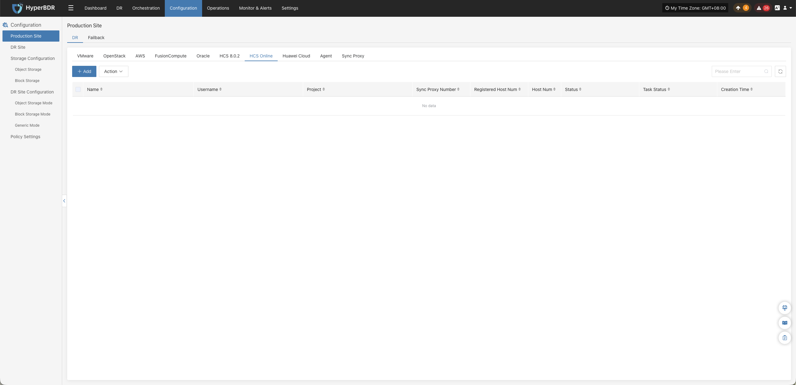

### **HCS Online**

The HCS Online platform page on the production site is mainly used for adding, deleting, updating, and other related management operations for the HCS Online platform.

#### **Add HCS Online Platform**

Click "Production Site" in the left navigation bar, select HCS Online, and click the "Add" button. Follow the steps in the pop-up window to add the platform.

##### **Deploy Sync Proxy**

Deploy the Source Sync Proxy in your HCS Online environment:

1. **Prepare Image & Create Cloud Host**:
   * Create a cloud host in the HCS Online platform using the official **Ubuntu 24.04** OS image;
   * Recommended specifications: **4 vCPU / 8 GB RAM / 50 GB Disk**.
2. **Network Connectivity Check**:
   * Ensure the instance can access the HyperBDR Console (ports 10443 and 30080) and has access permissions to HCS Online internal API endpoints.
3. **One-Click Installation & Registration**:
   * Copy the installation command from the wizard, log in to the Sync Proxy terminal as `root`, and execute it;
   * Once completed, the node will automatically register with HyperBDR.

> **Note:** For detailed node specifications and network planning, see [Source Sync Proxy](#source-sync-proxy).

##### **Create HCS Online Production Platform**

1. **HCS Online Connection and Authentication Information**

| **Parameter** | **Input Method** | **Description & Acquisition Method** |
| :--- | :--- | :--- |
| **Domain** | Enter domain name | Enter the base domain of HCS Online. For example: for regions uniformly managed by Cloud Federation, enter `myhuaweicloud.com`; for independently managed regions, enter the corresponding base domain based on the console login address. For example, if the console address is `https://console.cloud.provider.com.xx/`, enter `cloud.provider.com.xx`. |
| **Access Key ID** | Enter Access Key ID | Used for identity authentication when accessing HCS Online APIs. Log in to the management console, click the username in the upper-right corner, and go to **"My Credentials" > "Access Keys"** to obtain it. |
| **Access Key Secret** | Enter Access Key Secret | The secret access key paired with the Access Key ID for HCS Online API authentication. Log in to the management console, click the username in the upper-right corner, and go to **"My Credentials" > "Access Keys"** to obtain it. |
| **Project** | Enter project name or identifier | Enter the project required for calling HCS Online APIs. Log in to the management console, click the username in the upper-right corner, and go to **"My Credentials" > "API Credentials" > "Projects"** to view and obtain it. |
| **Source Sync Proxy** | Select proxy node | Select the host IP where the Source Sync Proxy is deployed. |
| **Name** | Optional | Identifier name for the connected production platform. If omitted, the system automatically generates a default name. |

2. **Bucket Information**

| Parameter | Description |
|---|---|
| Bucket Type | Supports three types: Existing Authorized Bucket, Create New Authorized Bucket, and Authorize Specified Bucket. Choose according to actual requirements. |
| Bucket Name | Select an existing bucket from the dropdown list, or create a new bucket as needed. |

* **Network Policy Requirements:**

| **Source** | **Target** | **Port / Protocol** | **Description** |
| :--- | :--- | :--- | :--- |
| Sync Proxy | HCS Online API / OBS Endpoint | 443 / TCP (HTTPS) | Accessing HCS Online APIs for authentication and communicating with OBS buckets for data transfer |

##### **Complete HCS Online Addition**

Once the HCS Online production platform configuration is complete, wait until the platform status becomes "Normal" and the number of managed ECS instances is retrieved before proceeding with subsequent steps.

> **Note:**
> * To protect workloads across multiple regions or tenant environments, repeat the steps above to add each environment independently.

#### **Action**

In the HCS Online production platform list, click the **"Action"** dropdown menu on the right side of the target platform row to perform operations such as **Settings**, **Bind**, **Unbind**, **Reload Virtual Machine**, **Modify Authentication Information**, and **Delete**. For detailed instructions, refer to [Production Site Management](#production-site-management).

---
