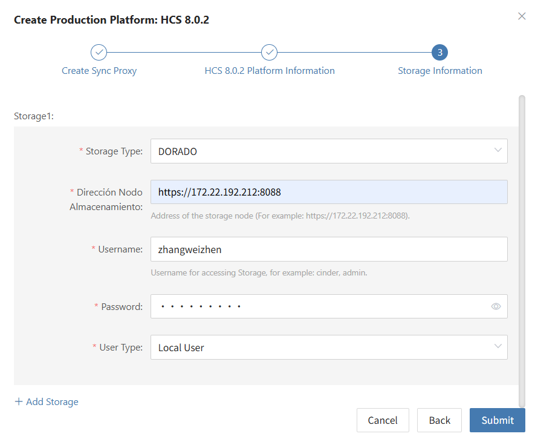

### **HCS 8.0.2**

The HCS 8.0.2 page is used to configure and manage the Huawei Cloud Stack (HCS) 8.0.2 agentless (Agentless) production platform, including ManageOne authentication, Dorado storage integration, Sync Proxy binding, and connection status monitoring.

> **Version Compatibility Notice:**
> 1. Currently, the interface architecture of Huawei Cloud Stack (HCS) 8.2.x / 8.3.x differs significantly from HCS 8.0.2. This section exclusively supports **HCS 8.0.2**;
> 2. The current version is deeply adapted to Huawei OceanStor Dorado all-flash storage backends by default.

#### **Add HCS 8.0.2 Platform**

In the left navigation bar of the console, click **"Production Site"** > **"HCS 8.0.2"**, and click the **"Add"** button. Follow the wizard to complete platform connection.

##### **Deploy Sync Proxy**

Import the OVA template into the HCS 8.0.2 cluster to deploy the Source Sync Proxy (Sync Proxy):

1. **Download OVA Template**:
   * Click the download link in the wizard, or download directly via the internet: <https://downloads.oneprocloud.com/proxy-agent_BaseOS.ova>
2. **Import Virtual Machine**:
   * Import the OVA file into the HCS cluster, deploy one or more Source Sync Proxy virtual machines, and configure network IP addresses. Recommended specification: **4 vCPU / 8 GB RAM / 50 GB Disk**.
3. **Log in to the Virtual Machine**:
   * Log in to the newly created Sync Proxy VM. The system default initial credentials are `root` / `Acb@132.Inst`.
4. **One-Click Installation & Registration**:
   * Copy the installation command from the wizard interface, paste and execute it in the Sync Proxy terminal. Upon completion, the node will automatically register with the HyperBDR platform.

> **Note:** For detailed specifications and network planning, see [Source Sync Proxy](#source-sync-proxy).

##### **Create HCS 8.0.2 Production Platform**

1. **HCS Platform Connection Authentication Information**

| **Parameter** | **Example / Format** | **Description & Acquisition Method** |
| :--- | :--- | :--- |
| **Auth Address** | `https://iam-apigateway-proxy.<external_global_domain_name>/v3` | HCS unified IAM APIG access address, formatted as `iam-apigateway-proxy.{external_global_domain_name}`. Replace with your actual external global domain name and configure hosts resolution in HyperBDR in advance. |
| **Tenant ID** | `HPUAAG0B2...` | Log in to ManageOne Operation Portal → click the username in the upper-right corner → view [Tenant ID] under [Personal Settings]. |
| **Username** | Administrator account | Username for logging in to the ManageOne Operation Portal (requires tenant management permissions). |
| **Password** | Account password | User login password. |
| **Project Domain ID** | `HPUAAG0B2...` | Domain ID to which the project belongs, typically identical to the Tenant ID. |
| **Project Name** | `admin` or project name | Project name listed under [Project List] in the ManageOne Operation Portal. |
| **Project (Region)** | `RegionOne` or `mx-ags-1` | Physical Region identifier to which the project belongs. |
| **Source Sync Proxy** | Select from dropdown | Select the deployed Source Sync Proxy node from the dropdown list. |

2. **Storage Backend Configuration (Dorado)**

Click **"+ Add Storage"** on the page to configure underlying storage access authentication:

| **Parameter** | **Example / Format** | **Description** |
| :--- | :--- | :--- |
| **Storage Type** | `DORADO` | Select the connected Huawei OceanStor Dorado storage series from the dropdown list. |
| **Storage Node Address** | `https://172.22.192.212:8088` | Management address and port of the storage device DeviceManager (default 8088). |
| **Username** | Storage admin account | Username for logging in to the storage system DeviceManager. |
| **Password** | Account password | Password for the storage system user. |
| **User Type** | `Local User` | Account type (supports Local User, LDAP User, RADIUS User). |

* **Network Policy Requirements:**

| **Source** | **Target** | **Port / Protocol** | **Description** |
| :--- | :--- | :--- | :--- |
| Sync Proxy | HCS APIG Unified Gateway | 443 / TCP | Accessing HCS APIs for identity authentication and virtual machine metadata management |
| Sync Proxy | Dorado Storage Management Plane | 8088 / TCP | Accessing Dorado storage management interfaces for LUN queries and snapshot management |

##### **Complete HCS 8.0.2 Addition**

After confirming all authentication details and storage backend configurations are correct, click **"Confirm"** to submit. Wait until the platform status becomes **"Normal"** and the number of managed ECS cloud hosts is retrieved, indicating a successful connection.

> **Note:**
> * Repeat the above steps to add multiple HCS regions or tenant environments.

#### **Action**

In the HCS 8.0.2 production platform list, click the **"Action"** dropdown menu on the right side of the target platform row to perform operations such as **Settings**, **Bind**, **Unbind**, **Reload Virtual Machine**, **Modify Authentication Information**, and **Delete**. For detailed instructions, refer to [Production Site Management](#production-site-management).

---
