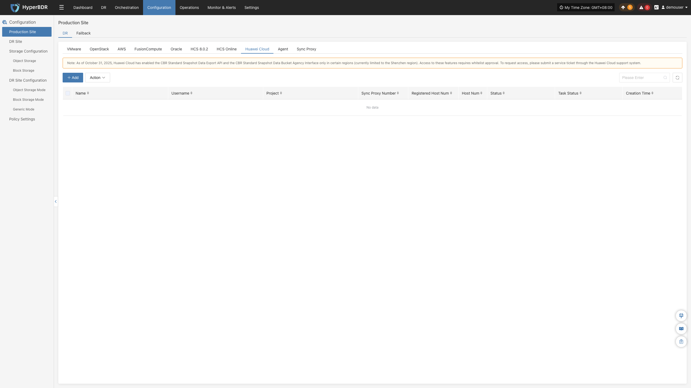
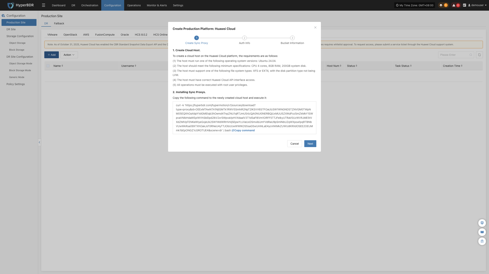
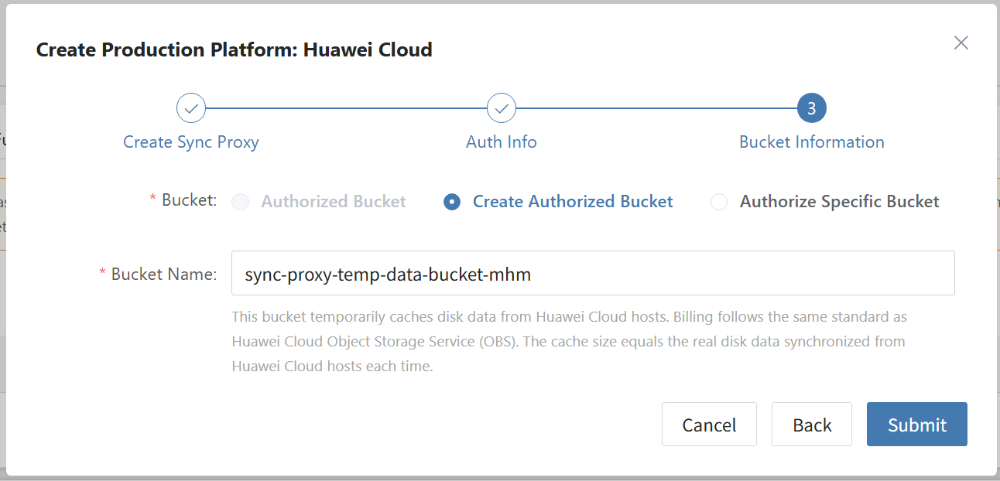

### **Huawei Cloud**

The Huawei Cloud page is used to configure and manage the Huawei Cloud agentless (Agentless) production platform, including access keys, project endpoints, OBS staging bucket configuration, Sync Proxy binding, and connection status monitoring.

::: warning
The Huawei Cloud agentless mode relies on the Huawei Cloud CBR (Cloud Backup and Recovery) standard snapshot export API and CBR bucket agency interface. Access to these features in certain regions requires submitting a service ticket to Huawei Cloud for whitelist approval.
:::

#### **Add Huawei Cloud Platform**

In the left navigation bar of the console, click **"Production Site"** > **"Huawei Cloud"**, and click the **"Add"** button. Follow the wizard to complete platform connection.

##### **Deploy Sync Proxy**

Launch an ECS instance in the target Huawei Cloud Region to deploy the Source Sync Proxy (Sync Proxy):

1. **Launch ECS Instance**:
   * In the Huawei Cloud console, launch an ECS instance using the official native **Ubuntu 24.04** image (recommended specification: **4 vCPU / 8 GB RAM / System Disk 50 GB or larger**, filesystem recommended as ext4 or xfs, non-LVM partition).
2. **Configure Network & Security Group**:
   * Ensure the instance can access the HyperBDR Console (ports 10443 and 30080) and has outbound network permissions to access Huawei Cloud IAM, ECS, and OBS service endpoints.
3. **One-Click Installation & Registration**:
   * Log in to the ECS instance, paste and execute the installation command provided in the wizard terminal as `root`. Upon completion, the instance will automatically register as a Sync Proxy.

> **Note:** For detailed specifications and network planning, see [Source Sync Proxy](#source-sync-proxy).

##### **Create Huawei Cloud Production Platform**

1. **Huawei Cloud Credentials & Parameter Configuration**

| **Parameter** | **Example / Format** | **Description & Acquisition Method** |
| :--- | :--- | :--- |
| **Access Key ID** | `H******************K` | Access Key ID for accessing Huawei Cloud APIs. Log in to the Huawei Cloud console → click [Username] in the upper-right corner → [My Credentials] → [Access Keys] to obtain it. |
| **Secret Access Key** | `4*************************A` | Private secret access key paired with the Access Key ID. |
| **Project (Region/Project)** | `cn-north-4` or `tr-west-1` | Project region identifier where the target workload resides. View the [Project] name under [My Credentials] → [API Credentials] (**please enter the project name like `cn-north-4`, not the project ID**). |
| **Source Sync Proxy** | Select from dropdown | Select the deployed Source Sync Proxy node from the dropdown list. |
| **Platform Name** | Custom name (optional) | Identifier name for the production platform, supporting custom input or system auto-generation. |

2. **Temporary Staging Bucket Configuration (OBS)**

Huawei Cloud agentless mode utilizes an OBS temporary staging bucket to transfer and read ECS disk snapshot data:

| **Parameter** | **Example / Format** | **Description** |
| :--- | :--- | :--- |
| **Bucket Name** | `sync-proxy-temp-data-bucket-xxx` | Supports creating a new bucket or selecting an existing OBS bucket. Used for temporary backup data staging; occupies transient storage only during synchronization and is automatically freed upon transfer completion. |

* **Network Policy Requirements:**

| **Source** | **Target** | **Port / Protocol** | **Description** |
| :--- | :--- | :--- | :--- |
| Sync Proxy | Huawei Cloud IAM / ECS / OBS Endpoints | 443 / TCP (HTTPS) | Calling Huawei Cloud APIs and communicating with OBS buckets to read data |

##### **Complete Huawei Cloud Addition**

Click **"Confirm"** to submit. Wait until the platform status becomes **"Normal"** and the total number of managed ECS instances in the target Region is retrieved, indicating a successful connection.

> **Note:**
> * To protect workloads across multiple Huawei Cloud regions or under different primary accounts, repeat the steps above to add each environment independently.

#### **Action**

In the Huawei Cloud production platform list, click the **"Action"** dropdown menu on the right side of the target platform row to perform operations such as **Settings**, **Bind**, **Unbind**, **Reload Virtual Machine**, **Modify Authentication Information**, and **Delete**. For detailed instructions, refer to [Production Site Management](#production-site-management).

---
