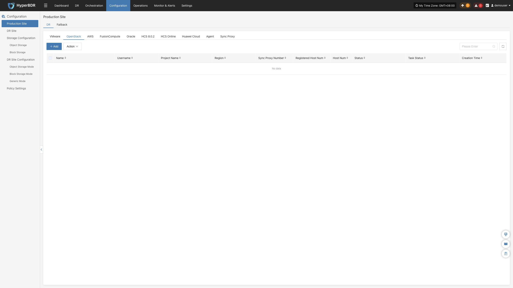
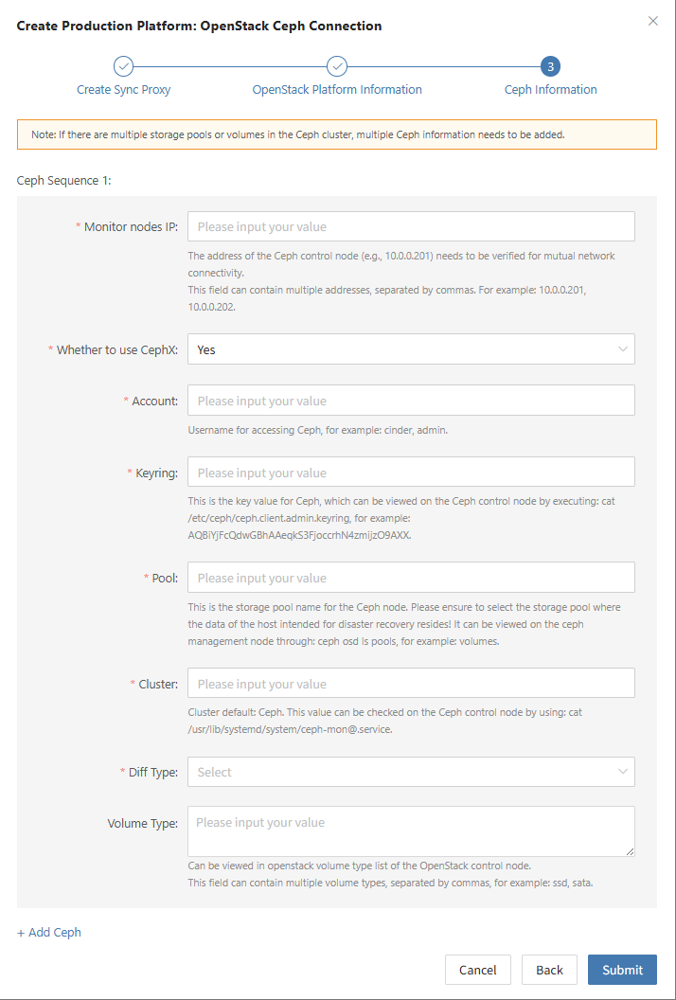

### **OpenStack**

The OpenStack page is used to configure and manage the OpenStack + Ceph agentless (Agentless) production platform, including Keystone authentication, Ceph storage pool integration, Sync Proxy binding, and connection status monitoring.

#### **Add OpenStack Platform**

In the left navigation bar of the console, click **"Production Site"** > **"OpenStack"**, and click the **"Add"** button. Follow the wizard to complete platform connection.

##### **Deploy Sync Proxy**

Create a cloud virtual machine in the OpenStack environment to deploy the Source Sync Proxy (Sync Proxy):

1. **Prepare Image**:
   * Use a standard native Ubuntu 24.04 image from OpenStack, or download the official QCOW2 image and import it into the image repository:
   * [Download Ubuntu 24.04 QCOW2 Image](https://downloads.oneprocloud.com/docs_images/ubuntu-24.04-server-cloud-init-amd64.qcow2)
   > **Note:** This QCOW2 image has no preset static password and relies on `cloud-init` to inject passwords or SSH Keys. Ensure the platform supports cloud-init.
2. **Create Cloud Host**:
   * Launch a virtual machine in OpenStack based on this image and associate a network IP. Recommended specification: **4 vCPU / 8 GB RAM / 50 GB Disk**.
3. **One-Click Installation & Registration**:
   * Log in to the cloud host, paste and execute the installation command provided in the wizard terminal. Upon completion, the node will automatically register with the HyperBDR platform.

> **Note:** For detailed specifications and network planning, see [Source Sync Proxy](#source-sync-proxy).

##### **Create OpenStack Production Platform**

1. **Keystone Authentication Configuration**

| **Parameter** | **Example / Format** | **Description** |
| :--- | :--- | :--- |
| **Auth Address** | `http://<Keystone_IP>:5000/v3` | OpenStack Keystone Public Endpoint (v3 recommended). If using a domain name, configure DNS resolution in advance. |
| **User Domain ID** | `default` | Domain ID to which the user belongs. |
| **Username** | Administrator account | Username with platform query and volume management permissions. |
| **Password** | Account password | Login password for the user account. |
| **Project Domain ID** | `default` | Domain ID to which the project belongs. |
| **Project Name** | `admin` | Tenant project name to which the user belongs. |
| **Region** | `RegionOne` | Region name of the target OpenStack cluster. |
| **Source Sync Proxy** | Select from dropdown | Select the deployed Source Sync Proxy node from the dropdown list. |

* **OpenStack Service Network Policy Requirements:**

| **Source** | **Target** | **Port / Protocol** | **Description** |
| :--- | :--- | :--- | :--- |
| Sync Proxy | OpenStack Controller Nodes | 5000, 9696, 8774, 8776, 9292 / TCP | Corresponding to Keystone, Neutron, Nova, Cinder, and Glance API endpoints respectively |

2. **Ceph Storage Cluster Authentication Configuration**

In OpenStack scenarios, HyperBDR directly connects to the underlying Ceph storage pools to read differential snapshot data without agents:

| **Parameter** | **Example / Format** | **Description** |
| :--- | :--- | :--- |
| **Control Node Addresses** | `10.0.0.201,10.0.0.202` | Ceph Monitor node IPs, separated by commas `,`. |
| **Enable CephX Auth** | `Yes` | Whether to enable CephX authentication (recommended). |
| **Username** | `cinder` or `admin` | Ceph username used to access the specified storage pool. |
| **Keyring** | `AQBBY9hf...==` | Client access key. Run `cat /etc/ceph/ceph.client.cinder.keyring` on a Ceph node to obtain it. |
| **Storage Pool** | `volumes` | Ceph Pool where protected virtual machine disks reside (view via `ceph osd ls pools`). |
| **Incremental Fetch Type** | `rbd diff` | Incremental read mode: + `rbd diff`: Snapshot-based precise differential comparison, high data accuracy (recommended); + `rbd du`: Fast overview comparison. |
| **Cluster Name** | `ceph` | Ceph cluster name, defaults to `ceph`. |
| **OpenStack Volume Types** | `DEFAULT_VOLUME_TYPE, ssd` | Associated Cinder Volume Types, queried via `openstack volume type list`. |

* **Ceph Storage Network Policy Requirements:**

| **Source** | **Target** | **Port / Protocol** | **Description** |
| :--- | :--- | :--- | :--- |
| Sync Proxy | Ceph Monitor / OSD | 6789, 3300, 6800-7300 / TCP | Ceph Mon authentication communication and direct disk block data retrieval from OSD nodes |

##### **Complete OpenStack Addition**

After clicking **"Confirm"** to save, the platform automatically validates Keystone and Ceph cluster connectivity. Wait until the platform status becomes **"Normal"** and the number of cluster cloud hosts is retrieved, indicating a successful connection.

> **Note:** If the system contains multiple backend Ceph storage pools or multiple OpenStack clusters, repeat the steps to add and bind them.

#### **Action**

In the OpenStack production platform list, click the **"Action"** dropdown menu on the right side of the target platform row to perform operations such as **Settings**, **Bind**, **Unbind**, **Reload Virtual Machine**, **Modify Authentication Information**, and **Delete**. For detailed instructions, refer to [Production Site Management](#production-site-management).

---
