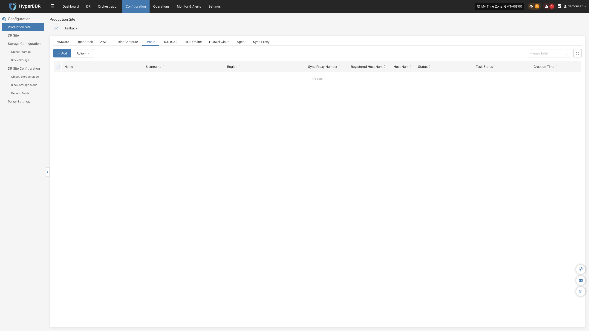
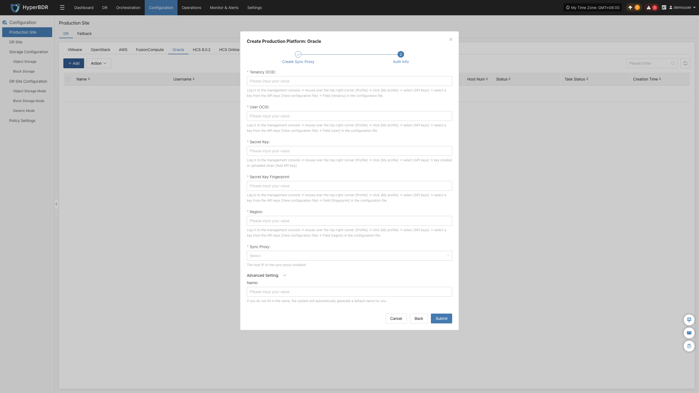

### **Oracle**

The Oracle page is used to configure and manage the Oracle Cloud Infrastructure (OCI) agentless (Agentless) production platform, including OCI tenancy credentials, region configuration, Sync Proxy binding, and connection status monitoring.

#### **Add Oracle Platform**

In the left navigation bar of the console, click **"Production Site"** > **"Oracle"**, and click the **"Add"** button. Follow the wizard to complete platform connection.

##### **Deploy Sync Proxy**

Launch a compute instance in the target OCI Region to deploy the Source Sync Proxy (Sync Proxy):

1. **Launch OCI Compute Instance**:
   * In the Oracle Cloud console, launch an instance using the official standard **Ubuntu 24.04** image (recommended specification: **4 OCPU / 8 GB RAM / 50 GB Boot Volume**).
2. **Configure Network & Security List**:
   * Ensure the instance can access the HyperBDR Console (ports 10443 and 30080) and has outbound access to OCI API endpoints (port 443).
3. **One-Click Installation & Registration**:
   * Log in to the compute instance, paste and execute the installation command provided in the wizard terminal. Upon completion, the instance will automatically register as a Sync Proxy.

> **Note:** For detailed specifications and network planning, see [Source Sync Proxy](#source-sync-proxy).

##### **Create Oracle Production Platform**

1. **OCI Authentication Configuration**

| **Parameter** | **Example / Format** | **Description & Acquisition Method** |
| :--- | :--- | :--- |
| **Tenancy OCID** | `ocid1.tenancy.oc1..aaaaaaaaxxxx` | Unique identifier for the OCI tenancy. Log in to the OCI console → click the user avatar in the upper right corner → copy the OCID under [Tenancy: Overview]. |
| **User OCID** | `ocid1.user.oc1..aaaaaaabbbbb` | OCID of the OCI IAM user with API access permissions. Copy from [User Settings] or [Identity & Security] > [Users] details in the console. |
| **Private Key** | Content of `oci_api_key.pem` | API private key for connecting to OCI services. Generate or upload a public key under [API Keys] on the user details page, and paste the corresponding private key content here. |
| **Fingerprint** | `20:3b:97:13:55:1c:8c:...` | Fingerprint string of the corresponding API key, copied directly from the API key list in the OCI console. |
| **Region** | `ap-singapore-1` | OCI Region identifier where target cloud hosts are located (e.g., `ap-singapore-1`, `us-ashburn-1`, etc.). |
| **Source Sync Proxy** | Select from dropdown | Select the deployed Source Sync Proxy compute instance from the dropdown list. |
| **Platform Name** | Custom name (optional) | Identifier name for the production platform, supporting custom input or system auto-generation. |

2. **Network Policy Requirements**

| **Source** | **Target** | **Port / Protocol** | **Description** |
| :--- | :--- | :--- | :--- |
| Sync Proxy | OCI Service API Endpoints | 443 / TCP (HTTPS) | Authenticating and interacting with OCI Identity, Compute, and Block Volumes APIs and reading block data |

After confirming all configurations are correct, click **"Confirm"** to submit.

##### **Complete Oracle Addition**

After adding, return to the Oracle production platform list. Wait until the platform status becomes **"Normal"** and the total number of managed OCI cloud hosts in that Region is retrieved, indicating a successful connection.

> **Note:**
> * To protect workloads across multiple OCI Regions or different tenancies, repeat the steps above to add each environment independently.

#### **Action**

In the Oracle production platform list, click the **"Action"** dropdown menu on the right side of the target platform row to perform operations such as **Settings**, **Bind**, **Unbind**, **Reload Virtual Machine**, **Modify Authentication Information**, and **Delete**. For detailed instructions, refer to [Production Site Management](#production-site-management).

---
