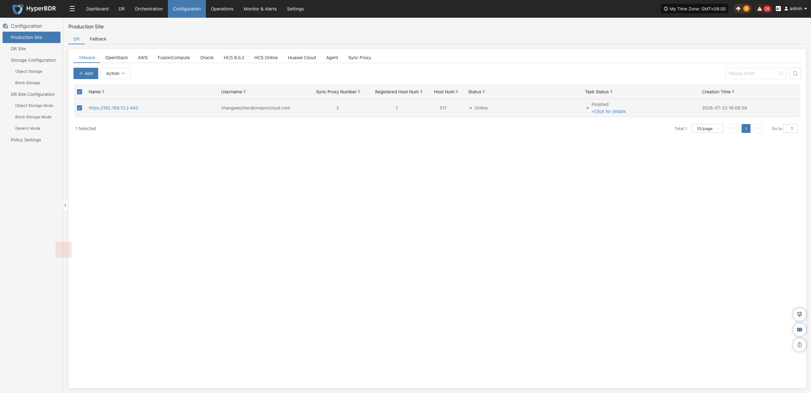
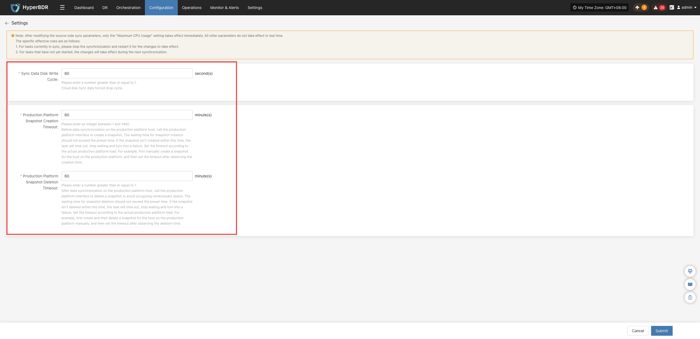
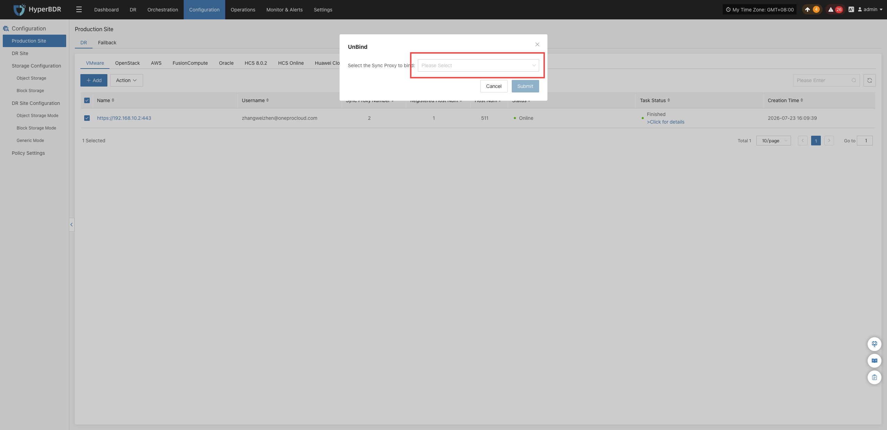
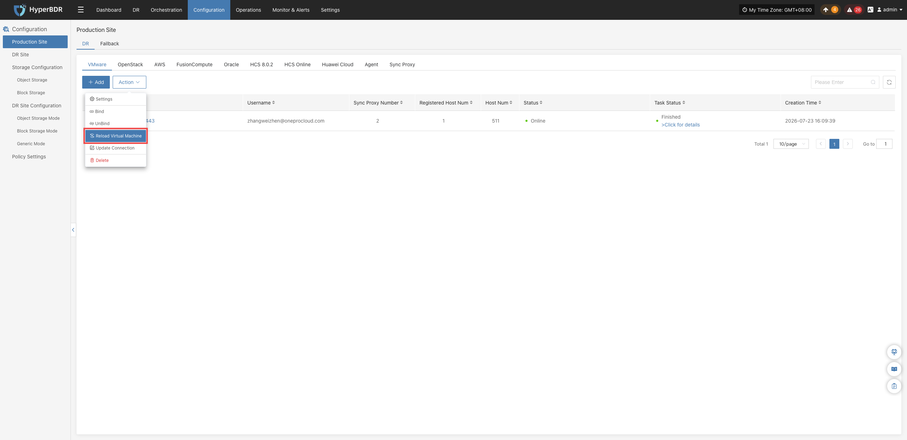
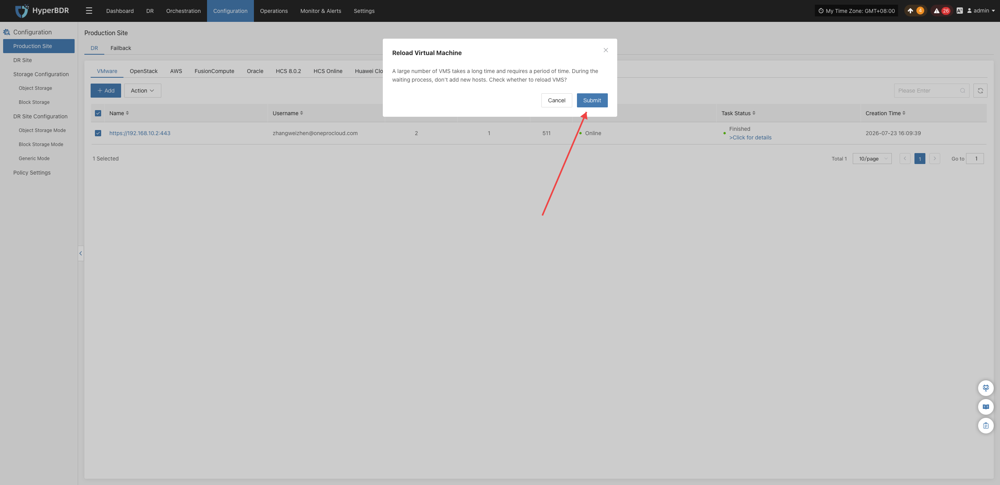
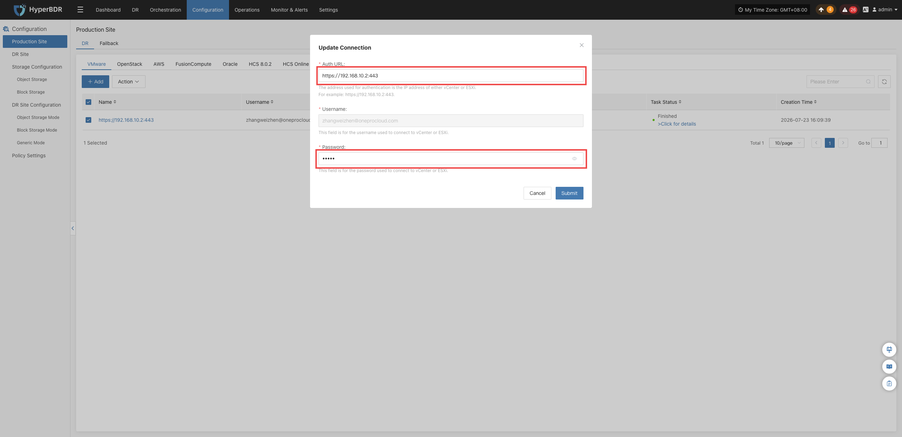

### **Production Site Management**

After an agentless (Agentless) production platform is connected, in the corresponding platform list, click the **"Action"** dropdown menu in the target platform row to perform routine management and lifecycle maintenance operations:

> The following operations take the VMware platform as an example. The workflows and functions for other platforms are basically identical; refer to the actual capabilities provided by each platform.

#### **Settings**

Click **"Action"** > **"Settings"** to adjust synchronization parameters for the current production platform:

> Configuration changes will not take effect immediately. The specific effective rules are as follows:
> 1. **Ongoing synchronization tasks**: You must stop synchronization and restart it for modified configurations to take effect.
> 2. **Tasks not yet started**: Modified configurations will take effect during the next synchronization run.

- Adjust relevant parameters based on actual requirements and on-screen prompts to achieve a more suitable synchronization configuration.

| Setting | Default Value | Description |
|---|---|---|
| Sync Data Disk Flush Interval | 60 seconds | Sets the time interval for force-flushing sync data to cloud disks. For example, setting it to 60 seconds means force-flushing once every 60 seconds. |
| Production Platform Create Snapshot Timeout | 60 minutes | Sets the maximum wait time for creating snapshots. If creation is not completed within the set time, the task fails. It is recommended to adjust this based on the production platform's actual workload, such as creating a manual snapshot first to observe the required time. |
| Production Platform Delete Snapshot Timeout | 60 minutes | Sets the maximum wait time for deleting snapshots. If deletion is not completed within the set time, the task fails. It is recommended to adjust this based on the production platform's actual workload, such as deleting a manual snapshot first to observe the required time. |

#### **Bind**

Click **"Action"** > **"Bind"** to associate ready Source Sync Proxy nodes with this production platform:

> A single production platform supports binding multiple Sync Proxy nodes concurrently to expand the maximum number of attached disks supported by the platform. By default, a single host supports attaching up to 50 disks.

* In the pop-up dialog, select the target Sync Proxy node from the dropdown list, and click **"OK"** to complete the binding.

#### **Unbind**

Click **"Action"** > **"Unbind"** to disassociate a bound Source Sync Proxy node from the current production platform:

> Before unbinding, ensure that the proxy node has no ongoing data synchronization or disaster recovery backup tasks. Once unbound, the proxy stops processing replication jobs for this platform and can be rebound to other platforms or retired as needed.

* In the pop-up dialog, select the target Sync Proxy node from the dropdown list, and click **"OK"** to complete the unbinding.

#### **Reload Virtual Machine**

Click **"Action"** > **"Reload Virtual Machine"** to force HyperBDR to immediately call source native APIs and synchronize the latest host and virtual machine inventory:

> When new virtual machines/instances are added to the source environment and the console has not updated in real time, you can manually refresh the asset list using this function.

* In the pop-up dialog, review the precautions and click **"OK"** to start reloading virtual machines.

#### **Modify Authentication Information**

Click **"Action"** > **"Modify Authentication Information"** to directly modify credentials and connection parameters for the connected production platform.

> When the source platform management IP, access endpoint, administrator credentials, API access keys, connection ports, or SSL certificates change causing abnormal connection status, update configurations via this function. After updating, the system will re-verify connectivity and update the platform status **without needing to delete and recreate the platform**, fully preserving existing disaster recovery protection policies and historical backup data.

- In the pop-up dialog, update the required authentication information or connection parameters. Click **"OK"** to submit changes and initiate connection re-verification.

#### **Delete**

Click **"Action"** > **"Delete"** to permanently remove the production platform from HyperBDR:

> Before deleting, ensure that the production site is not associated with any Sync Proxy.

* Once prerequisites are met, click **"OK"** in the confirmation dialog to complete the permanent deletion of the platform.

---
