### **Source Agent**

When the source workload is a physical server, a standalone virtual machine (such as KVM, Xen, or Hyper-V), or a cloud host without native snapshot API access, install the **Source Agent** inside the guest operating system to capture disk data and drive replication.

* **Use Cases**: Universally applicable across diverse heterogeneous environments, including x86 physical servers, private cloud hypervisors, and public cloud instances;
* **Support Matrix**: [View Source Agent OS Compatibility Matrix](https://oneprocloud.feishu.cn/sheets/VRqksSPEPhRTPStp3kVcItXNnyh?sheet=Y9fpqO).

#### **Prerequisites & Network Policies**

1. **Environment Preparation**
   * Administrator access credentials for the host to be protected (Linux `root`, Windows `Administrator`);
   * HyperBDR platform and Cloud Sync Gateway basic deployment completed;
   * For Windows hosts running antivirus or security software, add the Agent installation directory to the trusted whitelist in advance.

2. **Network Policy Requirements**

| **Source** | **Target** | **Port / Protocol** | **Description** |
| :--- | :--- | :--- | :--- |
| Protected Host (Agent) | HyperBDR Console | 10443 / TCP | Authentication communication and task heartbeat |
| Protected Host (Agent) | HyperBDR Console | 30080 / TCP | Agent installation package download and auto-upgrade |
| Protected Host (Agent) | Cloud Sync Gateway | 13260 / TCP | Data transmission channel for block storage mode |
| Protected Host (Agent) | Cloud Sync Gateway | 443 / TCP (HTTPS) | Encrypted data transmission port for block storage mode |
| Protected Host (Agent) | Object Storage Services (OBS/S3/OSS) | 443 / TCP (HTTPS) | Direct transmission port for object storage mode (ensure valid certificates and DNS resolution) |

---

#### **Linux Agent**

##### **Install Linux Agent**

1. Log in to the HyperBDR console, and click **"Production Site"** > **"Source Agent"**.
2. Under the Linux tab, click **"Copy Command"** to obtain the one-line installation command.


3. Log in to the source Linux server, and execute the copied command in the terminal as `root`.


4. Wait for the script to download dependencies, deploy services, and complete host registration automatically. Once the success message is output, you can view the registered host in the platform host list.


##### **Uninstall Linux Agent**

> **Note:** Before uninstalling the Agent, ensure the host has been deregistered on the **"Host DR"** > **"Select Host"** page in the HyperBDR console.

1. Log in to the source Linux operating system terminal.
2. Execute the official one-click uninstallation script:
   ```bash
   bash /var/lib/egisplus-agent/uninstall_agent.sh
   ```
3. When the console displays the uninstallation success prompt, system services and temporary dependencies are completely removed.

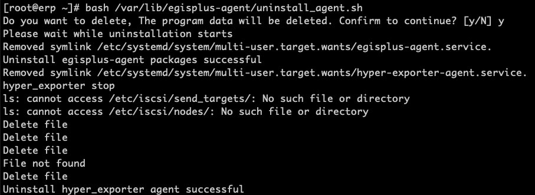

---

#### **Windows Agent**

##### **Install Windows Agent**

1. On the console **"Production Site"** > **"Source Agent"** page, click **"Download Now"** to obtain the Windows Agent installation package (`windows-agent.zip`).


2. Extract the package to a local directory on the source Windows server.

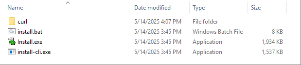

3. Right-click `Install.exe` and select **"Run as administrator"**.

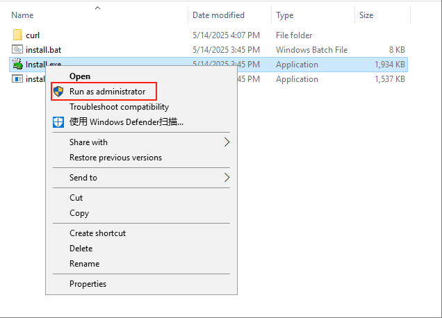

4. In the installation wizard, click **"Install >"** to start the installation. If prompted about antivirus software, confirm that the Agent has been whitelisted and click **"OK"** to continue.


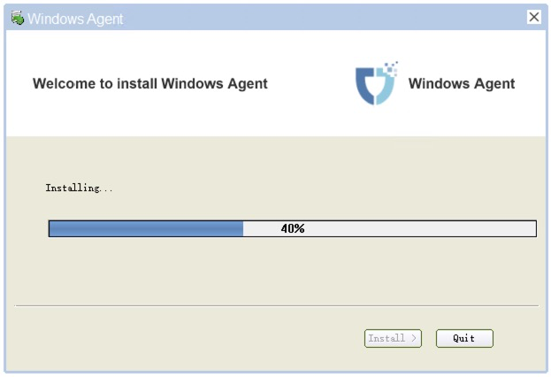

5. Once installation is complete, a prompt will ask to start the service. Click **"Yes"** to enter the service initialization wizard.


##### **Start Windows Agent & Precheck**

1. In the service management window, click **"Precheck"** in the lower-left corner to perform an environment health inspection.

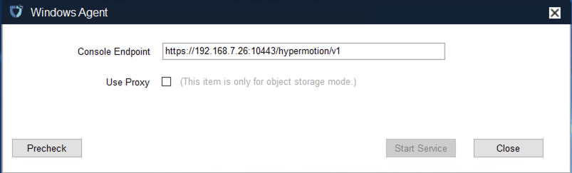

* **Precheck Item Descriptions:**

| **Check Item** | **Item Name** | **Description & Recommended Action** |
| :---: | :--- | :--- |
| **1/9** | Service Start Permission | Check whether the account has administrative permissions to start and query Windows services. |
| **2/9** | Language Environment Support | Check whether the system user display language supports English. |
| **3/9** | VSS Snapshot Command Permission | Verify whether the `vssadmin` command can successfully create and delete VSS volume shadow copies. |
| **4/9** | Antivirus Software Interception | Check whether any security software blocks Windows Agent service registration and startup. |
| **5/9** | Filesystem & Free Space | Check whether volume filesystems and free space meet synchronization cache requirements. |
| **6/9** | Volume Type Support | Ensure no unsupported dynamic volume types exist (RAID-5, Mirror, Stripe, and Spanned volumes are not supported). |
| **7/9** | Critical Patch Check | For Windows Server 2008 / 2008 R2, verify that patch KB4474419 is installed. |
| **8/9** | Third-Party VSS Conflicts | Check whether third-party backup software has left locked VSS shadow copies. |
| **9/9** | Windows Backup Schedule | Temporarily disable built-in Windows backup schedules to prevent volume locking conflicts. |

2. Once all prechecks pass (showing green PASS), click **"OK"**.

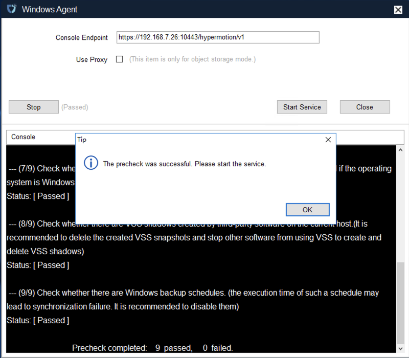

3. Click **"Start Services"** to launch core synchronization services.

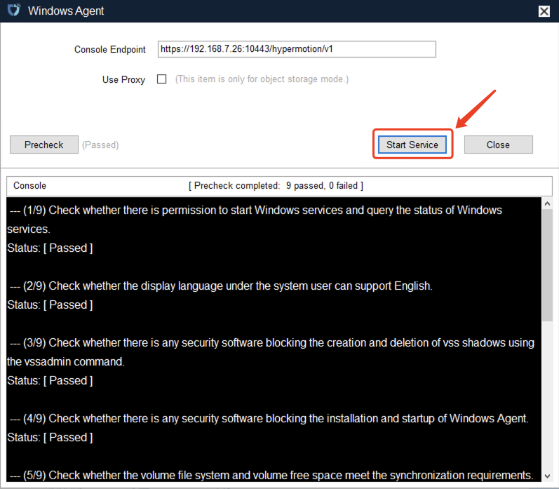

4. Confirm that the service status shows Running, then click **"OK"** to complete configuration.


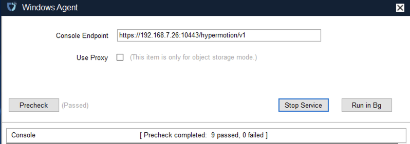

5. Return to the HyperBDR console; the Windows host will appear in the host list as automatically registered and online.


##### **Uninstall Windows Agent**

1. On the source Windows server, open **"Control Panel"** > **"Programs and Features"** (Uninstall a program).

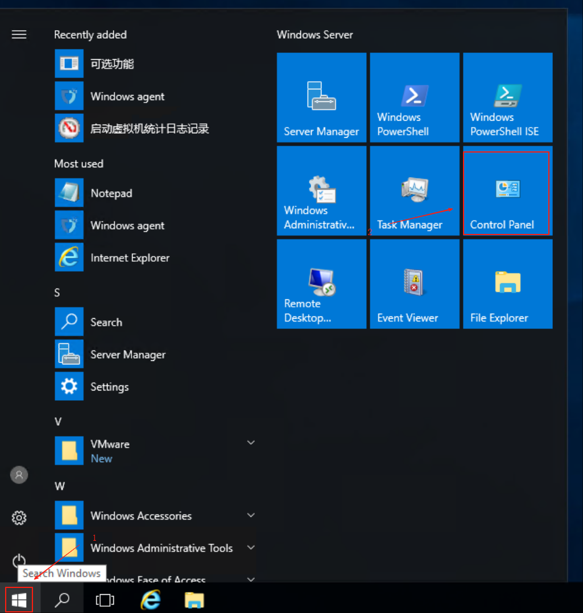

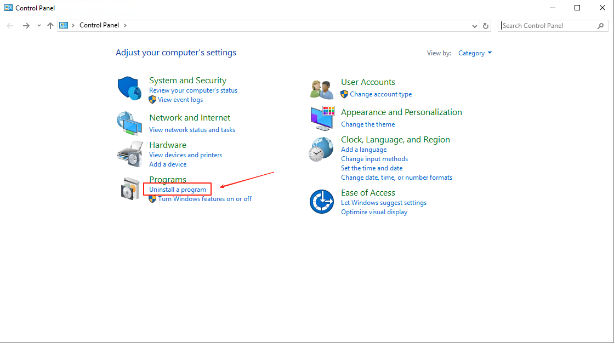

2. Locate **Windows_Agent** (Publisher: OneProCloud) in the list, right-click and select **"Uninstall"**.

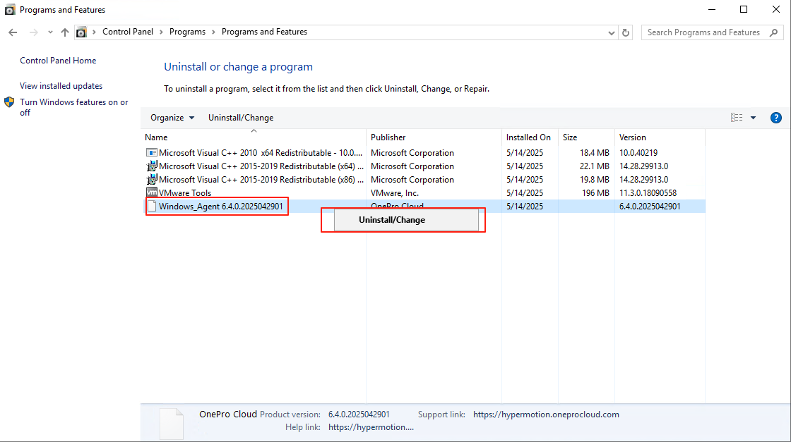

3. In the confirmation dialog, click **"Yes"**. Wait for the uninstaller to remove services and drivers, then click **"OK"** to finish.

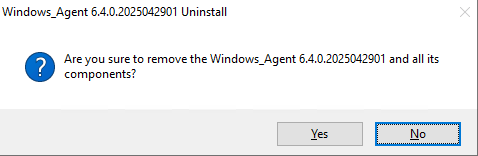

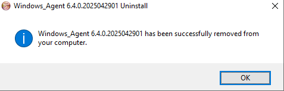

---
