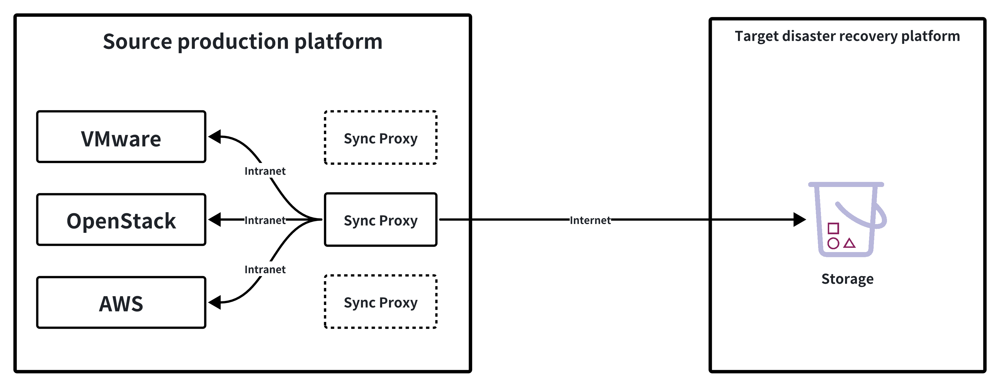
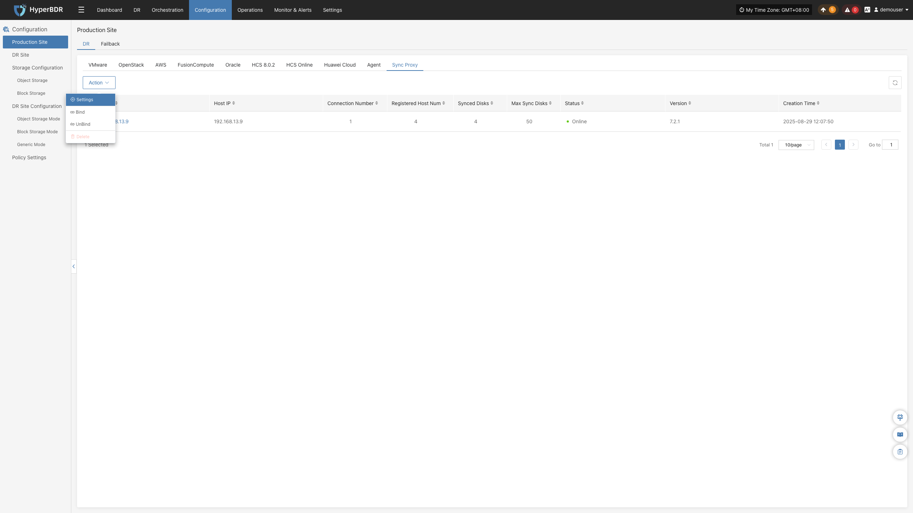
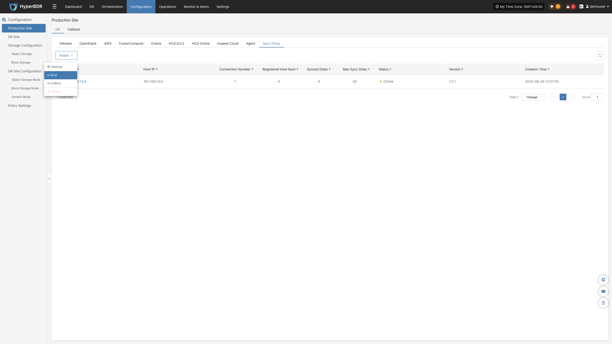
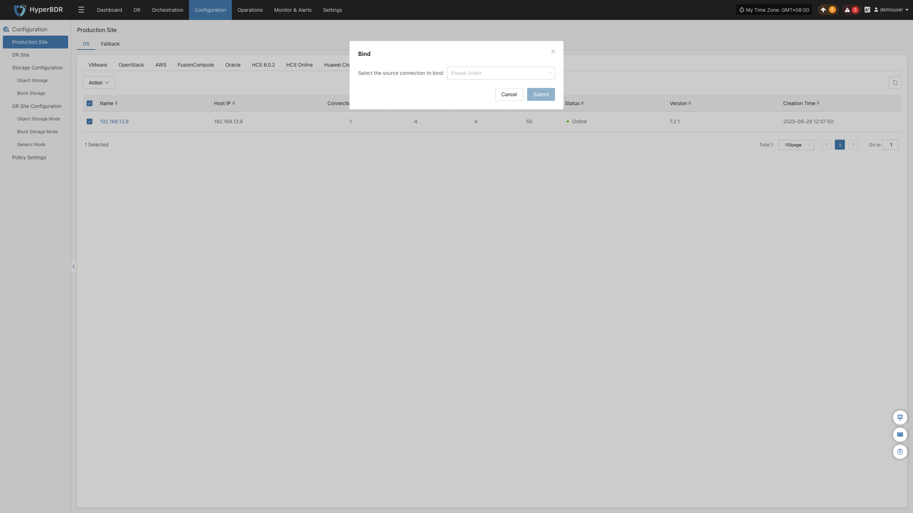
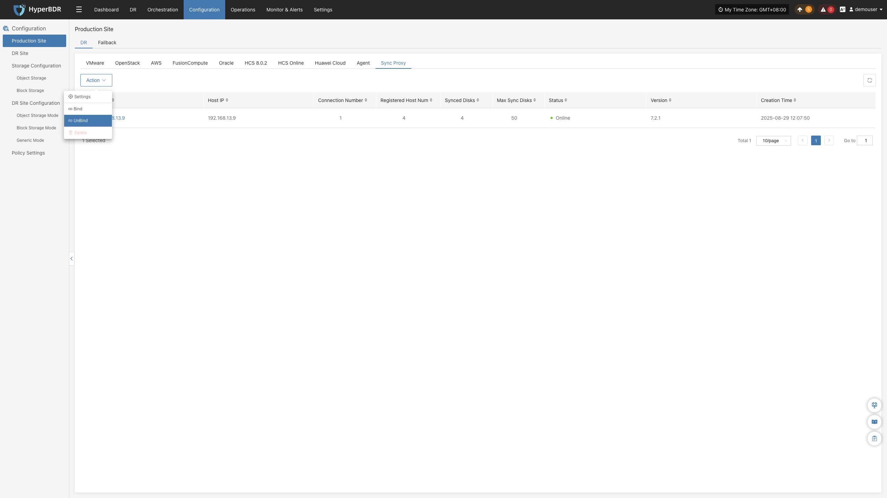
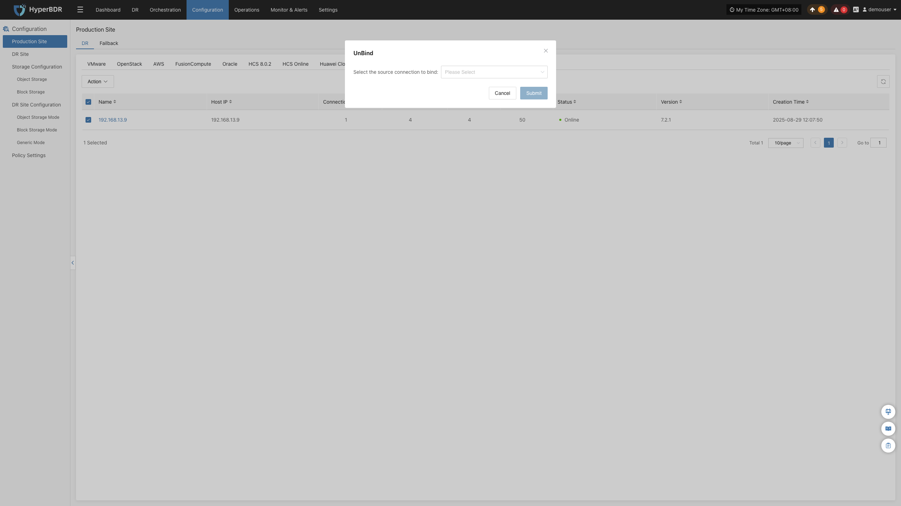

### **Source Sync Proxy**

#### **Technical Architecture & Principles**

The Source Sync Proxy (Sync Proxy) is HyperBDR's core data synchronization engine for agentless (Agentless) disaster recovery, designed for **VMware, OpenStack + Ceph, AWS EC2, FusionCompute, Oracle Cloud, HCS, and Huawei Cloud** source production environments.

By deploying a lightweight Sync Proxy within the source local network, HyperBDR captures virtualized or cloud disk snapshot data locally via native hypervisor/cloud APIs and transfers backup data securely and efficiently to the target DR site. This architecture eliminates the security risks and performance overhead of invoking production APIs across wide-area networks.

* **Internal Communication**: Sync Proxy only requires access to the source production platform's management network (API authentication and snapshot control) and storage network (disk data reading).
* **External Transmission**: Sync Proxy only communicates with the HyperBDR Console and the target DR site, isolating and protecting the source production platform's internal network topology.

#### **Node Specifications & Network Requirements**

##### **Recommended Specifications**

Sync Proxy runs on an Ubuntu 24.04 operating environment. By default, a single Sync Proxy node supports concurrent mounting and synchronization of up to **50 disks**. When protecting large numbers of hosts or high disk counts, you can scale out by deploying multiple Sync Proxy nodes at any time.

| **Parameter** | **Recommended Specification** | **Description** |
| :--- | :--- | :--- |
| **Operating System** | Ubuntu 24.04 LTS | Official standard image or provided OVA / QCOW2 template |
| **CPU** | 4 Cores (4 vCPU) | Can be increased for high concurrency scenarios as needed |
| **Memory** | 8 GB | Sufficient memory ensures adequate caching performance |
| **System Disk** | 50 GB | Used for system runtime and temporary log caching |

##### **Network Policy & Port Requirements**

The virtual machine or host deploying Sync Proxy must satisfy the following network connectivity requirements:

| **Source** | **Target** | **Port / Protocol** | **Description** |
| :--- | :--- | :--- | :--- |
| Sync Proxy | HyperBDR Console | 10443 / TCP | Control communication and bidirectional node authentication |
| Sync Proxy | HyperBDR Console | 30080 / TCP | Sync Proxy installation package download and component updates |
| Sync Proxy | Source Platform Management & Storage Planes | Platform native ports | Invoking source APIs (e.g., vCenter 443, Keystone 5000, etc.) and storage interfaces |
| Sync Proxy | DR Cloud Sync Gateway / Storage Services | 13260 / 443 / TCP | Transferring backup data to the disaster recovery target |

#### **Node Management & Operations**

After deploying and registering Sync Proxy via any production platform wizard, manage the node lifecycle on the **"Source Sync Proxy"** page.

##### **Settings**

In the Sync Proxy list, click **"More Operations"** (or **"Action"**) > **"Settings"** on the right side of the target node row to fine-tune running parameters:

| **Setting** | **Default Value** | **Description** |
| :--- | :---: | :--- |
| **HTTP Communication Timeout** | 600 seconds | Timeout threshold for communications between the proxy node, the source production platform, and the console. Increase this value under poor network conditions or large-batch API calls to prevent retry failures. |
| **Max Concurrent Disks** | 50 | Maximum number of disks allowed to be mounted simultaneously for data reading on a single node. Increasing this requires higher CPU and memory allocations; the recommended upper limit is 150 per node. |

##### **Bind**

Click **"More Operations"** (or **"Action"**) > **"Bind"** to associate the Sync Proxy with an added production platform. Once bound, the node can handle disk data synchronization tasks for that platform.

> **Multi-Node Concurrency Mechanism:**
> * **One-to-Many**: A single Sync Proxy node can be bound to multiple source production platforms simultaneously.
> * **Many-to-One**: A single production platform can be bound to multiple Sync Proxy nodes. HyperBDR's load-balancing scheduler automatically distributes disk mounting and replication tasks across proxies, significantly boosting throughput for large-scale host migrations and backups.
> 
> **Note**: Multiple nodes provide concurrency scalability. If a proxy node experiences physical or network interruption, its active sync tasks will fail; resolve the proxy issue and retry. Active in-flight tasks do not automatically fail over to other nodes.

##### **Unbind**

Click **"More Operations"** (or **"Action"**) > **"Unbind"** to disassociate the proxy node from the specified production platform.

> **Note:** Before unbinding, ensure the Sync Proxy has no ongoing synchronization or backup tasks. After unbinding, the node can be rebound to another platform or deleted.

##### **Delete**

Click **"More Operations"** (or **"Action"**) > **"Delete"** to permanently remove the Sync Proxy node from the system.

> **Note:** A proxy node bound to any production platform cannot be deleted directly. You must first perform **"Unbind"** and ensure the node is completely unbound before deletion.

---
