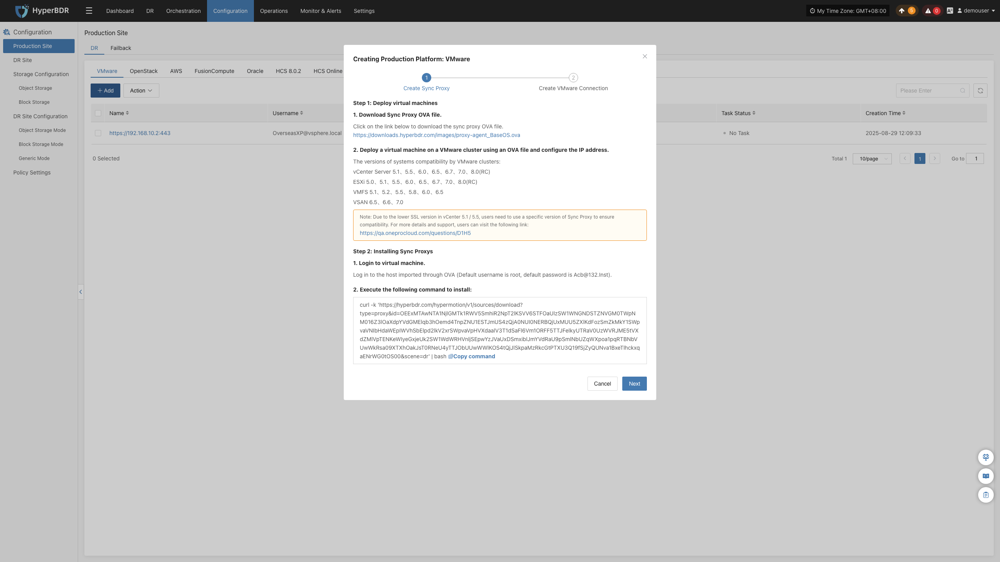

### **VMware**

The VMware page is used to configure and manage the VMware agentless (Agentless) production platform, including platform authentication, Sync Proxy binding, and connection status monitoring.

#### **Add VMware Platform**

In the left navigation bar of the console, click **"Production Site"** > **"VMware"**, and click the **"Add"** button. Follow the wizard in the pop-up window to complete platform connection.

##### **Deploy Sync Proxy**

The VMware platform uses agentless (Agentless) mode and requires deploying a Source Sync Proxy (Sync Proxy) in the source VMware cluster:

1. **Download OVA Template**:
   * Click the download link in the wizard, or download directly via the following link: <https://downloads.oneprocloud.com/proxy-agent_BaseOS.ova>
2. **Import Virtual Machine**:
   * Import the OVA file into the source VMware cluster, deploy one or more Source Sync Proxy virtual machines, and configure network IP addresses.
3. **Log in to the Virtual Machine**:
   * Log in to the newly created Sync Proxy VM. The system default initial credentials are `root` / `Acb@132.Inst`.
4. **One-Click Installation & Registration**:
   * Copy the installation command from the wizard interface, paste and execute it in the Sync Proxy terminal. Upon completion, the node will automatically register with the HyperBDR platform.

> **Note:** The recommended specification for Sync Proxy is **4 vCPU / 8 GB RAM / 50 GB Disk**, supporting concurrent mounting and synchronization of up to 50 disks per node. For detailed specifications and multi-node scale-out instructions, see [Source Sync Proxy](#source-sync-proxy).

##### **Create VMware Production Platform**

In step 2 of the wizard, configure VMware connection authentication details and verify network connectivity:

1. **Authentication Parameter Configuration**

| **Parameter** | **Example / Format** | **Description** |
| :--- | :--- | :--- |
| **Auth Address** | https://<vCenter_or_ESXi_IP_or_Domain>:443 | Access address of the vCenter or standalone ESXi host. If using a domain name, configure the corresponding hosts resolution in the HyperBDR console in advance. |
| **Username** | Administrator or backup account | Username with necessary API invocation permissions (e.g., `administrator@vsphere.local` or a custom role account). |
| **Password** | Account password | Password used to connect to vCenter or ESXi. |
| **Source Sync Proxy** | Select from dropdown | Select the deployed Source Sync Proxy node from the dropdown list, no need to enter the IP manually. |

2. **Network Policy Requirements**

| **Source** | **Target** | **Port / Protocol** | **Description** |
| :--- | :--- | :--- | :--- |
| Sync Proxy | vCenter / ESXi | 443 / TCP | Management authentication and virtual machine metadata exchange |
| Sync Proxy | ESXi Hosts | 902 / TCP | VMware native data stream channel. If protected virtual machines are distributed across multiple ESXi hosts, ensure bidirectional connectivity between Sync Proxy and port 902 on all relevant ESXi hosts. |

3. **Permissions and CBT Mechanism**

HyperBDR relies on VMware's native CBT (Changed Block Tracking) technology to achieve fast incremental backups. The vCenter account used must possess minimum permissions for snapshot management, virtual machine configuration, and CBT. For a detailed permission list, see [VMware User Permission Requirements](/userguide/poc/vmware-pre-settings.md#vmware-user-permission-requirements).

After confirming all configurations are correct, click **"Confirm"** to submit.

##### **Complete VMware Addition**

After adding, return to the VMware production platform list. Wait until the platform status becomes **"Normal"** and the number of cluster hosts and virtual machines is successfully retrieved, indicating a successful connection. You can then proceed with subsequent disaster recovery protection.

> **Note:** Repeat the above steps to add multiple vCenter clusters or standalone ESXi hosts.

#### **Action**

In the VMware production platform list, click the **"Action"** dropdown menu on the right side of the target platform row to perform operations such as **Settings**, **Bind**, **Unbind**, **Reload Virtual Machine**, **Modify Authentication Information**, and **Delete**. For detailed instructions, refer to [Production Site Management](#production-site-management).

---
