# **DR Site Configuration**

When the primary production site fails, the system can automatically or manually switch to a standby environment. To ensure business continuity and data availability during the DR switchover, you need to complete the DR platform configuration in advance.

The platform supports two business scenarios: **DR** and **Failback**:

* **DR**: When the source host fails or becomes unavailable, quickly switch business services to the standby platform to ensure business continuity and data security.
* **Failback**: After DR switchover and once the source site is recovered, smoothly migrate business services back to the source platform to restore the system to its original production state.

You can configure DR or failback policies according to actual business needs to achieve end-to-end business continuity management.

## **Object Storage Mode**

### **Supported Cloud Platforms**

| Cloud Vendor | Notes |
| ------------ | ----- |
| Alibaba Cloud | [Click to View](../dr-site-configuration-obs/alibaba.md) |
| Alibaba Cloud Apsara Stack (wv3.16.x) | |
| Alibaba Cloud Apsara Stack (v3.18.x) | |
| Huawei Cloud | [Click to View](../dr-site-configuration-obs/huawei.md) |
| Huawei Cloud HCS Online (v23.3) | |
| Volcano Engine | |
| Tencent Cloud | [Click to View](../dr-site-configuration-obs/tengxun.md) |
| Tencent Cloud Enterprise (TCE) | [Click to View](../dr-site-configuration-obs/tengxun-tce.md) |
| CTyun Joint Cloud | |
| China Mobile Cloud (ecloud) | |
| AWS (SDK v1.34.93) | |
| AWS China (SDK v1.34.93) | [Click to View](../dr-site-configuration-obs/aws.md) |
| GDS Local Cloud | |
| Open Telekom Cloud (SDK v3.1.86) | |
| OpenStack Community (Juno+) | |
| TM CAE | |
| UCloud | |
| VMware | [Click to View](../dr-site-configuration-obs/vmware.md) |
| XHERE (NeutonOs_3.x) | |

## **Block Storage Mode**

::: tip
For all operations in [Block Storage Mode], please go to [Storage Configuration] > [Block Storage] > [DR].
[👉Click to View](./storage-configuration.md#block-storage)
:::

## **Generic Mode (DR)**

Generic Mode applies to environments that do not currently support automated DR or failback workflows. In this mode, users need to manually complete certain operations.

### **Transition Host**

#### **Add Transition Host**

Navigate to **[Configuration] > [DR Site Configuration] > [DR] > [Transition Host]**, and click the **[Add]** button in the upper-right corner. In the configuration dialog, read the precautions carefully and prepare the corresponding host according to the page prompts:

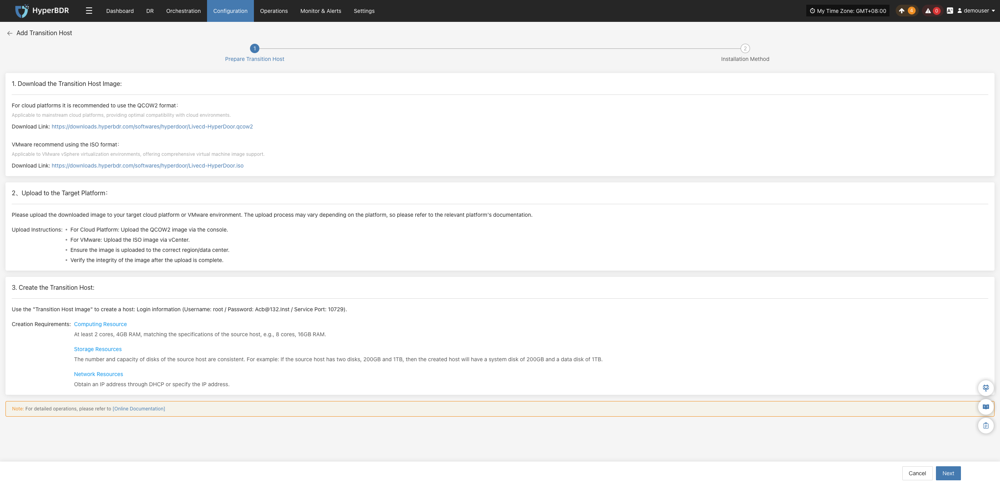

Once the target resources are prepared, click **[Next]** to continue. The system provides two installation methods; you can choose either one according to your network environment.

##### **Installation Method 1: Console Access to Transition Host**

The console can directly access the transition host network. When the transition host is in a private network or has a public IP, data synchronization to the transition host is initiated from the console:

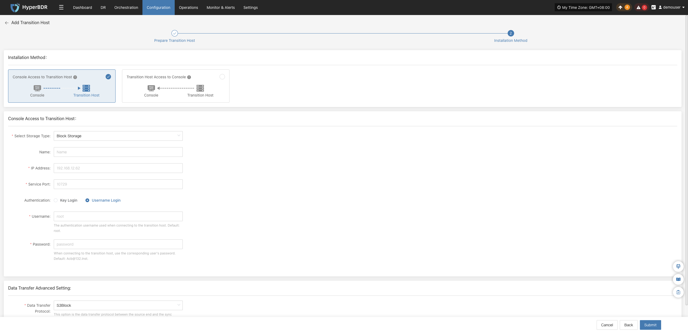

In the configuration window, select the storage method and enter the transition host information, such as name, IP address, and service port:

* **Transition Host Configuration Instructions**

| **Configuration Item** | **Example Value** | **Description** |
| ---------------------- | ----------------- | --------------- |
| Storage Type | Object Storage | Select the storage type for backup data writing. Both Block Storage and Object Storage are supported. |
| Name | test | A unique name used to identify the host in the HyperBDR platform. |
| IP Address | 192.168.7.146 | The IP address of the transition host. |
| Service Port | 10729 | The port listened to by the storage service, default is 10729. |
| Authentication | Username Login | Login authentication method for the transition host. Password or Key login is supported. |
| Username | root | Authentication username for connecting to the transition host. |
| Password | Acb@132.Inst | Authentication password for connecting to the transition host. It is recommended to change the default value after deployment. |
| Advanced Settings for Data Transmission | iSCSI | Data transmission protocol between the source and sync gateway, supporting S3Block and iSCSI: • S3Block: Suitable for WAN environments with high transmission efficiency; • iSCSI: Suitable for dedicated network scenarios with stable network connections. **Note: This option is unavailable when the storage type is object storage.** |

After filling in the information, click **[OK]**. The system will start creating the transition host. When the status displays as "Available", the addition is complete and subsequent operations can be performed:

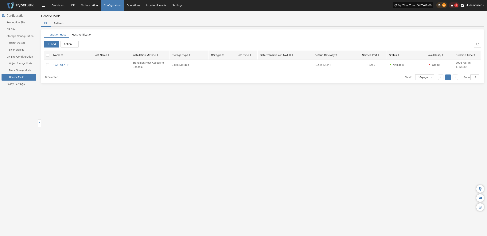

##### **Installation Method 2: Transition Host Access to Console**

The transition host can actively access the console network. When the console is in a private network or has a public IP, data synchronization needs to be initiated from the transition host to the console:

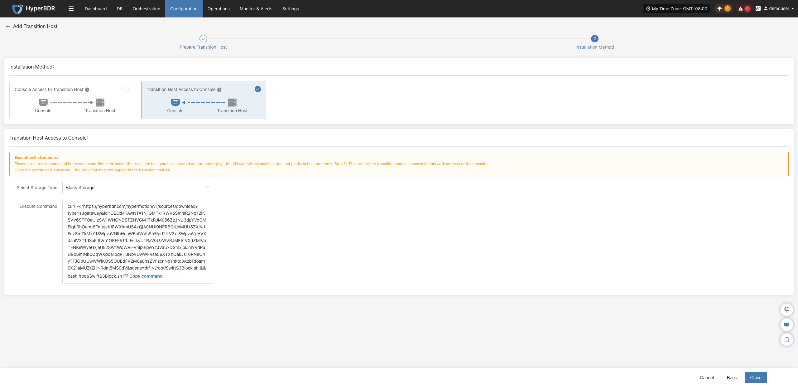

Copy and execute the command on the command-line interface of the prepared transition host, ensuring the transition host can reach the console network address:

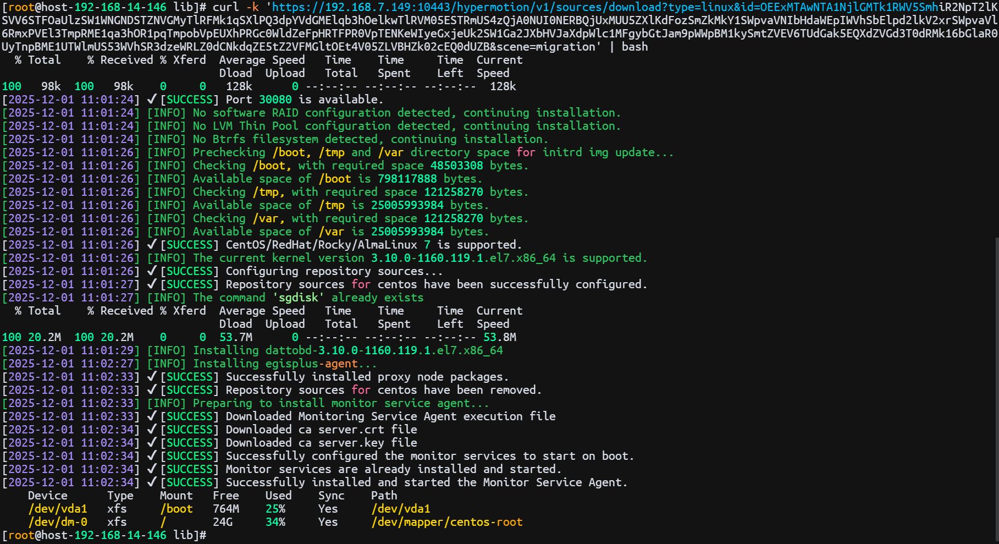

After the command runs successfully, the transition host will automatically appear in the transition host list with the status updated to "Available":

#### **Action**

Select the target host and click the **[Action]** button on the page to perform more configurations:

##### **Data Transmission NAT**

Select the target host and click **[Action] > [Data Transmission NAT]**:

In the pop-up window, configure the host NAT mapping address and data transmission port to ensure data stream connectivity across isolated networks or NAT environments:

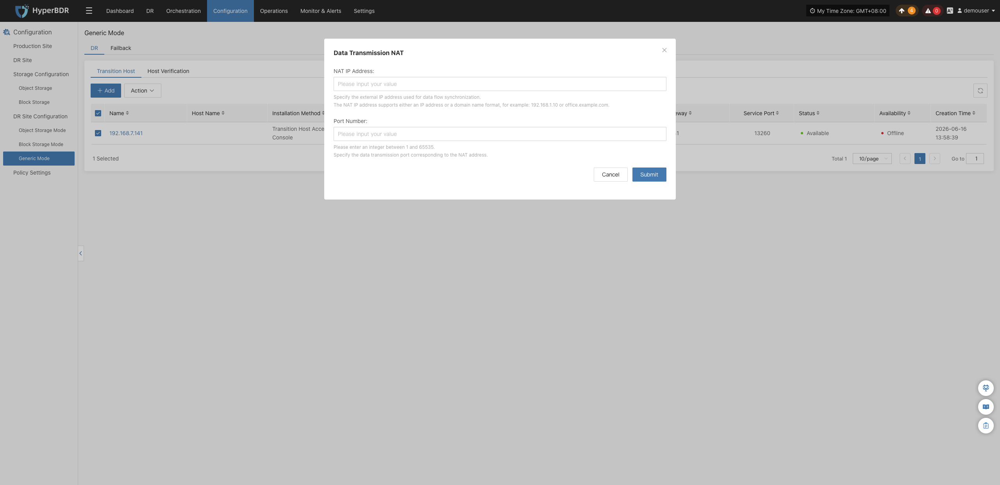

##### **Delete**

Select the target host and click **[Action] > [Delete]**. Confirm in the secondary confirmation dialog by clicking **[OK]** to remove the transition host:

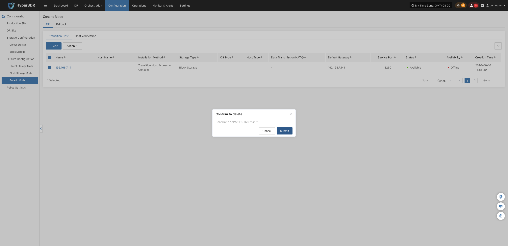

### **Host Verification**

::: note
Only hosts that have completed the "DR > Sync > Drill" process will appear in the "Host Verification" list. Hosts that have not completed data sync will not appear here.
:::

After starting a DR drill, related hosts will appear in this list. Wait for the verification process to complete before proceeding:

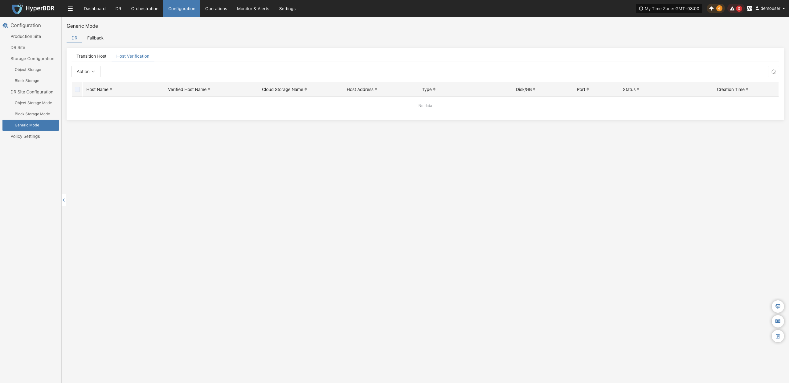

#### **Action**

Select the target host and click the **[Action]** button on the page to perform driver repair or deletion operations:

##### **Driver Repair**

Select the target host and click **[Action] > [Driver Repair]**. In the pop-up "Driver Adaptation" window, verify the disk mapping, set the boot disk (and optionally choose whether to restart automatically), and click **[Verify]** to inject the necessary drivers and complete boot repair.

##### **Delete**

Select the target host and click **[Action] > [Delete]**. Confirm in the secondary confirmation dialog by clicking **[OK]** to remove the verified host.

## **Generic Mode (Failback)**

Generic Mode applies to environments that do not currently support automated DR or failback workflows. In this mode, users need to manually complete certain operations.

### **Transition Host**

#### **Add Transition Host**

Navigate to **[Configuration] > [DR Site Configuration] > [Failback] > [Transition Host]**, and click the **[Add]** button in the upper-right corner. In the configuration dialog, read the precautions carefully and prepare the corresponding host according to the page prompts:

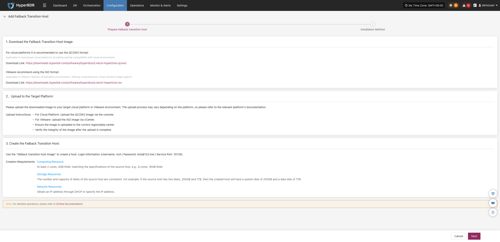

Once the target resources are prepared, click **[Next]** to continue. The system provides two installation methods; you can choose either one according to your network environment.

##### **Installation Method 1: Console Access to Failback Transition Host**

The console can directly access the transition host network. When the transition host is in a private network or has a public IP, data synchronization to the transition host is initiated from the console:

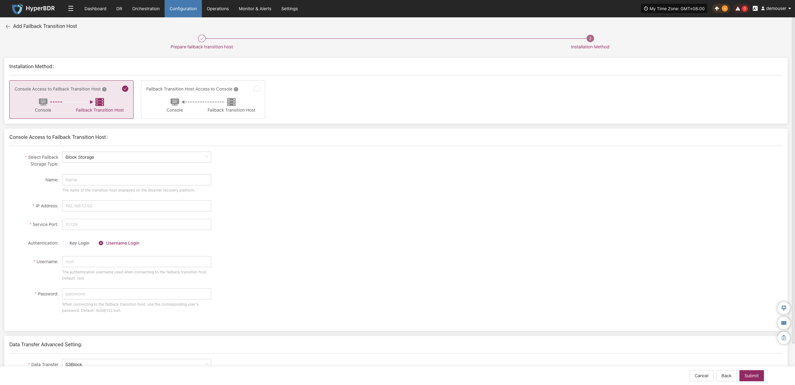

In the configuration window, select the storage method and enter the transition host information, such as name, IP address, and service port:

* **Transition Host Configuration Instructions**

| **Configuration Item** | **Example Value** | **Description** |
| ---------------------- | ----------------- | --------------- |
| Storage Type | Object Storage | Select the storage type for backup data writing. Both Block Storage and Object Storage are supported. |
| Name | test | A unique name used to identify the host in the HyperBDR platform. |
| IP Address | 192.168.7.146 | The IP address of the transition host. |
| Service Port | 10729 | The port listened to by the storage service, default is 10729. |
| Authentication | Username Login | Login authentication method for the transition host. Password or Key login is supported. |
| Username | root | Authentication username for connecting to the transition host. |
| Password | Acb@132.Inst | Authentication password for connecting to the transition host. It is recommended to change the default value after deployment. |
| Advanced Settings for Data Transmission | iSCSI | Data transmission protocol between the source and sync gateway, supporting S3Block and iSCSI: • S3Block: Suitable for WAN environments with high transmission efficiency; • iSCSI: Suitable for dedicated network scenarios with stable network connections. **Note: This option is unavailable when the storage type is object storage.** |

After filling in the information, click **[OK]**. The system will start creating the transition host. When the status displays as "Available", the addition is complete and subsequent operations can be performed:

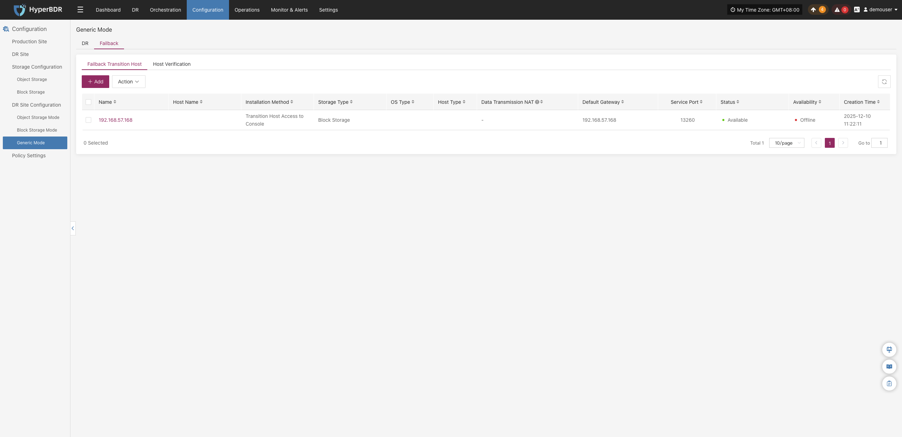

##### **Installation Method 2: Transition Host Access to Console**

The transition host can actively access the console network. When the console is in a private network or has a public IP, data synchronization needs to be initiated from the transition host to the console:

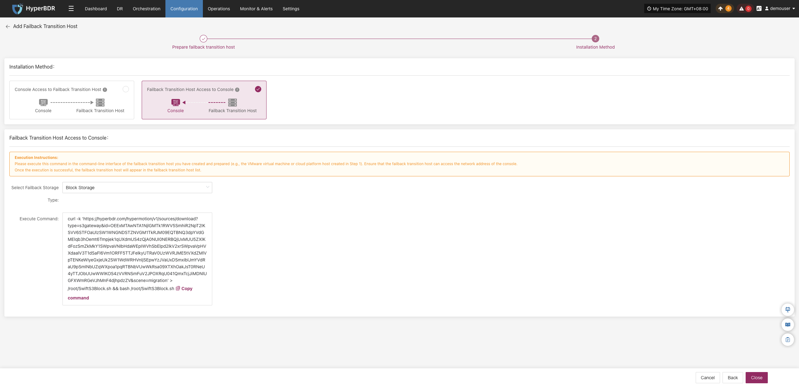

Copy and execute the command on the command-line interface of the prepared transition host, ensuring the transition host can reach the console network address:

After the command runs successfully, the transition host will automatically appear in the transition host list with the status updated to "Available":

#### **Action**

Select the target host and click the **[Action]** button on the page to perform more configurations:

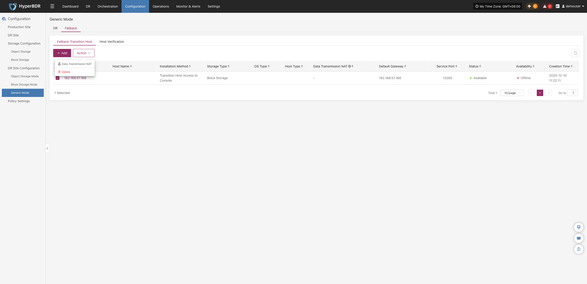

##### **Data Transmission NAT**

Select the target host and click **[Action] > [Data Transmission NAT]**:

In the pop-up window, configure the host NAT mapping address and data transmission port to ensure data stream connectivity across isolated networks or NAT environments:

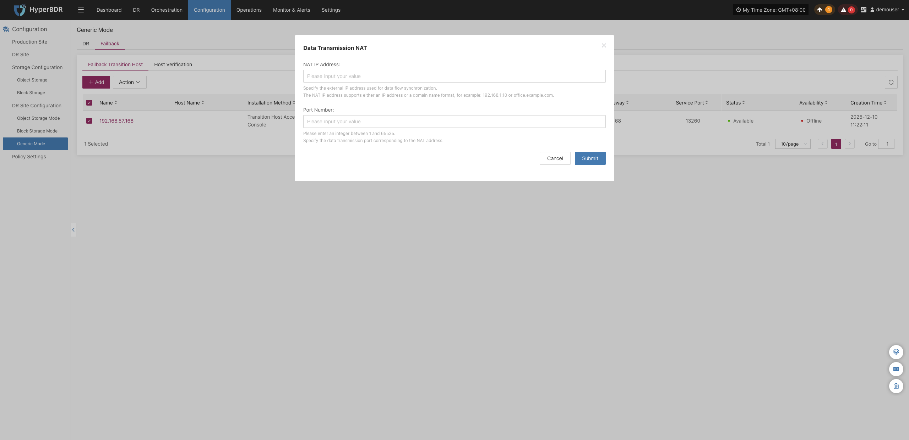

##### **Delete**

Select the target host and click **[Action] > [Delete]**. Confirm in the secondary confirmation dialog by clicking **[OK]** to remove the transition host:

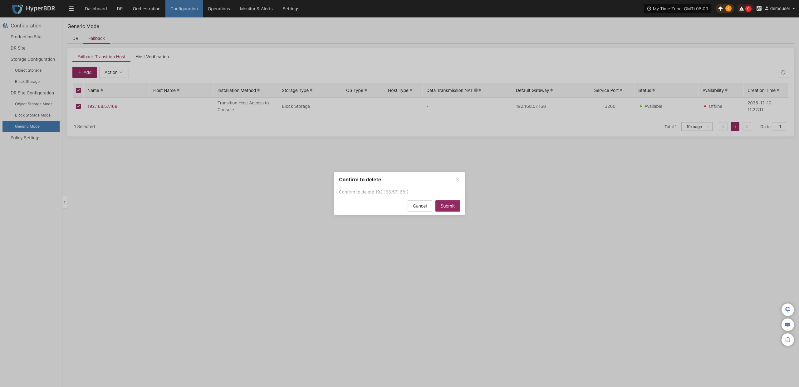

### **Host Verification**

::: note
Only hosts that have completed the "DR > Host Failback > Failback Drill" process will appear in the "Host Verification" list. Hosts that have not completed data sync will not appear here.
:::

After starting a failback drill, related hosts will appear in this list. Wait for the verification process to complete before proceeding:

#### **Action**

Select the target host and click the **[Action]** button on the page to perform driver repair or deletion operations:

##### **Driver Repair**

Select the target host and click **[Action] > [Driver Repair]**. In the pop-up "Driver Adaptation" window, verify the disk mapping, set the boot disk (and optionally choose whether to restart automatically), and click **[Verify]** to inject the necessary drivers and complete boot repair.

##### **Delete**

Select the target host and click **[Action] > [Delete]**. Confirm in the secondary confirmation dialog by clicking **[OK]** to remove the verified host.
