# **Policy Settings**

The **Policy Settings module** is used to centrally configure and manage critical control policies during disaster recovery and failback, helping users flexibly design data sync schedules, network resource allocation, and storage snapshot retention plans. The system supports three core policy types:
- **Sync Policy**: Defines the trigger frequency and scheduling method for full and incremental data synchronization.
- **Speed Limit Policy**: Controls host network bandwidth consumption during data transmission based on peak and off-peak business hours.
- **Retention Policy**: Optimizes target storage space utilization and meets Recovery Point Objectives (RPO) by configuring retention periods and snapshot quantities.

---

## **Create Policy**

### **Operational Steps**

1. Log in to the HyperBDR console, and navigate to **【Configuration】>【Policy Settings】** from the top navigation menu.
2. Policies can be independently maintained in the **【DR】** and **【Failback】** modules; switch to the target business module.
3. Click the **【+ Create Policy】** button in the upper right corner to open the full-screen policy configuration dialog.
4. In the basic information area, enter the policy name, set the snapshot retention quota, and select the initial policy status.

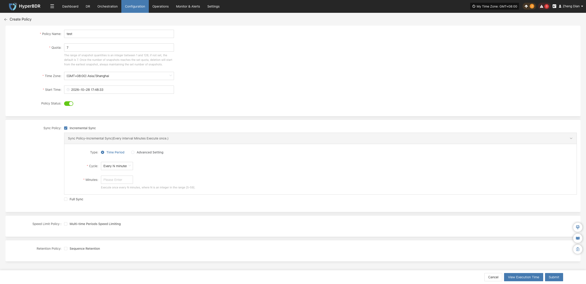

#### **Basic Information Parameters**

| **Parameter** | **Description** |
| :--- | :--- |
| **Policy Name** | Unique identifier for the policy. It is recommended to name it according to business systems or application levels. |
| **Quota** | Maximum number of snapshot replicas retained on the target end. When exceeded, snapshots will be automatically rotated and purged based on the retention policy. |
| **Policy Status** | Default operational status after creation (Enable / Disable). |

---

### **Sync Policy**

In policy settings, users can configure both **Incremental Sync** and **Full Sync** modes to build flexible data synchronization plans.

::: note
Incremental sync and full sync can be configured in parallel. To ensure smooth task execution, it is recommended to plan execution schedules reasonably to avoid schedule overlap causing network and storage I/O resource contention.
:::

#### **Incremental Sync**

Incremental sync continuously replicates source changes at defined cycles after initial full backup, achieving lightweight, low-overhead continuous data protection. Two scheduling types are supported:

##### **1. Time Period Mode**

Trigger incremental sync tasks at fixed time intervals.

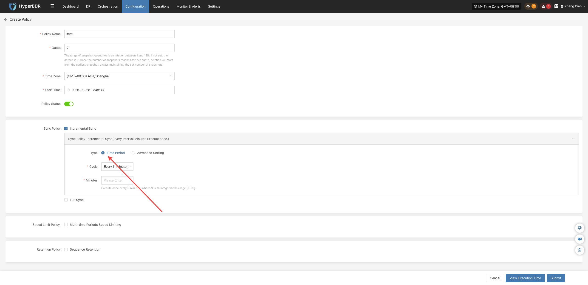

| **Parameter** | **Example Value** | **Description** |
| :--- | :--- | :--- |
| **Type** | Time Period | Basic periodic scheduling mode. |
| **Cycle** | Every N minutes | Triggers cyclically at fixed time intervals. |
| **Minutes** | `30` | Execution interval, valid range is an integer between `5` and `59`. |
| **Start Time** | `2025-05-27 00:00:00` | Effective time of the first execution, followed by cycles based on this time. |
| **Time Zone** | `(GMT+08:00) Asia/Shanghai` | Reference time zone for task scheduling. Setting it explicitly avoids deviations. |

##### **2. Advanced Setting Mode (Crontab)**

Use standard 5-field Crontab expressions to configure flexible and complex timing rules.

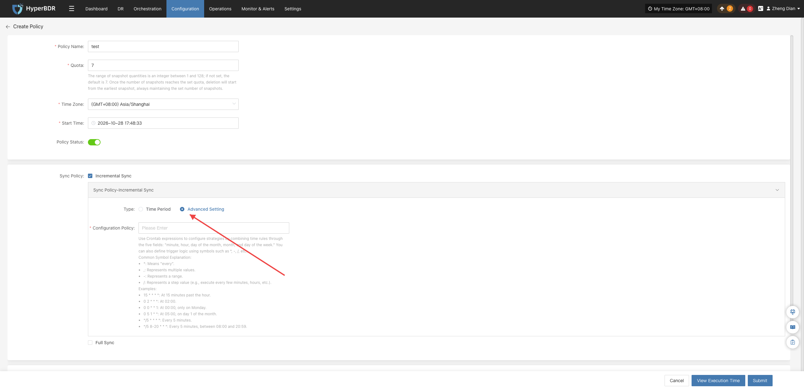

| **Parameter** | **Example Value** | **Description** |
| :--- | :--- | :--- |
| **Type** | Advanced Setting | Use Crontab expressions to customize complex scheduling rules. |
| **Configuration** | `*/30 * * * *` | Combine time rules using five fields: minute, hour, day, month, weekday.  **Common Wildcards:** • `*`: Every point in time; • `,`: Enumerate multiple values; • `-`: Continuous range; • `/`: Step value (e.g., every N minutes/hours).  **Common Expression Examples:** • `15 * * * *`: Triggers at minute 15 of every hour; • `0 2 * * *`: Runs daily at 2:00 AM; • `0 0 * * 1`: Runs every Monday at 0:00 AM; • `0 5 1 * *`: Runs on the 1st of every month at 5:00 AM; • `*/5 * * * *`: Runs every 5 minutes; • `*/5 8-20 * * *`: Runs every 5 minutes during working hours (8:00–20:00). |
| **Start Time** | `2025-05-27 00:00:00` | Base effective time for the policy. |
| **Time Zone** | `(GMT+08:00) Asia/Shanghai` | Reference time zone for scheduling. |

---

#### **Full Sync**

Full sync performs a complete data baseline synchronization for the source host. Since full sync reads the entire disk and consumes relatively high network bandwidth, it is usually recommended to schedule it during off-peak business hours.

##### **1. Time Period Mode**

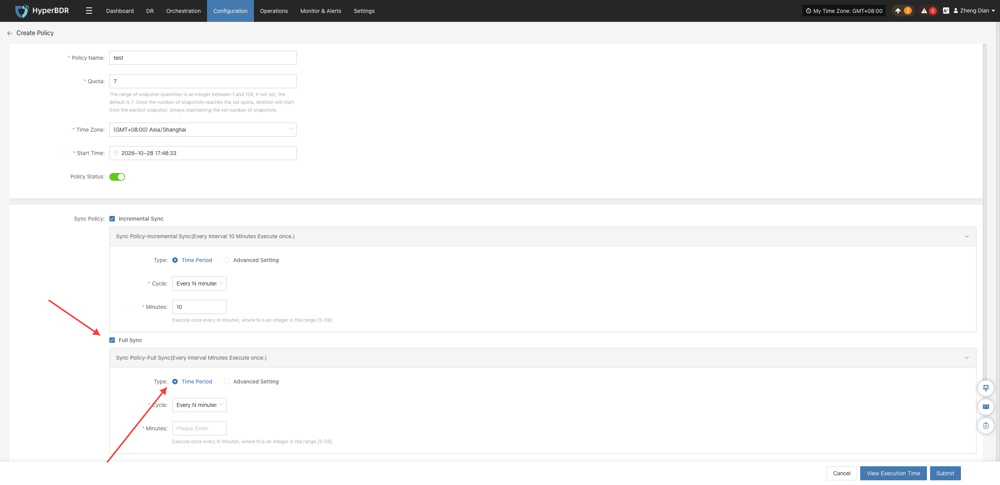

| **Parameter** | **Example Value** | **Description** |
| :--- | :--- | :--- |
| **Type** | Time Period | Schedules full sync tasks at fixed intervals. |
| **Cycle** | Every N minutes | Recurrence interval setting. |
| **Minutes** | `30` | Valid range is an integer between `5` and `59`. |
| **Start Time** | `2025-05-27 00:00:00` | Scheduled effective time for full sync. |
| **Time Zone** | `(GMT+08:00) Asia/Shanghai` | Reference time zone for scheduling. |

##### **2. Advanced Setting Mode (Crontab)**

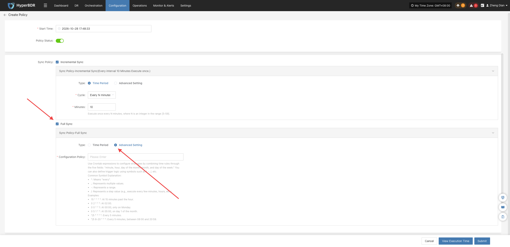

| **Parameter** | **Example Value** | **Description** |
| :--- | :--- | :--- |
| **Type** | Advanced Setting | Use Crontab expressions to customize full sync schedules. |
| **Configuration** | `*/30 * * * *` | Executes according to standard Crontab rules (syntax identical to incremental advanced mode). |
| **Start Time** | `2025-05-27 00:00:00` | Effective time for the plan. |
| **Time Zone** | `(GMT+08:00) Asia/Shanghai` | Reference time zone for scheduling. |

---

#### **View Execution Time**

After configuring sync policy parameters, users can click the **【View Execution Time】** button at the bottom of the dialog. The system will automatically calculate upcoming execution timestamps based on the start time, interval minutes, or Crontab expression, making it easy to verify scheduling logic before saving.

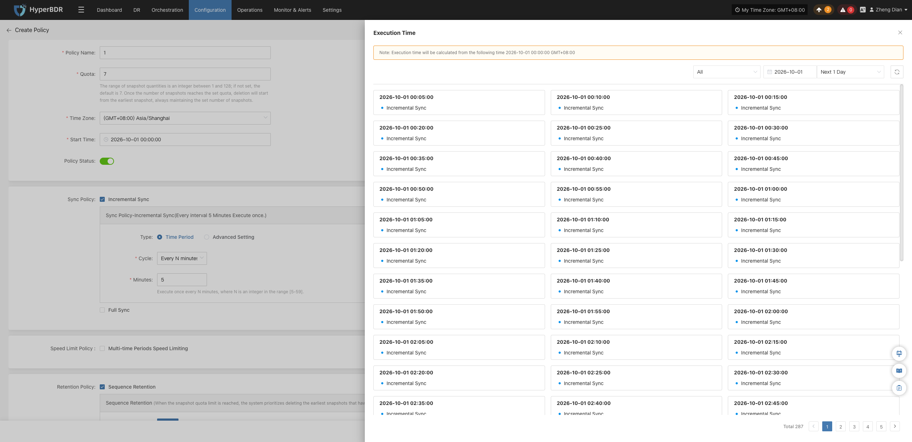

---

### **Speed Limit Policy**

The speed limit policy allows users to set independent bandwidth caps for sync tasks across different time periods, preventing DR replication traffic from overwhelming daytime production network bandwidth.

::: tip
Configuring multiple speed limit rules across different time periods within the same cycle is supported; switching the cycle type will reset and clear existing time period configurations.
:::

#### **Multi-time Periods Speed Limiting**

Check to enable multi-period speed limiting, allowing you to configure host transmission bandwidth limits for different time slots.

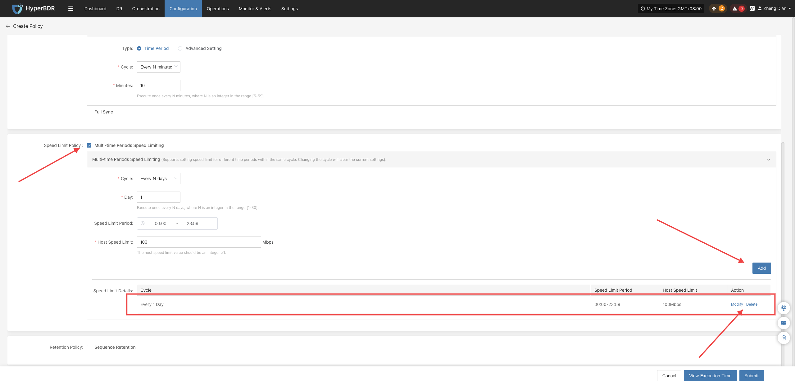

| **Parameter** | **Example Value** | **Description** |
| :--- | :--- | :--- |
| **Cycle** | Every N days / Weekly / Monthly | Recurrence cycle type for speed limits, supporting daily intervals, designated weekdays, or specific days of the month. |
| **Days** | `1` | When the cycle is "Every N days", represents the interval frequency, ranging from `[1–30]` as an integer. |
| **Date** | Monday, Wednesday | When the cycle is "Weekly", designates specific weekdays (supports multi-selection). |
| **Date** | Day 5 | When the cycle is "Monthly", designates specific calendar days of the month (supports multi-selection). |
| **Speed Limit Time** | `00:00 - 23:59` | Active time interval within a single day for this speed limit rule. |
| **Time Zone** | `(GMT+08:00) Asia/Shanghai` | Reference standard time zone for the speed limit interval. |
| **Host Speed Limit** | `10 Mbps` | Maximum bandwidth limit for the host during sync, measured in Mbps. |
| **Speed Limit Details** | (Table summary) | After adding parameters, all active time-period speed limit rules will be summarized and displayed here. |

---

### **Retention Policy**

Retention policies manage the lifecycle of target storage replicas, preventing unbounded data growth from exhausting storage resources.

::: caution
When configuring retention policies, ensure the target storage has sufficient quota to support creating new snapshots. Snapshot creation failures may cause sync tasks to abort.
:::

#### **Sequence Retention**

The system retains the latest copies according to the chronological sequence of sync backups. When the number of snapshots exceeds the set quota, older historical replicas are automatically pruned and reclaimed.

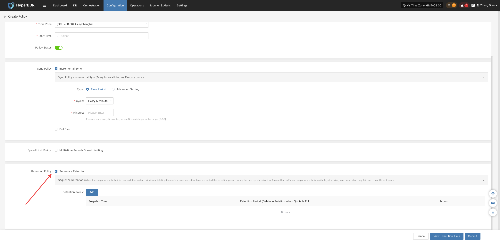

#### **Sequence Retention Parameter Description**

Users can flexibly configure the number of snapshot replicas across four time granularities: day, week, month, and year:

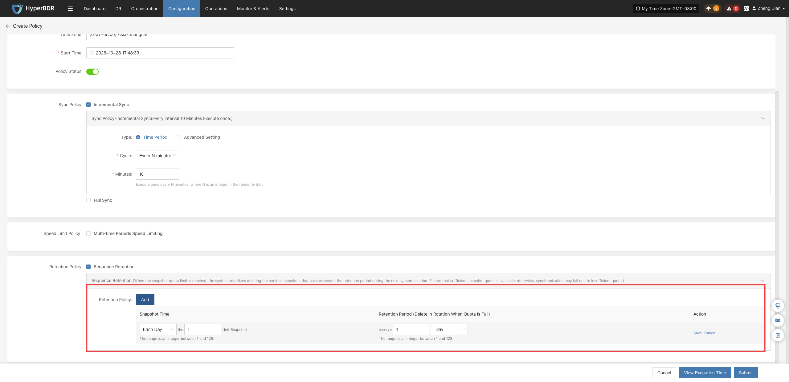

::: note
The minimum retention count for each granularity is `1`, and the maximum does not exceed `129`. The system intelligently consolidates redundant backups to ensure the specified number of optimal recovery points is retained across granularities.
:::

---

## **Action**

In the Policy Settings list, select the checkbox before the target policy record, and click the **【Action】** dropdown button above the table to perform the following management operations:

### **Modify**

When you need to adjust the policy name, snapshot quota, or sync schedule, use the modify feature:

1. In the policy list, check the target policy and click **【Action】>【Modify】**.
   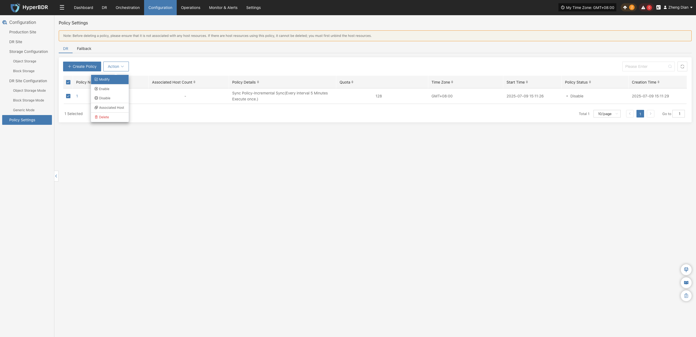
2. In the popup Edit Policy dialog, adjust parameters as needed, and click **【Submit】** to save changes.
   

---

### **Enable**

When a policy is disabled and needs to be reactivated:
1. Select the checkbox for the target policy.
2. Click **【Action】>【Enable】**. The policy status will immediately switch to "Enable", resuming execution according to the schedule.

---

### **Disable**

When you need to temporarily suspend scheduled tasks (e.g., during source maintenance or network inspection):
1. Select the checkbox for the target policy.
2. Click **【Action】>【Disable】**. All scheduled sync and rotation tasks under this policy will pause.

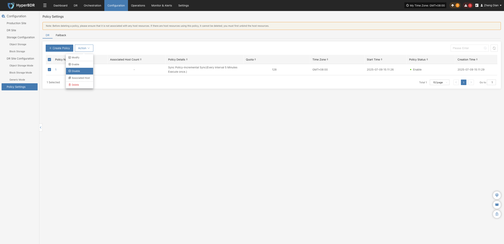

---

### **Associated Host**

Batch-bind host resources that need protection under this policy:

1. Select the checkbox for the target policy, and click **【Action】>【Associated Host】**.
   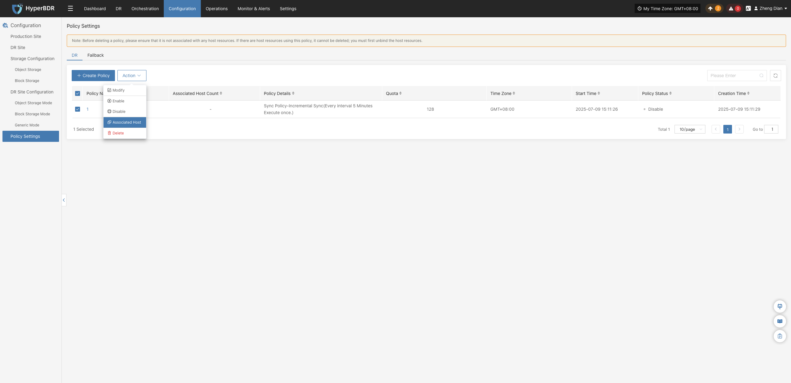
2. In the popup Associated Host dialog, check the target hosts to protect, and click **【Submit】** to complete binding.
   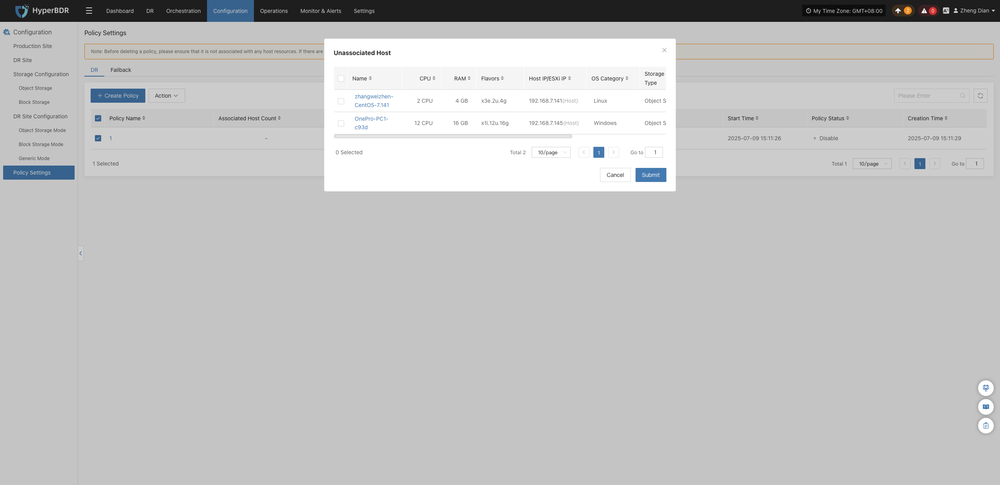

---

### **Delete**

To permanently remove a policy configuration:

1. Select the checkbox for the target policy, and click **【Action】>【Delete】**.
   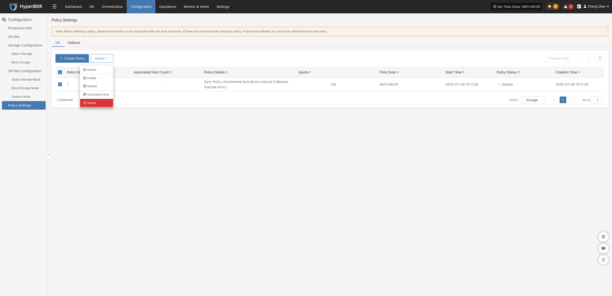
2. A secondary confirmation alert dialog will appear. After verifying details, click **【Confirm】** to complete removal.

::: warning
Before deleting a policy, ensure that **no host resources are associated with this policy**. If any hosts are currently using this policy, the system will intercept the deletion; you must unbind the hosts first before deleting.
:::

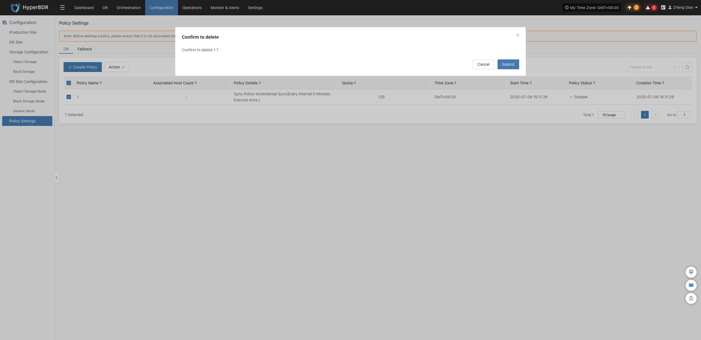

---

## **Policy Setting Details**

Click any **Policy Name** in the policy list. The policy details drawer will slide out from the right, allowing users to verify configurations and association relationships.

### **Overview**

On the **【Overview】** tab of the details drawer, you can view comprehensive summary information including basic configurations, sync modes (incremental/full), speed limit schedules, and snapshot quotas.

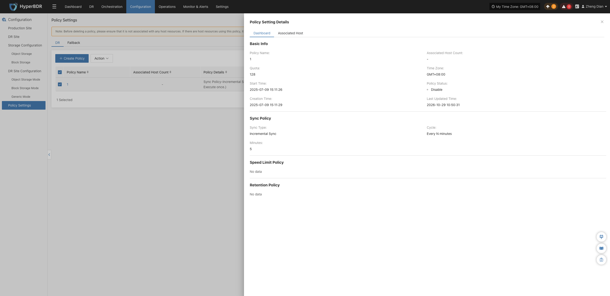

---

### **Associated Host**

Switch to the **【Associated Host】** tab to inspect the complete list of hosts currently protected by this policy, including host names, IP addresses, platform types, and other details.

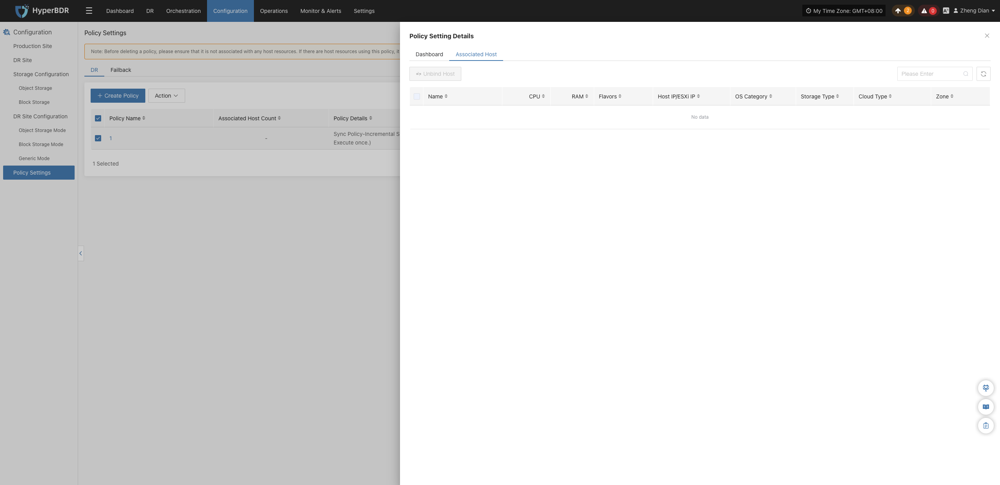

---

### **Unbind Host**

If a host needs to change protection policies or no longer requires disaster recovery protection, you can unbind it here:

1. In the **Associated Host** list, select the checkbox of the host to unbind.
2. Click the **【Unbind Host】** button above the table, confirm the action in the popup prompt, and the host will be safely unbound from the current policy.

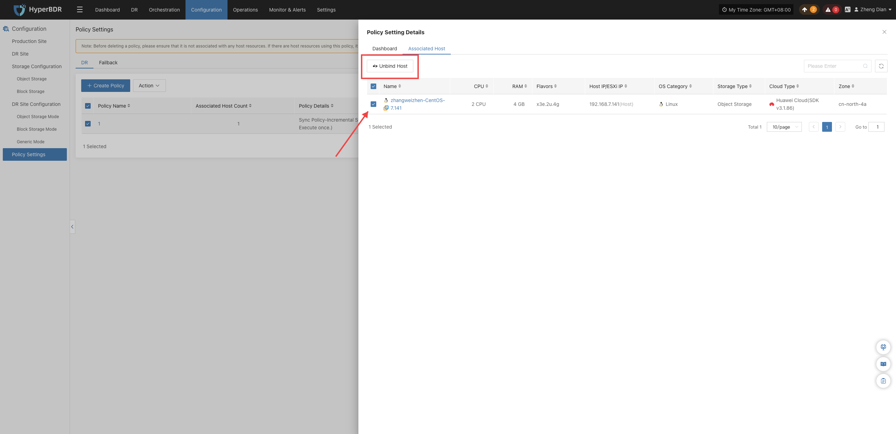
