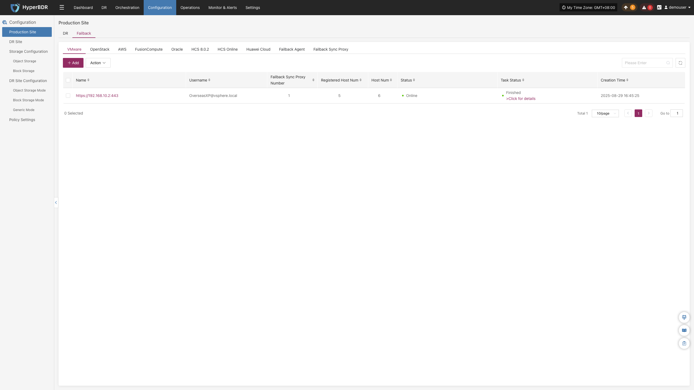

# **Production Site**

In the HyperBDR disaster recovery architecture, a **Production Site** represents the source environment hosting your core business workloads. The system supports two data replication modes to balance universal compatibility with agentless, non-intrusive deployment:

* **Agent Mode**: A lightweight Agent program is installed inside the source operating system. It is suitable for complex heterogeneous environments, including x86 physical servers, standalone private cloud virtual machines (such as KVM, Xen, Hyper-V), and public cloud hosts.
* **Agentless Mode**: Requires zero software installation inside workload hosts. It captures differential disk block changes directly via native hypervisor/cloud APIs and snapshot mechanisms. Currently supported platforms include: **VMware, OpenStack + Ceph, AWS EC2, FusionCompute, Oracle Cloud, HCS 8.0.2, HCS Online, and Huawei Cloud**.

::: tip OS Compatibility Support Matrix
* [View Source Agentless OS Compatibility Matrix](https://oneprocloud.feishu.cn/sheets/VRqksSPEPhRTPStp3kVcItXNnyh?sheet=0MJNYC)
* [View Source Agent OS Compatibility Matrix](https://oneprocloud.feishu.cn/sheets/VRqksSPEPhRTPStp3kVcItXNnyh?sheet=Y9fpqO)
:::

## **DR**

<!-- @include: ./_production-site/vmware.md -->
<!-- @include: ./_production-site/openstack.md -->
<!-- @include: ./_production-site/aws.md -->
<!-- @include: ./_production-site/fusioncompute.md -->
<!-- @include: ./_production-site/oracle.md -->
<!-- @include: ./_production-site/hcs.md -->
<!-- @include: ./_production-site/hcs-online.md -->
<!-- @include: ./_production-site/huawei-cloud.md -->
<!-- @include: ./_production-site/platform-operations.md -->
<!-- @include: ./_production-site/source-agent.md -->
<!-- @include: ./_production-site/sync-proxy.md -->

## **Failback**

When configuring a Failback Production Site, the overall configuration logic is consistent with the DR Production Site workflow. The meaning and operation of each parameter can be directly referenced in the [DR Production Site](#dr) section. Once the configuration is complete, you can proceed with the Host Failback operation.

