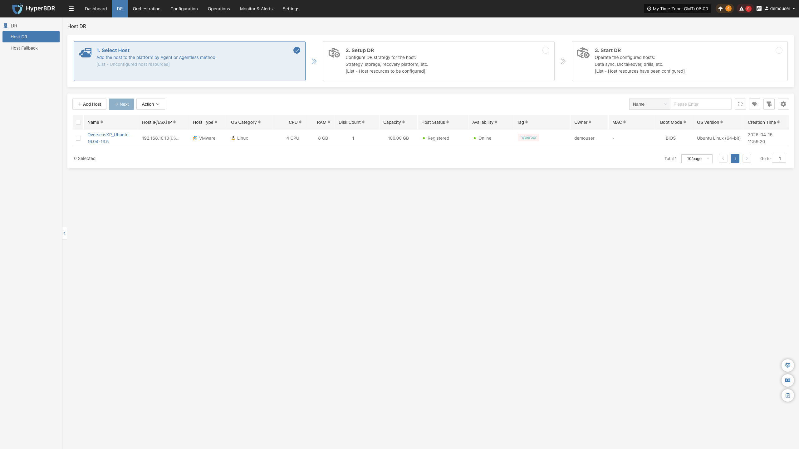
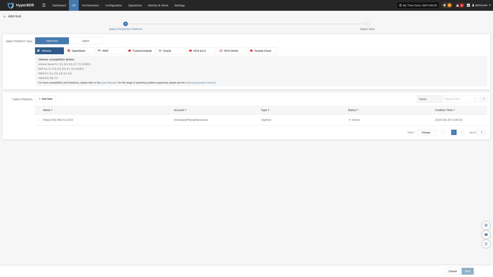
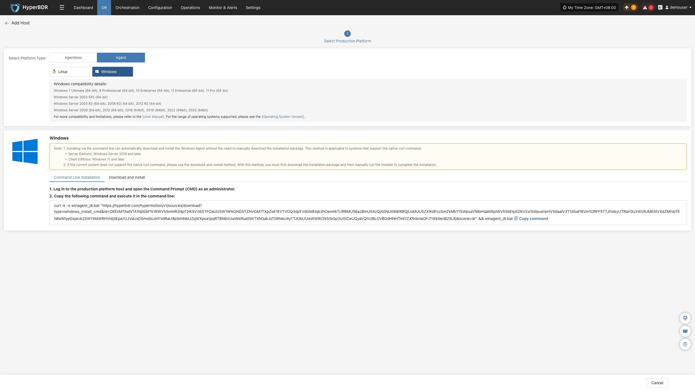
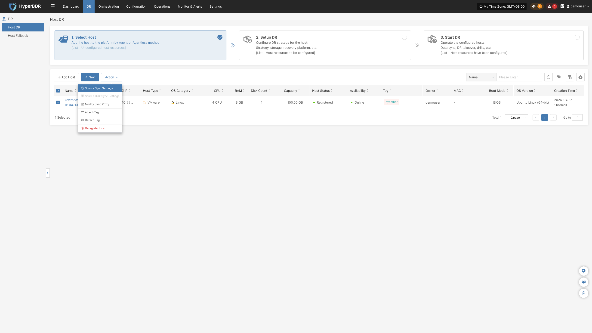
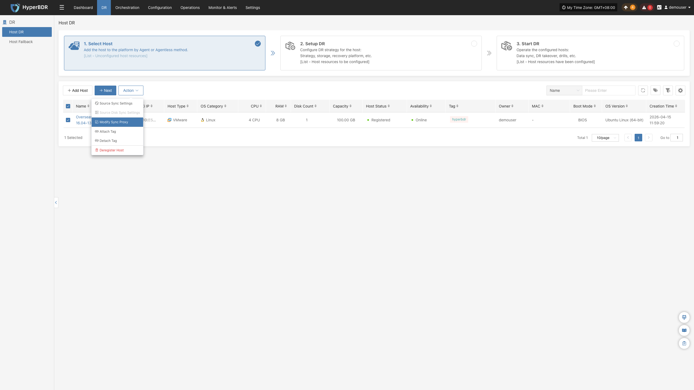
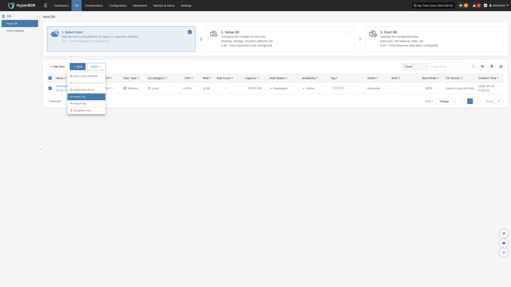
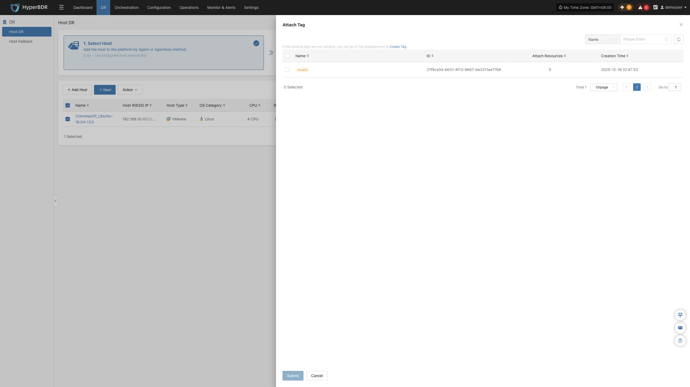
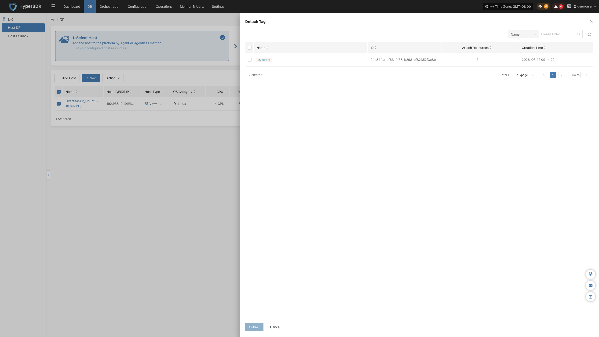
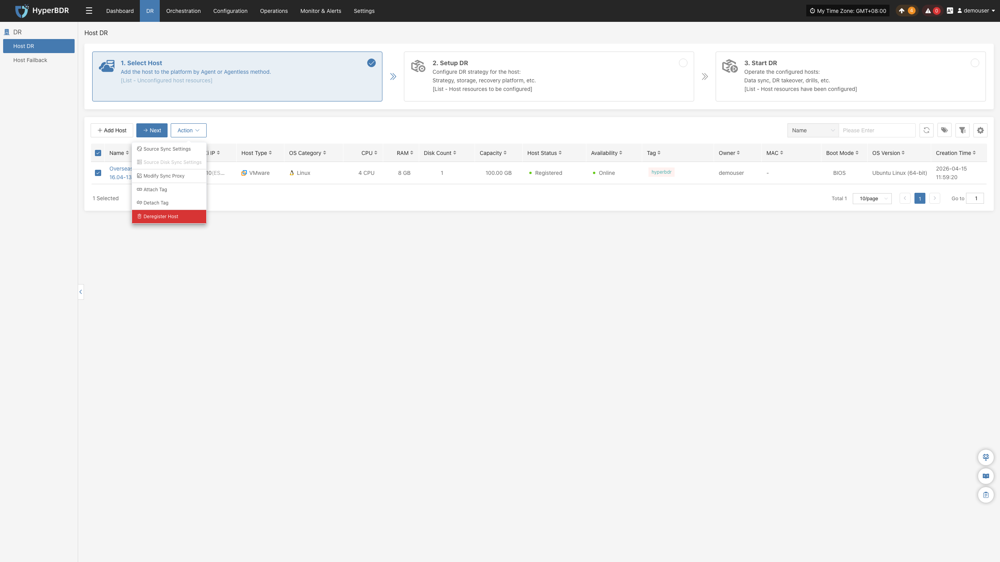

## **Select Host**

Go to **DR** > **Host DR** > **Select Host** to view and manage protected hosts.

The **"Select Host"** page provides three primary actions: **"Add Host"**, **"Next"**, and **"Action"**.

On the Add Host page, choose between two deployment modes: **Agentless** and **Agent**.

| **Production Platform Type** | **Supported Resources** | **Description** |
|:---:|:---:|:---|
| **Agentless** | VMware, OpenStack, AWS, FusionCompute, Oracle, HCS 8.0.2, HCS Online, Huawei Cloud | Backs up virtual machines directly without installing software inside the guest OS. |
| **Agent** | Linux Windows | Installs an agent directly inside source Linux or Windows hosts. OS Support Matrix (Agentless): [View Here](https://oneprocloud.feishu.cn/sheets/VRqksSPEPhRTPStp3kVcItXNnyh?sheet=0MJNYC) OS Support Matrix (Agent): [View Here](https://oneprocloud.feishu.cn/sheets/VRqksSPEPhRTPStp3kVcItXNnyh?sheet=Y9fpqO) |

### **Add Host**

Click **"Add Host"** to register source hosts for disaster recovery, then select **"Agentless"** or **"Agent"**.

#### **Agentless**

Agentless mode supports the following platforms: VMware, OpenStack, AWS, FusionCompute, Oracle, HCS 8.0.2, HCS Online, and Huawei Cloud.

Agentless protection requires deploying one or more **Sync Proxy** instances in the source environment. The Sync Proxy connects to the source platform APIs to read and transfer disk data. Ensure network planning is completed beforehand.

* Deploy Sync Proxy for VMware

Download the OVA template and deploy it in your VMware vSphere environment:

OVA template: [Download OVA](https://downloads.oneprocloud.com/proxy-agent_BaseOS.ova)

* Deploy Sync Proxy for other platforms

Deploy an Ubuntu 24.04 instance. For OpenStack or KVM environments, download and import the standard cloud-init QCOW2 image:

QCOW2 image: [Download Image](https://downloads.oneprocloud.com/docs_images/ubuntu-24.04-server-cloud-init-amd64.qcow2)

> **Note:** The Ubuntu 24.04 image has no default password. It relies on cloud-init for credential injection; ensure your cloud platform supports cloud-init before deploying.

* Prerequisites

| Production Platform | Prerequisites | Documentation |
|:---:|:---|:---|
| VMware | Deploy and install Sync Proxy, then add the source VMware platform. | [Add VMware Platform](../../configuration/production-site.md#add-vmware-platform) |
| OpenStack | Deploy and install Sync Proxy, then add the source OpenStack Ceph platform. | [Add OpenStack Platform](../../configuration/production-site.md#add-openstack-platform) |
| AWS | Deploy and install Sync Proxy, then add the source AWS platform. | [Add AWS Platform](../../configuration/production-site.md#add-aws-platform) |
| FusionCompute | Deploy and install Sync Proxy, then add the source FusionCompute platform. | [Add FusionCompute Platform](../../configuration/production-site.md#add-fusioncompute-platform) |
| Oracle | Deploy and install Sync Proxy, then add the source Oracle platform. | [Add Oracle Platform](../../configuration/production-site.md#add-oracle-platform) |
| HCS 8.0.2 | Deploy and install Sync Proxy, then add the source HCS 8.0.2 platform. | [Add HCS 8.0.2 Platform](../../configuration/production-site.md#add-hcs-8-0-2-platform) |
| HCS Online | Deploy and install Sync Proxy, then add the source HCS Online platform. | [Add HCS Online Platform](../../configuration/production-site.md#add-hcs-online-platform) |
| Huawei Cloud | Deploy and install Sync Proxy, then add the source Huawei Cloud platform. | [Add Huawei Cloud Platform](../../configuration/production-site.md#add-huawei-cloud-platform) |

**Example: Adding a Host**

- Click **"Add Host"**, select **"Agentless"**, and choose your platform. In the platform list, select the configured site and click **"Next"** to view virtual machines.

   > **Note:** If you have not added a production platform, click **"Add New"** to add one first. Refer to the prerequisites table above.

- Select the virtual machines to protect. You can select hosts across multiple pages or search by name or operating system.

   > **Note:** Check the host disk count and Sync Proxy metrics (current proxies, maximum mountable disks, mounted disks, and remaining capacity). Scale proxy resources or deploy additional proxies to handle large-scale workloads. The table details operating systems, disk counts, total capacity, and support for initial and incremental synchronization.

> If newly created virtual machines do not appear in the list, click **"Reload Virtual Machines"** to refresh.

- After selecting the virtual machines, click **"Submit"** to register them with the platform.

#### **Agent**

Agent mode installs an agent inside the guest operating system to capture and replicate data.

##### **Linux**

Go to **Select Host** > **Add Host**, choose **"Agent"**, and select **"Linux"**. Verify compatibility using the displayed OS support list.

Copy the generated installation command and execute it in the terminal of the source Linux host.

For detailed installation steps, see [Linux Agent Guide](../../configuration/production-site.md#linux-agent).

Once installation completes, the host registers automatically. Verify the host in the host list.

##### **Windows**

Go to **Select Host** > **Add Host**, choose **"Agent"**, and select **"Windows"**. Verify compatibility using the displayed OS support list.

Click **"Download Now"** to download the Windows Agent installer matching your OS version, then transfer and install it on the source host.

For detailed installation steps, see [Windows Agent Guide](../../configuration/production-site.md#windows-agent).

Once installation completes, the host registers automatically. Verify the host in the host list.

### **Next**

After registering source hosts, select the hosts to protect and click **"Next"** to proceed to Step 2, **"Setup DR"**.

### **Action**

#### **Source Sync Settings**

Configure data synchronization parameters for protected hosts to optimize performance and bandwidth usage across different network conditions.

##### **General Settings**

> This configuration applies to Linux Agent, Windows Agent, and Agentless modes. The interface layout or configuration location may vary slightly between modes. Refer to the actual interface.

| Parameter | Setting | Description |
|---|---:|---|
| Maximum CPU Usage (%) | 30 | Limits the maximum CPU percentage that backup tasks can use. A higher value increases backup speed but also has a greater impact on source-host services. Keep the default value unless the workload requires adjustment. |
| Available Memory | 1024 | The amount of available system memory. Valid range: 700–1024. |
| Encryption | Yes | Encrypts transmitted data to improve security, but consumes additional CPU resources and may slightly reduce backup speed. |
| Compression | No | Compresses data before transmission to reduce the amount of data transferred. This is suitable for networks with limited bandwidth. The actual space saved varies by data type, and the system automatically selects an appropriate compression strategy. |
| Duplicate Data Check | Automatic | Detects and skips duplicate data to reduce data transfer. **Automatic**: the system determines whether to perform the check based on actual conditions (recommended). **Enable**: perform the check for every synchronization. **Disable**: do not perform the check. |
| Volume Reserved Space | 3 | The percentage of available space on a Windows Agent volume. Valid range: 0–99. |
| Snapshot Creation Timeout (seconds) | 600 | The maximum wait time for snapshot creation. Valid range: **600–86400** seconds. If creation is not completed within this time, the task is marked as failed. |

##### **Sync Thread Settings**

> This configuration applies to Agentless mode. The interface layout or configuration location may vary slightly between modes. Refer to the actual interface.

| Parameter | Setting | Description |
|---|---|---|
| VMware Quiesced Snapshot | No | Applies only to VMware VMs with **VMware Tools** installed. When enabled, it provides the greatest possible file-system consistency during snapshot creation. Enable it according to business requirements. |
| Read Threads | Automatic Adaptation | Sets the number of data-read threads for a host. In **Automatic Adaptation** mode, the system automatically adjusts the number of threads (1–10) based on Sync Proxy resources and the number of disks to synchronize. **Custom** mode supports 1–100 threads and should generally remain within 30. In 10-Gigabit or faster networks, increasing the Sync Proxy resources, such as to 8 CPU cores and 16 GB or more memory, may allow a higher thread count to improve synchronization performance. |
| Write Threads | Automatic Adaptation | Sets the number of data-write threads for a host. The automatic and custom modes follow the same behavior and recommendations as Read Threads. |
| Concurrent Multi-Disk Read/Write | Yes | Controls whether multiple disks are read and written concurrently. Enabling it can improve synchronization efficiency; disabling it synchronizes disks sequentially and is suitable when system-resource usage must be controlled. |

##### **Sync Retry Settings**

> This configuration applies to Linux Agent, Windows Agent, and Agentless modes. The interface layout or configuration location may vary slightly between modes. Refer to the actual interface.

| Parameter | Setting | Description |
|---|---:|---|
| Retry on Failure | Yes | Automatically reconnects and resumes synchronization when a temporary failure, such as a network error, interrupts synchronization. When disabled, synchronization ends after a failure and is not retried automatically. |
| Retry Count | 3 | The maximum number of retries after synchronization fails. Valid range: **1–100**. If the connection is not restored after the maximum is reached, the synchronization task is marked as failed. |
| Retry Interval | 60 | The wait time between retries, in **seconds**. Valid range: **1–3600**. A longer interval allows more time for network recovery and avoids frequent retries. |

##### **Sync Thread Settings**

> This configuration applies to Linux Agent and Windows Agent modes. The interface layout or configuration location may vary slightly between modes. Refer to the actual interface.

| Parameter | Setting | Description |
|---|---:|---|
| Sync Thread Count | 2 | The number of threads used by the synchronization task. Increasing it may improve synchronization performance but consumes more system resources. Valid range: **1–64**. Adjust it according to the host resources. |
| Sync Memory Size | 8 | The amount of memory available to the synchronization task. Increasing it may improve synchronization performance but consumes more memory. Valid range: **1–1024**. Adjust it according to available host memory. |

##### **Object Upload Settings**

> This configuration applies to Linux Agent mode. The interface layout or configuration location may vary slightly between modes. Refer to the actual interface.

| Parameter | Setting | Description |
|---|---:|---|
| Connection Timeout | 120 | The maximum time to wait for a connection when uploading an object, in **seconds**. Valid range: **1–1800**. If a connection is not established within this time, it is marked as timed out. |
| Send MD5 Digest | Yes | Sends an MD5 digest during object upload to verify data integrity and help detect data corruption during transmission. |
| Perform Segmented SHA256 Checksum | No | Performs SHA256 verification for each data segment during multipart upload. This improves integrity verification but may increase CPU overhead. |

##### **Volume VSS Storage Settings**

> This configuration applies to Windows Agent mode. The interface layout or configuration location may vary slightly between modes. Refer to the actual interface.

| Parameter | Setting | Description |
|---|---|---|
| General Volume Ratio | 10 | The default percentage of disk space that VSS snapshot storage may occupy, in **%**. Valid range: **5–100**. This value is used when no volume-specific VSS storage is configured. |
| Volume-Specific Storage | `VSS_SPEC_MAX_C=d:10` | Sets the VSS snapshot location and capacity for a specified volume. **Single-volume example:** `VSS_SPEC_MAX_C=d:10` stores the VSS snapshots of volume **C** on volume **D** and allocates **10 GB**. **Multiple-volume example:** `VSS_SPEC_MAX_C=d:10;VSS_SPEC_MAX_E=f:10`; separate entries with semicolons (`;`). **Leave blank by default unless special requirements exist.** |
| VSS Snapshot Creation Timeout | 300 | The maximum wait time for creating a VSS snapshot, in **seconds**. The value must be at least **60**. If creation is not completed within this time, the operation is marked as failed. |
| Raw Data Sync Volumes | F | Specifies partitions to synchronize as raw data without VSS snapshots. Enter drive letters; separate multiple letters with commas, for example, `F` or `E,F`. **Leave blank by default unless special requirements exist.** |

#### **Source Disk Sync Settings**

Exclude specific disks from data synchronization on multi-disk hosts. This feature is available only for hosts added in Agent mode.

> **Note:** This setting can be modified only before initial data synchronization starts. Once synchronization begins, disk inclusion cannot be modified.

Locate the disk to exclude, change the synchronization status from **Yes** to **No**, and click **Confirm**. Excluded disks are skipped during all subsequent synchronization tasks.

#### **Modify Sync Proxy**

Reassign the Sync Proxy node used for host data transfer.

#### **Attach Tag**

Assign tags to organize and manage hosts by environment, application, or owner.

#### **Detach Tag**

Remove tags previously assigned to the host.

#### **Deregister Host**

Unregister a host and remove it from the HyperBDR management console.

