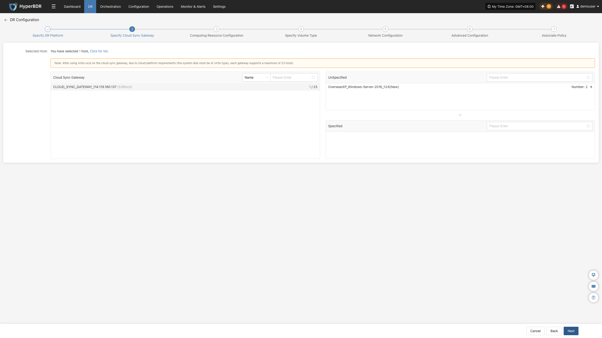
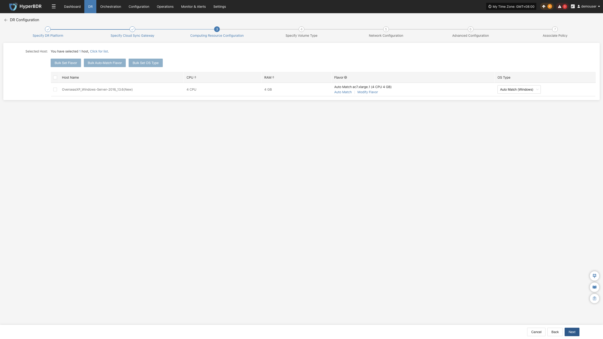
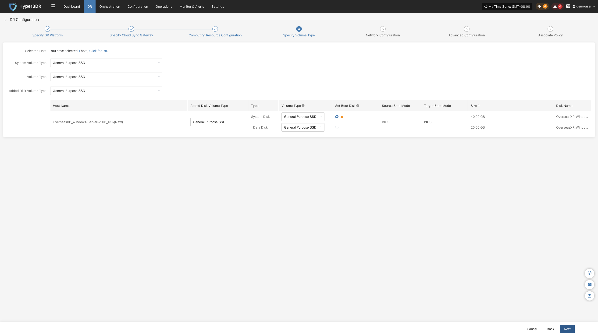
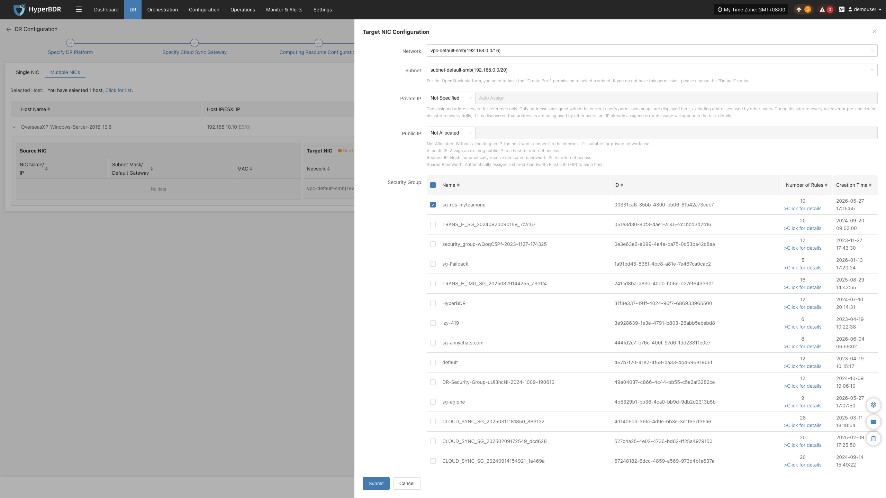
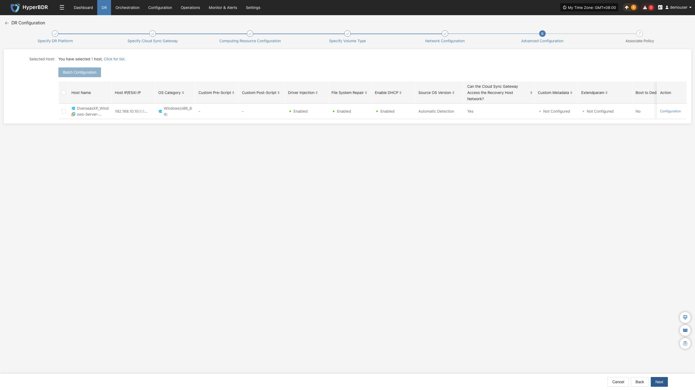
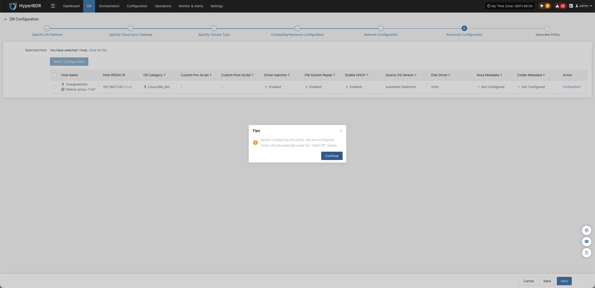
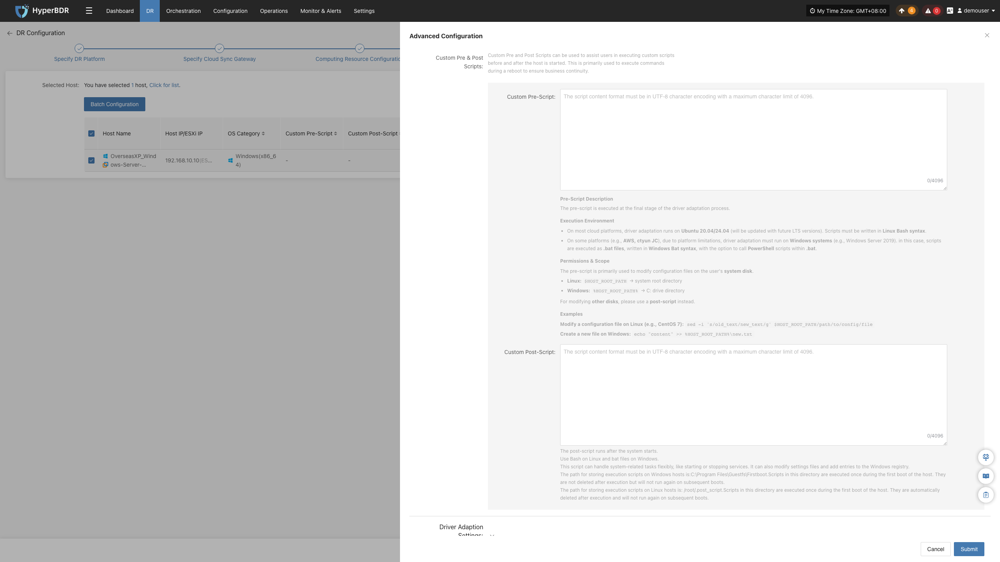
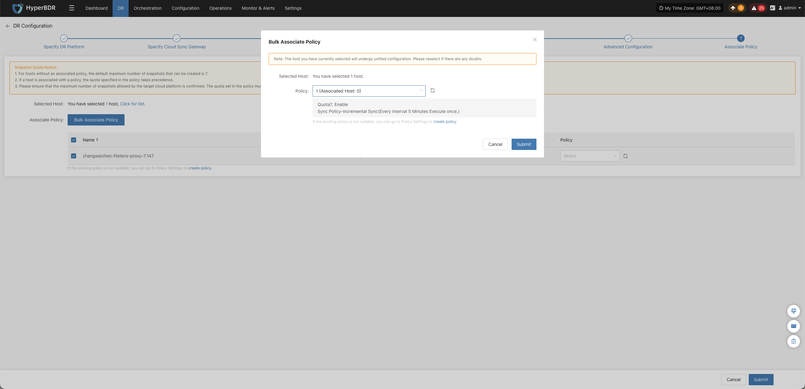

#### **Block Storage**

When configuring **Block Storage**, complete the following steps in sequence: **Specify DR Platform**, **Specify Cloud Sync Gateway**, **Computing Resource Configuration**, **Specify Volume Type**, **Network Configuration**, **Advanced Configuration**, and **Associate Policy**.

> **Note:** Available configuration options may vary depending on the target cloud platform, but the general workflow remains identical. This section illustrates the procedure using Huawei Cloud.

#### Specify DR Platform

**Prerequisites:**

- Completed block storage target configuration (see "Complete DR Target Configuration" in Preparation).
- Completed Cloud Sync Gateway initialization (the gateway initializes automatically once block storage is properly configured).

**Operation Steps:**

1. Under **"Storage Configuration"**, set **"Select Storage Type"** to **"Block Storage"**.
2. In the **"Select Storage Platform"** dropdown, select your configured block storage platform.
3. In the **"Select Platform Account"** dropdown, select the target cloud account.
4. Select the **Region** and **Zone** where the Cloud Sync Gateway is deployed.
5. Click **"Next"** to proceed to [**"Specify Cloud Sync Gateway"**](../host-dr.html#specify-cloud-sync-gateway).

###### **Storage Configuration**

| Parameter | Configuration | Description |
| --- | --- | --- |
| Select Storage Type | Block Storage | Select block storage as the disaster recovery storage type. Block storage must be configured before use. |
| Select Storage Platform | Added block storage platform | Select the block storage platform that has been added and configured. |
| Select Platform Account | Configured cloud account | Select the cloud account corresponding to the selected storage platform. If no account is available, click **"Please click here to create"** on the page to jump to the block storage configuration page. For details, see [Block Storage Configuration](../../configuration/storage-configuration.md#block-storage). |

###### **Source Sync Settings**

> **Note:** This is an optional advanced configuration. Unless you have specific requirements, it is recommended to keep the default settings.

| Parameter | Configuration | Description |
| --- | --- | --- |
| Maximum CPU Usage (%) | 30 | Effective only for VMware hosts with VMware Tools installed. |
| Encryption | Yes / No | Effective only for VMware hosts with VMware Tools installed. |
| Compression | Yes / No | Effective only for VMware hosts with VMware Tools installed. |
| VMware Quiesced Snapshot | Yes / No | Effective only for VMware hosts with VMware Tools installed. |

#### Specify Cloud Sync Gateway

**Prerequisites:** Completed the "Specify DR Platform" configuration.

**Operation Steps:**

1. In the Cloud Sync Gateway list, select the Cloud Sync Gateway to use.
2. In the "Unassigned Hosts" list, find the host to synchronize, and click **"+"** in the corresponding row to add it to the assigned hosts list.

3. In the "Assigned Hosts" list, you can view the assigned hosts. To unassign a host, click **"x"** in the corresponding row.
4. After confirming that the Cloud Sync Gateway and host assignments are correct, click **"Next"** to enter [**"Computing Resource Configuration"**](../host-dr.html#computing-resource-configuration).

###### **Configuration Parameter Description:**

| Parameter | Configuration | Description |
| --- | --- | --- |
| Cloud Sync Gateway | Available Cloud Sync Gateway list | Used to select the Cloud Sync Gateway that executes data synchronization tasks. |
| Unassigned Hosts | List of hosts to assign | Displays hosts that have not yet been assigned a Cloud Sync Gateway. Click **"+"** to add a host to the assigned hosts list. |
| Assigned Hosts | List of assigned hosts | Displays hosts assigned to the Cloud Sync Gateway. Click **"x"** to cancel assignment. |

##### **Computing Resource Configuration**

Configure parameters such as CPU, memory, and operating system type for the hosts to be recovered, and set the target boot mode.

**Operation Steps:**

1. In the host list, select the virtual machines to configure.
2. The system automatically matches target boot specifications consistent with the source host by default. If the auto-matched result does not meet your needs, or if you need to adjust target instance specifications, click **"Modify Flavor"** to configure CPU and memory specifications for the selected virtual machine in the pop-up list.
> **Flavor Matching Note:** If a preset template consistent with the resource type exists, the system automatically matches it; otherwise, you need to manually select the appropriate configuration.
3. The system automatically matches a target boot mode consistent with the source host by default. If the auto-matched result is incorrect or unrecognized, click **"Modify"** to adjust manually.
> **Note:** When the source host uses UEFI boot mode, the target boot mode can be BIOS or UEFI. If the system disk capacity exceeds 2 TB, BIOS boot mode cannot be selected. Not all target platforms support configuring target boot modes; please refer to the actual page display.
4. The system automatically matches an operating system type consistent with the source host by default. If the automatic identification is incorrect or unrecognized, you can manually select the target boot mode via the drop-down list.
5. After completing computing resource configuration, click **"Next"** to enter [**"Specify Volume Type"**](../host-dr.html#specify-volume-type).

###### **Batch Configuration Description**

Supports batch configuration of flavor, target boot mode, and OS type.

**Operation Steps:**

1. In the host list, select the hosts to configure in batch.
2. Click the corresponding batch operation button based on the parameters to configure:
    - **Bulk Set Flavor**: Batch configure target instance specifications for selected virtual machines.
    - **Bulk Auto Match Flavor**: Batch auto-match target instance specifications for selected virtual machines.
    - **Bulk Set Target Boot Mode**: Batch configure target boot modes for selected virtual machines.
    - **Bulk Set OS Type**: Batch configure operating system types for selected virtual machines.
3. In the pop-up dialog box, complete the corresponding configurations, and follow the page prompts to confirm and submit.

##### **Specify Volume Type**

Specify the volume type on the target cloud platform for the disks of the hosts to be recovered.

**Operation Steps:**

1. In the host list, set the target volume type for system disks, data disks, and newly added disks. You can configure in batch using the list above or configure host by host in the host list.
2. When a host contains multiple disks, select the boot disk individually for each host in the **"Set Boot Disk"** column.

   > **Note:** When a host contains multiple disks, you must select the boot disk individually for each host to ensure the system can boot properly.

3. After completing volume type configuration, click **"Next"** to enter [**"Network Configuration"**](../host-dr.html#network-configuration).

**Parameter Description:**

| Configuration Item | Example Value | Description |
| --- | --- | --- |
| System Volume Type | Ultra-high / IO | Set the cloud disk type used when the system disk is recovered to the target cloud platform. The system disk is usually also the boot disk; ensure the volume type is configured properly, otherwise host boot may be affected. Once block storage synchronization starts, modifying this configuration is not supported. |
| Data Volume Type | Ultra-high / IO | Set the cloud disk type used when existing data disks are recovered to the target cloud platform. You can configure in batch using the list above or configure host by host in the host list. |
| Target Volume Type for New Disks | Ultra-high / IO | Set the default target volume type for disks newly added to the source host after disaster recovery configuration is completed. This configuration only takes effect for newly added disks and does not affect existing disks. |

##### **Network Configuration**

Configure target network, private IP, public IP, security group, and MAC address parameters for the hosts to be recovered to satisfy network connection requirements on the target platform.

###### **Single NIC**

**Operation Steps:**

> If a host has multiple NICs that need separate configurations, follow the "Multiple NICs" section.

1. Select the network and subnet according to the deployment requirements of the DR host.
2. By default, private IP is set to Not Specified. You can set a specified private IP or retain the original IP according to your requirements.
3. By default, public IP is set to Do Not Assign. You can choose Assign Public IP, Apply for Public IP, or Shared Bandwidth according to your requirements.
4. Set the MAC address according to cloud platform support.
5. Select a security group based on the target network, defaulting to default.
6. After **Network Configuration** is complete, click **"Next"** to enter [**"Advanced Configuration"**](../host-dr.html#advanced-configuration).

###### **Batch Configuration Description**

Supports batch configuration of private IP, public IP, specified MAC address, and security group.

**Operation Steps:**

1. In the host list, select the hosts to configure in batch.
2. Click the corresponding batch operation button based on the parameters to configure:
    - **Bulk Set Private IP**: Set private IP allocation type.
    - **Bulk Set Public IP**: Set public IP allocation type.
    - **Bulk Set Fixed MAC**: Set MAC address allocation type.
    - **Bulk Set Security Group**: Select the security group to configure.
3. In the pop-up dialog box, complete the corresponding configurations, and follow the page prompts to confirm and submit.

###### **Multiple NICs**

**Operation Steps:**

1. **Add NIC:**

> **Note:** Adding a NIC is optional. If you do not need to add a new NIC, you can directly configure existing NICs of the source host and skip this step.

- In the host list, find the host where a NIC needs to be added, click **"Add NIC"**, and add a new NIC for the selected host.

   

2. **Modify or Remove NIC:**

- In the NIC list, find the NIC to operate on.
   
   - To modify NIC configuration, click **"Modify"**, and configure parameters such as network, subnet, private IP, public IP, MAC address, and security group for the NIC according to actual needs.
   
   - To delete a NIC, click **"Remove"**.

   

3. After completing network configuration, click **"Next"** to enter [**"Advanced Configuration"**](../host-dr.html#advanced-configuration).

###### **IP Setting Rules**

> Support for the following functions varies slightly across different cloud platforms; please refer to actual conditions.

| Parameter | Configuration Option | Description |
| --- | --- | --- |
| Network | Target DR network name | Specify the target network accessed by the DR host. |
| Subnet | Target DR subnet name | Specify the subnet in the target network. |
| Private IP | Original IP | Retain the source host IP address. Requires that the target subnet matches the source host original network and ensures no IP conflict occurs after allocation. The system assigns IP addresses via DHCP service. |
|  | Specified IP | Manually specify a private IP. The specified IP address range must match the target subnet. The system assigns the specified IP address via DHCP service. |
|  | Not Specified | Do not manually specify a private IP; the DHCP service automatically assigns an IP address based on the target network. If DHCP service is unavailable, the system cannot automatically configure an IP. |
| Public IP | Do Not Assign | Do not assign an Elastic IP to the host. The host cannot communicate directly with the Internet via Elastic IP. |
|  | Assign IP | Select an existing Elastic IP from the drop-down list and assign it to the host. |
|  | Apply for IP | Automatically apply for an Elastic IP for each host and assign dedicated bandwidth. |
|  | Shared Bandwidth | Select an existing shared bandwidth Elastic IP from the drop-down list and assign it to the host. |
| MAC Address | Original MAC | Retain the source host MAC address. This capability is not supported by all cloud platforms; please refer to actual conditions. |
|  | Specified MAC | Manually specify the target host MAC address. This capability is not supported by all cloud platforms; please refer to actual conditions. |
|  | Do Not Assign | Do not specify a MAC address; the target cloud platform will automatically create the corresponding MAC address for the host, subject to the cloud platform. |
| Security Group | Configured by target network | Select security groups based on the target network; specific options are subject to the actual page display. |

##### **Advanced Configuration**

Configure parameters such as custom scripts, driver adaptation, network recovery, and boot advanced settings for the hosts to be recovered to satisfy recovery and boot requirements on the target platform.

**Operation Steps:**

> Advanced configuration is optional; usually no modification is needed, and you can proceed directly to the next step. If you have special requirements, please adjust with caution.

1. In the host list, click **"Configure"** on the right side of the row for the host to configure.

2. Configure parameters such as custom pre/post scripts, driver adaptation, recovery host network, and boot advanced settings according to actual needs and page prompts.
3. After completing advanced configuration, click **"Next"** to enter [**"Associate Policy"**](../host-dr.html#associate-policy-1).

>**Note:** At this point, the page will prompt: "Before configuring policies, already configured hosts will automatically enter the third step **'Start DR'**." Please confirm the prompt and click confirm to continue.

> **Description:** The host entering the "Start DR" state does not mean initial synchronization has started. The initial full synchronization still requires clicking **"Sync"** in the third step **"Start DR"**; for specific operations, see [Sync Operation Description](../host-dr.html#sync).

###### **Custom Pre & Post Scripts**

Custom pre and post scripts are used to execute specified operations during the host recovery process, including modifying configuration files, starting or stopping services, etc.

| Configuration Item | Function Description |
| --- | --- |
| Custom Pre-script | Executed before the host boots, can be used to modify configuration files on the system disk. When modifying data on other disks, post-scripts are recommended. Linux uses Bash syntax, Windows uses bat format. |
| Custom Post-script | Executed after system boots, can be used to start or stop services, modify configuration files, write to Windows registry, etc. Linux uses Bash syntax, Windows uses bat format. |

For specific usage, see [Custom Pre & Post Scripts Best Practices](/userguide/technical-practices/script-best-practices.md).

###### **Driver Adaptation Settings**

Driver adaptation is used to configure driver processing and network adaptation options before host boot to improve host boot success rate on the target platform.

| Configuration Item | Function Description |
| --- | --- |
| Driver Injection | Applicable to scenarios where driver adaptation needs to be skipped; recommended only when booting hosts on the same virtualization platform. Skipping driver adaptation may cause the host to fail to boot properly; proceed with caution. |
| File System Repair | When enabled, attempts to repair the file system using file system integrity check and repair tools, such as `xfs_repair`. This option may increase driver adaptation execution time. |
| Enable DHCP | When enabled, automatically modifies operating system network configuration files to adjust network configuration to DHCP mode. Target cloud platforms usually allocate IP addresses via DHCP; it is recommended to enable this when targeting cloud platforms, otherwise the host may fail to obtain an IP address. |
| Source OS Version | Supports automatic detection of source operating system version. |

###### **Transition Host Network Settings**

Used to configure whether the Cloud Sync Gateway can access the recovery host network, allowing flexible system configuration based on actual network connectivity.

| Configuration Item | Function Description |
| --- | --- |
| Can the Cloud Sync Gateway Access the Recovery Host Network? | Select based on connectivity between Cloud Sync Gateway and recovery host network. If the Cloud Sync Gateway can access the recovery host network, select "Yes"; if it cannot access directly, select "No". |

###### **Boot Advanced Settings**

Used to configure custom metadata, extended parameters, and dedicated host options when the recovery host boots to satisfy specific cloud server creation and boot requirements.

| Configuration Item | Function Description |
| --- | --- |
| Custom Metadata | Used to set custom metadata needed when the host boots; configuration items can be added or deleted via Key and Value. |
| Extended Parameters (Extendparam) | Used to pass additional configuration parameters when creating cloud servers to customize resource behavior, billing mode, and advanced settings. For details, please refer to help documentation. |
| Boot to Dedicated Host | Select whether to boot the recovered host onto a dedicated host. When selecting "Yes", the dedicated host must be created in advance, otherwise boot failure may occur. |

##### **Associate Policy**

Associate disaster recovery policies with hosts to be recovered to configure parameters such as data synchronization execution time, sync speed, and snapshot retention count to satisfy different DR management requirements.

**Prerequisites:**

A corresponding policy must be created before association. If no policy exists in the system to bind to the host or existing policies cannot meet requirements, click the create policy button on the page. For creation methods, see [Policy Settings](../../configuration/policy-settings.md).

**Operation Steps:**

> **Description:** You can choose to associate a policy in the current step, or temporarily skip this step and click confirm directly to enter the third step [**"Start DR"**](../host-dr.html#start-dr), and associate later according to actual requirements.

1. In the host list, find the host to associate with a policy.
2. In the drop-down list on the right side of the corresponding row, select the policy to associate. If a created policy is not displayed, click the refresh button next to the drop-down list to refresh the policy list.
3. After selection, click **"Confirm"** to complete policy association and enter the third step [**"Start DR"**](../host-dr.html#start-dr).

###### **Batch Associate Policy**

1. In the host list, select the hosts to associate with policies.
2. Click **"Batch Associate Policy"**.
3. In the pop-up dialog box, select the policy to associate.
4. Click **"Confirm"** to complete batch association.
5. After selection, click **"Confirm"** to complete policy association and enter the third step [**"Start DR"**](../host-dr.html#start-dr).

