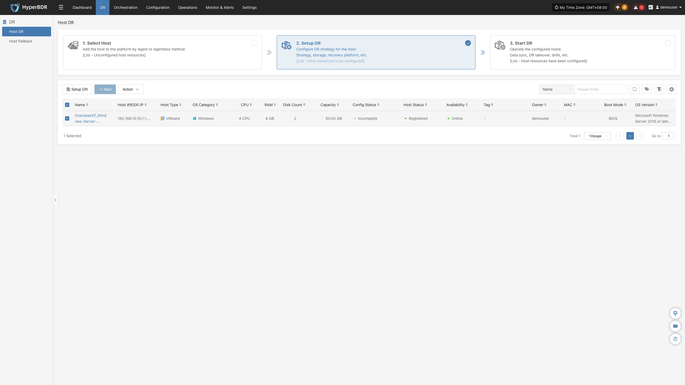

<!-- #region setup-dr-intro -->
## **Setup DR**

Go to **DR** > **Host DR** > **Setup DR**, select one or more hosts, and click **"Setup DR"** to configure disaster recovery parameters.

The **"Setup DR"** page provides three primary actions: **"Setup DR"**, **"Next"**, and **"Action"**.

### **Setup DR**

Click **"Setup DR"** to configure replication targets for the selected hosts. Two storage modes are supported: [**"Block Storage"**](../host-dr.html#block-storage) and [**"Object Storage"**](../host-dr.html#object-storage).

::: tip
The configuration workflow order may vary slightly across cloud platforms (for example, configuring volume types before compute resources, or vice versa). Follow the on-screen wizard for your target platform.
   :::
<!-- #endregion setup-dr-intro -->

<!-- #region setup-dr-shared -->
### **Next**

Once disaster recovery configuration is completed, configured hosts automatically advance to Step 3, [**"Start DR"**](../host-dr.html#start-dr). Manually clicking **"Next"** is not required.

### **Action**

The **"Action"** menu items in this step match those in Step 1. For details, refer to [**"Action" in Select Host**](../host-dr.html#action).

<!-- #endregion setup-dr-shared -->
