## **Start DR**

Go to **DR** > **Host DR** > **Start DR**, select one or more hosts, and click **"Sync"** to start the initial full data synchronization.

> **Note:** Initial data synchronization must complete successfully before executing drills or takeover.

### **Sync**

Select the hosts to replicate and click **"Sync"** to initiate the initial full synchronization.

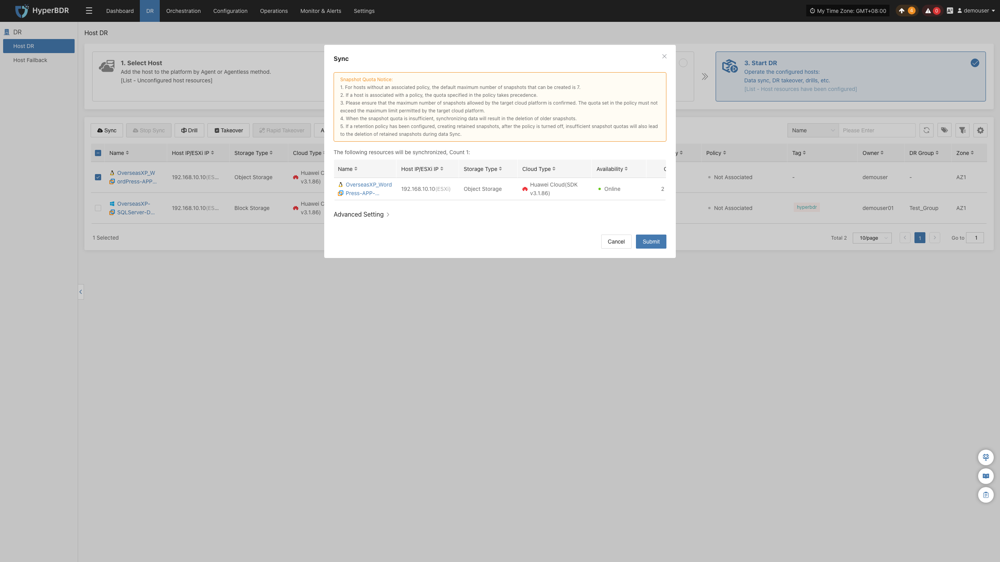

Review the prompt in the confirmation dialog, then click **"Confirm"** to start syncing.

Wait for data synchronization to complete before proceeding. You can click "Click for details" in the table to monitor synchronization progress and host status.

| View Entry | Description |
| --- | --- |
| Host Status | Click "Click for details" to view host running status and data synchronization details. |
| Task Status | Click "Click for details" to view task execution status and data synchronization progress. |
| Startup Status | Click "Click for details" to view host startup status and boot progress. |

### **Stop Sync**

While synchronization is in progress and after volume preparation has completed, you can click **"Stop Sync"** to cancel the synchronization task.

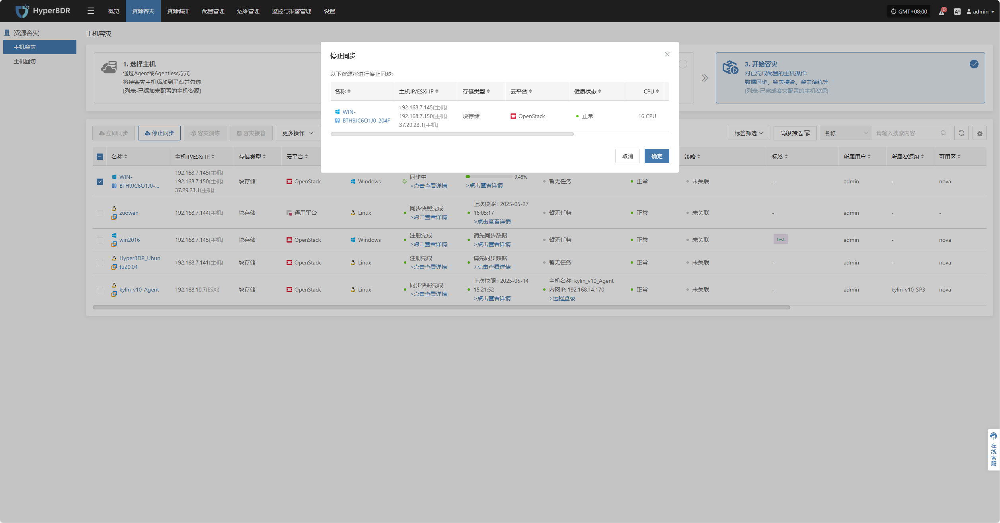

> **Note:** Stopping synchronization is only supported while a sync task is actively running.

### **Drill**

Select the host, click **"Drill"**, choose a recovery point, and restore the host to the target environment for testing.

HyperBDR automatically launches instances on the target platform based on your preconfigured compute, storage, and networking resources. Once the instance is running, log in to verify configurations and test application services.

After recovery, verify that application services, databases, and network connectivity function properly.

### **Takeover**

Select the production host, click **"Takeover"**, choose a recovery snapshot point, and click **"Confirm"** to perform failover takeover.

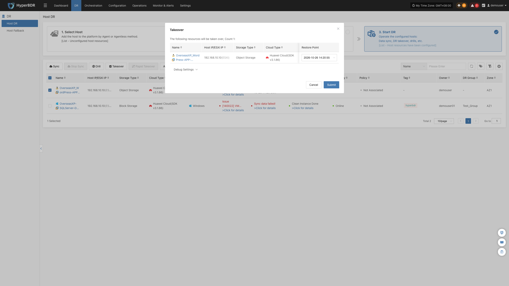

HyperBDR launches target instances based on your configured resource orchestration. Once instances start, log in to the target platform to validate business operations and switch production traffic.

After services are online, verify database consistency, application configurations, and dependent services (such as caches and message queues).

### **Rapid Takeover**

Rapid Takeover allows you to take over workloads instantly by directly utilizing target disks on the Cloud Sync Gateway without creating new cloud storage volumes. Once Rapid Takeover is executed, ongoing synchronization is stopped and cannot be resumed. This feature is supported only in Block Storage mode.

1. Select one or more hosts and click **"Rapid Takeover"** on the Host DR page.

2. In the dialog, click **"Disassociate Policy"**. Once the policy status updates to **"No Policy"**, click **"Next"**.

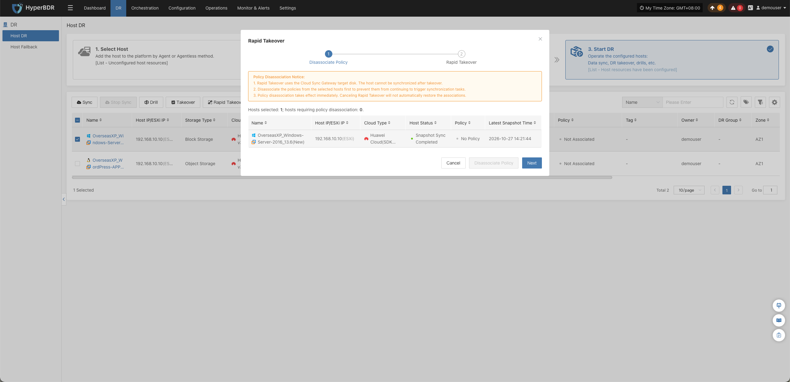

3. Select the hosts for rapid takeover, check "I acknowledge the impact of rapid takeover and confirm to continue.", and click **"Confirm Rapid Takeover"** to begin takeover.

### **Action**

Click "Action" to perform configuration adjustments and other management operations on already configured hosts.

#### **Specify DR Platform**

> Note: Hosts that have completed data synchronization do not support modification.

Click **"Specify DR Platform"** to modify the disaster recovery target platform used by the host. For specific operations, see:

Block Storage: [Click here to view](#specify-dr-platform)

Object Storage: [Click here to view](#specify-dr-platform-1)

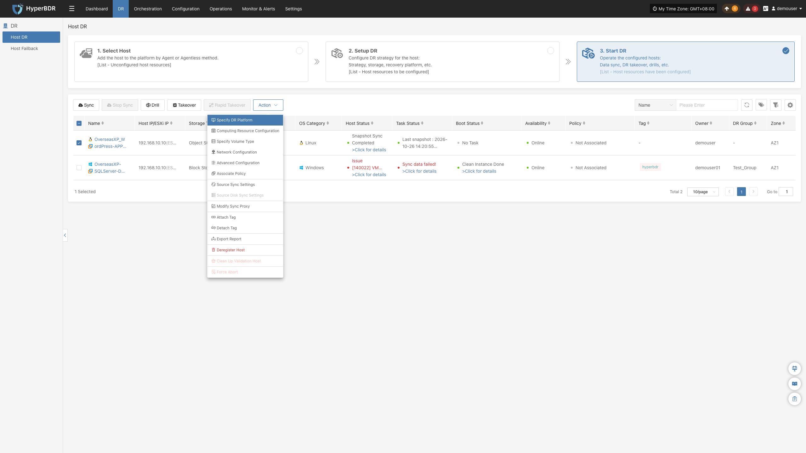

#### **Specify Cloud Sync Gateway**

> Note: Hosts that have completed data synchronization do not support modification.

Click **"Specify Cloud Sync Gateway"** to modify the Cloud Sync Gateway used by the host. For specific operations, see:

Block Storage: [Click here to view](#specify-cloud-sync-gateway)

#### **Specify Volume Type**

> Note: Hosts that have completed data synchronization do not support modification.

Click **"Specify Volume Type"** to modify the target volume type. For specific operations, see:

Block Storage: [Click here to view](#specify-volume-type)

Object Storage: [Click here to view](#specify-volume-type-1)

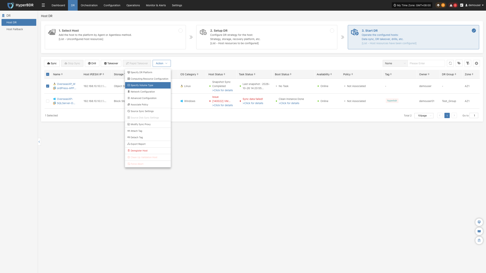

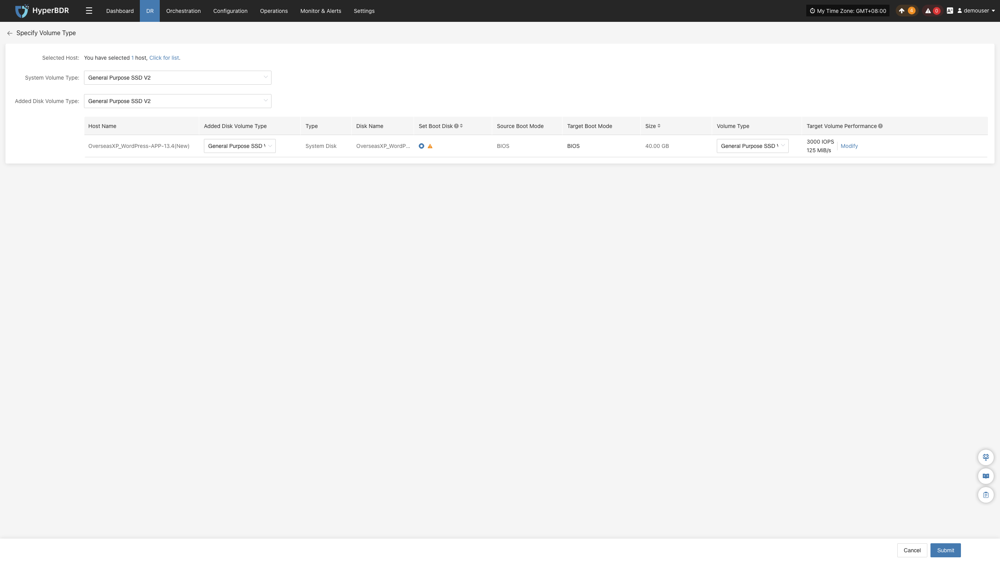

#### **Computing Resource Configuration**

> Note: Hosts that have completed data synchronization do not support modification.

Click **"Computing Resource Configuration"** to adjust computing resource configuration on the target side. For specific operations, see:

Block Storage: [Click here to view](#computing-resource-configuration)

Object Storage: [Click here to view](#computing-resource-configuration-1)

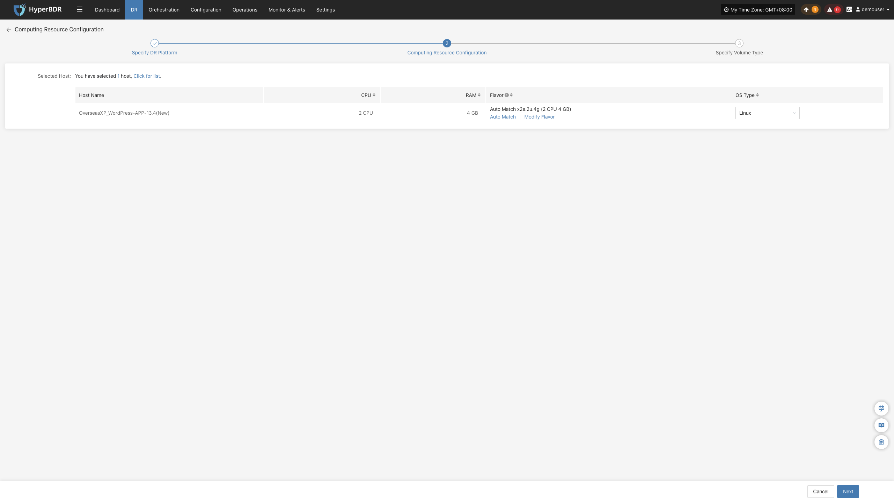

#### **Network Configuration**

> Note: Hosts that have completed data synchronization do not support modification.

Click **"Network Configuration"** to adjust network configuration on the target side. For specific operations, see:

Block Storage: [Click here to view](#network-configuration)

Object Storage: [Click here to view](#network-configuration-1)

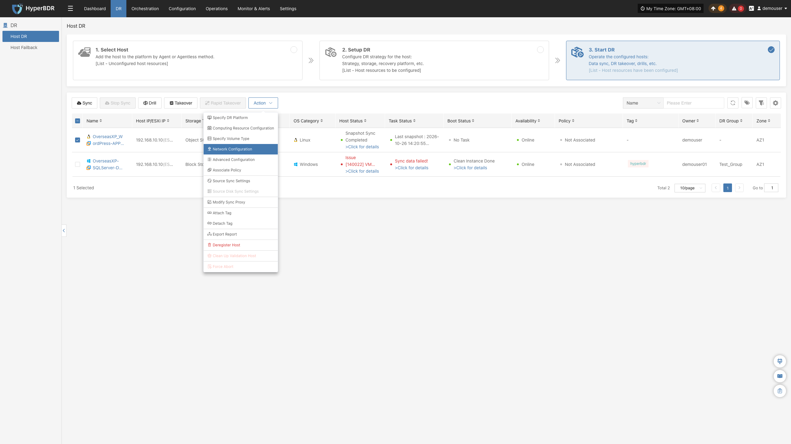

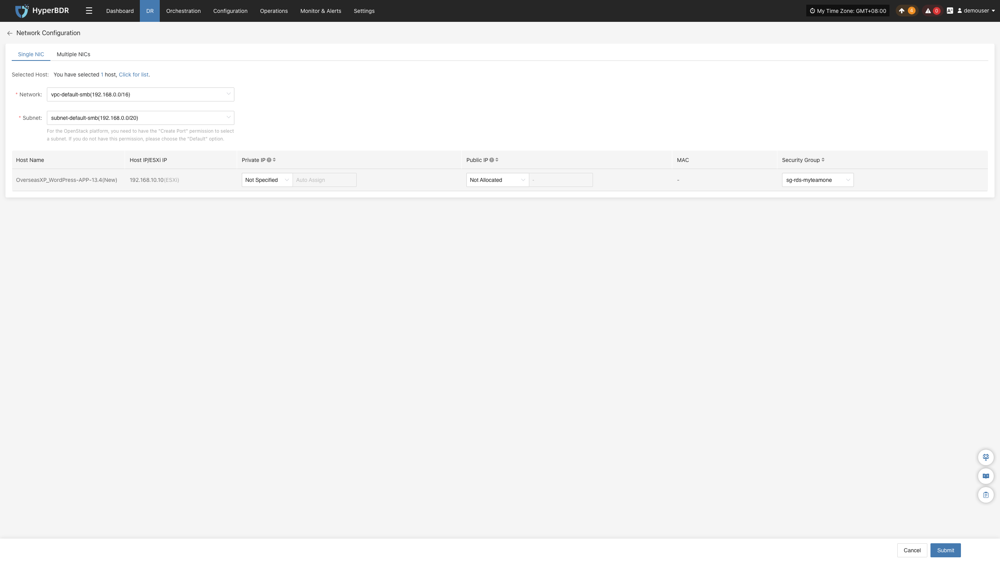

#### **Advanced Configuration**

Click **"Advanced Configuration"** to adjust advanced configuration items on the target side. For specific operations, see:

Block Storage: [Click here to view](#advanced-configuration)

Object Storage: [Click here to view](#advanced-configuration-1)

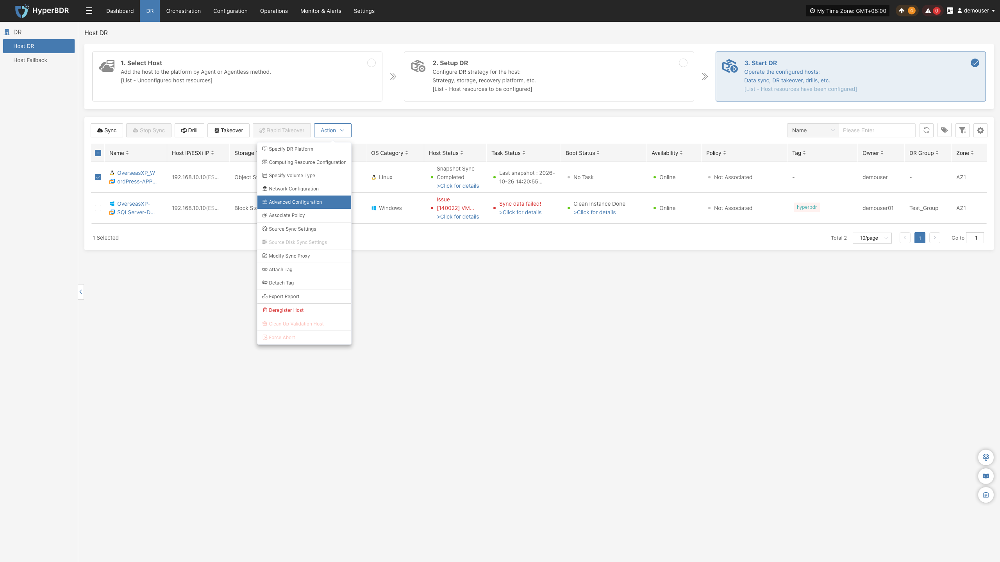

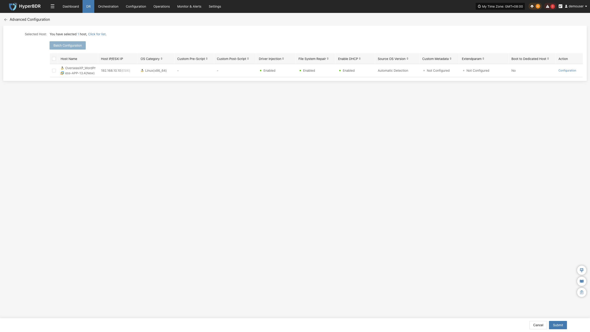

#### **Associate Policy**

Click **"Associate Policy"** to adjust disaster recovery policies associated with the host. For specific operations, see:

Block Storage: [Click here to view](#associate-policy)

Object Storage: [Click here to view](#associate-policy-1)

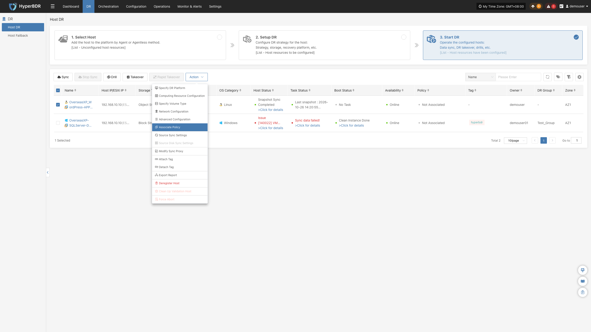

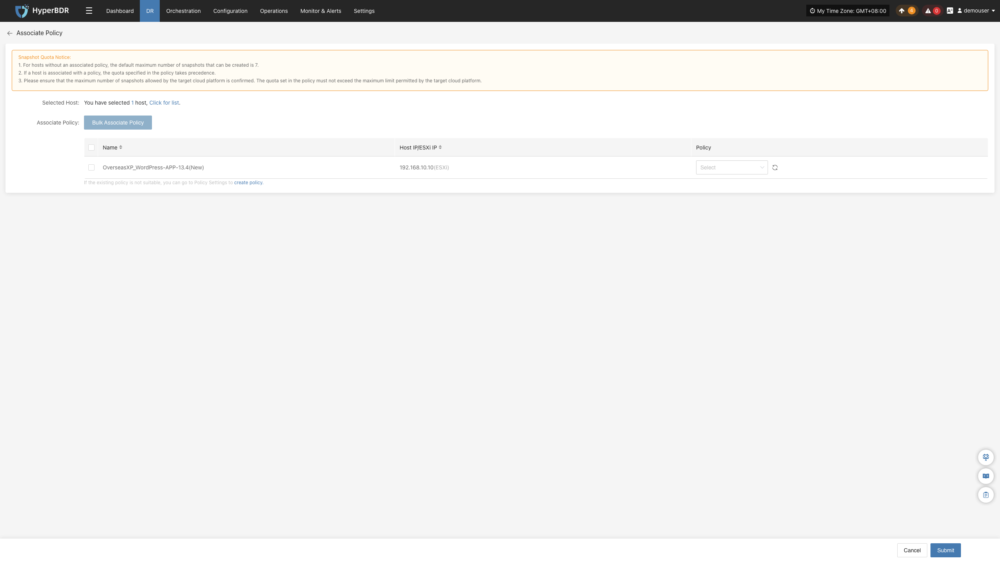

#### **Source Sync Settings**

Used to configure source synchronization parameters for backup hosts to satisfy synchronization requirements in different scenarios.

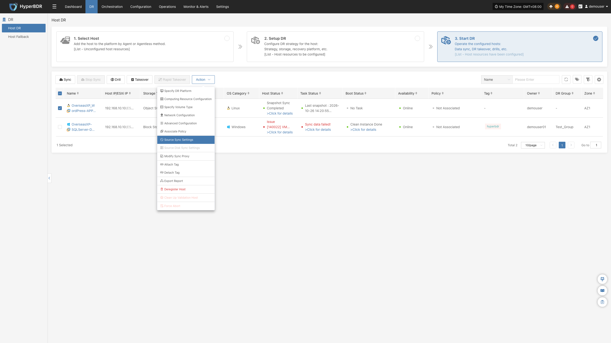

##### **General Settings**

> This configuration applies to Linux Agent, Windows Agent, and Agentless modes. Interface layout or configuration location may vary slightly across different modes; please refer to the actual interface display.

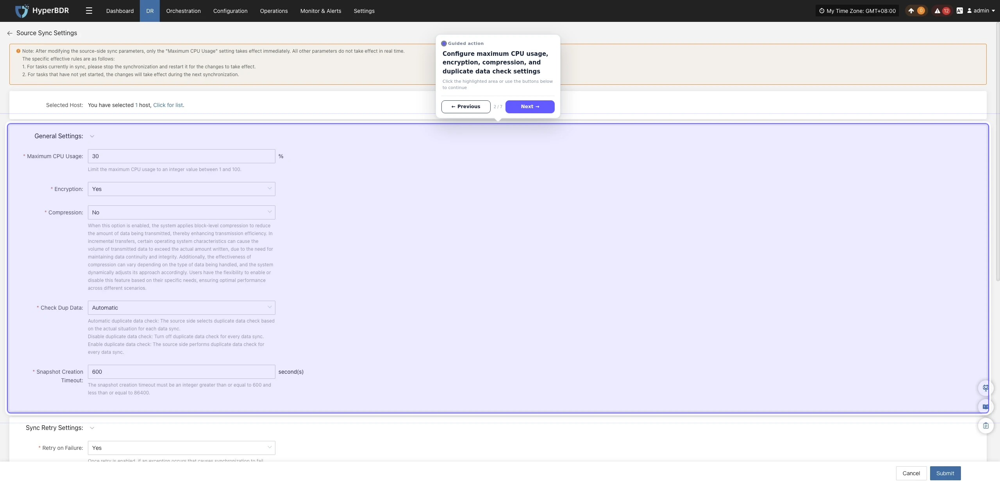

| Parameter | Configuration | Description |
| --- | --- | --- |
| Maximum CPU Usage (%) | 30 | Limits the maximum CPU percentage available for backup tasks. A higher value increases backup speed but also has a greater impact on source host services. It is recommended to set reasonably based on service load; usually keep the default. |
| Available Memory (MB) | 1024 | Remaining available memory size in the system, range: integer from 700 to 1024. |
| Enable Encryption | Yes | When enabled, transmitted data will be encrypted to improve data security, but increases CPU consumption and may cause backup speed to slightly decrease. |
| Enable Compression | No | When enabled, data is compressed before transmission to reduce network transmission volume, suitable for scenarios with low network bandwidth. Since different data types have different compression effects, actual data savings vary, and the system automatically selects an appropriate compression strategy. |
| Deduplication Check | Automatic | Used to detect and skip duplicate data to reduce data transmission volume. **Automatic**: The system automatically determines whether to perform deduplication checks based on actual conditions (recommended). **Enabled**: Performs deduplication checks on every synchronization. **Disabled**: Does not perform deduplication checks on any synchronization. |
| Reserved Volume Space (%) | 3 | Proportion of remaining available space on Windows Agent volumes, range: greater than or equal to 0 and less than or equal to 99. |
| Snapshot Creation Timeout (s) | 600 | Maximum wait time allowed for snapshot creation, in seconds. Range: **600–86400**. If snapshot creation is not completed within this time, the task is judged as failed. For environments with longer snapshot creation times, this value can be appropriately increased. |

##### **Sync Thread Settings**

> This configuration applies to Agentless mode. Interface layout or configuration location may vary slightly across different modes; please refer to the actual interface display.

| Parameter | Configuration | Description |
| --- | --- | --- |
| VMware Quiesced Snapshot | No | Applicable only to VMware virtual machines with **VMware Tools** installed. When enabled, helps ensure file system consistency as much as possible during snapshot creation; recommended to enable based on business needs. |
| Read Threads | Auto-adapt | Sets the number of data read threads for a single host. Uses **Auto-adapt** mode by default; the system automatically adjusts threads (1–10) based on source sync proxy resource configuration and number of disks to synchronize without manual configuration. Only when further synchronization performance optimization is needed, use **Custom** mode (1–100), recommended not to exceed 30 threads. In 10GbE and higher network environments, threads can be appropriately increased after upgrading source sync proxy resources (e.g., 8-core CPU, 16 GB memory and above) to boost performance. |
| Write Threads | Auto-adapt | Sets the number of data write threads for a single host. Uses **Auto-adapt** mode by default; the system automatically adjusts threads (1–10) based on source sync proxy resource configuration and number of disks to synchronize without manual configuration. Only when further synchronization performance optimization is needed, use **Custom** mode (1–100), recommended not to exceed 30 threads. In 10GbE and higher network environments, threads can be appropriately increased after upgrading source sync proxy resources (e.g., 8-core CPU, 16 GB memory and above) to boost performance. |
| Multi-disk Concurrent Read/Write | Yes | Controls whether to read and write data to multiple disks concurrently during synchronization. When enabled, synchronizes multiple disks concurrently to improve efficiency; when disabled, disks are synchronized sequentially, suitable for scenarios requiring lower system resource consumption. |

##### **Sync Retry Settings**

> This configuration applies to Linux Agent, Windows Agent, and Agentless modes. Interface layout or configuration location may vary slightly across different modes; please refer to the actual interface display.

| Parameter | Configuration | Description |
| --- | --- | --- |
| Retry | Yes | When enabled, if synchronization is interrupted due to temporary faults such as network anomalies, the system automatically attempts to reconnect and continue synchronization; when disabled, failed synchronization ends directly without automatic retries. |
| Max Retries | 3 | Sets the maximum number of retries after synchronization fails, range: **1–100**. If connection is still not recovered after reaching maximum retries, the synchronization task is judged as failed. |
| Interval (s) | 60 | Sets the waiting time between two retries, in **seconds**, range: **1–3600**. Appropriately increasing interval time helps wait for network recovery and avoid frequent retries. |

##### **Sync Thread Settings**

> This configuration applies to Linux Agent and Windows Agent modes. Interface layout or configuration location may vary slightly across different modes; please refer to the actual interface display.

| Parameter | Configuration | Description |
| --- | --- | --- |
| Sync Threads | 2 | Sets the number of threads used by synchronization tasks. Appropriately increasing threads boosts synchronization performance but consumes more system resources. Range: **1–64**, recommended to adjust reasonably based on host resource configuration. |
| Sync Memory Size (MB) | 8 | Sets the memory size available for synchronization tasks. Appropriately increasing this value helps boost synchronization performance but increases memory consumption. Range: **1–1024**, recommended to set reasonably based on host available memory. |

##### **Object Upload Settings**

> This configuration applies to Linux Agent mode. Interface layout or configuration location may vary slightly across different modes; please refer to the actual interface display.

| Parameter | Configuration | Description |
| --- | --- | --- |
| Connection Timeout (s) | 120 | Sets the maximum waiting time to establish a connection when uploading objects, in **seconds**. Range: **1–1800**. If a connection is not established within this time, the connection is judged as timed out. |
| Send MD5 Digest | Yes | When enabled, sends an MD5 digest during object upload for data integrity validation to help detect potential data corruption during transmission. |
| Multipart SHA256 Verification | No | When enabled, performs SHA256 verification on each data part during multipart upload to further enhance data transmission integrity verification, but may increase computational overhead. |

##### **Volume VSS Storage Settings**

> This configuration applies to Windows Agent mode. Interface layout or configuration location may vary slightly across different modes; please refer to the actual interface display.

| Parameter | Configuration | Description |
| --- | --- | --- |
| Volume General Ratio (%) | 10 | Sets the default proportion of disk space that VSS snapshot storage can occupy, in **%**. Range: **5–100**. This configuration is used when VSS storage space is not individually configured for a volume. |
| Volume Special Storage | `VSS_SPEC_MAX_C=d:10` | Separately set VSS snapshot storage location and capacity for specified volumes. **Single volume example:** `VSS_SPEC_MAX_C=d:10`, indicating storing volume **C**'s VSS snapshot on volume **D** with **10 GB** allocated storage space. **Multi-volume example:** `VSS_SPEC_MAX_C=d:10;VSS_SPEC_MAX_E=f:10`, separated by semicolons (`;`). **Leave blank by default unless special requirements exist.** |
| Create VSS Snapshot Timeout (s) | 300 | Sets the maximum waiting time for creating VSS snapshots, in **seconds**. Value should be greater than or equal to **60**. If snapshot creation is not completed within this time, the operation is judged as failed. |
| Raw Data Sync Volume | F | Specifies partitions to synchronize using raw data mode without using VSS snapshots. Enter drive letters, separated by commas (`,`), for example: `F` or `E,F`. Suitable for partitions that do not require VSS consistency snapshots. **Leave blank by default unless special requirements exist.** |

#### **Source Disk Sync Settings**

Used to configure source disk synchronization policies. When the source host contains multiple disks, you can configure whether each disk participates in synchronization. This feature applies only to hosts added via Agent mode.

> Note: This configuration is only supported before initial data synchronization; once synchronization starts, modification is no longer supported.

Select disks that do not need synchronization, change **Yes** in the last column of the corresponding row to **No**, and select confirm in the pop-up window to complete exclusion settings. Once set, subsequent synchronization tasks will no longer synchronize that disk.

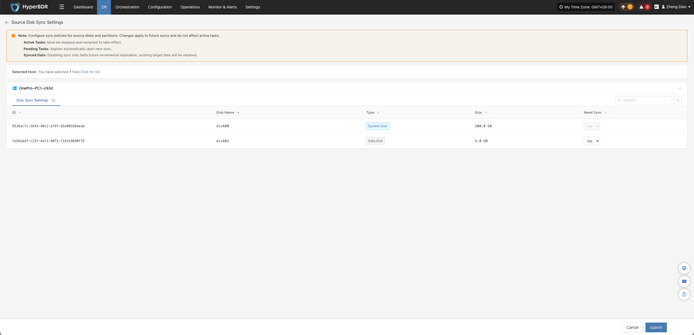

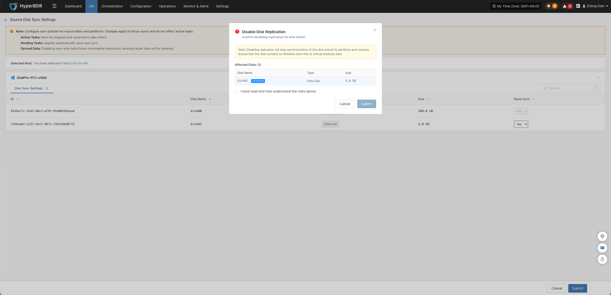

#### **Modify Sync Proxy**

> Note: Hosts that have completed data synchronization do not support modification.

Used to modify the source sync proxy associated with backup hosts to adjust the proxy node used for data synchronization.

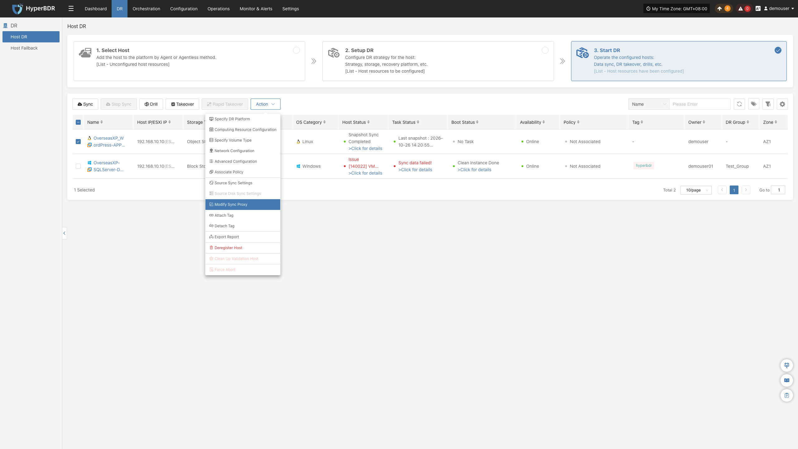

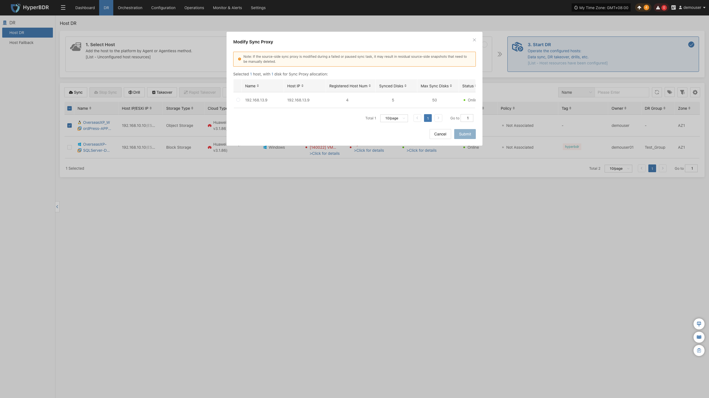

#### **Attach Tag**

Used to attach one or more tags to backup hosts for classified management based on business, environment, or purpose.

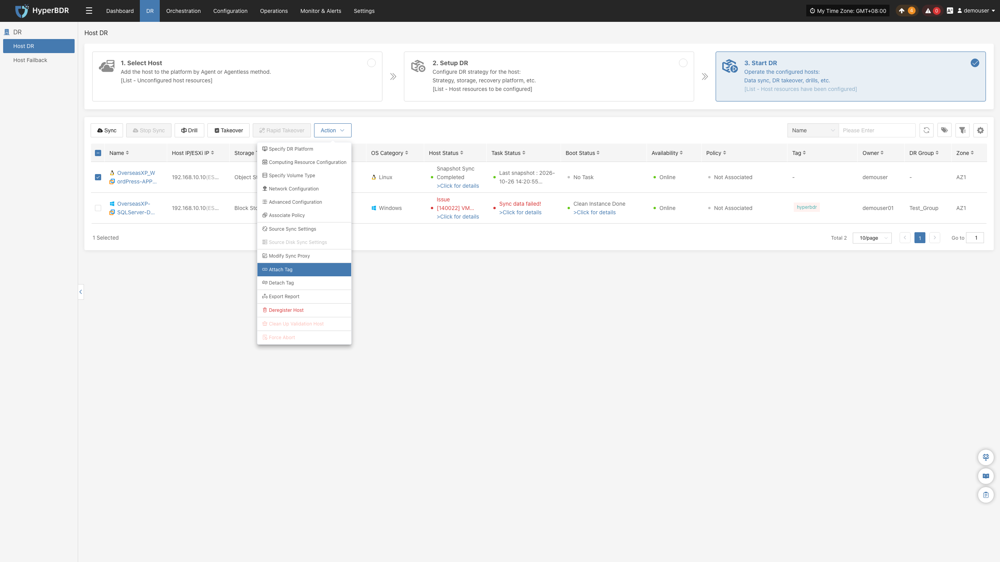

#### **Detach Tag**

Used to detach specified tags from backup hosts to adjust host tag classifications.

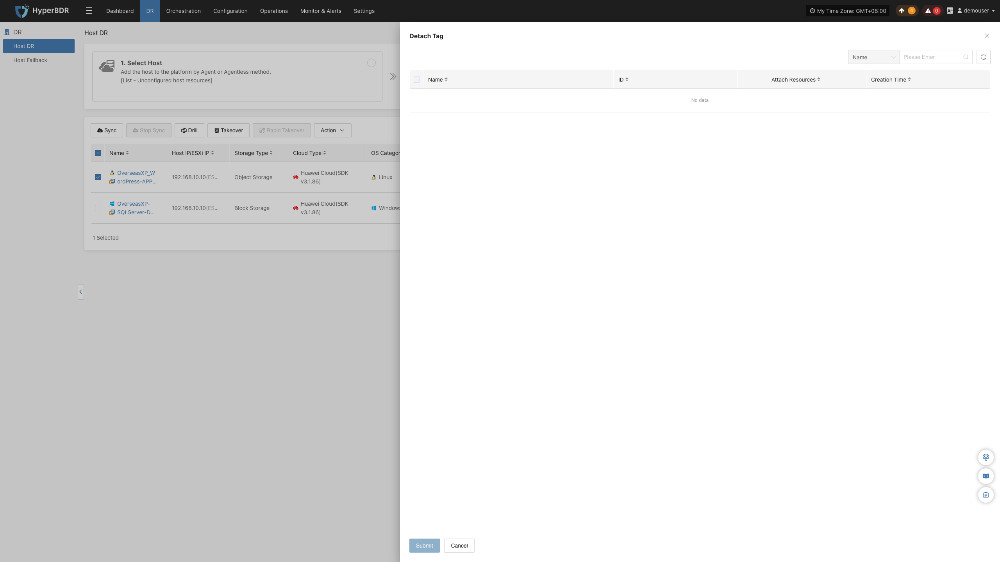

#### **Reports**

Click **"Report"** to export disaster recovery reports for selected hosts for viewing and archiving. You can select report types during export; for specific details, see [Report Export](../../operations/reports.html#report-export).

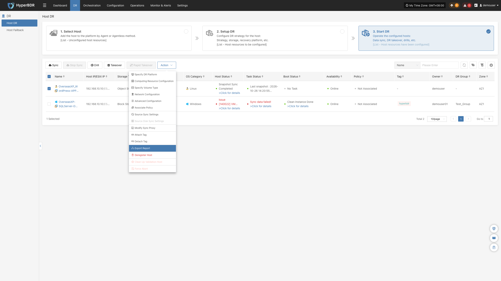

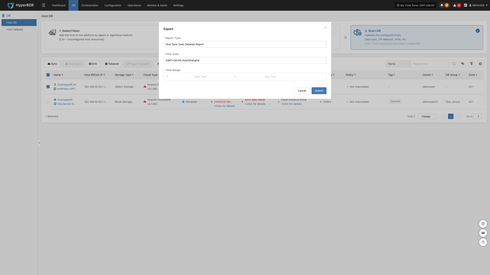

#### **Deregister Host**

Used to deregister backup hosts from the disaster recovery management platform and cancel the host's registration association with the platform. Click the **"Deregister Host"** button, carefully review precautions in the pop-up dialog box, and click confirm to complete deregistration.

> **Note:** Deregistration automatically cancels the service. Please reload hosts or restart Agent services based on the access mode:
>
> - **Agentless Mode:** In the "Select Host" step, select the corresponding production platform site, and then select the hosts to register.
> - **Agent Mode:** Log in to the source host and restart the Agent service.
>
> **Advanced Functions:**
>
> - **Clean Up Resources (Without Deregistering):** Applicable to hosts that need to reconfigure the DR platform after synchronization. This operation restores the host to its initial disaster recovery configuration state and clears all synchronized data. After cleanup is complete, you can reconfigure in the "Setup DR" step.
> - **Force Deregister:** Applicable to hosts that have lost connection. Check "I confirm that I want to force deregister the host, which may cause residual resources", and then select "Force Deregister".

#### **Clean Up Validation Host**

Used to clean up validation hosts booted in the cloud for the current host. This operation only cleans up hosts that have been booted in the cloud. Click the **"Clean Up Validation Host"** button, enter "Yes" in the pop-up dialog box, and click confirm.

#### **Force Abort**

> Note: When operations such as synchronization or drills freeze for a long time or encounter uncontrollable exceptions, this function can be used to forcibly terminate tasks.

Click the **"Force Abort"** button to immediately stop execution of the current task.

