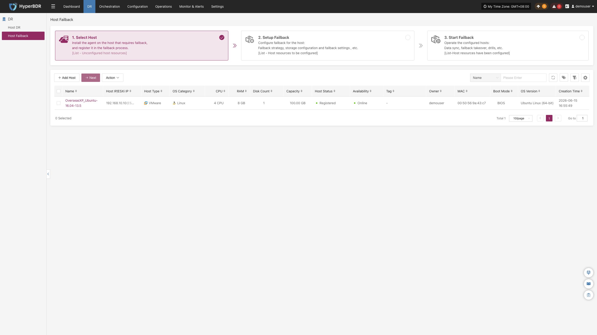

# Host Failback

Host Failback guides you through restoring workloads back to the source production environment after a drill or takeover has completed and the source site is recovered. The workflow mirrors the forward DR process in three key steps: **Select Host**, **Setup Failback**, and **Start Failback**.

To begin, click the top **"DR"** navigation bar and select **"Host Failback"** in the left sidebar.

The configuration logic in the failback setup stage follows the same principles as the Host DR workflow. For detailed descriptions and instructions for each setting, refer to the [**Host DR**](host-dr.md) guide. Once configuration is complete, proceed with the failback execution.