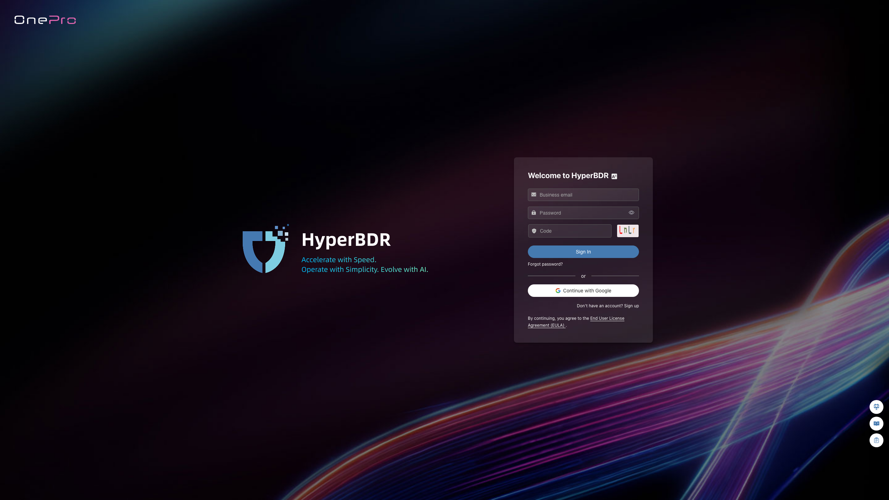

# **Login**

## **Login Entry**

The platform supports two service modes: private deployment and SaaS. Please select the appropriate access entry based on your actual needs.

### **Private Deployment**

#### **Username & Password Login**

- Enter the console access address in the browser address bar: `https://<Your-Server-IP>:10443`

- After the login page opens, sign in with the default administrator account:

    - **Username**: `admin`

    - **Initial Password**: `P@ssw0rd`

> 💡 **Security Notice**: To keep your account secure, please change the default password promptly after your first successful login.

### **SaaS Service**

- Access the official platform at: [https://hyperbdr.com/](https://hyperbdr.com/login)

#### **Username & Password Login**

- **Existing account**: Sign in directly with the email bound to your account during registration.

- **New user**: Please refer to the [Account Registration Guide](../register/register.md) to create an account first, then sign in.

#### **Google Quick Sign-in**

- Supports one-click quick sign-in with an authorized Google account. See [Google Sign-in Guide](../register/register.md#sign-up-with-google).
