# **Alert Rules**

To ensure system security, stability, and visibility into critical events, the platform includes built-in alert rule functionality. It monitors the operating status and resource utilization of disaster recovery hosts in real time and triggers alert notifications upon detecting anomalies, enabling operations personnel to promptly discover and address issues while minimizing the impact on business systems.

::: tip
For best practices on configuring alert rules, refer to [【O&M Guide】>【Monitoring & Alerts】>【Alarm Best Practice】](../../om-guide/monitor-alerts/alarm-best-practice.md) for detailed recommendations and instructions.
:::

## **Resource Rules**

In the system menu, navigate to: **【Monitoring & Alerts】>【Alert Rules】>【Resource Rules】**.

On the Resource Rules page, you can view, create, and manage resource monitoring rules in a centralized manner.

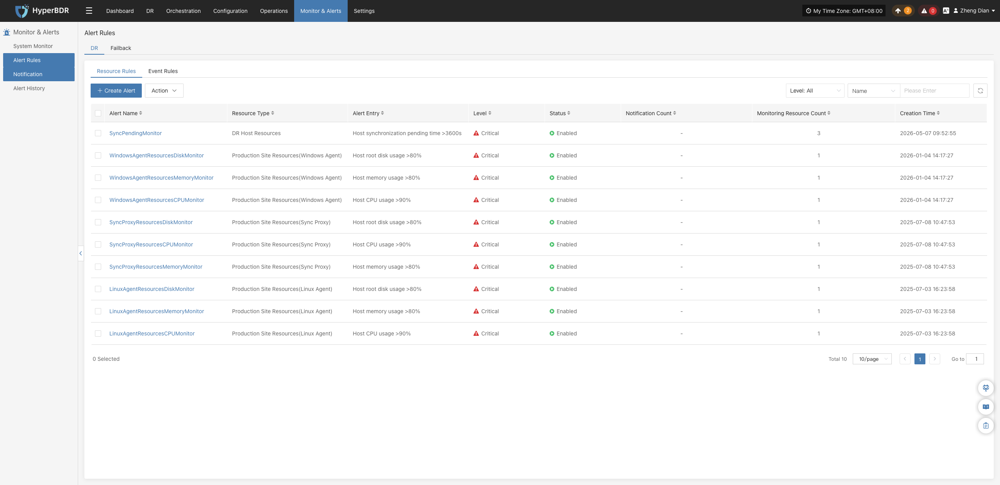

### **Create Alert Rule**

Click the **【+ Create Alert Rule】** button in the upper left corner of the list to enter the resource alert rule creation page:

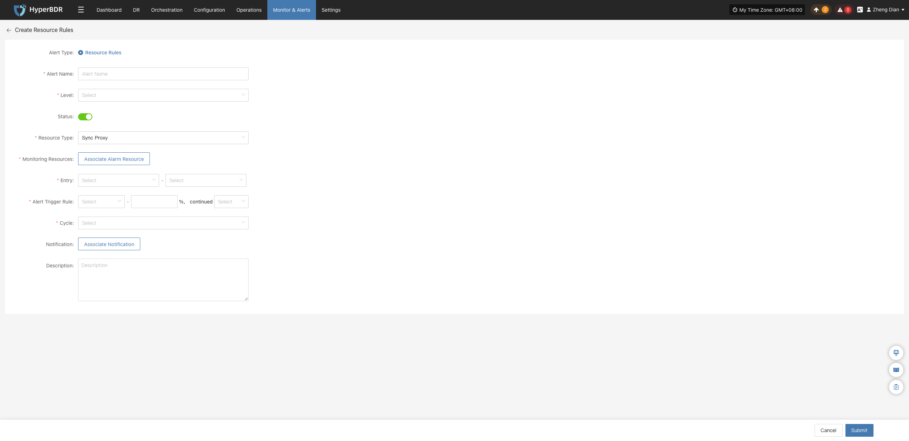

#### **Alert Rule Configuration Field Description**

| **Field Name** | **Example** | **Description** |
| :--- | :--- | :--- |
| **Rule Type** | Resource Alert Rule | Select the classification or intended purpose of the alert rule, used to distinguish between different monitoring strategies. |
| **Rule Name** | test | Custom name for the alert rule, used for identification and management. |
| **Alert Level** | Critical | Specifies the severity of the alert, such as: Info, Critical, Emergency. |
| **Status** | Enabled | Sets whether the alert rule is enabled. When enabled, the system monitors and alerts according to the configured rule. |
| **Resource Type** | Sync Proxy | The type of resource monitored by the alert rule. Common resource types include: • Sync Proxy • Cloud Sync Gateway • Linux Agent • Windows Agent • Object Storage Resources |
| **Monitored Resource** | ubuntu-ova | Select the target resource objects to monitor (multiple can be added). The system will continuously monitor them based on configuration. |
| **Metric** | CPU | Sets the specific metric items to monitor. Supported items include: • CPU • Disk • RAM • Process |
| **Trigger Rule** | ≥ 80%, for 5 minutes | Defines the condition that triggers an alert, e.g., when a metric exceeds a preset threshold for a specified duration. |
| **Check Interval** | 5 minutes | Sets the time interval at which the system checks metric statuses. |
| **Notification Recipient** | - | Specifies the recipients (users or notification groups) to notify once an alert is triggered. |
| **Rule Description** | - | Optional notes or description documenting the purpose of the alert rule for easier management and auditing. |

#### **Monitored Resource Types**

| **Resource Type** | **Metrics** | **Description** |
| :--- | :--- | :--- |
| **Sync Proxy** | CPU, RAM, Disk, Process | Monitors hardware resource utilization and process status of the source sync proxy. |
| **Cloud Sync Gateway** | CPU, RAM, Disk, Process | Monitors hardware resource utilization and service process status of the cloud sync gateway. |
| **Linux Agent** | CPU, RAM, Disk, Process | Monitors resource utilization and key process status of Linux Agents. |
| **Windows Agent** | CPU, RAM, Disk, Process | Monitors resource utilization and process status of Windows Agents. |
| **Object Storage Resources** | Object Storage Capacity | Monitors storage capacity usage and remaining quota. |

::: note
Once an alert rule is created, the system will automatically trigger alerts when corresponding events occur and send notifications through designated channels based on associated notification recipients. Meanwhile, related alert messages will appear on the "Alert Messages" page for centralized review and resolution.
:::

### **Action**

Select the resource alert rule to manage and click the **【Action】** button to expand the action menu. Note that certain operations may not support batch execution; please refer to the actual interface display:

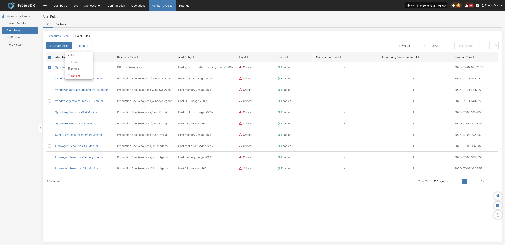

#### **Modify**

Click **【Modify】** to navigate to the editing page, where you can modify the configuration parameters of the created resource alert rule:

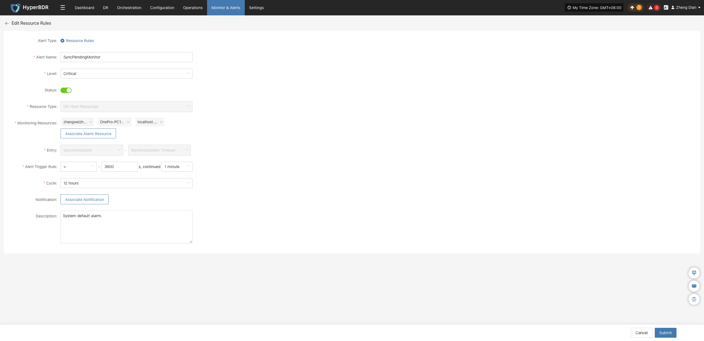

#### **Enable**

Click **【Enable】** to update the alert rule status to "Enabled":

#### **Disable**

Click **【Disable】** to update the alert rule status to "Disabled". Disabled rules will stop monitoring metrics:

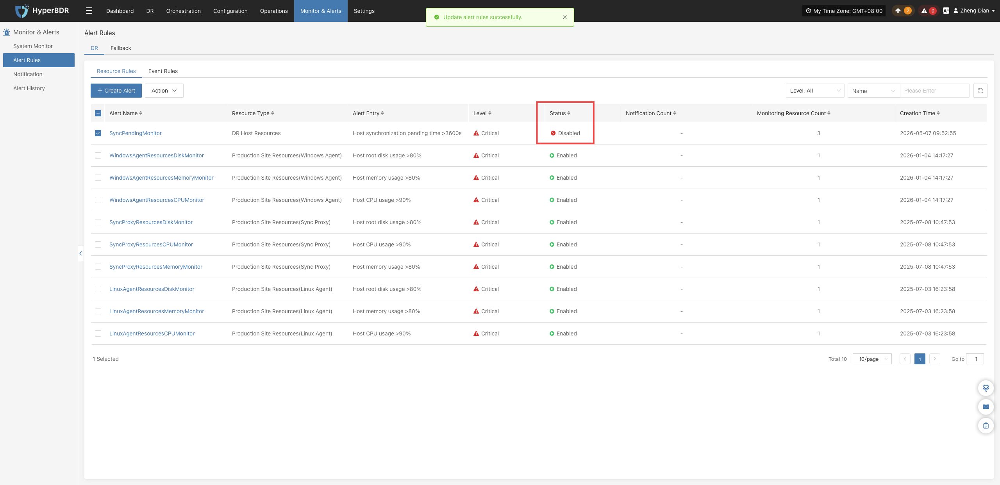

#### **Remove**

Click **【Remove】** to display a secondary confirmation dialog. After confirmation, the alert rule is permanently deleted:

::: warning
The remove operation permanently deletes the alert policy configuration and cannot be undone. Please ensure there are no active dependencies before proceeding.
:::

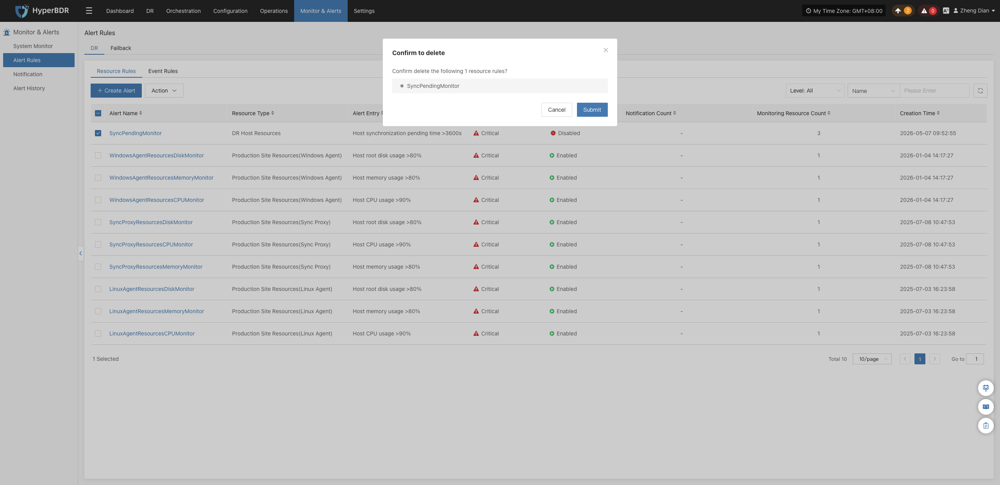

## **Event Rules**

In the system menu, navigate to: **【Monitoring & Alerts】>【Alert Rules】>【Event Rules】**.

On the Event Rules page, you can view, create, and manage various event monitoring rules in a centralized manner.

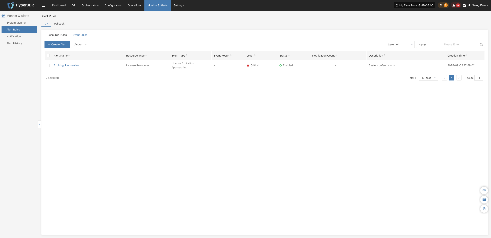

### **Create Alert Rule**

Click the **【+ Create Alert Rule】** button in the upper left corner of the list to enter the event alert rule creation page:

#### **Alert Rule Configuration Field Description**

| **Field Name** | **Example** | **Description** |
| :--- | :--- | :--- |
| **Rule Type** | Event Alert Rule | Sets the type of alert rule. Event alert rules monitor critical operational actions and abnormal states, triggering alert notifications upon occurrence. |
| **Rule Name** | test | Custom name for the alert rule, used for identification and management. |
| **Alert Level** | Critical | Severity level when the event is triggered (e.g., Info, Critical, Emergency). |
| **Status** | Enabled | Specifies whether the current alert rule is active. When enabled, the system monitors and alerts based on the rule. |
| **Event Type** | User Resource / Login | Category of event to monitor. Supported categories include: • User Resource • DR Host Resource • License Resource • Production Site Resources • DR Platform Resources • Monitoring Alarm Resource Group • Object Storage • DR Policies |
| **Event Result** | Success | Specifies the execution outcome condition that triggers the alert (e.g., Success, Failure). |
| **Notification Recipient** | Associated Notification Recipient | The recipients (personnel or groups) notified when an alert triggers, enabling prompt response by stakeholders. |
| **Rule Description** | — | Brief overview of the alert rule's function or purpose for ease of recognition and maintenance. |

#### **Event Type Descriptions**

| **Event Type** | **Alert Conditions (Examples)** | **Description** |
| :--- | :--- | :--- |
| **User Resources** | Login, Logout, Modify phone number, Change password, Reset password | Events related to user account login, authentication, and credential modifications. |
| **DR Host Resources** | Add DR host configuration, Boot host, Clean resources, Force abort task, Host disconnected/recovered, Snapshot integrity check, Sync host, Takeover host, Resource limits, etc. | Key events relating to disaster recovery host tasks, status monitoring, and resource operations. |
| **License Resources** | Add License | Critical events relating to system license status, validity period, and authorization exceptions. |
| **Production Site Resources** | Add/Delete Linux or Windows agent, Add/Delete/Bind sync proxy and connections, Reload VM agent, Connection status changes, etc. | Events relating to agent deployment management and connection status in production environments. |
| **DR Platform Resources** | Add/Delete/Modify cloud platform, Create/Delete cloud sync gateway, and related process events | Operations relating to cloud disaster recovery platform infrastructure components and deployment status. |
| **Monitoring Alarm** | Create/Modify/Delete alert rules and notification recipients | Operational events relating to monitoring alert configurations and alert dispatch mechanisms. |
| **Resource Groups** | Create/Delete resource group, Clean verification resources, Drill/Takeover DR, Sync data, Modify resource group | Critical operations relating to multi-resource logical grouping and disaster recovery lifecycle management. |
| **Object Storage** | Add/Delete/Update object storage, Start add/delete operations | Events relating to storage integration, configuration changes, capacity updates, and access anomalies. |
| **DR Policies** | Create/Delete/Modify policies, Associate/Disassociate policies | Events relating to the full lifecycle management of disaster recovery plan policy configurations. |

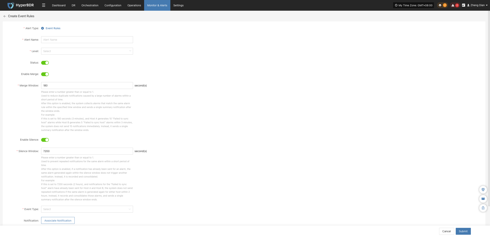

::: note
Once an alert rule is created, the system will automatically trigger alerts when corresponding events occur and send notifications through designated channels based on associated notification recipients. Meanwhile, related alert messages will appear on the "Alert Messages" page for centralized review and resolution.
:::

### **Action**

Select the event alert rule to manage and click the **【Action】** button to expand the action menu:

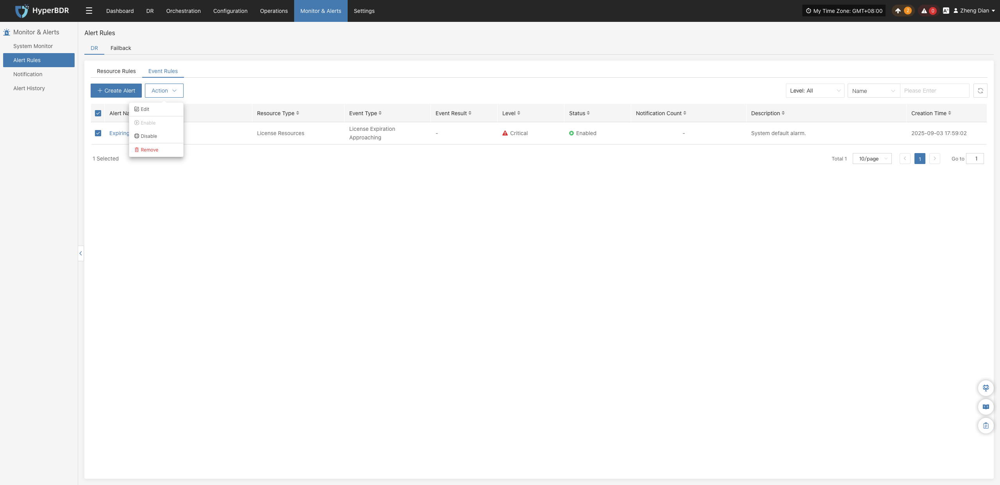

#### **Modify**

Click **【Modify】** to navigate to the editing page, where you can modify the configuration parameters of the created event alert rule:

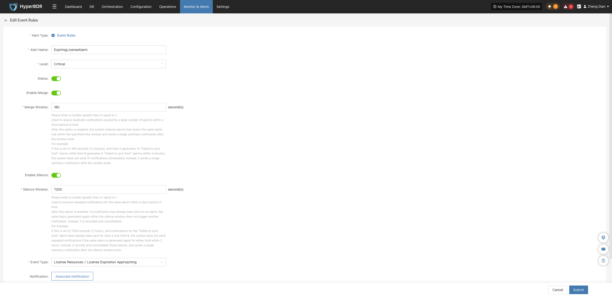

#### **Enable**

Click **【Enable】** to update the alert rule status to "Enabled":

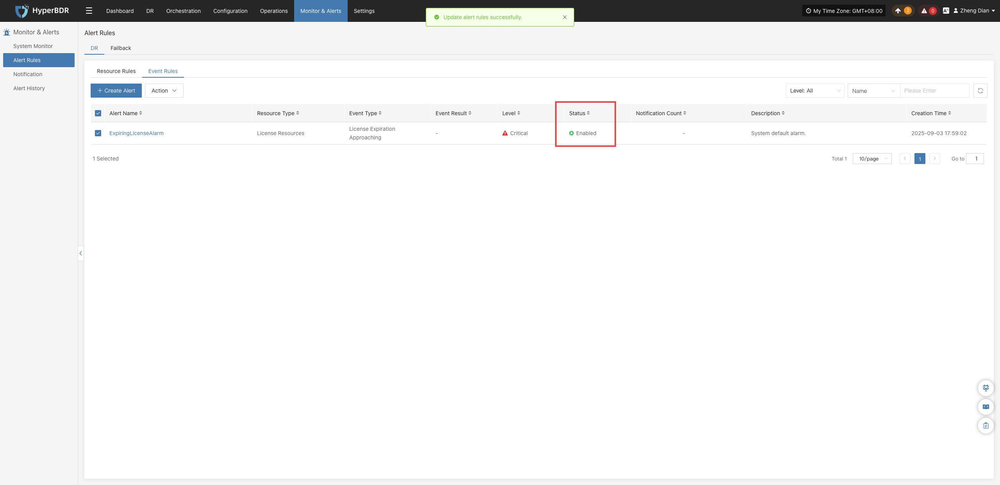

#### **Disable**

Click **【Disable】** to update the alert rule status to "Disabled":

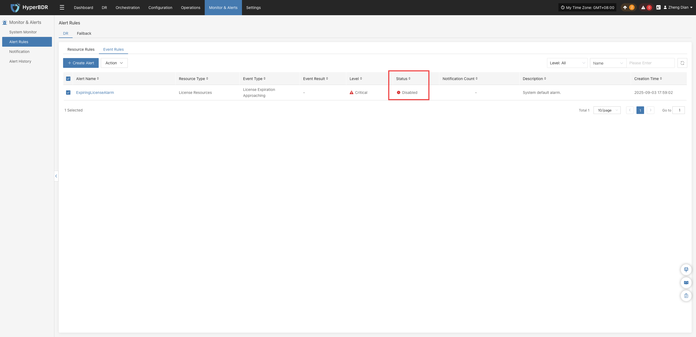

#### **Remove**

Click **【Remove】** to display a secondary confirmation dialog. After confirmation, the alert rule is permanently deleted:

::: warning
The remove operation permanently deletes the event alert policy and cannot be undone. Please ensure there are no active dependencies before proceeding.
:::

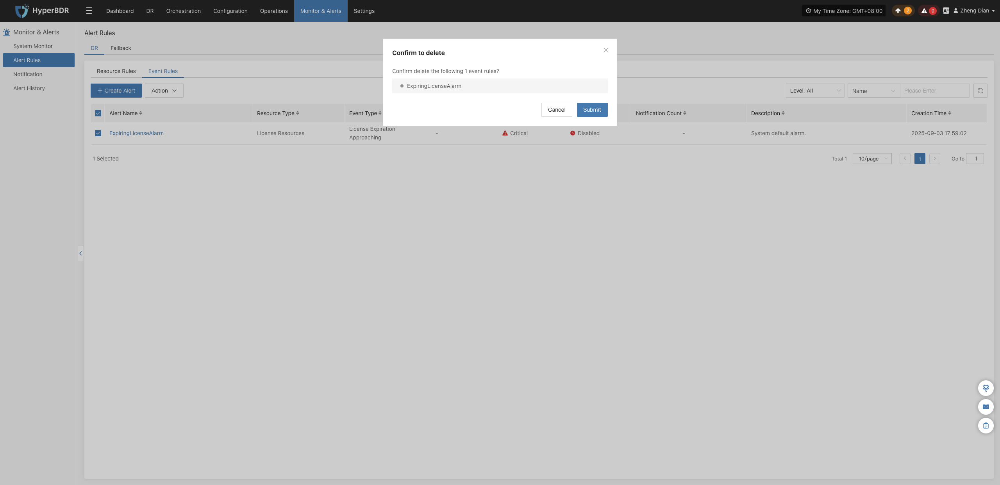
