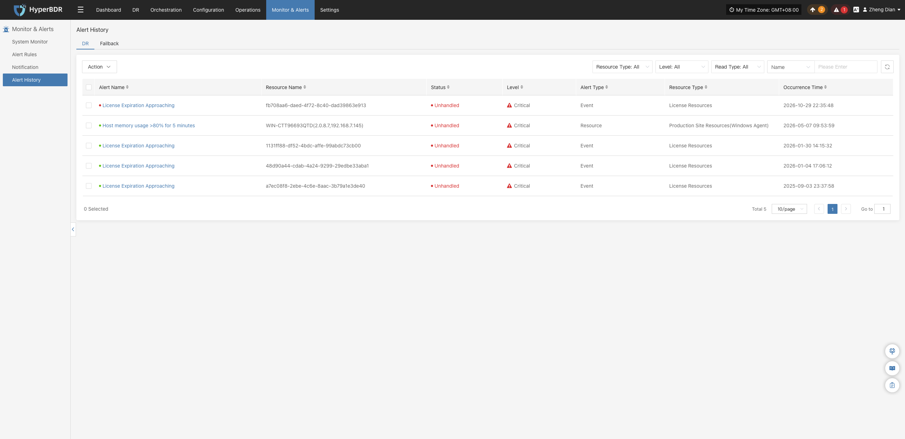
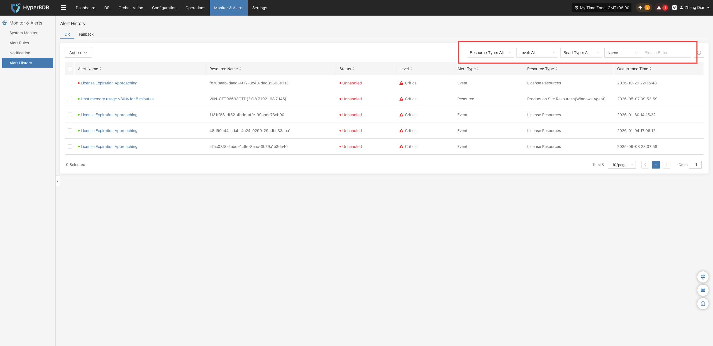
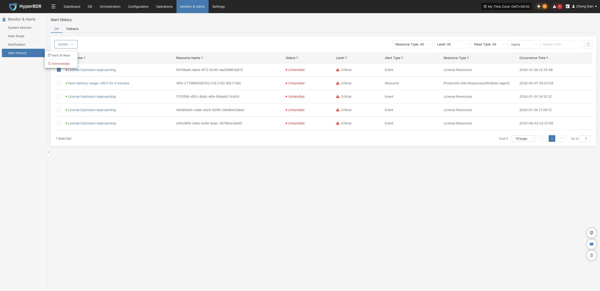
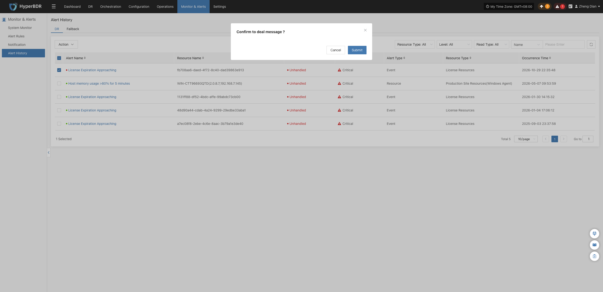
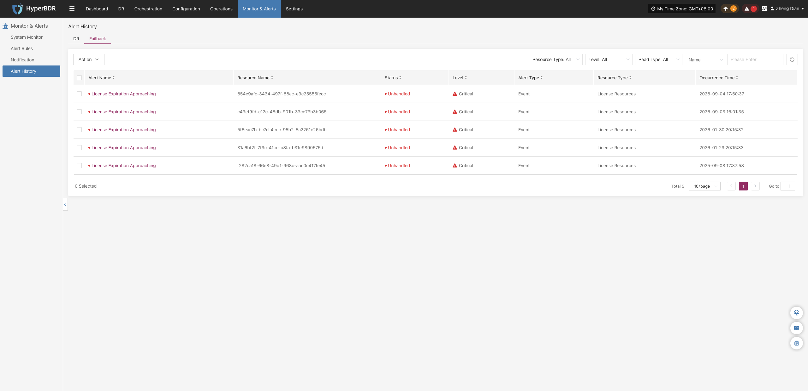
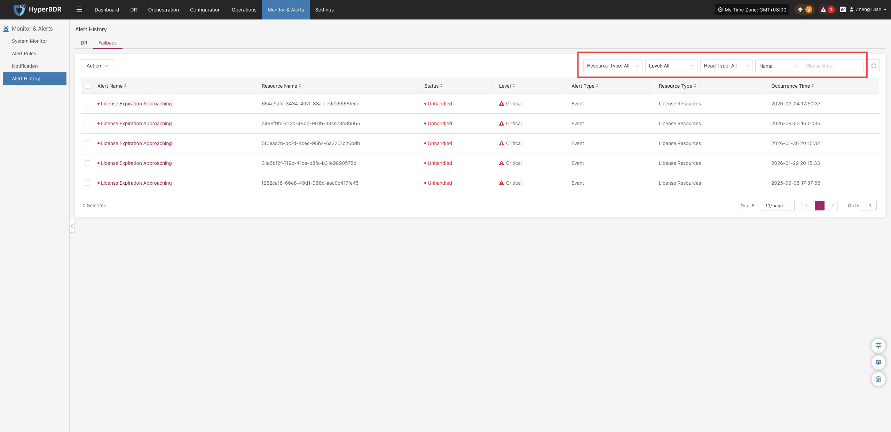
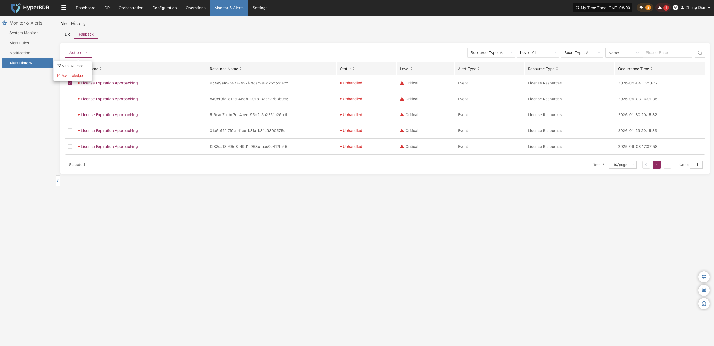
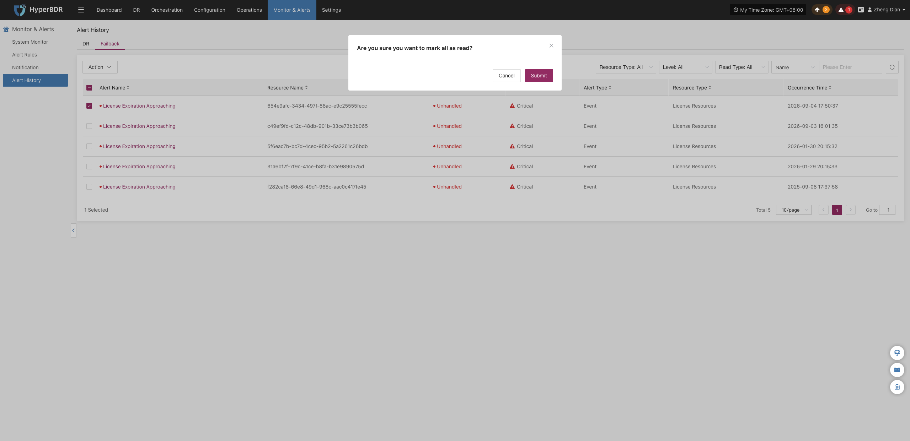

# Alerts

The system monitors the status of various resources and key events based on alert rules you set. When abnormal metrics are detected or preset alert conditions are triggered, the platform will automatically generate alert messages.

::: note
If you assign notification contacts when creating an alert, the system will notify them by email, SMS, or other methods as appropriate.
:::

## DR

### **Alert Message Fields**

When the system detects a resource issue or event trigger, it generates an alert message. The main fields are:

| **Field Name** | **Description** |
| :--- | :--- |
| **Alarm Name**      | The type of event that triggers the alarm, used to quickly identify the root cause of the issue.                                                                                                                                                                                                   |
| **Resource Name**   | The specific resource that triggered the alarm, such as a host name or service name.                                                                                                                                                                                                               |
| **Status**          | The current handling status of the alarm, for example, "Unprocessed" or "Processed".                                                                                                                                                                                                               |
| **Severity Level**  | The severity of the alarm event, commonly classified as "Info", "Critical", or "Emergency".                                                                                                                                                                                                        |
| **Alarm Type**      | The specific category of the alarm, such as "Event Alarm" or "Resource Alarm".                                                                                                                                                                                                                     |
| **Resource Type**   | The types of resources involved, including: · Object Storage · Disaster Recovery Policy User Resources · Disaster Recovery Host Resources · License Resources · Production Platform Resources · Disaster Recovery Platform Resources · Monitoring Alarms · Resource Groups |
| **Occurrence Time** | The time when the system first detected the alarm event, used for tracing the issue and analyzing response time.                                                                                                                                                                                   |

### **Search & Filter Alerts**

In the upper-right corner of the alert list, you can filter alert messages by **Resource Type**, **Severity Level**, **Read Type**, or by entering a **Resource Name**:

### **Action**

On the alert messages page, users can perform batch actions on alerts. After selecting one or more alert records, click the **Action** button to expand the action menu:

The following two batch actions are supported:

1. **Mark All Read**: Click this option to open the confirmation dialog "Are you sure you want to mark all as read?". Confirming marks all selected alert messages as read.

2. **Acknowledge**: Click this option to open the confirmation dialog "Confirm to deal message ?". Confirming updates the handling status of the selected alerts to processed.

## Failback

### **Alert Message Fields**

When the system detects a resource issue or event trigger, it generates an alert message. The main fields are:

| **Field Name** | **Description** |
| :--- | :--- |
| **Alarm Name**      | The type of event that triggers the alarm, used to quickly identify the root cause of the issue.                                                                                                                                                                                                   |
| **Resource Name**   | The specific resource that triggered the alarm, such as a host name or service name.                                                                                                                                                                                                               |
| **Status**          | The current handling status of the alarm, for example, "Unprocessed" or "Processed".                                                                                                                                                                                                               |
| **Severity Level**  | The severity of the alarm event, commonly classified as "Info", "Critical", or "Emergency".                                                                                                                                                                                                        |
| **Alarm Type**      | The specific category of the alarm, such as "Event Alarm" or "Resource Alarm".                                                                                                                                                                                                                     |
| **Resource Type**   | The types of resources involved, including: · Object Storage · Disaster Recovery Policy User Resources · Disaster Recovery Host Resources · License Resources · Production Platform Resources · Disaster Recovery Platform Resources · Monitoring Alarms · Resource Groups |
| **Occurrence Time** | The time when the system first detected the alarm event, used for tracing the issue and analyzing response time.                                                                                                                                                                                   |

### **Search & Filter Alerts**

In the upper-right corner of the Failback alert list, users can similarly search and filter failback alerts across multiple dimensions:

### **Action**

On the Failback alert messages page, select records and click the **Action** button to expand the action menu:

The following two batch actions are supported:

1. **Mark All Read**: Click to open the confirmation dialog "Are you sure you want to mark all as read?". Confirming marks all selected failback alerts as read.

2. **Acknowledge**: Click to open the confirmation dialog "Confirm to deal message ?". Confirming updates the handling status to processed.

