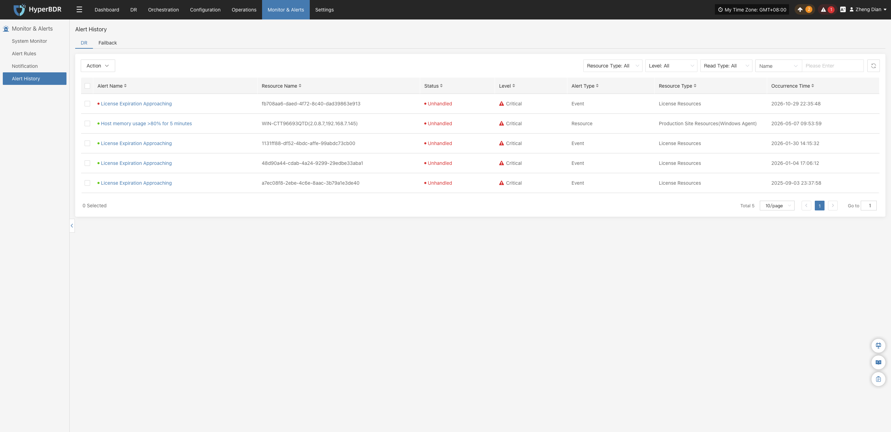
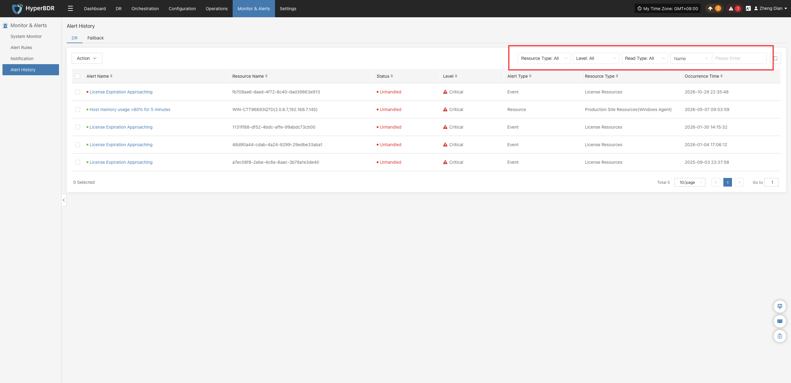
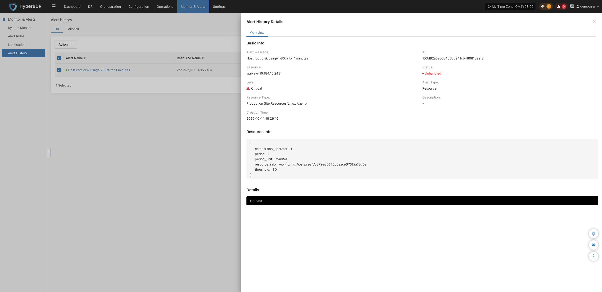
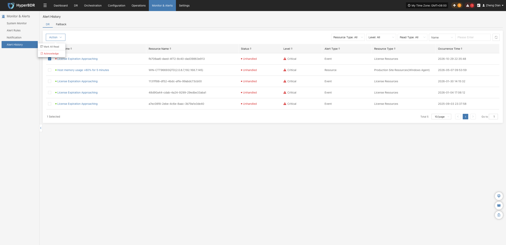
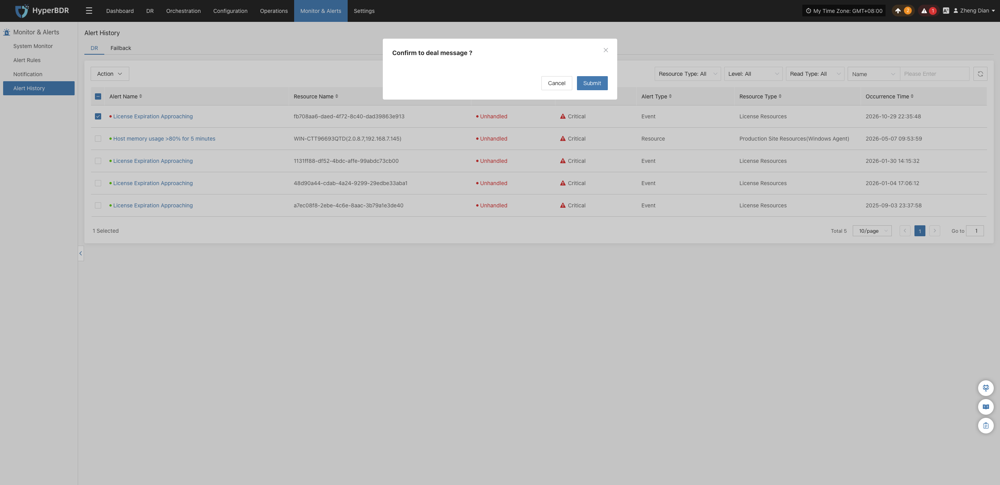
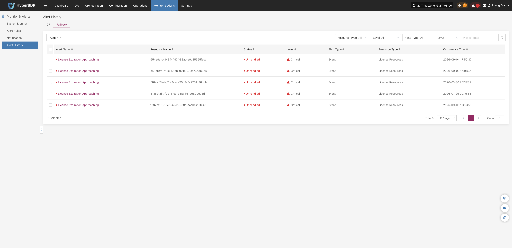
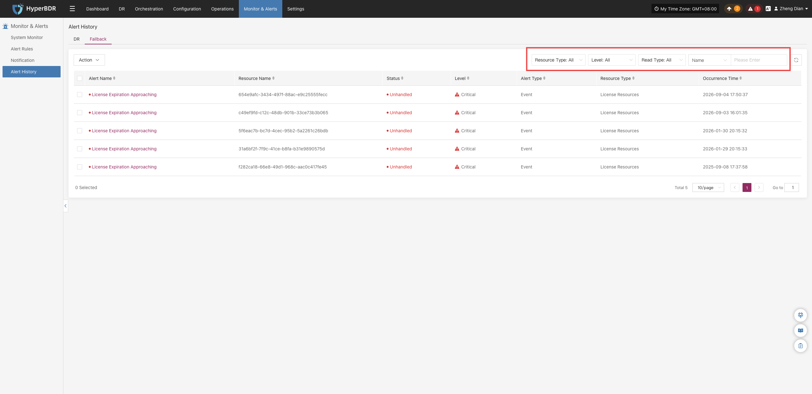
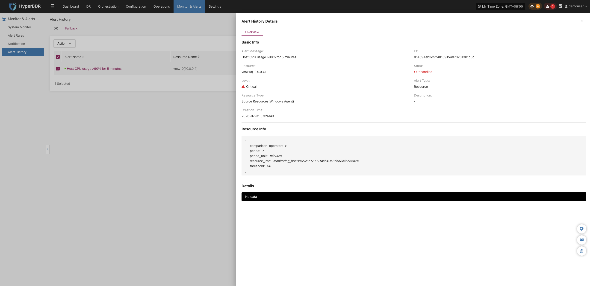
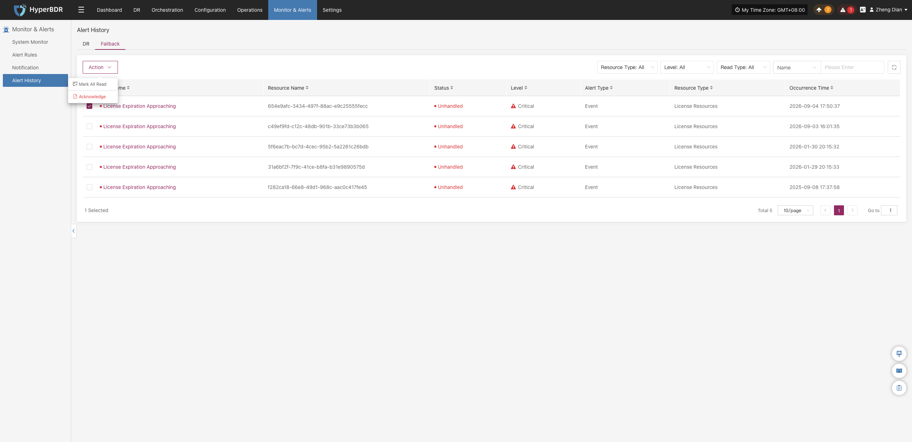
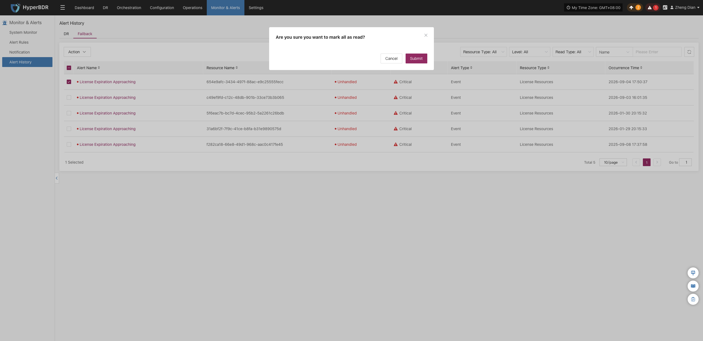

# Alerts

The system monitors the status of various resources and key events based on the configured alert rules. When abnormal metrics are detected or preset alert conditions are triggered, the platform automatically generates alert messages.

::: note
If notification recipients are assigned when creating an alert rule, the system will notify the relevant personnel by email, SMS, or other methods when an alert is triggered.
:::

## **Alert Message Fields**

When the system detects a resource issue or event trigger, it generates an alert message. The fields are described below:

| **Field Name** | **Description** |
| :--- | :--- |
| **Alarm Name** | The type of event or metric that triggered the alarm, used to quickly identify the root cause of the issue. |
| **Resource Name** | The specific resource that triggered the alarm, such as a host name or service name. |
| **Status** | The current handling status of the alarm, such as "Unprocessed" or "Processed". |
| **Severity Level** | The severity of the alarm event, including "Info", "Critical", and "Emergency". |
| **Alarm Type** | The category of the alarm, such as "Event Alarm" or "Resource Alarm". |
| **Resource Type** | The type of resource that triggered the alarm. See below for the supported values. |
| **Occurrence Time** | The time when the system first detected the alarm event, used for issue tracing and response time analysis. |

Resource types include:

- Object Storage
- Disaster Recovery Policy User Resources
- Disaster Recovery Host Resources
- License Resources
- Production Platform Resources
- Disaster Recovery Platform Resources
- Monitoring Alarms
- Resource Groups

## **DR**

The DR alert message list is shown below.

### **Search & Filter Alerts**

In the upper-right corner of the alert list, you can filter by **Resource Type** (All, Object Storage, DR Host, etc.), **Severity Level** (All, Info, Critical, Emergency, etc.), and **Read Status** (All, Read, Unread), or search by entering a **Resource Name**. Multiple conditions can be combined.

### **View Alert Details**

In the alert list, click the name of an alert record. A details drawer opens on the right, showing the triggering rule, severity level, related monitoring metrics, and recommended actions for the alert.

### **Action**

On the alert messages page, select one or more records and click the **Action** button to expand the action menu, where you can perform batch operations on the selected alerts.

The following two batch actions are supported:

1. **Mark All Read**: Click to open the confirmation dialog "Are you sure you want to mark all as read?". Confirming marks the selected alert messages as read. This action applies only to the selected records and does not affect unselected ones.

   

2. **Acknowledge**: Click to open the confirmation dialog "Confirm to deal message ?". Confirming updates the handling status of the selected alert messages to processed.

   

## **Failback**

The Failback alert message list is shown below.

### **Search & Filter Alerts**

In the upper-right corner of the Failback alert list, you can also filter by **Resource Type**, **Severity Level**, and **Read Status**, and search by entering a **Resource Name**. Multiple conditions can be combined.

### **View Alert Details**

In the Failback alert list, click the name of an alert record. A details drawer opens on the right, showing the triggering rule, severity level, related monitoring metrics, and recommended actions for the alert.

### **Action**

On the Failback alert messages page, select one or more records and click the **Action** button to expand the action menu, where you can perform batch operations on the selected failback alerts.

The following two batch actions are supported:

1. **Mark All Read**: Click to open the confirmation dialog "Are you sure you want to mark all as read?". Confirming marks the selected failback alerts as read. This action applies only to the selected records and does not affect unselected ones.

   

2. **Acknowledge**: Click to open the confirmation dialog "Confirm to deal message ?". Confirming updates the handling status of the selected failback alerts to processed.

   
