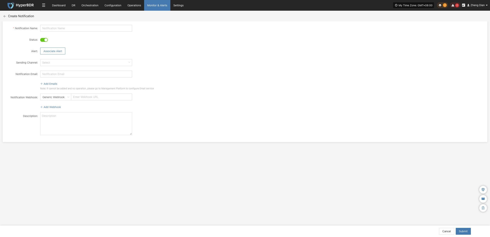
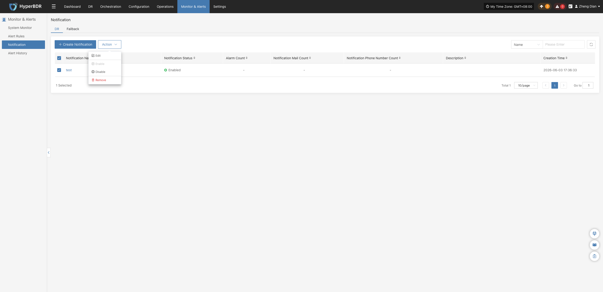
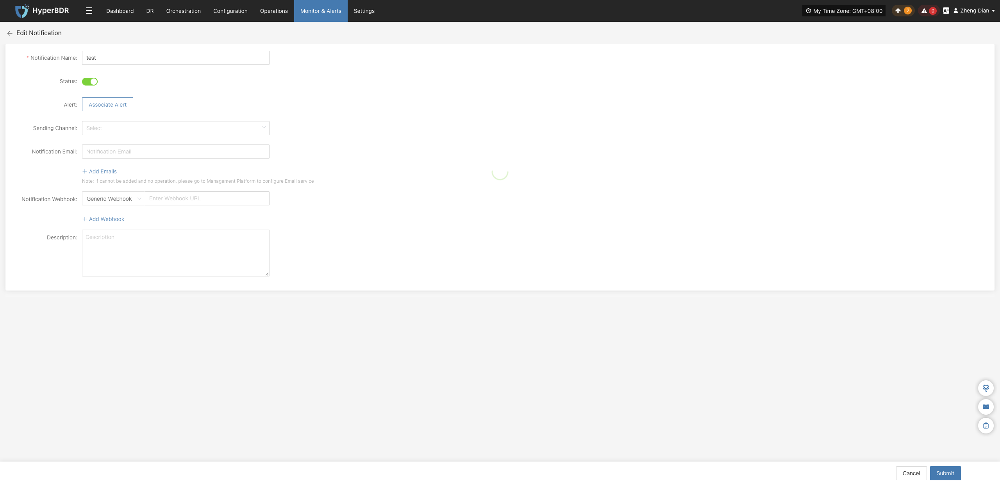
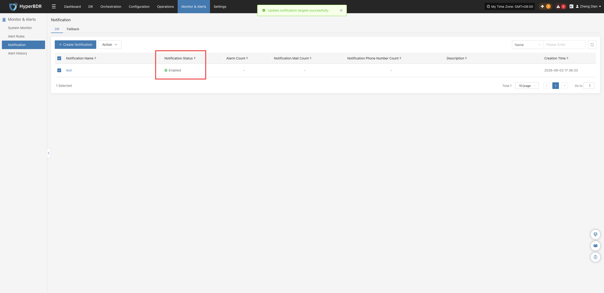
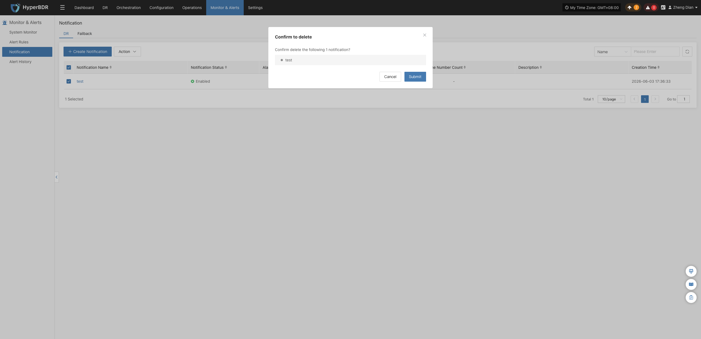
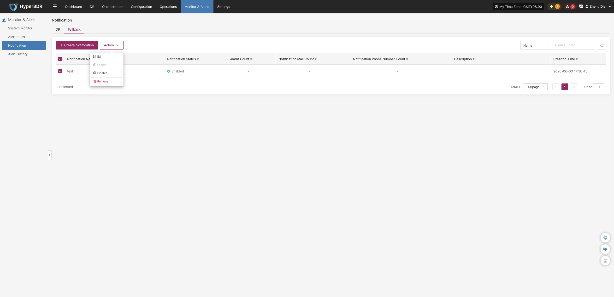
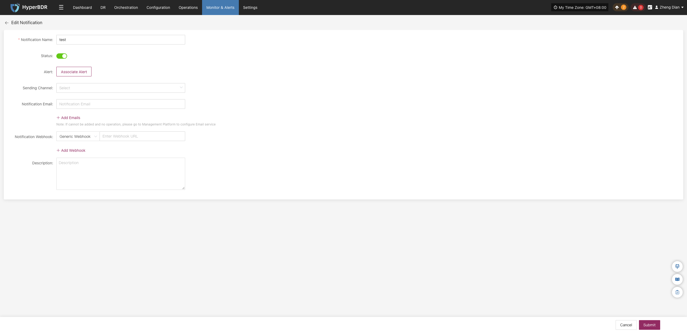
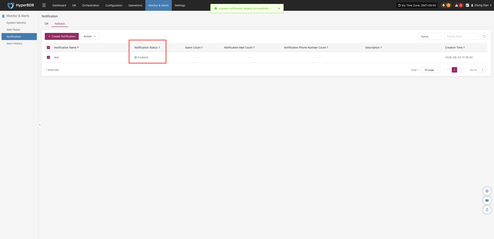
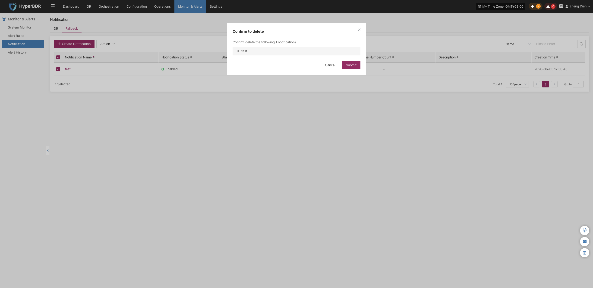

# **Notification**

When an alert occurs, the system will notify designated people or groups. Notification recipients can receive alerts by email, SMS, phone, or other methods to ensure timely awareness and response.

::: note
If no email or SMS service is configured for notification recipients, you cannot create notification users. Please go to [【O&M Platform】>【Notification Settings】](../../admin-portal/notification/email.md) to configure them.
:::

## **DR**

### **Create Notification**

Go to **【Monitoring & Alerts】>【Notification Recipients】**, which defaults to the **【DR】** tab, and click **【Create Notification Recipient】**. Fill in the relevant parameters and save as prompted to ensure personnel receive alerts in a timely manner.

| **Field Name** | **Example** | **Description** |
| :--- | :--- | :--- |
| **Notification Name** | test | Custom name of the notification recipient, used to identify different notification configurations. |
| **Status** | Enabled | Sets whether the notification recipient is active. When enabled, the system sends alert notifications whenever the conditions of associated alert rules are met. |
| **Alert Rules** | Associated Alert Rules | Click **【Associate Alert Rules】** to select the alert rules to link in the popup selection dialog. The notification recipient will receive and send notifications based on the associated alert rules. |
| **Sending Channel** | xxx@qq.com | Select a configured notification sending channel from the dropdown list. If no email channel is available in the list, please configure the service based on your deployment model: for on-premises/private deployments, configure email services in the management platform; for SaaS users, please contact technical support to [Get Support](https://support.oneprocloud.com/target/opc). |
| **Notification Email** | XXX@qq.com | Destination email address to receive alert notifications. Click **【+ Add Email】** on the page to add multiple email addresses. |
| **Notification Webhook** | https://example.com/webhook | Configure the Webhook URL to receive alert notifications. Click **【+ Add Webhook】** on the page to add multiple Webhook URLs. |
| **Description** | - | Additional remarks or notes for the notification recipient. |

### **Action**

After selecting a notification recipient, click the **【Action】** button to expand the action menu, where you can perform operations including modify, enable, disable, and remove:

#### **Modify**

Click **【Modify】** to navigate to the editing page, where you can modify the configuration parameters of the created notification recipient.

#### **Enable**

Click **【Enable】** to update the notification recipient status to "Enabled", resuming alert message notifications.

#### **Disable**

Click **【Disable】** to update the notification recipient status to "Disabled". No notifications will be sent while the recipient is in the disabled state.

#### **Remove**

Click **【Remove】** to display a secondary confirmation dialog. After confirmation, the system will permanently delete the notification recipient and cancel its association with all related alert rules.

::: warning
The remove operation completely unbinds the recipient from alert rules. Please verify that there are no active alert dependencies before proceeding.
:::

## **Failback**

### **Create Notification**

On the **【Monitoring & Alerts】>【Notification Recipients】** page, switch to the **【Failback】** tab, and click **【Create Notification Recipient】** to configure notification recipients for failback scenarios.

| **Field Name** | **Example** | **Description** |
| :--- | :--- | :--- |
| **Notification Name** | test | Custom name of the failback notification recipient, used to identify different notification configurations. |
| **Status** | Enabled | Sets whether the notification recipient is active. When enabled, the system sends alert notifications whenever the conditions of associated alert rules are met. |
| **Alert Rules** | Associated Alert Rules | Click **【Associate Alert Rules】** to select the alert rules to link in the popup selection dialog. The notification recipient will receive and send notifications based on the associated alert rules. |
| **Sending Channel** | xxx@qq.com | Select a configured notification sending channel from the dropdown list. If no email channel is available in the list, please configure the service based on your deployment model: for on-premises/private deployments, configure email services in the management platform; for SaaS users, please contact technical support to [Get Support](https://support.oneprocloud.com/target/opc). |
| **Notification Email** | XXX@qq.com | Destination email address to receive alert notifications. Click **【+ Add Email】** on the page to add multiple email addresses. |
| **Notification Webhook** | https://example.com/webhook | Configure the Webhook URL to receive alert notifications. Click **【+ Add Webhook】** on the page to add multiple Webhook URLs. |
| **Description** | - | Additional remarks or notes for the notification recipient. |

### **Action**

After selecting a failback notification recipient, click the **【Action】** button to expand the action menu, where you can perform modify, enable, disable, and remove operations:

#### **Modify**

Click **【Modify】** to navigate to the editing page, where you can modify the configuration parameters of the created failback notification recipient.

#### **Enable**

Click **【Enable】** to update the failback notification recipient status to "Enabled".

#### **Disable**

Click **【Disable】** to update the failback notification recipient status to "Disabled". No notifications will be sent while the recipient is in the disabled state.

#### **Remove**

Click **【Remove】** to display a secondary confirmation dialog. After confirmation, the system will permanently delete the notification recipient and cancel its association with all related alert rules.

::: warning
The remove operation completely unbinds the recipient from alert rules. Please verify that there are no active alert dependencies before proceeding.
:::

