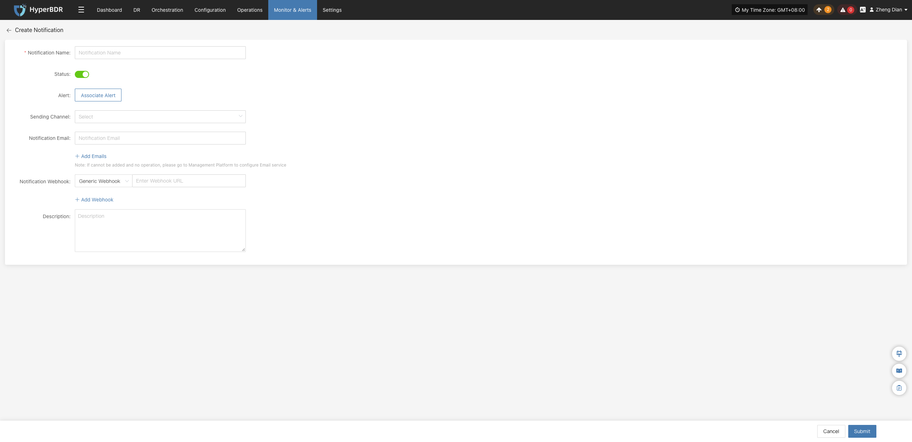
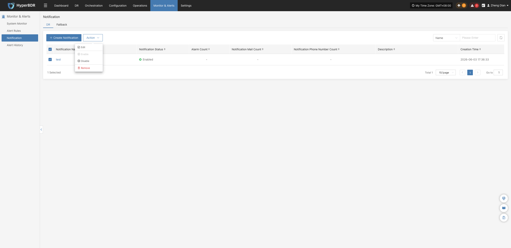
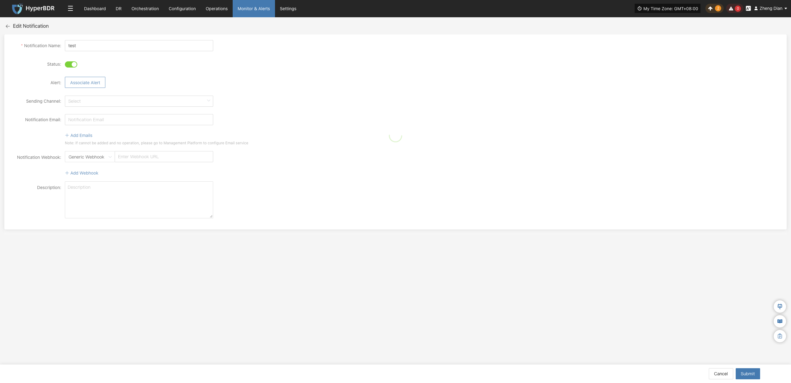
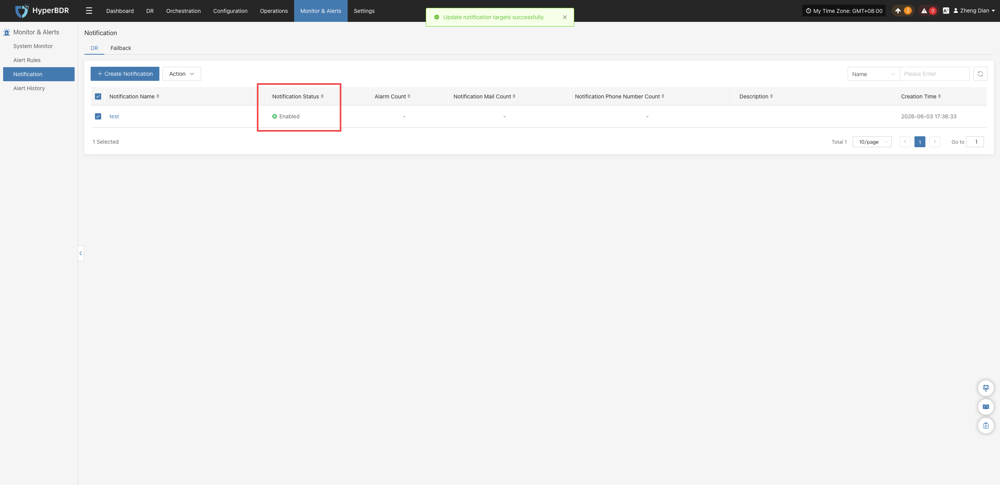
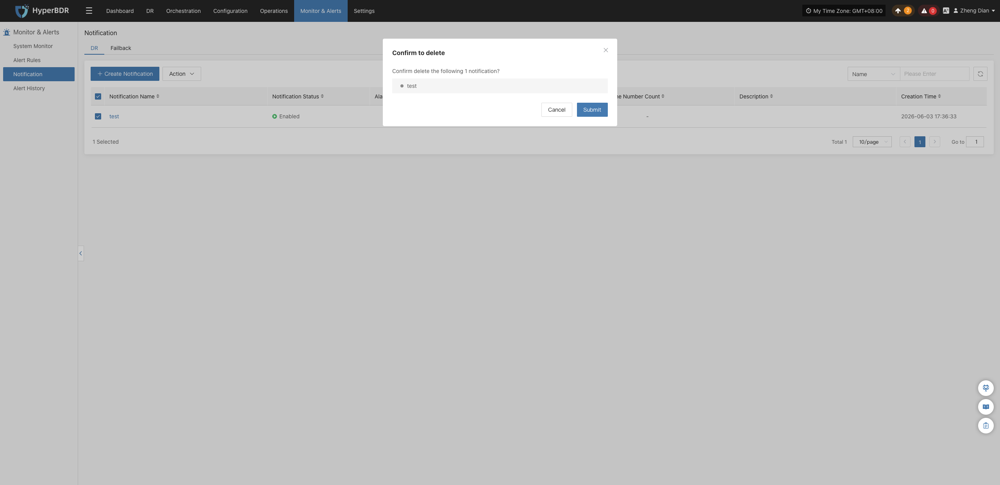
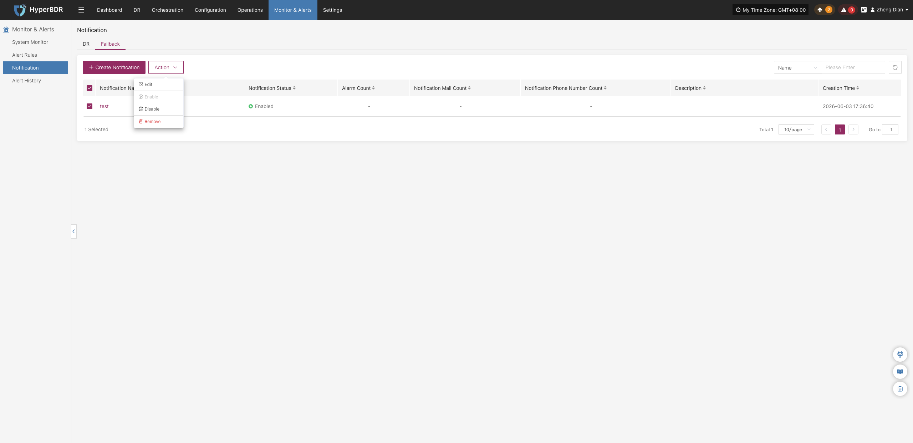
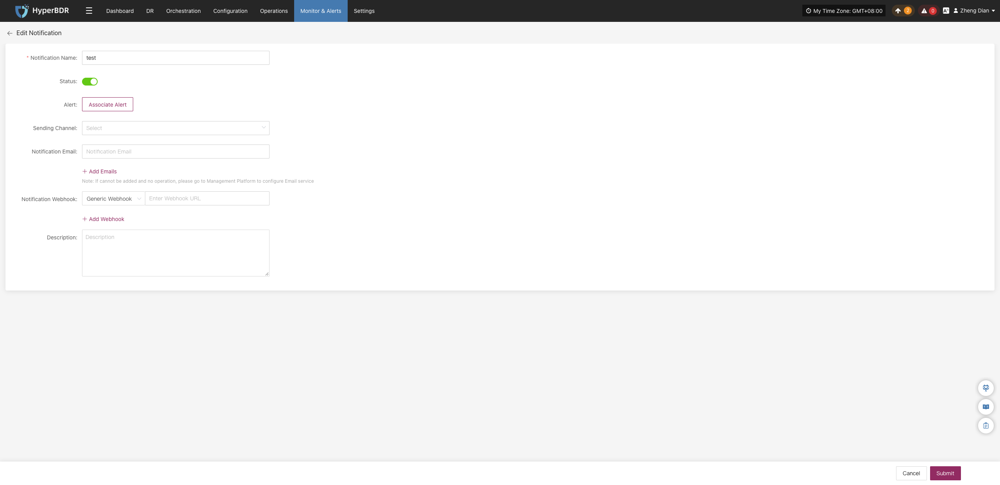
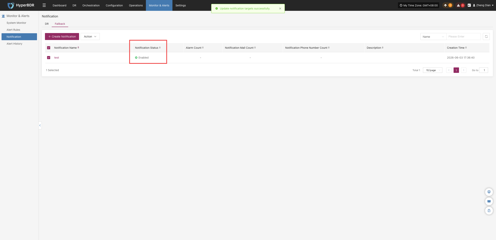
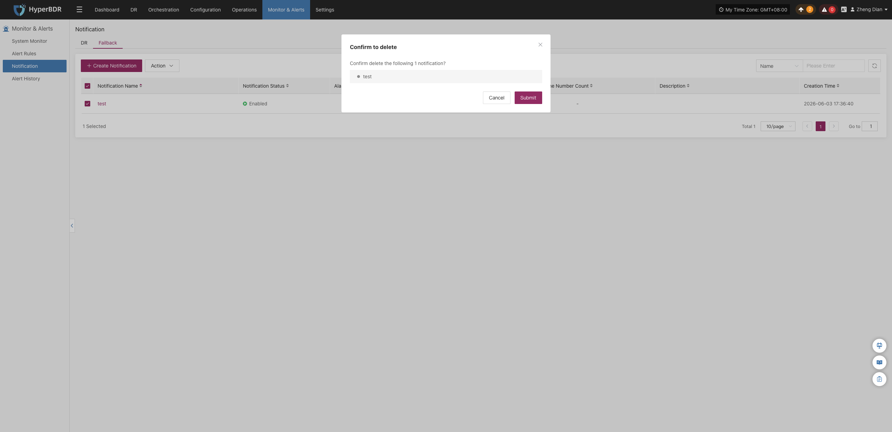

# **Notification**

The people or groups who receive alert information and respond when an alert event occurs. Notification recipients can receive notifications by email, SMS, phone, or other methods, ensuring that the relevant personnel are informed of and handle anomalies in a timely manner.

::: note
If the email and SMS receiving services are not yet configured for notification recipients, notification users cannot be created. Please configure them in **【O&M Platform】>【Notification Settings】**.
:::

## **DR**

### **Create Notification**

Go to the **【Monitoring & Alerts】** module, select **【DR】** under **【Notifications】**, and then click **【Create Notification】**.

Fill in the relevant information as prompted to complete the configuration of the notification recipient, ensuring that the relevant personnel can receive notifications in a timely manner when an alert event occurs.

| **Field Name** | **Example** | **Description** |
| :--- | :--- | :--- |
| **Notification Name** | test | Name of the notification recipient. |
| **Status** | Enabled | Whether the notification recipient is currently enabled. |
| **Alert Rule** | dame1 | Click to associate alert rules and bind the names of created alert rules. |
| **Sending Channel** | dianzheng0410@163.com | The channel through which notifications are sent, such as an email address. |
| **Notification Email** | XXX@qq.com | Email addresses used to receive notifications (multiple can be added). |
| **Description** | | Related remarks or notes. |

### **Action**

After selecting a notification recipient, click the **【Action】** button to expand the action menu, where you can perform management operations including modify, enable, disable, and remove:

#### **Modify**

* Click **【Modify】** to navigate to the editing page, where you can re-edit and adjust the configuration of the created notification recipient.

#### **Enable**

* Click **【Enable】** to update the notification recipient status to "Enabled":

#### **Disable**

* Click **【Disable】** to update the notification recipient status to "Disabled". No messages will be pushed while the notification recipient is disabled:

#### **Remove**

* Click **【Remove】** to trigger a secondary confirmation. After confirmation, the system will delete the notification recipient and cancel its association with the related alert rules:

## **Failback**

### **Create Notification**

Go to the **【Monitoring & Alerts】** module, select **【Failback】** under **【Notifications】**, and then click **【Create Notification】**.

Fill in the relevant information as prompted to complete the configuration of the notification recipient, ensuring that the relevant personnel can receive notifications in a timely manner when an alert event occurs.

| **Field Name** | **Example** | **Description** |
| :--- | :--- | :--- |
| **Notification Name** | test | Name of the notification recipient. |
| **Status** | Enabled | Whether the notification recipient is currently enabled. |
| **Alert Rule** | dame1 | Click to associate alert rules and bind the names of created alert rules. |
| **Sending Channel** | dianzheng0410@163.com | The channel through which notifications are sent, such as an email address. |
| **Notification Email** | XXX@qq.com | Email addresses used to receive notifications (multiple can be added). |
| **Description** | | Related remarks or notes. |

### **Action**

After selecting a failback notification recipient, click the **【Action】** button to expand the action menu, where you can perform management operations including modify, enable, disable, and remove:

#### **Modify**

* Click **【Modify】** to navigate to the editing page, where you can re-edit and adjust the configuration of the created failback notification recipient.

#### **Enable**

* Click **【Enable】** to update the failback notification recipient status to "Enabled":

#### **Disable**

* Click **【Disable】** to update the failback notification recipient status to "Disabled". No messages will be pushed while the notification recipient is disabled:

#### **Remove**

* Click **【Remove】** to trigger a secondary confirmation. After confirmation, the system will delete the notification recipient and cancel its association with the related alert rules:

