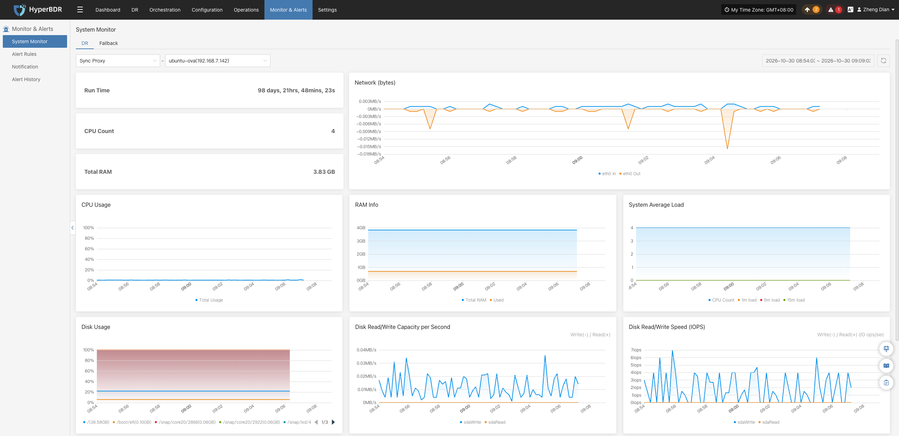
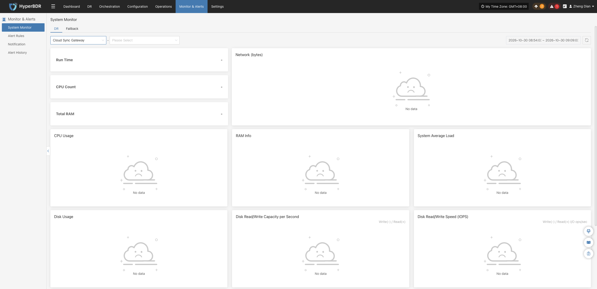
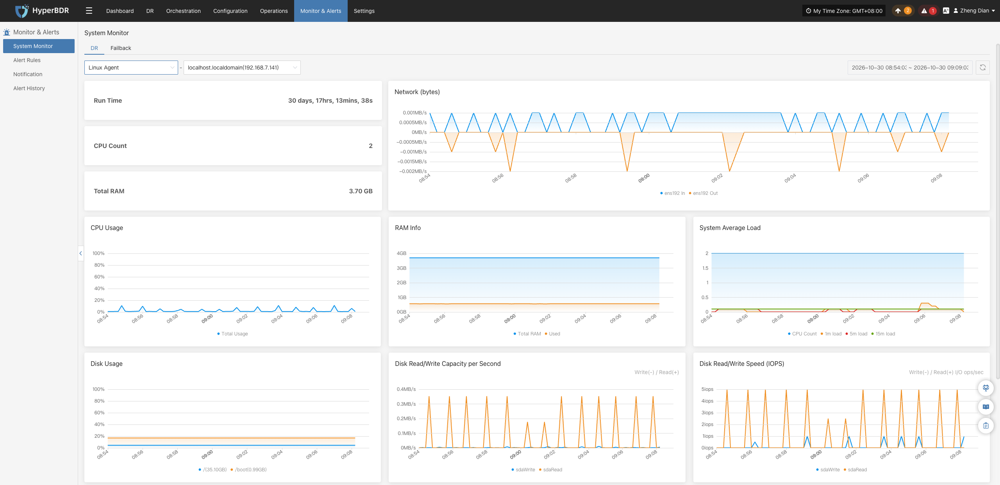
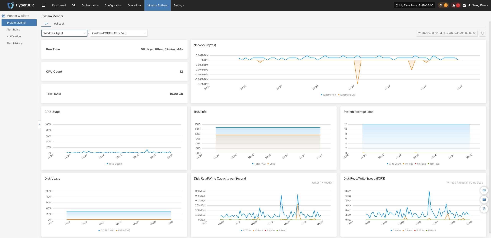
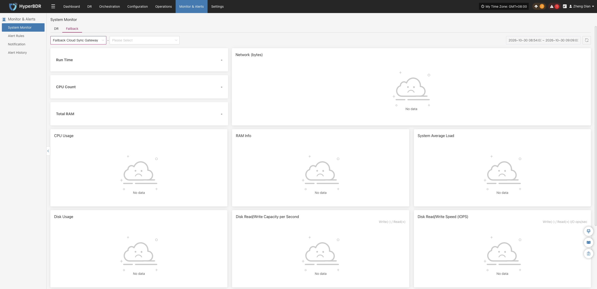

# **System Monitor**

Provides a visual overview of the operating status of core platform resources, supporting real-time collection of metrics such as CPU, memory, disk, network, and load. This helps administrators fully understand the health of host resources. Users can switch views by resource type and node for unified, hierarchical monitoring.

## **System Monitoring Features**

The system monitoring module provides real-time visualization and performance analysis of key resources across the platform. Taking "Sync Proxy" as an example, users can select a specific host to view detailed performance metrics for that node, helping quickly identify resource bottlenecks or potential failure risks.

#### **Basic Information**

* **Uptime**: Displays how long the sync proxy has been running continuously since startup.
* **CPU Cores**: Displays the number of physical CPU cores on the current host.
* **Total Memory**: Displays the total physical RAM capacity of the current host.

#### **Resource Usage**

The system dynamically displays the usage of various resources through charts, enabling users to track operational loads and performance variations in real time.

| **Metric** | **Description** |
| :--- | :--- |
| **CPU Usage** | Line chart showing CPU usage variations over time. |
| **RAM Info** | Displays total, used, and remaining memory. |
| **System Average Load** | Shows average system load over the past 1, 5, and 15 minutes respectively. |
| **Network (bytes)** | Graphically illustrates inbound (In) and outbound (Out) traffic on the network interface. |
| **Disk Usage** | Displays space utilization percentages across mounted disk paths. |
| **Disk Read/Write Capacity per Second** | Real-time display of disk read and write throughput. |
| **Disk Read/Write Speed (IOPS)** | Displays disk write frequency measured in IOPS. |
| **Count of iSCSI Processes in 'D' State** | Tracks count changes in current iSCSI process states. |

::: note
Supports flexibly switching views by resource type and host instance for targeted real-time performance monitoring.
:::

## **DR**

Log in to the HyperBDR console, and navigate to **【Monitor & Alerts】>【System Monitor】** from the top navigation bar. By default, the page opens on the **【DR】** tab. Users can use the component type dropdown menu and host list to flexibly inspect real-time metrics for each disaster recovery component.

### **Sync Proxy**

Select **【Sync Proxy】** from the component type dropdown menu to inspect system resource utilization for the selected proxy node.

### **Cloud Sync Gateway**

Select **【Cloud Sync Gateway】** from the component type dropdown menu to view resource consumption and workload metrics for the cloud sync gateway.

### **Linux Agent**

Select **【Linux Agent】** from the component type dropdown menu, and pick a target Linux instance from the host list to pull up Agent resource monitoring details for that source Linux host.

### **Windows Agent**

Select **【Windows Agent】** from the component type dropdown menu, and pick a target Windows instance from the host list to monitor Agent metrics for that production Windows host in real time.

## **Failback**

On the **【Monitor & Alerts】>【System Monitor】** page, switch to the **【Failback】** tab to monitor the real-time performance of various components involved in the reverse failback workflow.

### **Failback Sync Proxy**

Select **【Failback Sync Proxy】** from the component type dropdown menu to inspect the operational monitoring dashboard for the selected proxy node.

### **Failback Cloud Sync Gateway**

Select **【Failback Cloud Sync Gateway】** from the component type dropdown menu to check operational metrics of data transfer gateways during failback.

### **Failback Linux Agent**

Select **【Failback Linux Agent】** from the component type dropdown menu and pick a target node from the host list to view Linux host monitoring status during reverse failback.

### **Failback Windows Agent**

Select **【Failback Windows Agent】** from the component type dropdown menu and pick a target node from the host list to view Windows host system monitoring during failback.

