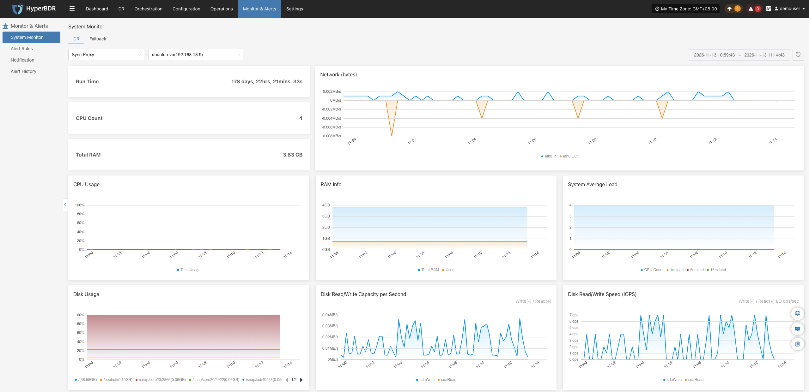
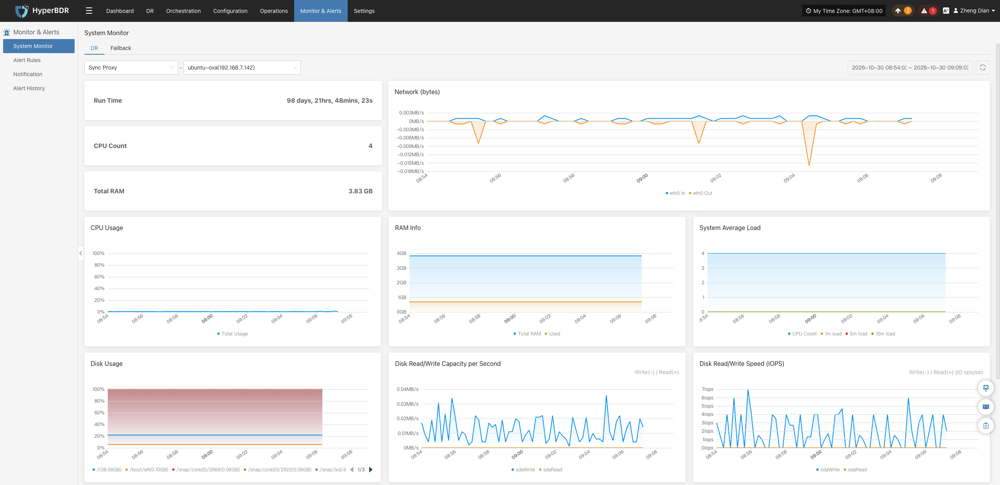
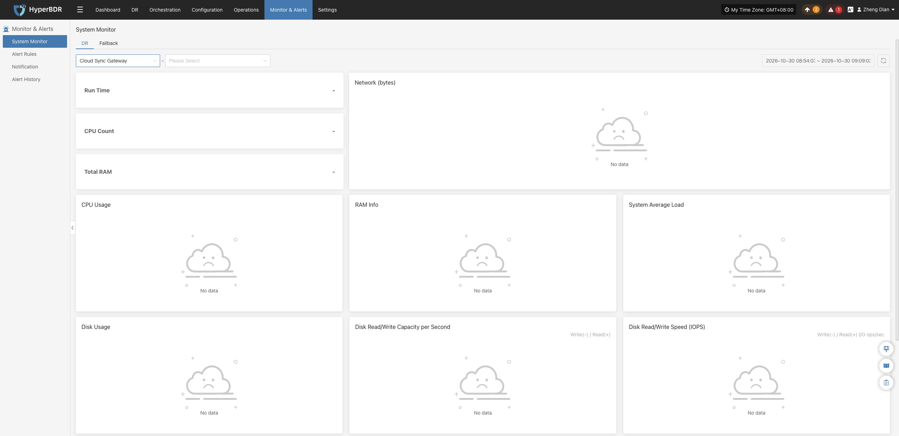
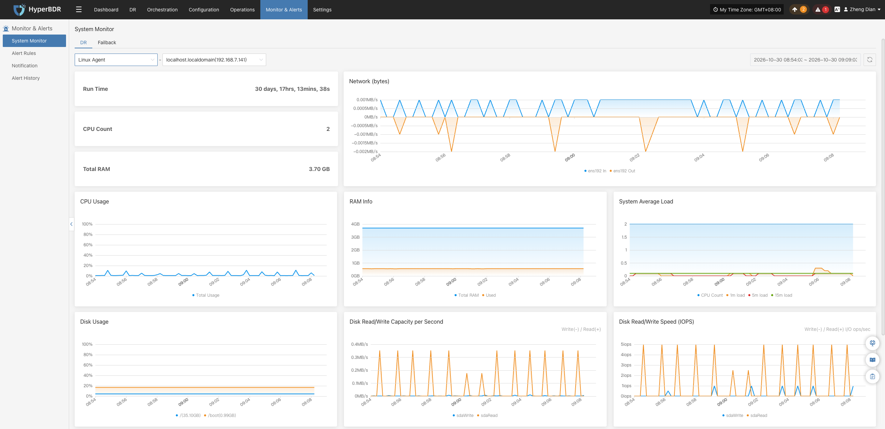
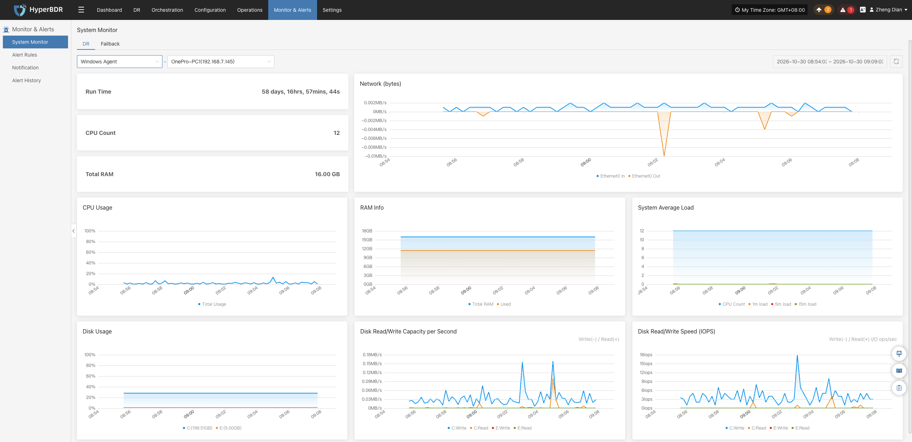
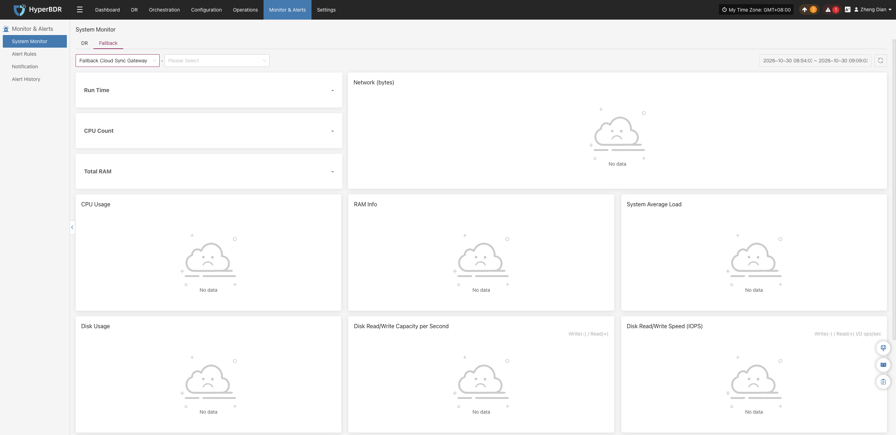

# **System Monitor**

Provides a visual overview of the operating status of core platform resources, supporting real-time collection of metrics such as CPU, memory, disk, network, and load. This helps administrators fully understand the health of host resources. Users can switch views by resource type and node for unified, hierarchical monitoring.

## **System Monitoring Features**

The system monitoring module provides real-time visualization and performance analysis of key resources across the platform. Taking "Sync Proxy" as an example, users can select a specific host to view detailed operating metrics for that node, helping quickly identify resource bottlenecks or potential failure risks.

#### **Basic Information**

* **Uptime**: Displays how long the sync proxy has been running continuously since startup.
* **CPU Cores**: Displays the number of physical CPU cores on the current host.
* **Total Memory**: Displays the total physical RAM capacity of the current host.

#### **Resource Usage**

The system dynamically displays the usage of various resources through charts, enabling users to track operational loads and performance variations in real time.

| **Metric** | **Description** |
| :--- | :--- |
| **CPU Usage** | Line chart showing CPU usage variations over time. |
| **RAM Info** | Displays total, used, and remaining memory. |
| **System Average Load** | Shows average system load over the past 1, 5, and 15 minutes respectively. |
| **Network (bytes)** | Graphically illustrates inbound (In) and outbound (Out) traffic on the network interface. |
| **Disk Usage** | Displays space utilization percentages across mounted disk paths. |
| **Disk Read/Write Capacity per Second** | Real-time display of disk read and write throughput. |
| **Disk Read/Write Speed (IOPS)** | Displays disk write frequency measured in IOPS. |
| **Count of iSCSI Processes in 'D' State** | Tracks count changes in current iSCSI process states. |

::: note
Supports flexibly switching views by resource type and host instance for targeted real-time performance monitoring.
:::

## **DR**

### **Sync Proxy**

Navigate to the **【Monitoring & Alerts】** module from the top navigation bar. The page opens on the **【DR】** tab by default. Select **【Sync Proxy】** from the component type dropdown menu to view the system resource usage of the selected proxy node.

### **Cloud Sync Gateway**

On the **【DR】** tab, switch the component type dropdown menu to **【Cloud Sync Gateway】** to view system resource consumption and workload metrics of the cloud sync gateway.

### **Linux Agent**

On the **【DR】** tab, switch the component type dropdown menu to **【Linux Agent】**, and select the target Linux instance from the host list to view Agent resource monitoring details of that source Linux host.

### **Windows Agent**

On the **【DR】** tab, switch the component type dropdown menu to **【Windows Agent】**, and select the target Windows instance from the host list to view Agent monitoring data of that Windows production host in real time.

## **Failback**

### **Failback Sync Proxy**

Navigate to the **【Monitoring & Alerts】** module from the top navigation bar and switch to the **【Failback】** tab. The **【Failback Sync Proxy】** monitoring dashboard is displayed by default.

### **Failback Cloud Sync Gateway**

On the **【Failback】** tab, switch the component type dropdown menu to **【Failback Cloud Sync Gateway】** to view operating metrics of data transfer gateways in failback scenarios.

### **Failback Linux Agent**

On the **【Failback】** tab, switch the component type dropdown menu to **【Failback Linux Agent】**, and select a managed host node to view Linux host monitoring status during failback.

### **Failback Windows Agent**

On the **【Failback】** tab, switch the component type dropdown menu to **【Failback Windows Agent】**, and select the target node to view system monitoring of Windows hosts during failback.

