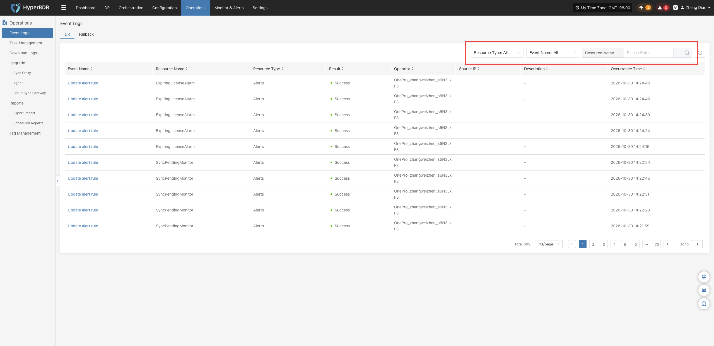
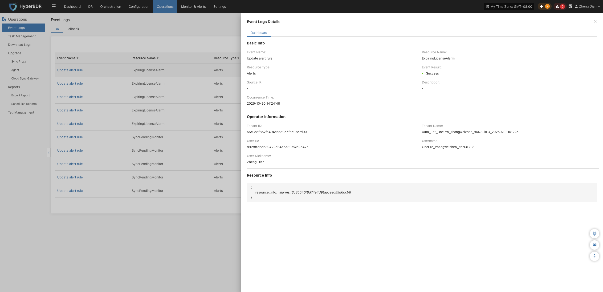

# **Event Logs**

Event logs are used to record various user operations and critical system events across the entire lifecycle of daily operations, disaster recovery protection, drill & takeover, and business failback. They help operations personnel track activities, perform security and compliance audits, and troubleshoot issues. The system provides two log views: **【DR】** and **【Failback】**, which share identical features and operational workflows.

Log in to the HyperBDR console, and navigate to **【O&M Management】>【Event Logs】** from the top navigation bar. The page defaults to the **【DR】** tab, and you can switch to the **【Failback】** tab as needed to review reverse failback operations.

## **Log Retrieval and Filtering**

The event log list supports multi-dimensional combined search. Administrators can quickly filter and locate target log entries using the top filter bar:

* **Resource Type**: Filter by resource category involved in the operation (e.g., User Resource, DR Host Resource, Production Site Resources, etc.).
* **Message Name**: Enter keywords to search for specific operations (e.g., login, sync host, create policy, etc.).
* **Resource Name**: Enter the target resource name for precise matching.

## **Field and Type Descriptions**

### **Event Log Field Descriptions**

Each record in the event log list includes the following fields:

| **Field Name** | **Example** | **Description** |
| :--- | :--- | :--- |
| **Message Name** | Login | The specific type of audit event triggered (click to view event details). |
| **Resource Name** | admin | The user or associated resource name that triggered the event. |
| **Resource Type** | User Resource | The system resource category involved in the audit event. |
| **Event Result** | Success | The final status of the operation, such as "Success" or "Failure". |
| **Source IP** | 172.30.1.33 | The client IP address that initiated the operation, facilitating security traceability. |
| **Description** | Login with username and password | Brief contextual description of the operation. |
| **Occurrence Time** | 2025-05-23 09:54:10 | The exact timestamp recorded by the system for the operation event. |

::: tip View Log Details
Click the specific **Message Name** in the list to open the operation details window, which displays the full execution context and extended information for the event.
:::

### **Resource Type Descriptions**

The resource type classifications used in the system are defined as follows:

| **Resource Type** | **Description** |
| :--- | :--- |
| **User Resource** | Operations related to user accounts and authentication, such as login, logout, password modification, and permission updates. |
| **DR Host Resource** | Host resources involved in disaster recovery protection, including configuration changes, data synchronization, and status monitoring. |
| **License Resource** | Management operations and quota status records related to system licensing. |
| **Production Site Resources** | Agent deployments, node management, and cloud platform connection status changes in production environments. |
| **DR Platform Resources** | Cloud accounts, cloud sync gateways, and architecture components in the disaster recovery destination environment. |
| **Monitoring Alarm** | Creation and maintenance operations for alert rules, notification recipients, and other monitoring mechanisms. |
| **Resource Group** | Logical host resource groupings and orchestration management operations based on business logic. |
| **Object Storage** | Integration, configuration updates, and capacity events for disaster recovery backup object storage buckets. |
| **DR Policies** | Creation, association, unbinding, and execution plan modifications for disaster recovery policies. |

::: note
Event logs serve as immutable audit trails of system behavior and cannot be manually edited or deleted. The page supports pagination (defaulting to 10 records per page), and you can use the top-right search box for keyword searches.
:::
