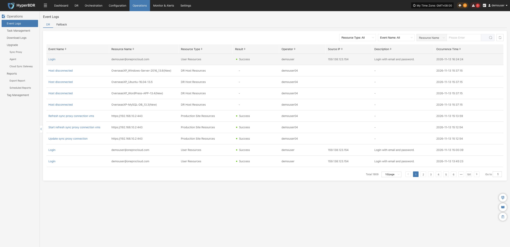
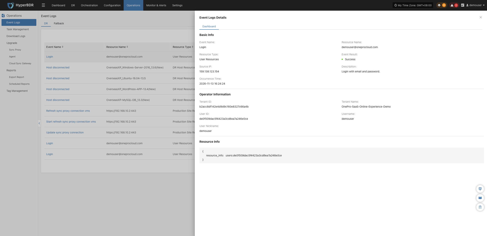

# Event Logs

In HyperBDR, users can navigate to **"O&M Management > Event Logs"** from the top navigation bar to view detailed records of all operations related to **DR** and **Failback** on the platform. This page helps O&M personnel with operation tracing, behavior auditing, and troubleshooting.

## Page Functions

Users can perform quick queries via the top filter conditions, which support filtering log data by the following fields:

* **Resource Type**: Select the resource type related to the operation (e.g., virtual machines, user resources, etc.)

* **Message Name**: Filter specific operation events by keyword

* **Resource Name**: Enter keywords to precisely locate the corresponding resource

### Event Log Descriptions

| **Field Name** | **Information** | **Description** |
| --------- | ------------------- | ----------------------------- |
| **Message Name** | Login | The type of audit event, indicating that the user performed a login operation. |
| **Resource Name** | admin | The user or resource name that triggered the audit event. |
| **Resource Type** | User Resource | The resource category involved in the audit event; here it refers to resources related to user operations. |
| **Event Result** | Success | The execution result of the operation, usually "Success" or "Failure". |
| **Source IP** | 172.30.1.33 | The client IP address that initiated the operation. |
| **Description** | Login with username and password | A brief description of the operation, helping users understand the operation intent and method. |
| **Occurrence Time** | 2025-05-23 09:54:10 | The exact time when the system recorded the event, used for behavior tracing or security audit analysis. |

> Click the corresponding message name to view details

### Resource Type Descriptions

| Resource Type | Description |
| ---------- | --------------------------- |
| User Resource | Resources related to user accounts and behaviors, such as login records and permission changes. |
| DR Host Resource | Host resources involved in disaster recovery protection, including configuration and status information. |
| License Resource | Management and status information of licenses required for system operation. |
| Production Platform Resource | Resources such as agents, hosts, and services on the actual business operation platform. |
| DR Platform Resource | Platform and component resources in the disaster recovery backup environment. |
| Monitoring & Alerts | Objects and events related to resource monitoring and alert configuration. |
| Resource Group | A combined unit that groups multiple resources by business or functional logic. |
| Object Storage | Object storage resources providing backup, archive, and other services. |
| DR Policies | Policy objects that define disaster recovery behavior of resources, such as sync and failover rules. |

### Additional Notes

* The page supports pagination, displaying 10 records per page by default.

* You can use the search box in the upper right corner to further search key operation records precisely.

* Event logs cannot be edited manually and are used only for system behavior auditing.
