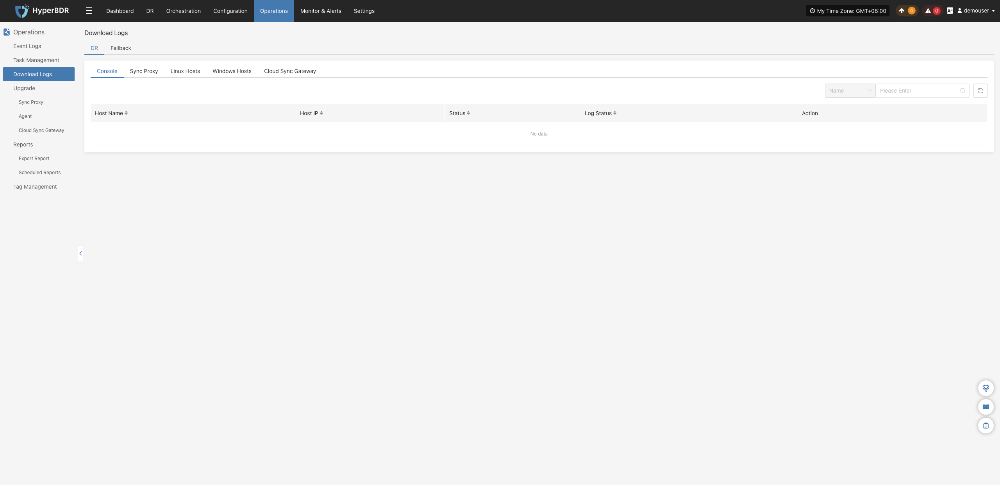
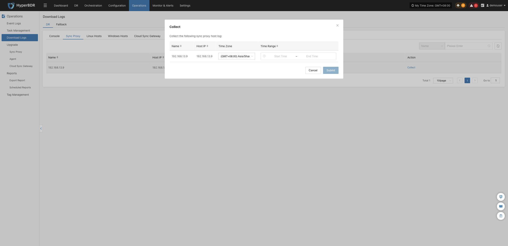
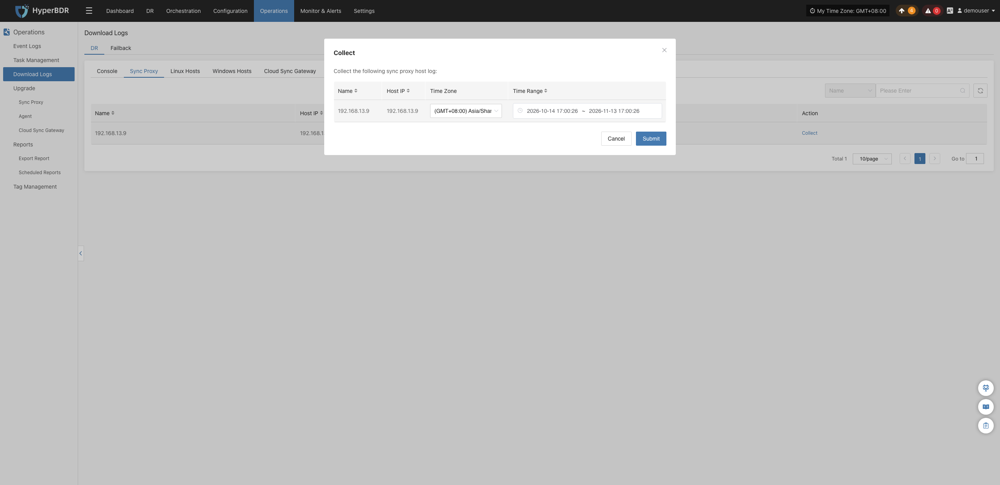
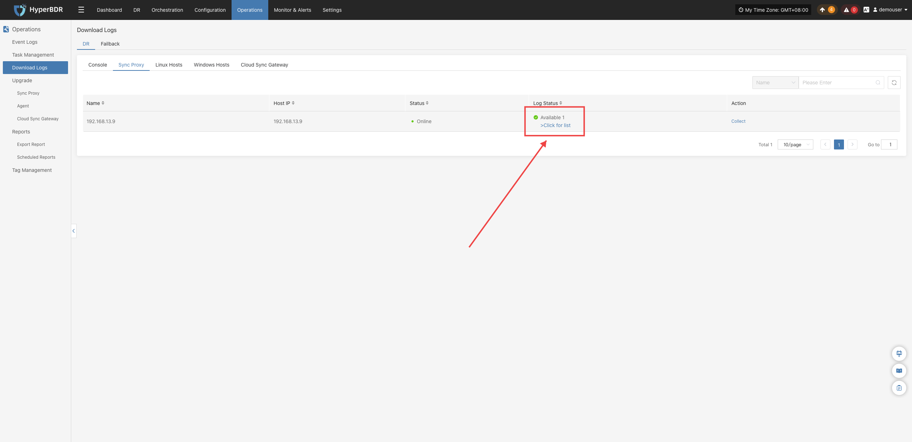
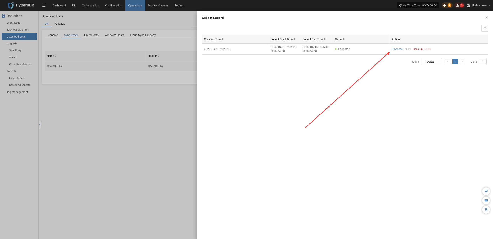
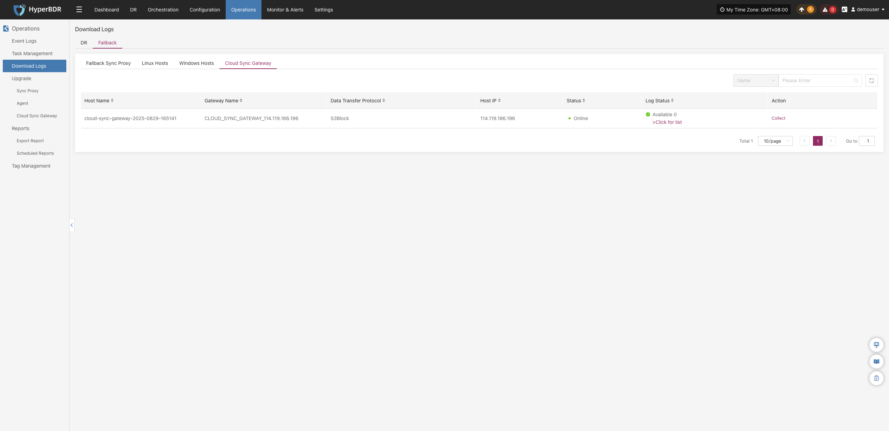
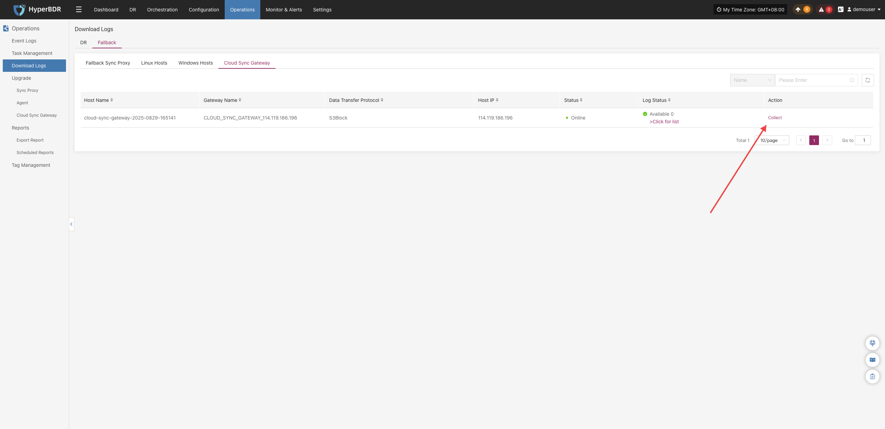
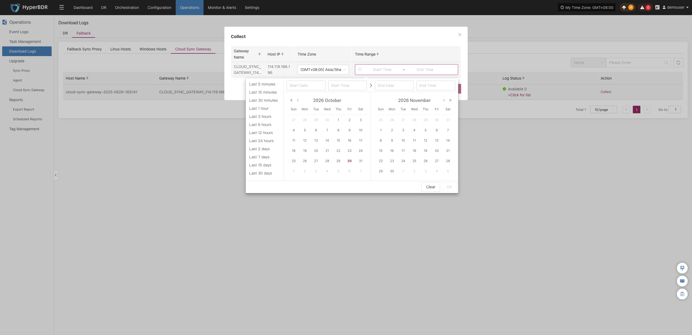
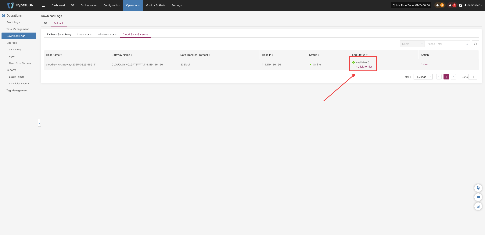
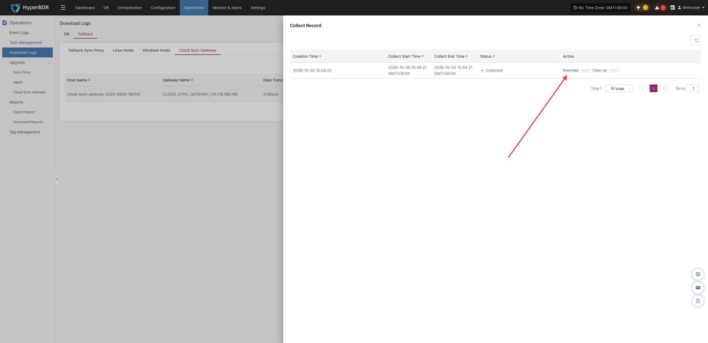

# Log Management

In HyperBDR, users can navigate to the **"O&M Management > Log Management"** module from the top navigation bar to quickly collect runtime logs of key components for troubleshooting.

## DR

### Supported Resource Types

| Resource Type | Description |
| ---------- | ------------------------ |
| Console | Management node log collection, including platform core runtime service logs |
| Sync Proxy | Agentless hosts deployed via OVA templates |
| Linux Host | Linux host logs with Agent installed |
| Windows Host | Windows host logs with Agent installed |
| Cloud Sync Gateway | Gateway hosts automatically created at the target site when starting DR |

### Page Field Type Descriptions

| Field Name | Example | Description |
| ---- | ------------- | ------------------------------ |
| Host Name | onepro | The name of the host, used to identify the specific device |
| Host IP | 192.168.7.141 | The IP address of the host, used to identify the device IP |
| Status | Online | The current running status of the host, such as online or offline (logs cannot be collected from offline hosts) |
| Log Status | Downloadable | The status of the host logs (click to view the list for details) |
| Action | Collect | Collect logs |

### Collection Example: Sync Proxy

Users can go to the **"Log Management > DR > Sync Proxy"** page to collect and download the required log files based on actual needs, facilitating troubleshooting and system monitoring.

#### Log Collection

Select the target host to collect and click the **"Collect"** action button in the corresponding row:

#### Select Time Range

Set the log time range to collect in the popup dialog. The system supports common quick time options (such as the last 15 minutes, the last 1 hour, the last 30 days) and custom start/end times via the calendar:

#### Start Collection

After confirming the selected time range and submitting, the system will automatically initiate the log collection task, and the log status changes to Collecting:

#### Log Download

After log collection is completed, the status updates to **"Downloadable"**. Users can click "Click for list" to expand the collection records drawer, view the log files, and click **"Download"** to download:

## Failback

### Supported Resource Types

| Resource Type | Description |
| ---------- | ------------------------ |
| Failback Sync Proxy | Agentless hosts deployed via OVA templates |
| Linux Host | Linux host logs with Agent installed |
| Windows Host | Windows host logs with Agent installed |
| Cloud Sync Gateway | Gateway hosts automatically created at the target site when starting failback |

### Page Field Type Descriptions

| Field Name | Example | Description |
| ---- | ------------- | ---------------------- |
| Host Name | ubuntu-ova | The name of the host, used to identify the specific device |
| Host IP | 192.168.7.202 | The IP address of the host, used to identify the device IP |
| Status | Online | (Logs cannot be collected from offline hosts) |
| Log Status | Downloadable | The status of the host logs (click to view the list for details) |
| Action | Collect | Collect logs |

### Collection Example: Cloud Sync Gateway

Users can go to the **"Log Management > Failback > Cloud Sync Gateway"** page to collect and download the required log files based on actual needs, facilitating troubleshooting and system monitoring.

#### Log Collection

Select the target gateway host to collect and click the **"Collect"** action button in the corresponding row:

#### Select Time Range

Set the log time range to collect in the popup dialog. The system supports quick time options and custom start/end times via the calendar:

#### Start Collection

After confirming the configured time range and submitting the task, the system will automatically start collecting gateway host logs, and the log status changes to Collecting:

#### Log Download

After log collection is completed, the status updates to **"Downloadable"**. Users can click "Click for list" to expand the collection records drawer, view the log files, and click **"Download"** to download:

