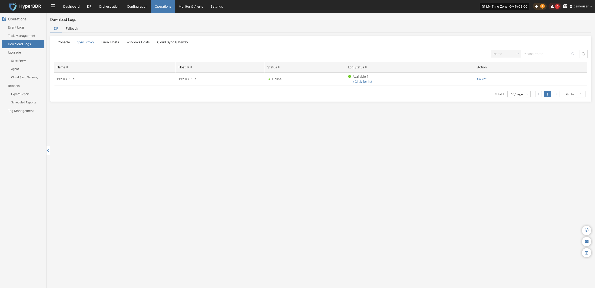
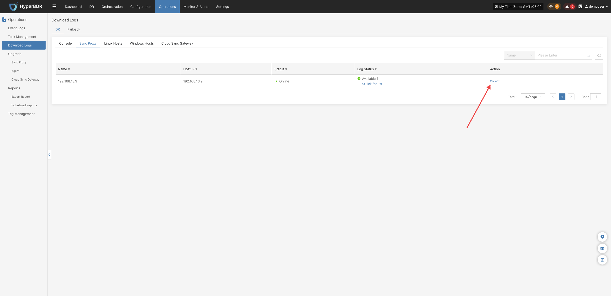
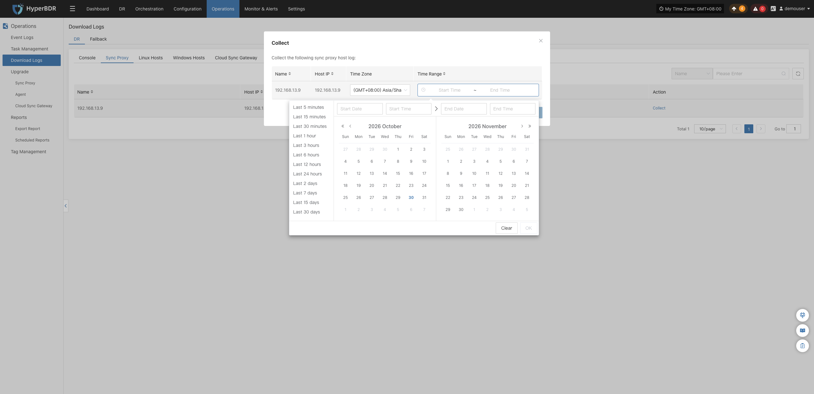
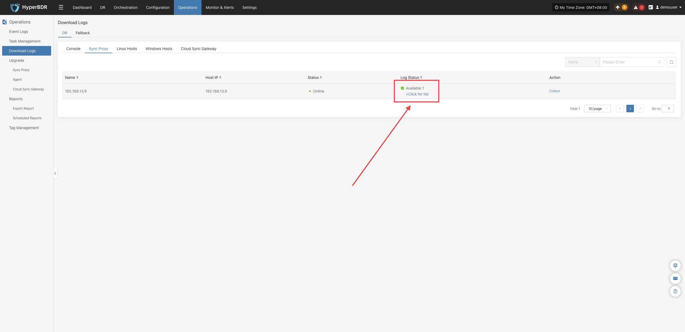
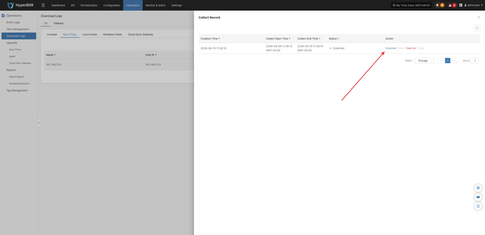
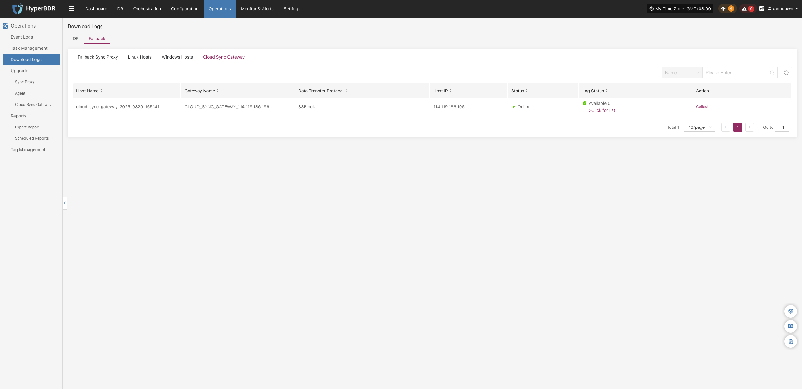
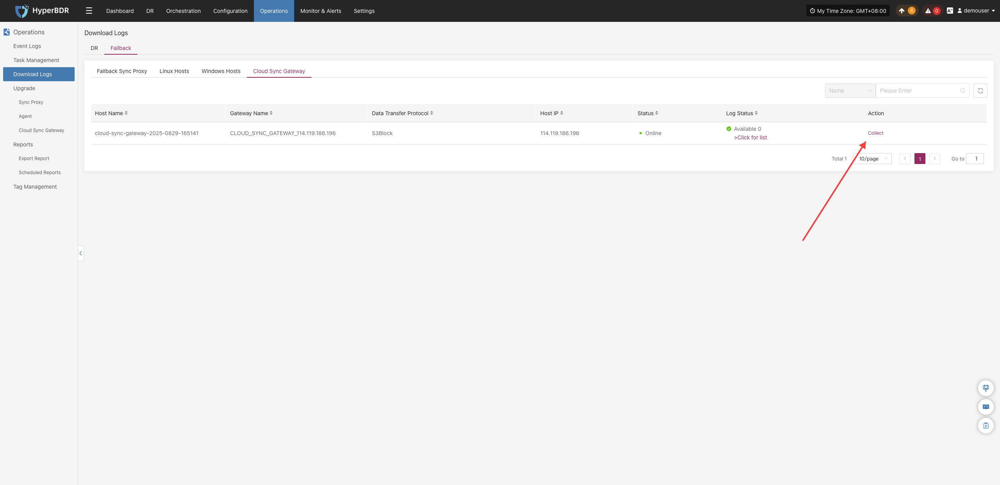
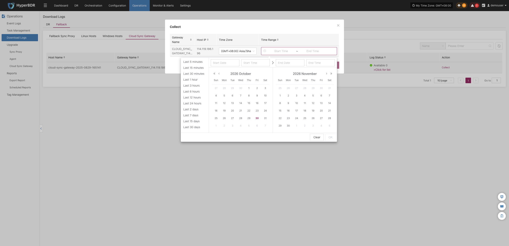
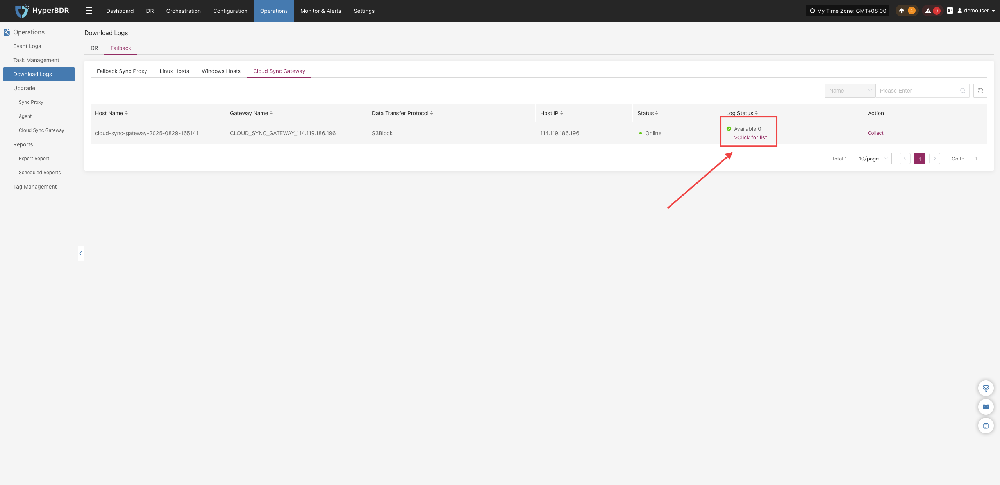
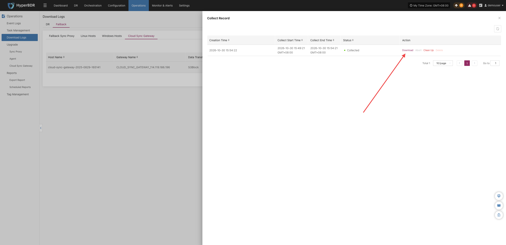

# **Download Logs**

In HyperBDR, users can access the **【O&M Management】>【Download Logs】** module from the top navigation bar to collect and download runtime logs from critical components on demand, facilitating in-depth troubleshooting, routine inspections, and failure diagnostics.

## **DR**

### **Supported Resource Types**

| **Resource Type** | **Description** |
| :--- | :--- |
| **Console** | Management node log collection, including platform core runtime service logs. |
| **Sync Proxy** | Agentless sync proxy hosts deployed via OVA templates. |
| **Linux Host** | Operating system host logs from Linux hosts with Agent installed. |
| **Windows Host** | Operating system host logs from Windows hosts with Agent installed. |
| **Cloud Sync Gateway** | Gateway hosts automatically created at the disaster recovery target cloud platform upon initiating DR. |

### **Page Field Descriptions**

| **Field Name** | **Example** | **Description** |
| :--- | :--- | :--- |
| **Host Name** | onepro | Identifier name of the target host. |
| **Host IP** | 192.168.7.141 | Communication IP address of the target host. |
| **Status** | Online | Current connectivity status of the host (logs cannot be collected if the host is offline). |
| **Log Status** | Available | Current readiness status of the logs (click to expand the list of collection history records). |
| **Action** | Collect | Entry button to initiate the log collection task. |

### **Collection Example: Sync Proxy**

Navigate to **【O&M Management】>【Download Logs】** and switch to the **【DR】>【Sync Proxy】** tab to collect and download log files for the specified sync proxy host:

#### **Log Collection**

Select the target host and click the **【Collect】** button in the corresponding row:

#### **Select Time Range**

In the popup dialog, specify the log time range to collect. The system provides convenient preset shortcuts (such as Last 15 minutes, Last 1 hour, Last 30 days) as well as custom date-time ranges via the calendar picker:

#### **Start Collection**

After confirming the selected time range and submitting, the system automatically launches the log collection task, and the log status changes to "Collecting":

#### **Download Logs**

Once log collection is completed, the status updates to **"Available"**. Click "Click for list" to open the Collect Record drawer, select the target log file, and click **【Download】** to complete the download:

## **Failback**

### **Supported Resource Types**

| **Resource Type** | **Description** |
| :--- | :--- |
| **Failback Sync Proxy** | Agentless failback sync proxy hosts deployed via OVA templates. |
| **Linux Host** | Operating system host logs from Linux failback hosts with Agent installed. |
| **Windows Host** | Operating system host logs from Windows failback hosts with Agent installed. |
| **Cloud Sync Gateway** | Gateway hosts automatically created at the target cloud platform upon initiating reverse failback. |

### **Page Field Descriptions**

| **Field Name** | **Example** | **Description** |
| :--- | :--- | :--- |
| **Host Name** | ubuntu-ova | Identifier name of the target host. |
| **Host IP** | 192.168.7.202 | Communication IP address of the target host. |
| **Status** | Online | Current connectivity status of the host (logs cannot be collected if the host is offline). |
| **Log Status** | Available | Current readiness status of the logs (click to expand the list of collection history records). |
| **Action** | Collect | Entry button to initiate the log collection task. |

### **Collection Example: Cloud Sync Gateway**

Navigate to **【O&M Management】>【Download Logs】** and switch to the **【Failback】>【Cloud Sync Gateway】** tab to collect and download log files for the target gateway host:

#### **Log Collection**

Select the target gateway host and click the **【Collect】** button in the corresponding row:

#### **Select Time Range**

In the popup dialog, specify the log time range to collect. The system provides convenient preset shortcuts (such as Last 15 minutes, Last 1 hour, Last 30 days) as well as custom date-time ranges via the calendar picker:

#### **Start Collection**

After confirming the selected time range and submitting, the system automatically launches the log collection task, and the log status changes to "Collecting":

#### **Download Logs**

Once log collection is completed, the status updates to **"Available"**. Click "Click for list" to open the Collect Record drawer, select the target log file, and click **【Download】** to complete the download:

