# **Reports**

Currently, users can export various system operation and management reports for **DR** and **Failback** processes through the HyperBDR console. This feature helps users perform **regular analysis and archiving** of platform status, supporting O&M audit, issue tracking, and management evaluation.

## **Supported Report Types and Descriptions**

| **Report Type** | **Description** |
| :--- | :--- |
| **Host DR Summary Report** | Summarizes basic info for all registered and unregistered hosts under the current tenant, including sync, drill, takeover counts, OS type, etc. |
| **Host Sync Data Detailed Report** | Details of sync tasks for all registered and unregistered hosts under the current tenant. |
| **Host DR Drill Detailed Report** | Details of drill tasks for all registered and unregistered hosts under the current tenant. |
| **Host DR Takeover Detailed Report** | Details of takeover tasks for all registered and unregistered hosts under the current tenant. |
| **Host DR Cycle Summary Report (Day)** | Daily statistics of disaster recovery cycle data for registered and unregistered hosts under the current tenant, showing sync, drill, and takeover frequencies, as well as capacity trends. |
| **DR Cloud Sync Gateway Summary Report** | Summarizes basic info for all cloud sync gateways under the current tenant. |
| **DR Cloud Sync Gateway Detailed Report** | Detailed info for all cloud sync gateways under the current tenant, down to each disk. |

## **Report Export Details**

### **Host DR Summary Report**

| **Field Name** | **Description** |
| :--- | :--- |
| **Host Name** | Host name, identifies the DR host. |
| **Host IP** | Host IP address for network identification and communication. |
| **Step** | Current step number in DR registration. |
| **Status** | Current task or operation status, e.g., Registered. |
| **Host Status** | Whether the host is successfully registered in the system. |
| **Storage Type** | Storage type, e.g., Block Storage or Object Storage. |
| **Cloud Type** | Cloud platform type and version, e.g., OpenStack Community (Juno+). |
| **OS Type** | Operating system type, e.g., Windows or Linux. |
| **Sync Count (Succeeded)** | Number of successful data sync tasks. |
| **Sync Count (Failed)** | Number of failed data sync tasks. |
| **Drill Count (Succeeded)** | Number of successful DR drills. |
| **Drill Count (Failed)** | Number of failed DR drills. |
| **Takeover Count (Succeeded)** | Number of successful DR takeovers. |
| **Takeover Count (Failed)** | Number of failed DR takeovers. |
| **Sync Size (GB)** | Cumulative synced data in GB. |
| **Region** | Cloud platform region identifier. |
| **Zone** | Availability zone (if any). |
| **Flavors** | Host specs (vCPU/memory/disk), e.g., 8 cores, 16GB RAM, 50GB disk. |
| **Disk Count** | Number of disks on the host. |
| **Capacity (GB)** | Total disk capacity on the host in GB. |
| **Subnet** | Subnet name the host belongs to. |
| **Network** | Network name connected to the host. |
| **Security Group** | Security group policy name applied to the host. |
| **Fixed IP** | Fixed private IP address of the host (unassigned). |
| **Public IP** | Public IP address of the host (unassigned). |

### **DR Cloud Sync Gateway Detailed Report**

| **Field Name** | **Description** |
| :--- | :--- |
| **Created Time** | Creation time of the cloud sync gateway resource. |
| **Cloud Sync Gateway Name** | Name of the cloud sync gateway, used to identify the component. |
| **Cloud Account Name** | Cloud account name, indicating which cloud platform account the gateway is bound to. |
| **Block Storage Platform** | Cloud platform type, e.g., OpenStack, VMware, etc. |
| **User Name** | Tenant or username that created the gateway resource. |
| **Status** | Current working status of the gateway (e.g., "Enabled", "Disabled"). |
| **Health Status** | Operational health status of the gateway (e.g., "Normal", "Abnormal"). |
| **Data Transfer Protocol** | Protocol used for data transfer, e.g., TCP, iSCSI, etc. |
| **Region** | Region in the cloud platform. |
| **Zone** | Availability zone in the cloud platform. |
| **Image** | Image name used by the cloud sync gateway. |
| **Flavor** | Resource configuration template used by the cloud gateway (e.g., CPU/memory/disk specs). |
| **System Disk Type** | System disk type, e.g., SSD, SATA, etc. |
| **System Disk Size** | System disk capacity in GB. |
| **Backup Volume** | Name of the backup volume currently attached or used. |
| **Max Backup Volume** | Maximum backup volume count or capacity supported by the gateway. |
| **Volume Name** | Name of the volume currently in use. |
| **Pool Uuid** | Unique identifier of the storage pool where the volume is mounted. |
| **Pool Name** | Name of the storage pool where the volume is mounted. |
| **Total Volume Capacity (GB)** | Total capacity of the current volume in GB. |
| **Usage Status** | Resource usage status, e.g., "In Use" or "Idle". |
| **Allocation Status** | Allocation status, indicating whether the gateway is associated with a host. |
| **Allocation Host** | If allocated, indicates the host name to which the gateway is currently attached or bound. |

### **DR Cloud Sync Gateway Summary Report**

| **Field Name** | **Description** |
| :--- | :--- |
| **Created Time** | Time the record was created, formatted as "YYYY/MM/DD HH:mm:ss". |
| **Cloud Sync Gateway Name** | Cloud sync gateway name, usually the gateway's IP address or unique identifier. |
| **Cloud Account Name** | Cloud account name, used to identify the specific cloud service account. |
| **Block Storage Platform** | Block storage platform type used, e.g., OpenStack, AWS, etc. |
| **User Name** | Username operating the sync gateway. |
| **Status** | Current status, e.g., "Creation Success". |
| **Health Status** | Health status, e.g., "Online" indicates the gateway is reachable. |
| **Data Transfer Protocol** | Data transfer protocol, e.g., "S3Block" indicates S3-based block storage transfer. |
| **Region** | Region name of the cloud platform. |
| **Zone** | Availability zone of the cloud platform, or "-" if none. |
| **Image** | Image name and unique identifier, usually the OS image. |
| **Flavor** | VM specs, combination of CPU, memory, and disk size. |
| **System Disk Type** | System disk type, e.g., default volume type "DEFAULT_VOLUME_TYPE". |
| **System Disk Size** | System disk size in GB. |
| **Backup Volume** | Current number of backup volumes. |
| **Max Backup Volume** | Maximum allowed number of backup volumes. |
| **Total Volume Capacity (GB)** | Total capacity of all volumes in GB. |
| **Hosts Count** | Number of associated hosts. |

### **Host DR Cycle Summary Report (Day)**

| **Field Name** | **Description** |
| :--- | :--- |
| **Serial Number** | Unique entry number. |
| **Period** | Time period covered by the report. |
| **Host Name** | Host name. |
| **Host IP** | Host IP address. |
| **Step** | Current step or phase number. |
| **Status** | Status, e.g., "Registered" for registered. |
| **Host Status** | Host status, e.g., "Registered" for registered host. |
| **Storage Type** | Storage type, e.g., "Block Storage". |
| **Cloud Type** | Cloud platform type, e.g., "OpenStackCommunity(Juno+)". |
| **OS Type** | OS type, e.g., Windows, Linux. |
| **Sync Count (Succeeded)** | Successful sync count. |
| **Sync Count (Failed)** | Failed sync count. |
| **Drill Count (Succeeded)** | Successful drill count. |
| **Drill Count (Failed)** | Failed drill count. |
| **Takeover Count (Succeeded)** | Successful takeover count. |
| **Takeover Count (Failed)** | Failed takeover count. |
| **Sync Size (GB)** | Synced data size in GB. |
| **Region** | Cloud platform region. |
| **Zone** | Availability zone, or "-" if none. |
| **Flavors** | VM specs (CPU, memory, disk). |
| **Disk Count** | Number of disks. |
| **Capacity (GB)** | Storage capacity in GB. |
| **Subnet** | Subnet name. |
| **Network** | Network name. |
| **Security Group** | Security group name. |
| **Fixed IP** | Fixed IP, or "-" if none. |
| **Public IP** | Public IP, or "-" if none. |

### **Host DR Takeover Detailed Report**

| **Field Name** | **Description** |
| :--- | :--- |
| **Host Name** | Host name. |
| **Host IP** | Host IP address. |
| **Status** | Current status, e.g., task completed, abnormal. |
| **Task Status** | Task status, reflects takeover progress. |
| **Start Time** | Task start time. |
| **End Time** | Task end time. |
| **Execution Time** | Task duration. |
| **Storage Type** | Storage type, e.g., Block Storage. |
| **Cloud Type** | Cloud platform type, e.g., OpenStackCommunity(Juno+). |
| **Region** | Cloud platform region. |
| **Zone** | Availability zone, "-" if none. |
| **Flavors** | VM specs (CPU, memory, disk). |
| **Disk Count** | Number of disks. |
| **Capacity (GB)** | Storage capacity in GB. |
| **Network** | Network name. |
| **Subnet** | Subnet name. |
| **Security Group** | Security group name. |
| **Fixed IP** | Fixed IP, "-" if none. |
| **Public IP** | Public IP, "-" if none. |
| **Task Details** | Task details, describes execution info/results. |

### **Host DR Drill Detailed Report**

| **Field Name** | **Description** |
| :--- | :--- |
| **Host Name** | Host name. |
| **Host IP** | Host IP address. |
| **Status** | Current status, e.g., task completed, abnormal. |
| **Task Status** | Task status, reflects drill progress. |
| **Start Time** | Task start time. |
| **End Time** | Task end time. |
| **Execution Time** | Task duration. |
| **Storage Type** | Storage type, e.g., Block Storage. |
| **Cloud Type** | Cloud platform type, e.g., OpenStackCommunity(Juno+). |
| **Region** | Cloud platform region. |
| **Zone** | Availability zone, "-" if none. |
| **Flavors** | VM specs (CPU, memory, disk). |
| **Disk Count** | Number of disks. |
| **Capacity (GB)** | Storage capacity in GB. |
| **Network** | Network name. |
| **Subnet** | Subnet name. |
| **Security Group** | Security group name. |
| **Fixed IP** | Fixed IP, "-" if none. |
| **Public IP** | Public IP, "-" if none. |
| **Task Details** | Task details, describes execution info/results. |

### **Host Sync Data Detailed Report**

| **Field Name** | **Description** |
| :--- | :--- |
| **Host Name** | Host name. |
| **Host IP** | Host IP address. |
| **Status** | Current status, e.g., task completed, abnormal. |
| **Task Status** | Task status, reflects sync progress. |
| **Start Time** | Task start time. |
| **End Time** | Task end time. |
| **Execution Time** | Task duration. |
| **Capacity Size (GB)** | Sync capacity in GB. |
| **Sync Mode** | Sync mode, e.g., full or incremental. |
| **Average Sync Rate (Mbps/s)** | Average sync rate in Mbps. |
| **Synced Size (GB)** | Synced data size in GB. |
| **Task Details** | Task details, describes execution info/results. |

## **Report Export**

The report export module is used to collect and export various business statistical reports on the platform. It supports customized filter conditions such as report type, statistical time range, and host scope, allowing backup, host, and O&M-related data to be exported as local files for offline auditing, business archiving, and data reconciliation.

::: note Tenant Data Isolation
Data of different tenants is isolated, and only the currently logged-in tenant account can export report data within its tenant scope. To download host information reports for other tenants, users belonging to the respective tenant must log in to the console.
:::

### **Report Export Example**

#### **Collect Report**

* Navigate to **【O&M Management】>【Report Export】** to enter the report management page:

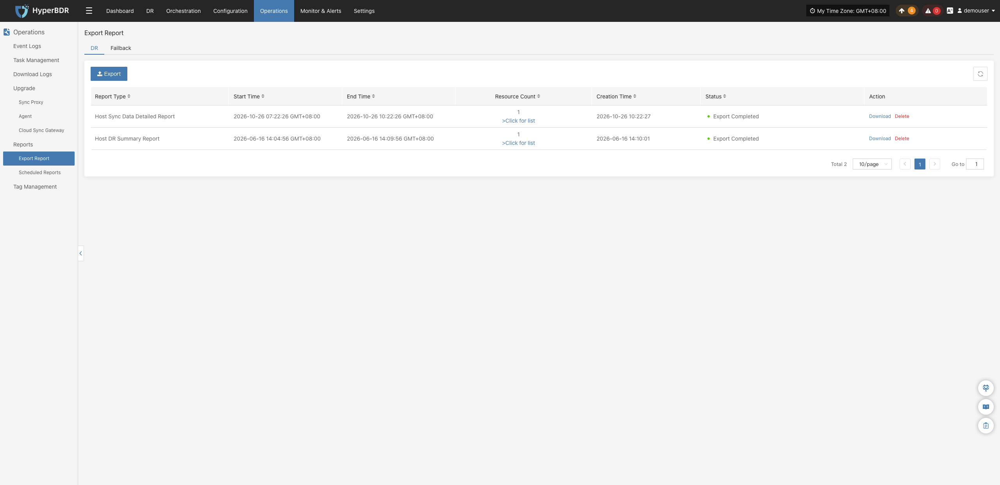

* Click the **【Export】** button, and select the report type, scope (Range), time zone, and time range as needed:

::: tip Range Description
* **All Host**: Includes all hosts under the current tenant in the report. After selecting this option, you do not need to proceed to the next step to select hosts. Click **【Submit】** directly to initiate report collection.
* **Select Host**: Includes only selected target hosts in the report. After selecting this option, click **【Next】** to enter the host selection interface, select the target hosts, and then click **【Submit】**.
:::

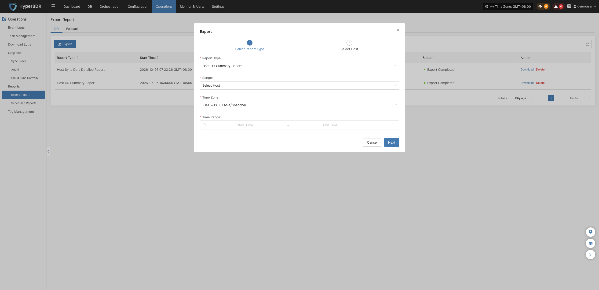

* If **Select Host** is selected for the range, the system will open the host selection interface. Select the target hosts and click **【Submit】** to initiate report collection:

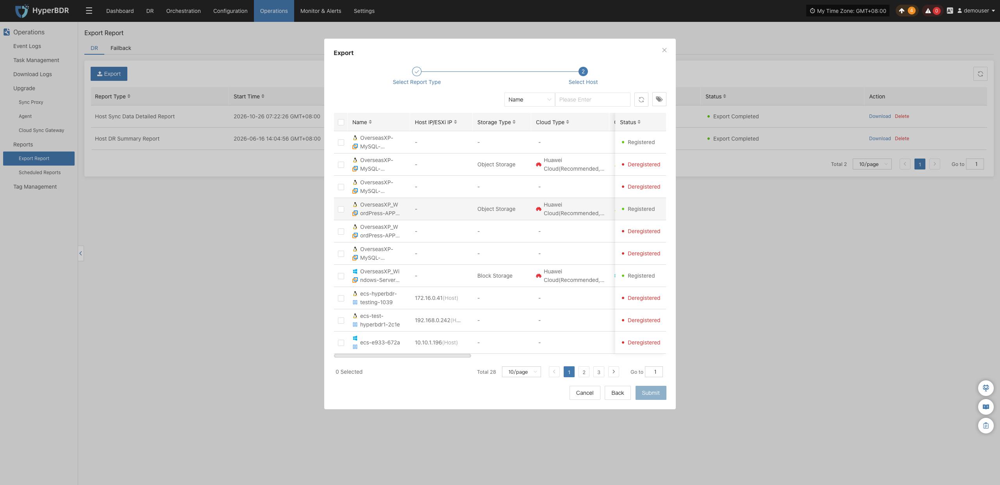

#### **Download Report**

Once report export is completed, locate the target report record in the list and click **【Download】** in the action column to download the generated report file:

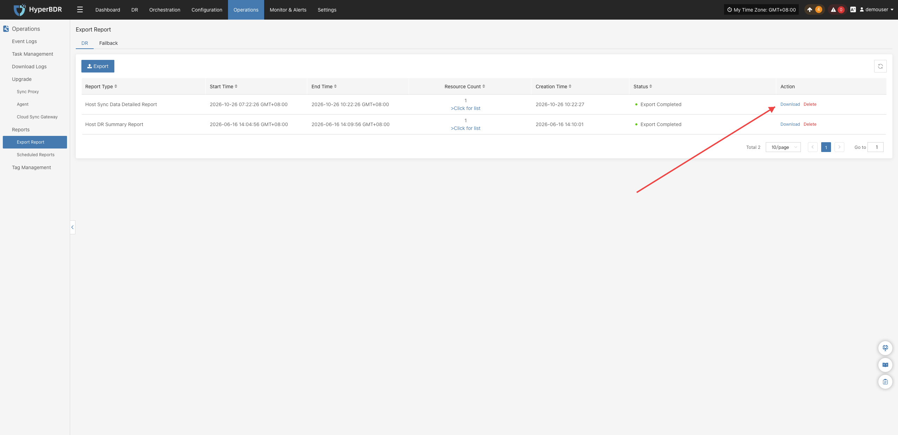

## **Scheduled Reports**

The scheduled report module supports configuring periodic automatic report tasks. The system automatically collects business data within the specified scope according to the preset cycle, generates reports, and supports local download or email delivery, enabling regular archiving and automated auditing without repeated manual collections.

::: note Tenant Data Isolation
Data of different tenants is isolated, and only the currently logged-in tenant account can configure and view its scheduled report tasks. To operate scheduled reports for different tenants, users belonging to the respective tenant must log in to the console.
:::

### **Scheduled Report Example**

#### **Create Scheduled Report**

* Navigate to **【O&M Management】>【Scheduled Reports】** to enter the scheduled report management page:

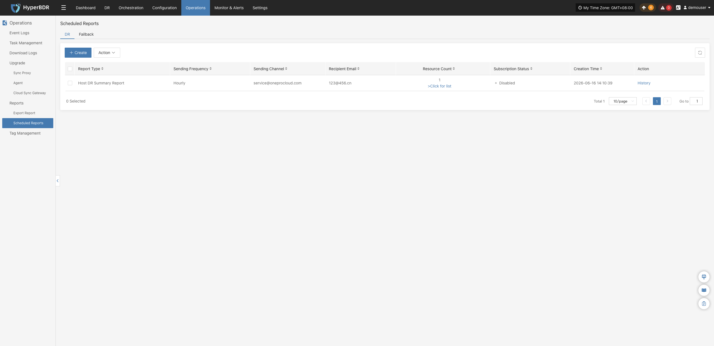

* Click the **【+ Create】** button, and configure the report type, scope (**All Host / Select Host**), sending channel, recipient email, frequency, and data time zone in the creation popup dialog:

::: tip Range Description
* **All Host**: Includes all hosts under the current tenant in the scheduled report. After selecting this option, you do not need to proceed to the next step to select hosts. Click **【Submit】** directly to complete creation.
* **Select Host**: Includes only selected hosts in the scheduled report. After selecting this option, click **【Next】** to enter the host selection interface, select the target hosts, and then click **【Submit】**.
:::

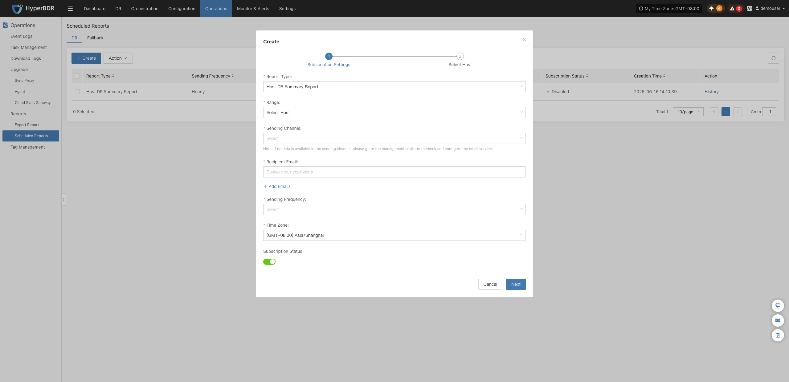

* If **Select Host** is selected for the range, the system will open the host selection interface. Select the target hosts to include in the report, verify all parameters, and click **【Submit】** to complete creation:

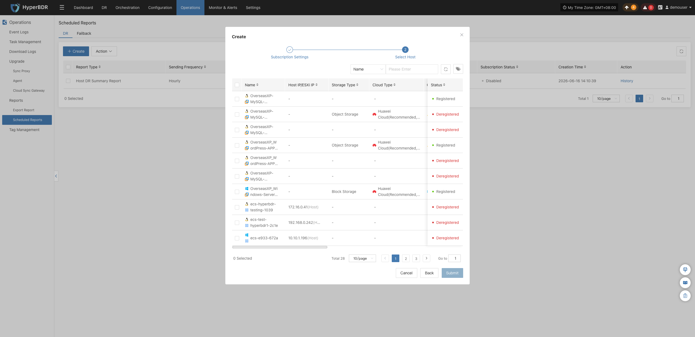

#### **View History Records**

In the scheduled reports list, users can inspect historical generation runs and reports for each scheduled task at any time:

* Click the **【History】** button in the action column of the target task to slide out the history drawer on the right:

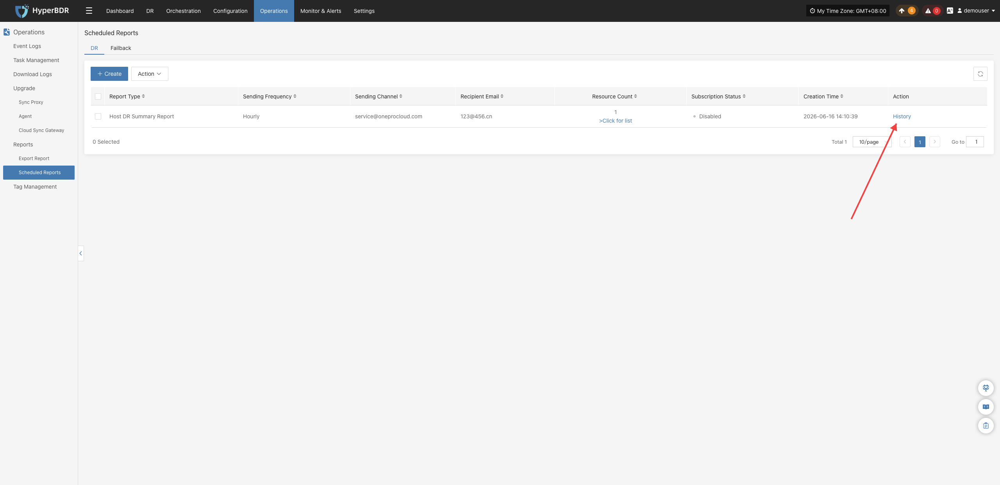

* In the history drawer, users can view the report type, task ID, statistical start/end time, and execution status of each automatic collection, and click **【Download】** to download historical report files directly:

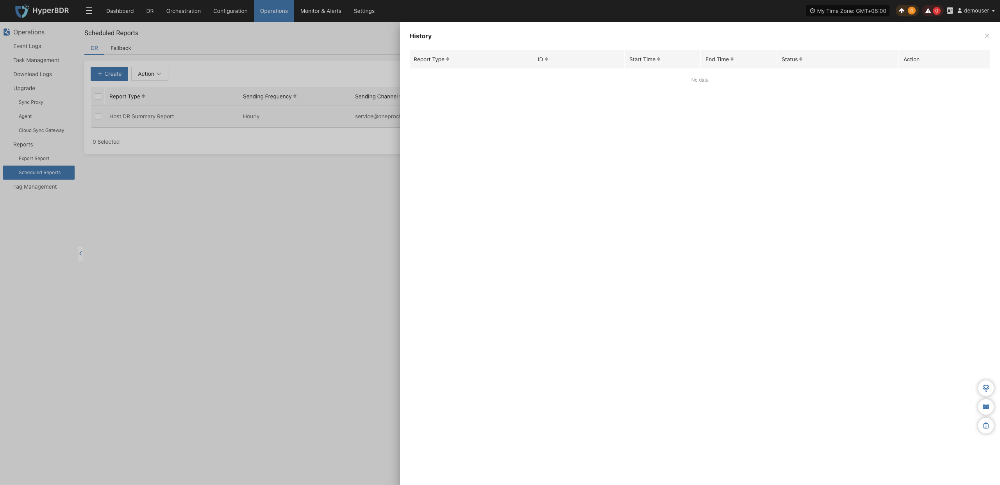

#### **Action**

After selecting target scheduled report tasks in the list, click the **【Action】** dropdown button above the table to perform the following management operations:

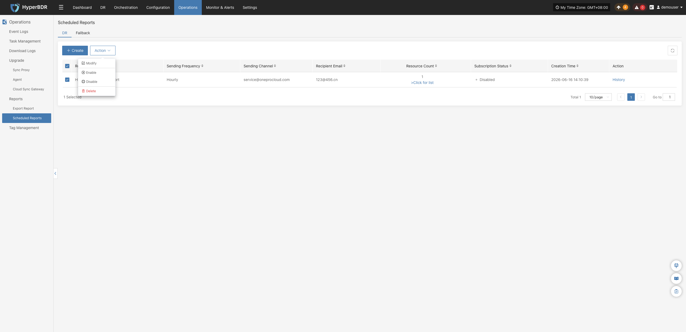

##### **Modify**

Select the target scheduled report task and click **【Modify】** to open the edit dialog. You can adjust the report type, scope, time zone, push channel, recipient email, target hosts, or execution frequency. After submission, changes take effect on the next cycle:

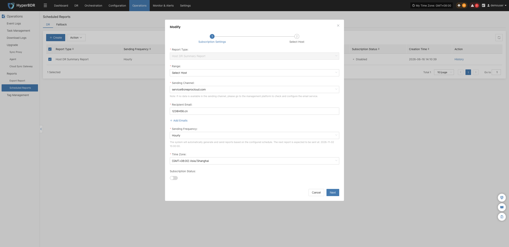

##### **Enable**

For a disabled scheduled task, select it in the list and click **【Action】>【Enable】** to resume automated periodic execution. The subscription status switches to "Enabled":

##### **Disable**

Select an active scheduled report task, check the row, and click **【Action】>【Disable】** to pause periodic execution while retaining task configuration. The subscription status switches to "Disabled":

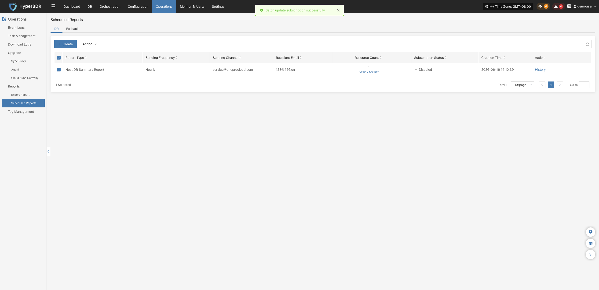

##### **Delete**

Select a scheduled report task that is no longer needed, and click **【Action】>【Delete】**. A secondary confirmation dialog will appear. Confirming will permanently remove the scheduled task:

::: warning
The delete operation is irreversible. Once deleted, the system will no longer generate corresponding reports periodically. Please ensure there is no need for report archiving before deleting.
:::

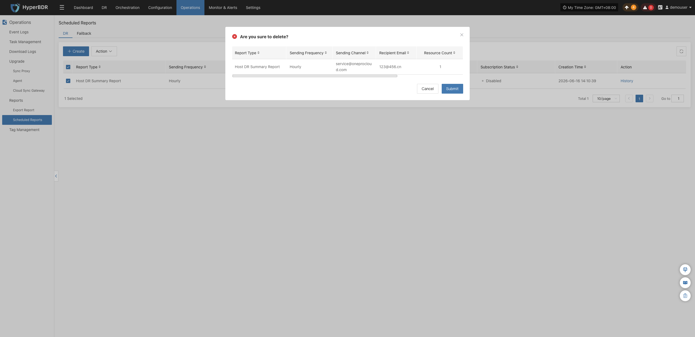
