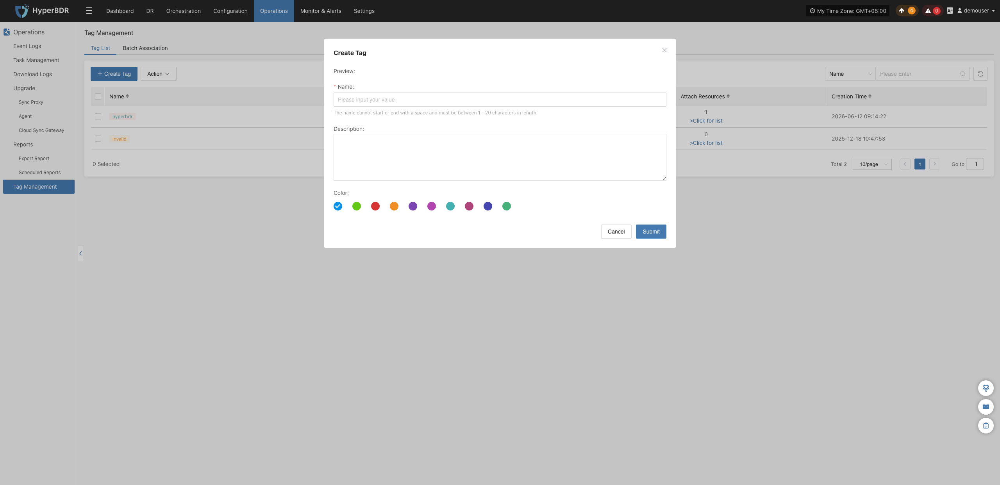
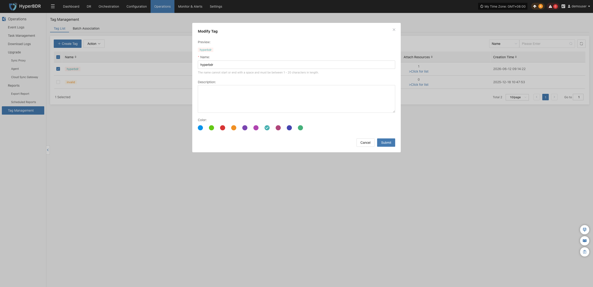
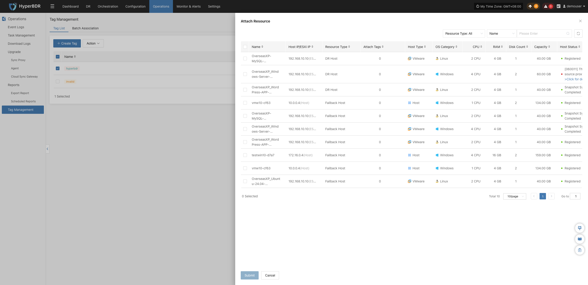
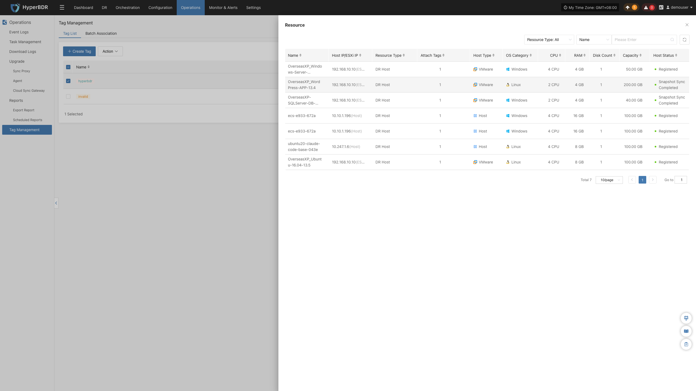
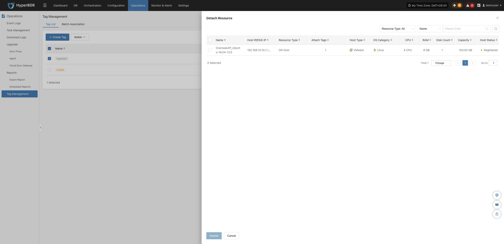
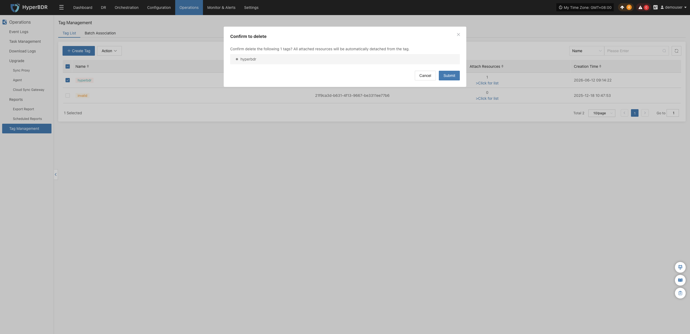
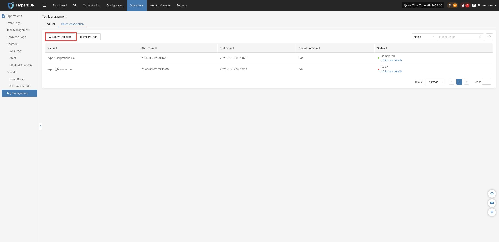
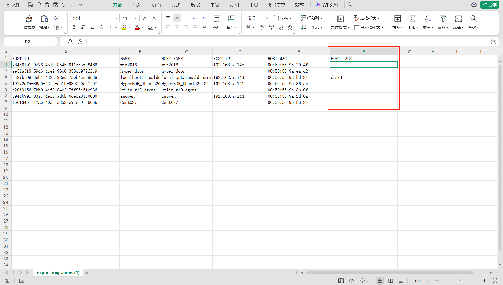
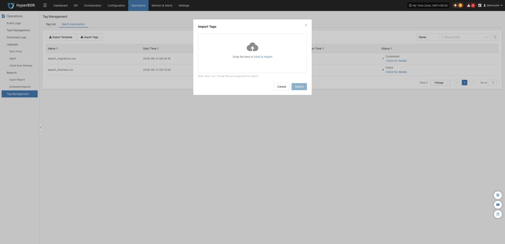
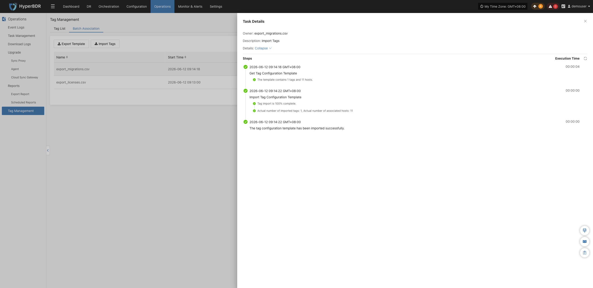

# Tag Management

The Tag Management module is used to classify and identify resources or objects in the system, making it convenient for users to quickly search, categorize, and manage resources, thereby improving management efficiency.

## Tag List

Navigate to **【O&M Management】>【Tag Management】>【Tag List】** from the top menu to enter the tag management page.

### Create Tag

Click **【Create Tag】** to start creating a tag. Add the tag name, description, and tag color according to the popup window content:

### Action

#### Modify

Select a created tag, click **【Action】>【Modify】**, and modify the corresponding name, description, and tag color:

#### Attach Resource

Select a created tag, click **【Action】>【Attach Resource】**, and attach the corresponding host resources:

Click **【Click for list】** to view the attached host resources:

#### Detach Resource

Select a created tag, click **【Action】>【Detach Resource】**, and detach the corresponding host resources:

#### Delete

Select a created tag, click **【Action】>【Delete】**, and delete the corresponding tag. All attached resources will be automatically detached from the tag:

## Batch Association

Navigate to **【O&M Management】>【Tag Management】>【Batch Association】** from the top menu to enter the batch association page.

### Export Template

Click the **【Export Template】** button on the page to start downloading the template file (in csv format):

##### Export Template Description

| Field Name | Description |
| --------- | ----------------------- |
| HOST ID | Unique host identifier, usually in UUID format. |
| NAME | Host name, customized by the user or assigned by the system. |
| HOST NAME | Network hostname of the host. |
| HOST IP | IP address of the host. |
| HOST MAC | MAC address of the host, uniquely identifying the network interface. |
| HOST TAGS | Host tags, custom information used to classify, group, or identify hosts. |

##### Fill in the Template

Fill in the tag names in the HOST TAGS field of the exported template and save it:

### Import Tags

Click the **【Import Tags】** button on the page, and drag or upload the file into the prompt box to start importing the template:

After the import is completed, tags will be created automatically and resources will be added to the corresponding tags. Click **【Click for details】** in the task list to expand the import task execution details drawer:

