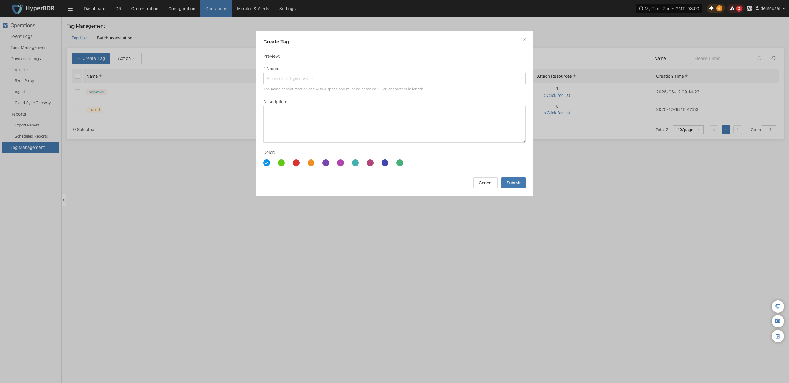
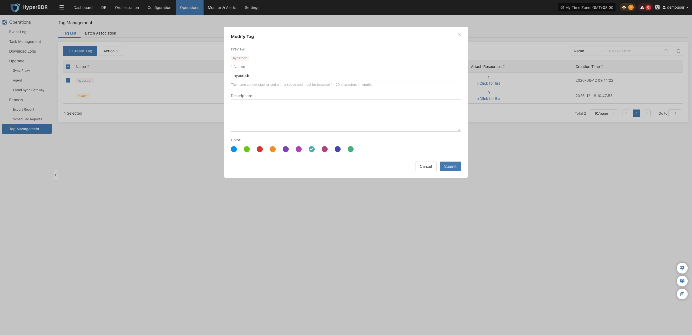
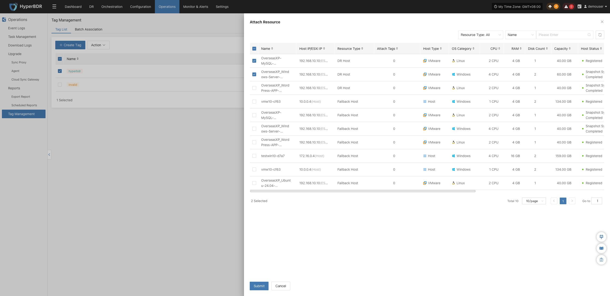
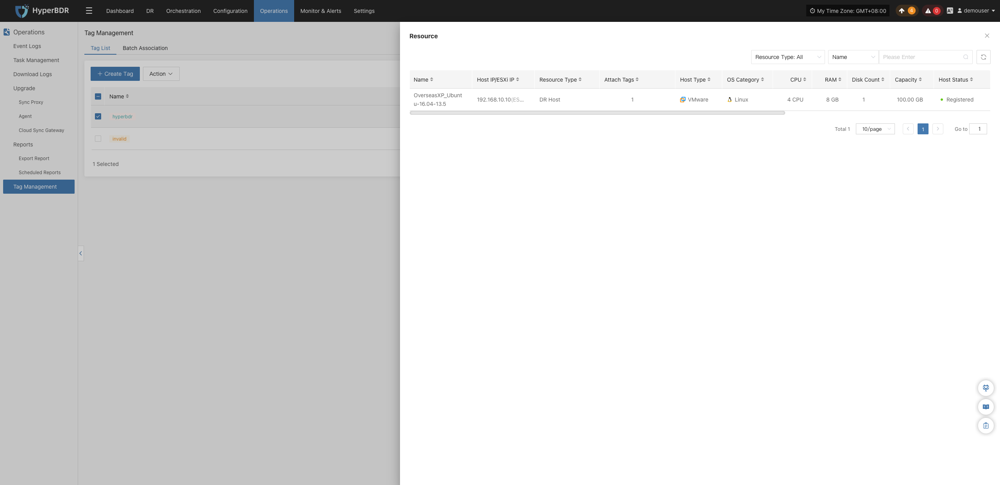
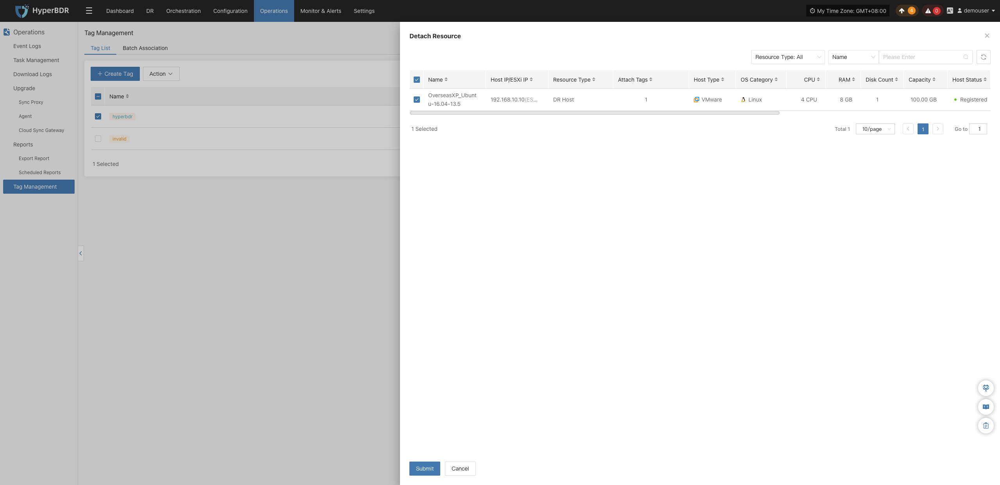
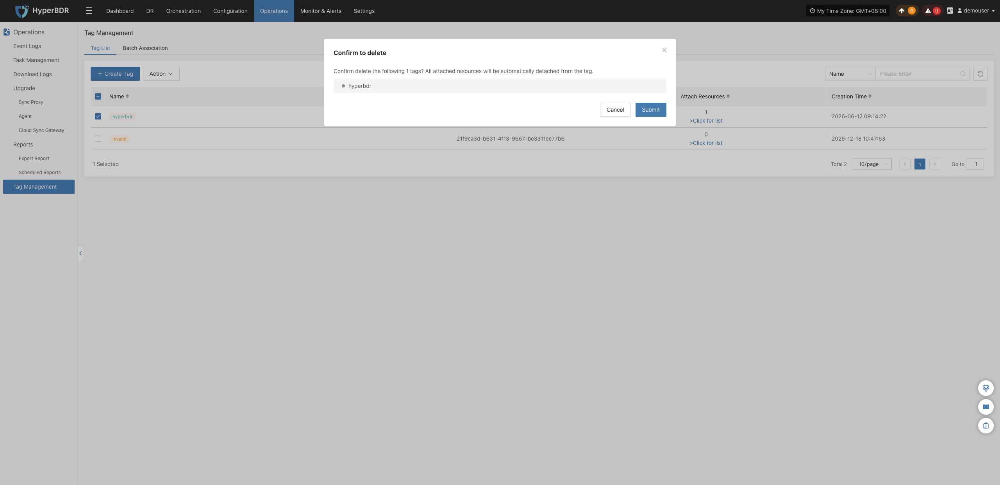
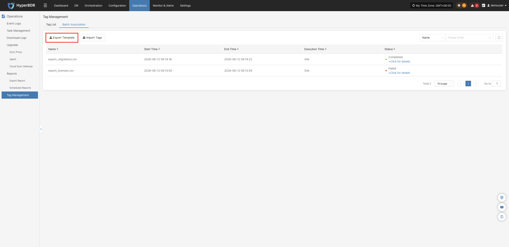
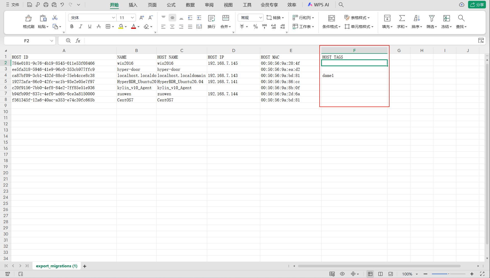
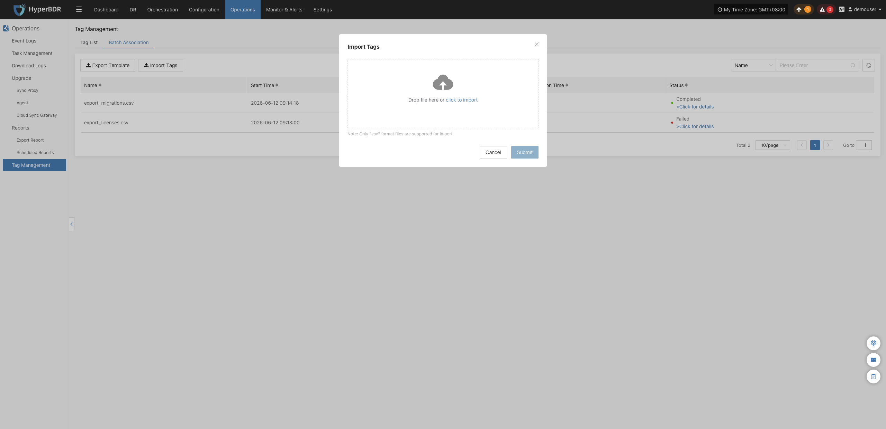
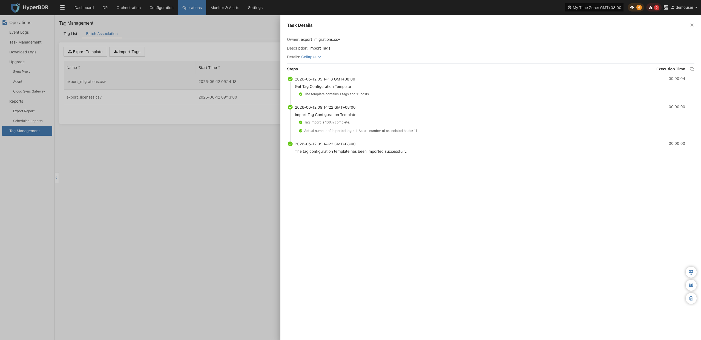

# **Tag Management**

The Tag Management module is used to classify and multi-dimensionally label host resources in the system, enabling users to quickly search, group, and manage large-scale resources, thereby improving O&M efficiency.

## **Tag List**

Log in to the HyperBDR console, and navigate to **【O&M Management】>【Tag Management】>【Tag List】** from the top navigation bar.

### **Create Tag**

Click the **【+ Create Tag】** button in the upper left corner of the list. In the popup window, fill in the tag name, description, and select the tag color, then click **【Submit】** to complete creation:

### **Action**

Select a created target tag, and click the **【Action】** dropdown menu above the list to perform the following management operations:

#### **Modify**

Select the target tag, click **【Action】>【Modify】**, edit the tag name, description, and color as needed, then click **【Submit】** to save changes:

#### **Attach Resource**

Select the target tag, click **【Action】>【Attach Resource】**, check the host resources to associate in the popup host list, and click **【Submit】** to complete binding:

After association, click **【>Click for list】** in the target tag's row. The resource details drawer will slide out from the right, allowing you to centrally view all host resources currently bound to this tag:

#### **Detach Resource**

Select the target tag, click **【Action】>【Detach Resource】**, check the host resources to unbind, and click **【Submit】** to confirm detaching:

#### **Delete**

Select the tag that is no longer needed, click **【Action】>【Delete】**, and a secondary confirmation dialog will pop up. Click **【Submit】** to permanently delete the tag:

::: warning
The deletion operation is irreversible. Once a tag is deleted, all attached host resources will be automatically detached from it.
:::

## **Batch Association**

For scenarios requiring large-scale tag assignment, you can import CSV templates to achieve batch association. Navigate to **【O&M Management】>【Tag Management】>【Batch Association】**.

### **Export Template**

Click the **【Export Template】** button in the upper right corner of the page to download the host tag configuration template file (`.csv` format):

#### **Template Field Description**

| **Field Name** | **Description** |
| :--- | :--- |
| **HOST ID** | Unique host identifier, usually in UUID format. |
| **NAME** | Host name, custom or system-assigned name. |
| **HOST NAME** | Host network hostname. |
| **HOST IP** | Host IP address. |
| **HOST MAC** | Host MAC address, uniquely identifying the network interface. |
| **HOST TAGS** | Host tags, used to classify, group, or identify custom host information (multiple tags separated by English commas). |

#### **Fill in and Save Template**

Open the exported CSV template file, enter the target tag names in the **HOST TAGS** column for the corresponding hosts, and save the file:

### **Import Tags**

Click the **【Import Tags】** button in the upper right corner of the page, and drag or upload the filled CSV template file in the popup dialog (only `.csv` format is supported):

After uploading and submitting the file, the system will automatically create the corresponding tags in batch and attach host resources to them. You can view the import progress and execution results in the task details drawer:

