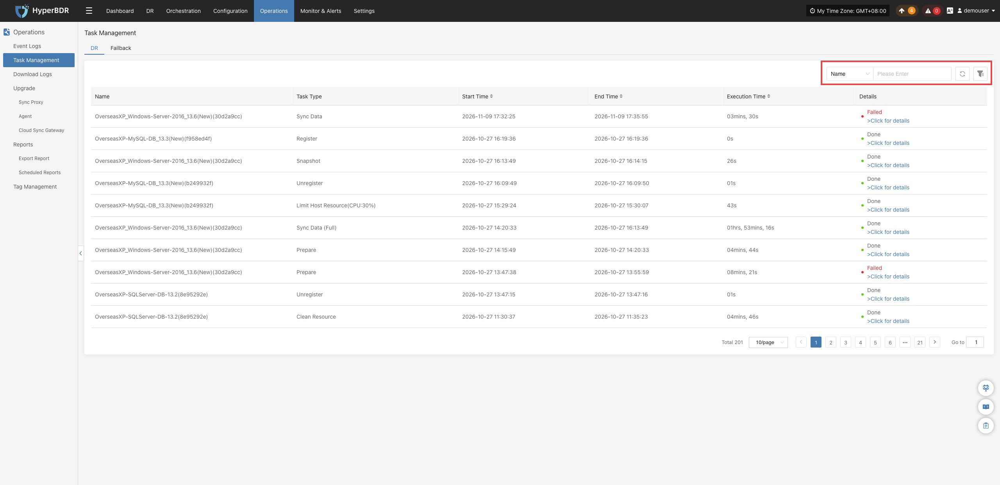
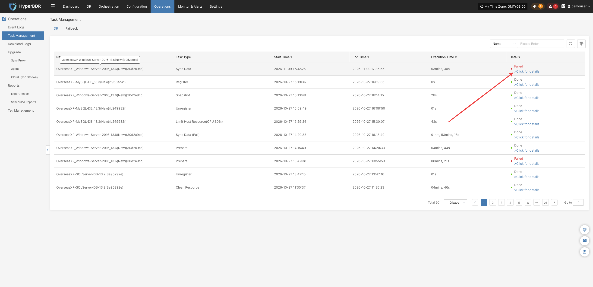
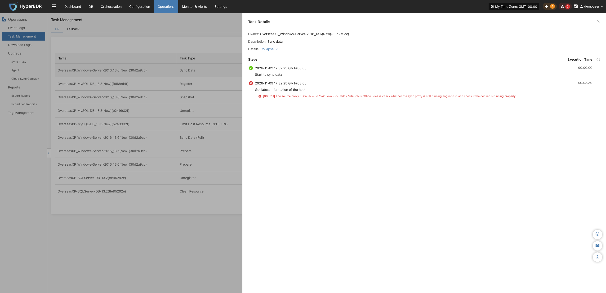

# Task Management

In HyperBDR, users can navigate to **"O&M Management > Task Management"** from the top navigation bar to view the execution status of all operation tasks related to **DR** and **Failback** on the platform, covering key task types such as registration, snapshot, and replication. The system supports real-time task status query, filtering, and detail viewing, helping users comprehensively grasp task execution progress and results.

## Page Functions

Users can perform quick queries via the top filter conditions, which support filtering log data by the following fields:

* **Advanced Filter:**

  * **Task Type**: Select the resource type related to the operation (e.g., virtual machines, user resources, etc.)

  * **Task Status**: Filter specific operation events by keyword

  * **Task Name**: Enter keywords to precisely locate the corresponding resource

  * **End Time**: Sort in ascending or descending order

### Task Management Descriptions

| Field Name | Description |
| ---- | ------------------------ |
| Name | Displays the host or resource name associated with the executed task. |
| Task Type | Shows the type of the task, such as registration, snapshot, sync, replica creation, etc. |
| Start Time | The actual start time of the task. |
| End Time | The time when the task was completed or interrupted. |
| Execution Time | The duration for which the task was executed. |
| Details | Displays the final execution result status of the task; click to view task details. |

> Note: Click the status link in the "Task Status" field to jump to the task details page, where you can view the complete logs and error information.

### Additional Notes

* The page supports pagination, displaying 10 records per page by default. You can adjust the number of records per page or jump to a specific page via the filter bar at the bottom of the page, so as to quickly locate the information you need.

* Task logs are used to record the behaviors and results of the system during the execution of various operation tasks, retaining a complete operation history to facilitate user tracing and troubleshooting.
