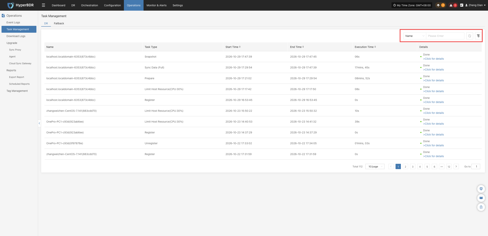
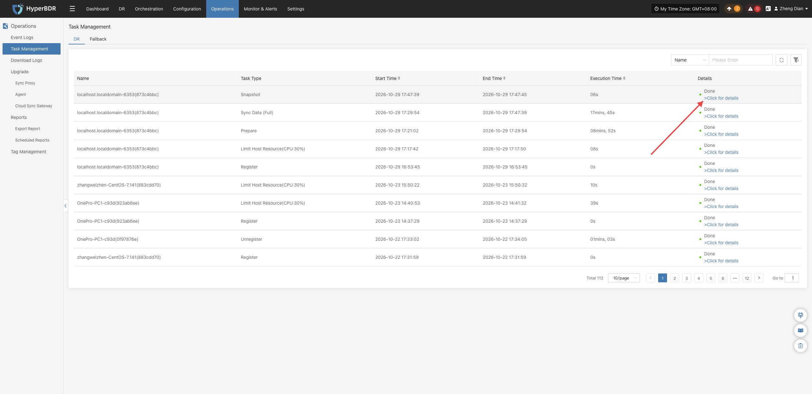
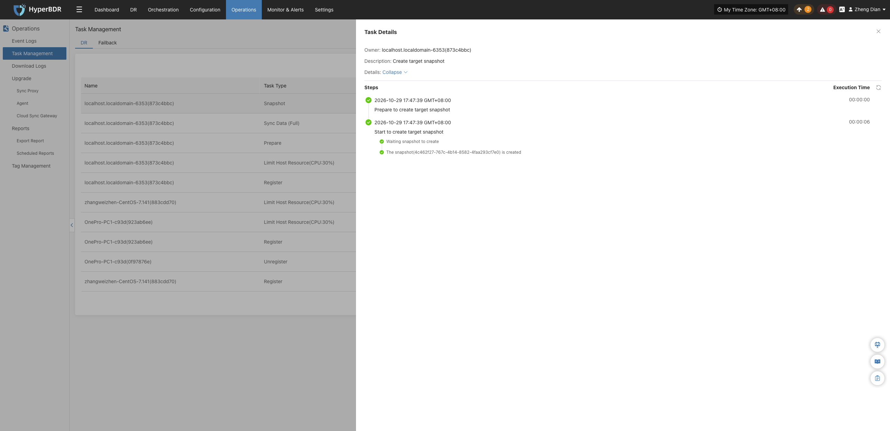

# **Task Management**

The task management module is used to centrally monitor the execution status of all background asynchronous tasks across daily disaster recovery protection, data snapshots, incremental replication, emergency takeover, and business failback. The system supports real-time task status tracking, combined filtering, and log detail inspection, helping administrators comprehensively grasp execution progress and troubleshoot abnormal results.

The system provides two task views: **【DR】** and **【Failback】**, which share identical features and operational workflows. Log in to the HyperBDR console, and navigate to **【O&M Management】>【Task Management】** from the top navigation bar. The page defaults to the **【DR】** tab, and you can switch to the **【Failback】** tab as needed to review reverse failback task execution records.

## **Task Retrieval and Filtering**

Users can select the task type from the dropdown list at the top of the list and enter keywords such as the host name in the search box to query records. You can also use the advanced filter feature to configure more specific filter conditions to accurately locate target tasks:

* **Name**: Enter keywords to search for the host or resource name associated with the task.
* **Task Type**: Filter by specific task category (e.g., data synchronization, snapshot creation, host recovery, drill launch, etc.).
* **Task Status**: Quickly filter by execution status (e.g., All, In Progress, Success, Failed, etc.).
* **Time Sorting**: Supports sorting in ascending or descending order based on the task start time or end time.

## **Task List Field Descriptions**

Each record in the task list contains the following fields:

| **Field Name** | **Description** |
| :--- | :--- |
| **Name** | Displays the host or resource name associated with the executed task. |
| **Task Type** | Shows the specific type of task, such as registration, snapshot, sync, replica creation, disaster recovery, etc. |
| **Start Time** | The actual start time when the task was scheduled and initiated by the system. |
| **End Time** | The time when the task successfully finished, was manually aborted, or encountered an abnormal termination. |
| **Execution Time** | The total duration elapsed from the start of the task to its completion. |
| **Details / Status** | Displays the final execution status of the task (e.g., Success, Failed). Click the link to view task details. |

::: tip View Task Details
In the "Details" column of the list, click **【View Details】** to open the task details window, which displays the complete execution workflow, step-by-step progress, and detailed error logs.
:::

::: note
Task management supports pagination (defaulting to 10 records per page). Administrators can adjust the number of items per page or navigate through pages to locate historical task records. All task logs are automatically recorded by the system for end-to-end audit tracking and troubleshooting.
:::
