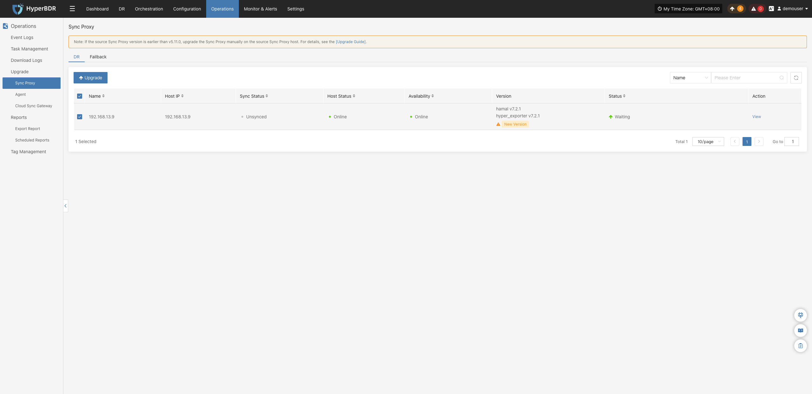
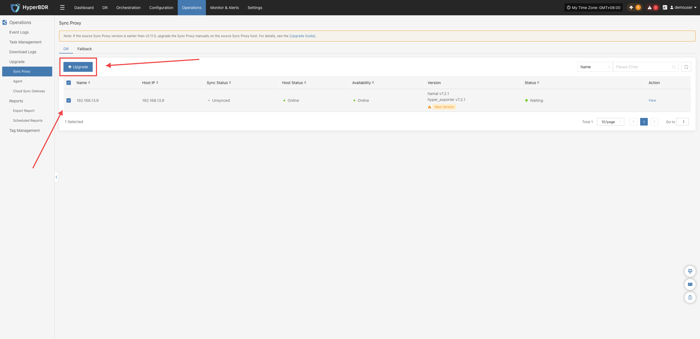
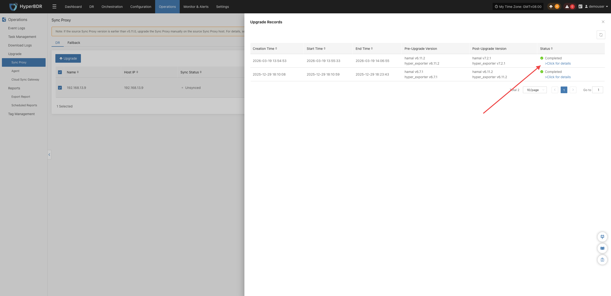
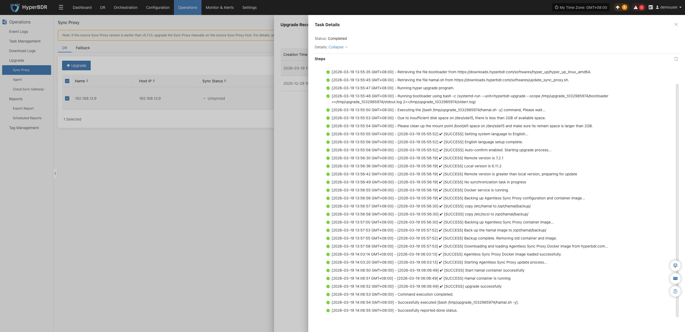

# **Upgrade Management**

Upgrade management is used to centrally maintain and update the versions of various components managed by the platform (including source sync proxies, host agent programs, and cloud sync gateways), ensuring all modules remain on supported, stable releases.

The system provides two component upgrade views: **【DR】** and **【Failback】**, which share identical interface layouts and upgrade workflows. Log in to the HyperBDR console, and navigate to **【O&M Management】>【Upgrade Management】** from the top navigation bar to start managing.

## **Prerequisites for Upgrade**

Before upgrading any endpoint components via the console, the **core console services must be upgraded first**.

Only when updated component packages are loaded into the console will the interface detect and highlight new versions available for upgrade. For details on obtaining installation packages and upgrading the console, please refer to [【O&M Guide】>【Upgrade Management】>【Console】](../../om-guide/upgrade-maintenance/console.md).

## **Supported Upgrade Components**

Under the **【DR】** or **【Failback】** tab, users can perform online version detection and upgrades for the following three types of components:

::: tip Version Prompts and List Notes
When the system detects an available new version for a component, it will display a **▲ New Version** indicator in the "Version" column of the list. If hosts of the corresponding component type have not yet been created or managed in the current environment, the list will appear empty.
:::

| **Component Name** | **Deployment Location** | **Upgrade Prerequisites and Notes** |
| :--- | :--- | :--- |
| **Sync Proxy** | Sync Proxy Host | Proxy host created during production site configuration, used for agentless source-side data synchronization. |
| **Agent** | Protected Linux / Windows production hosts | Hosts with the client Agent installed. |
| **Cloud Sync Gateway** | Target disaster recovery cloud platforms | Data receiving gateway automatically created when configuring 【Block Storage】 for DR/Failback. **Note**: Only gateways using the S3Block transmission protocol support online upgrade. |

## **Component Online Upgrade Workflow**

The upgrade interactions for all three components are identical, supporting both single-host quick upgrades and multi-node batch upgrades. The operational steps are as follows:

### **1. Select Upgrade Targets**

In the left sidebar, select the component type to upgrade: **【Sync Proxy】**, **【Agent】**, or **【Cloud Sync Gateway】** to enter the corresponding component list page.

In the list, check the "Version" column to find hosts displaying new version prompts. Select the checkbox before the host name to choose the target component hosts to upgrade (supports single selection or batch selection).

::: note Note
If the components to be upgraded belong to a failback scenario, first select the corresponding component type in the left sidebar, and then click the **【Failback】** tab at the top of the page to switch to the failback component list before making your selection.
:::

### **2. Initiate Online Upgrade**

Click the **【↑ Upgrade】** button in the upper left corner of the list. The system will automatically dispatch the upgrade task to the target hosts.

### **3. View Upgrade Records and Task Details**

* **View Upgrade History**: Click **【Upgrade Records】** in the target host's action column to slide out the historical upgrade records drawer on the right, displaying upgrade start/end times, pre/post-upgrade versions, and the final status.

* **View Detailed Execution Logs**: In the Upgrade Records drawer, click **【Click for details】** to open the task details drawer and review the step-by-step logs and elapsed time for package download, installation, and verification.

