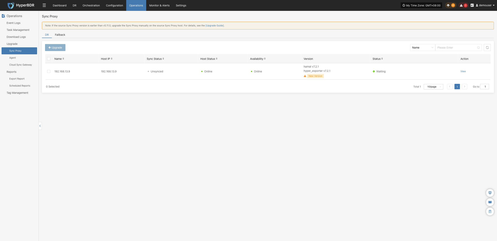
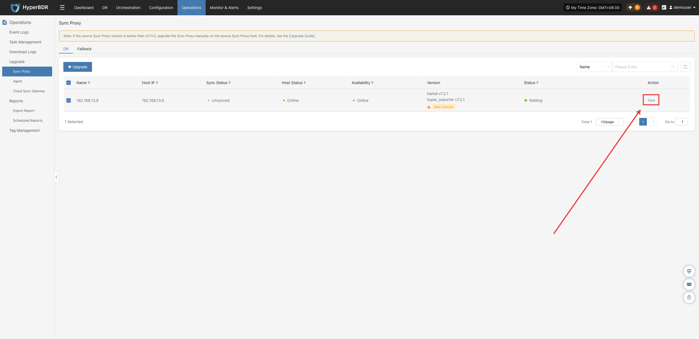
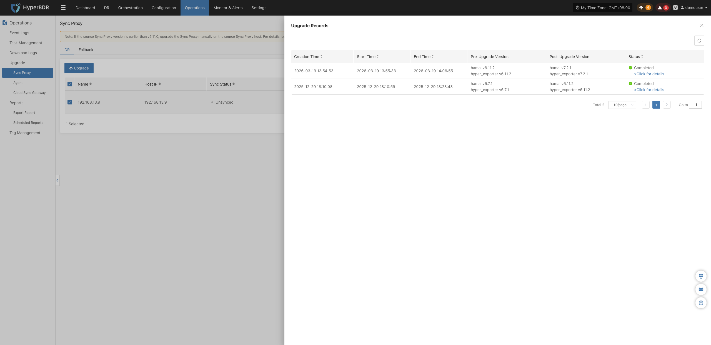
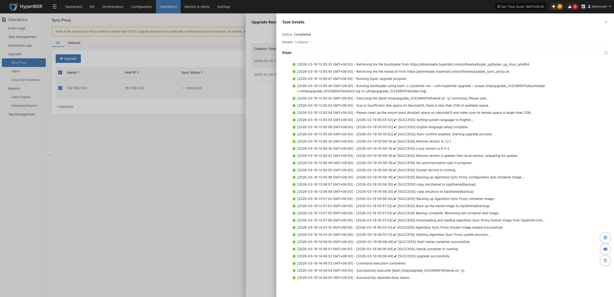
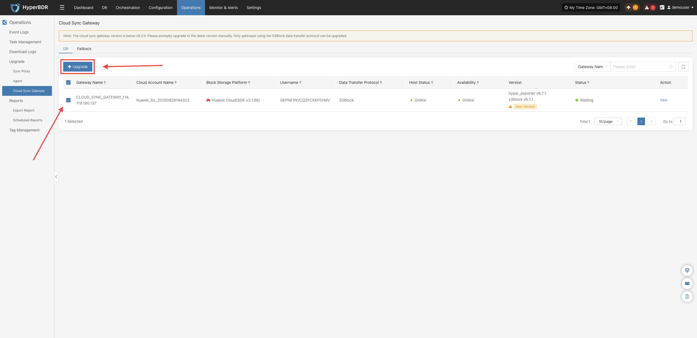
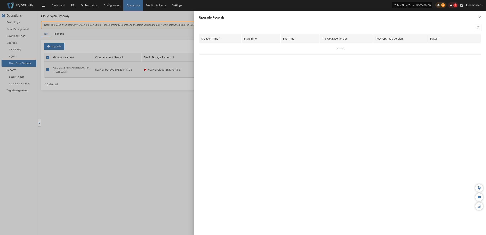

# Upgrade Management

**Upgrade Management** is used to centrally manage version updates of system components and agent programs, ensuring that all modules remain on supported and stable versions. Users can view the current version information through the platform interface and perform online upgrades as needed.

## Upgrade Preparation

Before upgrading each functional component (such as the sync proxy and cloud sync gateway), the console version upgrade must be completed first. As the core of system management, the console version must remain compatible with other components to avoid functional abnormalities or upgrade failures caused by version inconsistency.

### Obtain the Installation Package

#### Online Method:

Log in to the host where the console is installed, and use this method to obtain the installation package.

```bash
# Get the latest HyperBDR package URL.
HYPERBDR_PACKAGE=$(curl -s -k https://install.oneprocloud.com/get_hyperbdr_latest/latest)
echo "HYPERBDR_PACKAGE: ${HYPERBDR_PACKAGE}"

# Get the corresponding MD5 file URL.
HYPERBDR_PACKAGE_MD5="${HYPERBDR_PACKAGE}.md5"
echo "HYPERBDR_PACKAGE_MD5: ${HYPERBDR_PACKAGE_MD5}"

# Extract the package name using string operations.
HYPERBDR_PACKAGE_NAME="${HYPERBDR_PACKAGE##*/}"
echo "HYPERBDR_PACKAGE_NAME: ${HYPERBDR_PACKAGE_NAME}"

# Extract the MD5 file name
HYPERBDR_PACKAGE_MD5_NAME="${HYPERBDR_PACKAGE_NAME}.md5"
echo "HYPERBDR_PACKAGE_MD5_NAME: ${HYPERBDR_PACKAGE_MD5_NAME}"

# Start the download
curl -k -O "$HYPERBDR_PACKAGE"
curl -k -O "$HYPERBDR_PACKAGE_MD5"
```

#### Offline Method:

> If you have already obtained the installation package through the online method, skip this step.

If the installation host cannot directly access the Internet, you can use the browser on another device to visit the following URL to obtain the installation package link:

After the download is completed, use tools such as Xftp to upload the installation package to the console host

```plain text
https://install.oneprocloud.com/get_hyperbdr_latest
```

### Extract to the Specified Directory

Use the following command to extract it to the specified directory:

```plain text
tar zxvf <update package>.tar.gz -C /path/for/extraction
```

### Perform the Upgrade

Execute the upgrade command, and the system will automatically load the update content into the running directory `/opt/installer/production/venvs`:

```plain text
/opt/installer/production/scripts/hmctl upgrade /<extraction path>/installer/venvs
```

## DR

### Sync Proxy

#### Page Functions and Field Descriptions

After completing the console upgrade preparation, users can go to the **"O&M Management > Upgrade Management > DR > Sync Proxy"** module via the navigation bar. The system will automatically detect and prompt for upgradable agent component versions:

| Field Name | Description |
| :--- | :--- |
| Name | The name of the sync proxy host |
| Host IP | The IP address of the target host |
| Sync Status | The current sync status of the host (e.g., Not Synced, Synced) |
| Host Status | Whether the host is online or offline (online upgrades cannot be performed on offline hosts) |
| Availability | The running availability status of the agent component |
| Version | Displays the currently running component version (e.g., hamal, hyper_exporter); if a new version exists, "▲ New Version" will be prompted |
| Status | The current upgrade status of the component (e.g., Waiting, Upgrading, Completed) |
| Action | Supports performing the upgrade operation or viewing details |



#### Upgrade Execution Steps

1. **Select upgrade targets**: Check the checkboxes of the target hosts to upgrade (supports single or batch selection).
2. **Initiate the upgrade task**: Click the **"↑ Upgrade"** button at the upper left of the page, or click the initiate button in the action column of the corresponding host.



3. **View upgrade records**: Click **"Upgrade Records"** in the right action column or the status link, and the upgrade history drawer will slide out on the right, displaying the creation time, start/end time, pre-upgrade version, post-upgrade version, and completion status of each upgrade.



4. **View task execution details**: Click **"Click for details"** in the upgrade records to further expand the task details drawer, and view the detailed logs and execution time of each subtask such as upgrade package download, installation, and verification.



### Agent

The Agent is installed on the protected Linux or Windows production hosts. Its online upgrade logic and operation interactions are completely consistent with the **Sync Proxy**:

1. Go to the **"O&M Management > Upgrade Management > DR > Agent"** page.
2. The page automatically lists all protected hosts and their installed Agent versions. When a new version uploaded to the console is detected, the version column will prompt the new version information.
3. Check the hosts to upgrade, and click the **"↑ Upgrade"** button at the top of the page to initiate the upgrade tasks in batch.
4. Click **"Upgrade Records"** of the corresponding host to track the upgrade progress and execution results at any time.

> Note: If no Agent hosts to upgrade have been connected in the current managed environment, the list will be empty. After the hosts are connected and managed, the system will automatically identify and display the upgrade items.

### Cloud Sync Gateway

The Cloud Sync Gateway is used to receive and write data at the target site during the DR phase. The upgrade process of the gateway component is also consistent with the sync proxy:

1. **Version identification and restrictions**: The system automatically scans the versions of cloud sync gateway components (note: only gateways using the S3Block data transmission protocol support online upgrade).
2. **Perform the upgrade**: Check the gateway hosts to upgrade, and click the **"↑ Upgrade"** button at the upper left of the page to trigger the upgrade.



3. **Upgrade record tracking**: Click the **"Upgrade Records"** drawer of the corresponding gateway row to view historical upgrade versions and execution results.



## Failback

In the failback scenario, the entry of the upgrade management module is located at **"O&M Management > Upgrade Management > Failback"**, including:
* **Sync Proxy**
* **Agent**
* **Cloud Sync Gateway**

Its version compatibility requirements, interface layout, batch check upgrade, and upgrade record viewing processes are completely consistent with the **DR** module. Users can perform upgrades and verification according to the above DR steps based on the status of host and gateway components in the failback business environment.
