# **Batch Tasks**

The Batch Tasks module is used to perform batched, sequenced task orchestration and scheduled execution for multiple protected host resources in the system. It supports dividing multiple hosts into different sequence groups (Task Sequence), automatically triggering operations such as data sync in the defined order, greatly simplifying disaster recovery O&M processes across multiple hosts.

## **Batch Task Management**

Click **【Batch Tasks】** in the left navigation bar to centrally view and manage all batch tasks created in the system:

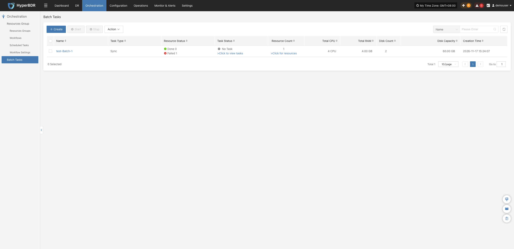

Action buttons are provided above the list: **【Create】**, **【Start】**, **【Stop】**, and **【Action】**; below them are the search and filter bars. The list columns clearly display the task name, task type, resource status, task status, number of resources, total CPU, total memory, number of disks, disk capacity, and creation time.

#### **View Details**

Each row in the batch task list provides detail drill-down drawer entries:

##### **View Associated Tasks**

Click **【Click to view tasks】** in the corresponding table row or click the task name directly, and the detail drawer of the batch task will slide out on the right:

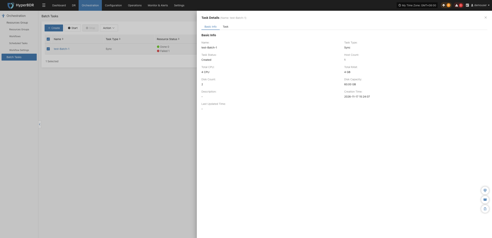

The drawer provides two tabs: **【Basic Info】** and **【Tasks】**:

- **Basic Info**: Displays the name, type, creation status, number of managed hosts, CPU/memory/disk resource specification summary, and creation and update time of the current batch task.
- **Task records**: Click to switch to the **【Tasks】** tab to view all historical execution records of the batch task (including task type, start time, end time, execution duration, and status):

  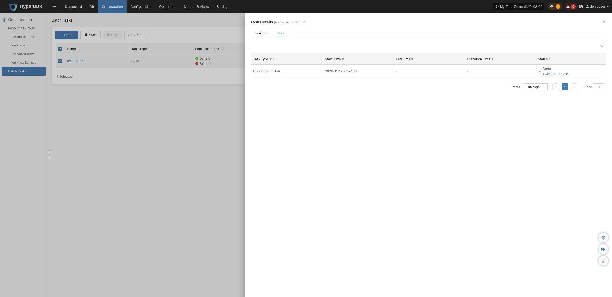

- **View task details**: In the task record list, click **【Click for details】** to further expand the sub-steps, execution duration, and log details of the task:

  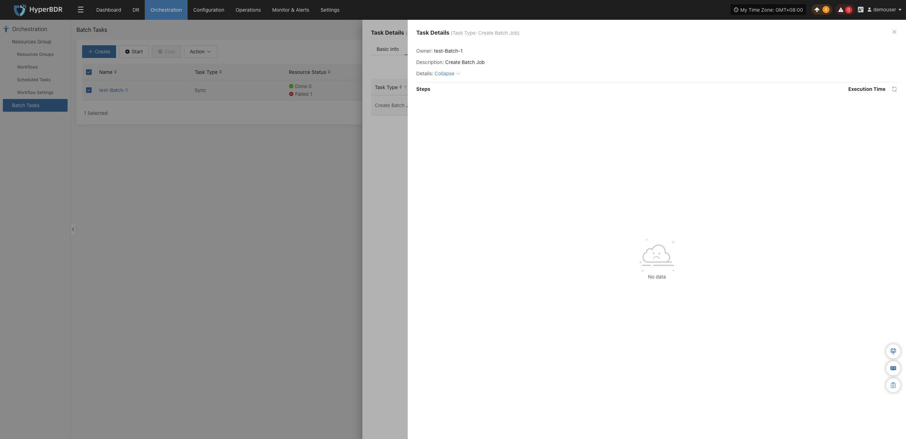

##### **View Associated Resources**

Click **【Click for resources】** in the corresponding table row, and the drawer of host resources managed by the current batch task (Resources List) will slide out on the right:

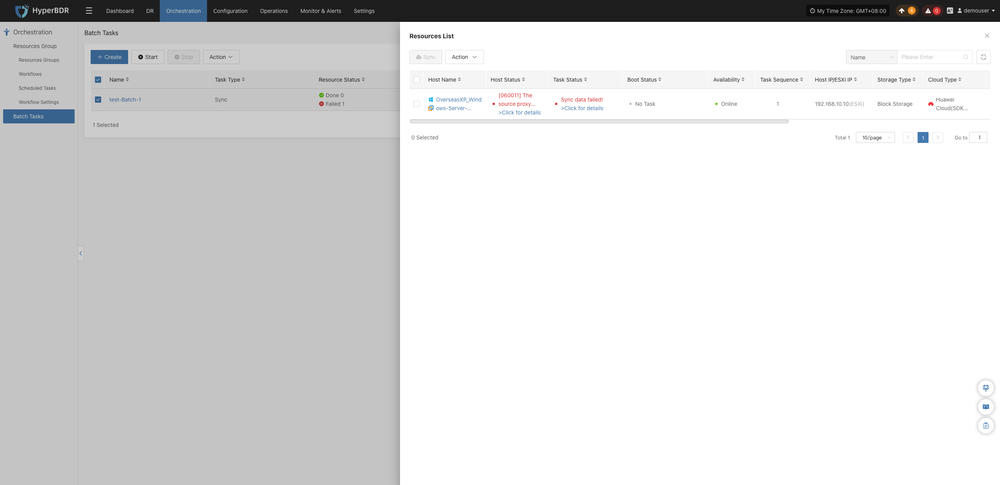

The drawer clearly displays the name, host status, task status, boot status, online status, execution order (Task Sequence), host IP, storage type, and target cloud platform of each protected host.

- **Data sync in the resource drawer**: After selecting the target host in the host resource drawer, click **【Sync】**, and the snapshot quota and sync policy window for that host will pop up:

  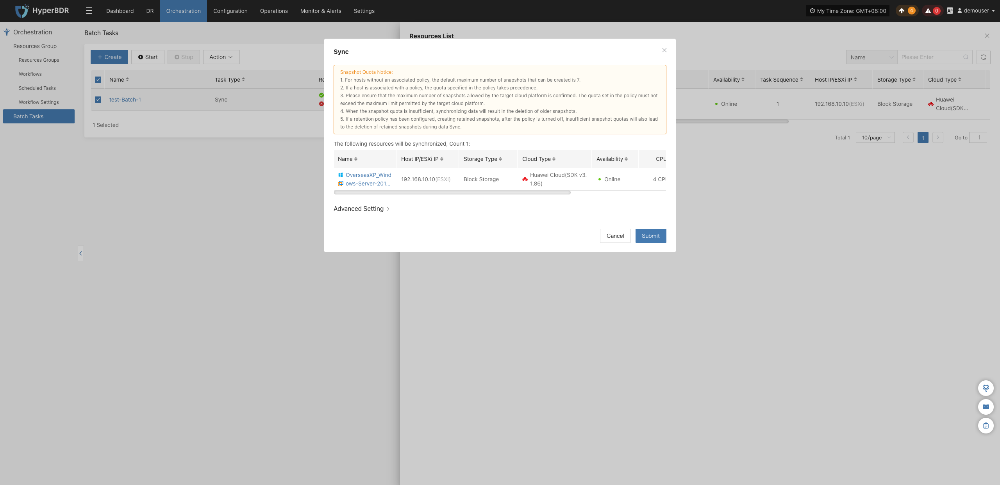

- **DR configuration in the resource drawer**: After selecting the target host in the host resource drawer, click **【Action】**, and the DR configuration menu of that host will pop up. For details, refer to [Host DR](../dr/host-dr.md):

  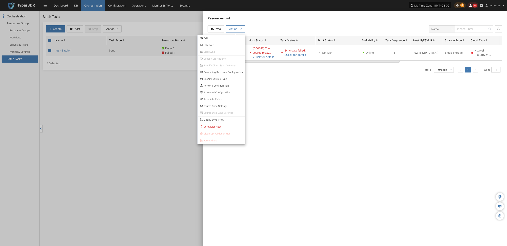

- **View host task details**: When a host encounters an exception during sync or disaster recovery, click **【Click for details】** in its task status column, and the sub-step execution logs and troubleshooting information of that host will slide out:

  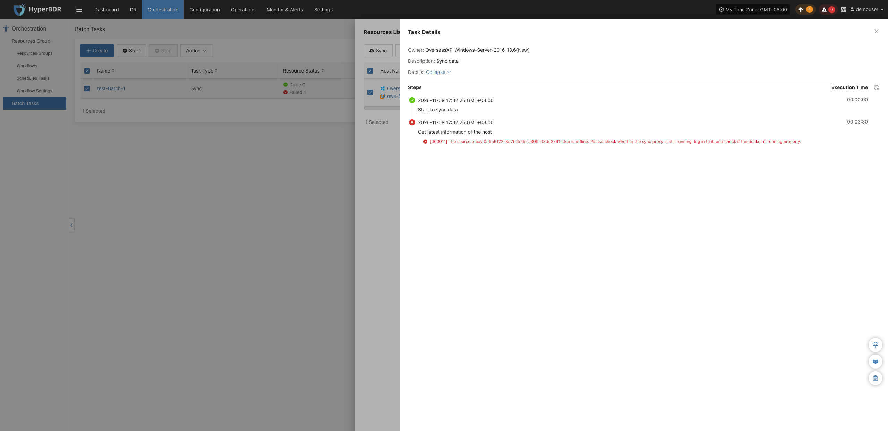

### **Create Batch Task**

Click the **【Create】** button in the upper left corner of the list, and the full-screen batch task creation wizard page will open:

#### **Step 1: Configure Basic Info**

In the basic info area of the wizard, fill in the basic configuration items of the task:

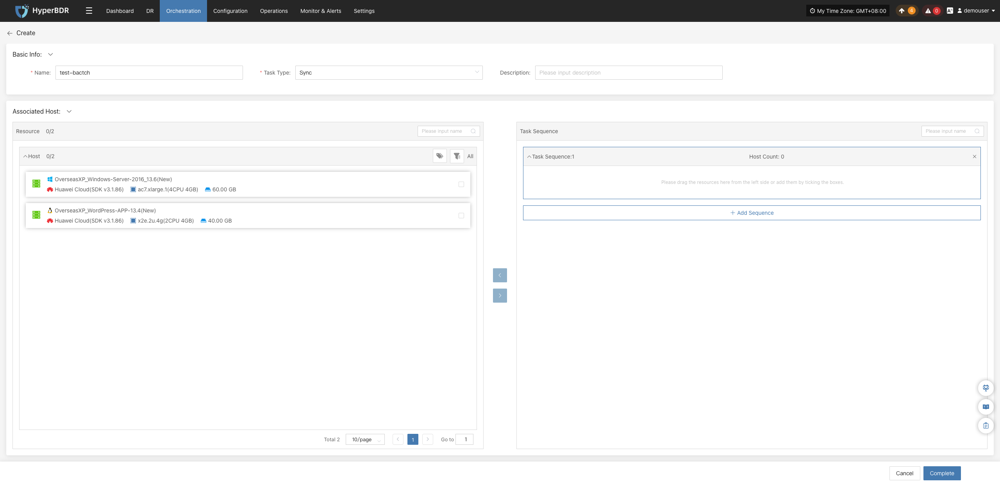

##### **Configuration Description**

| Configuration Item | Required | Description |
| :--- | :---: | :--- |
| **Task Name** | Yes | Custom batch task name for subsequent identification and management |
| **Task Type** | Yes | Select the specific action of the batch task from the dropdown (such as data sync `Sync`) |
| **Description** | No | Business background or remarks of the task |

#### **Step 2: Plan Execution Order and Associated Hosts**

In the associated hosts area, plan the sequence groups of the hosts:

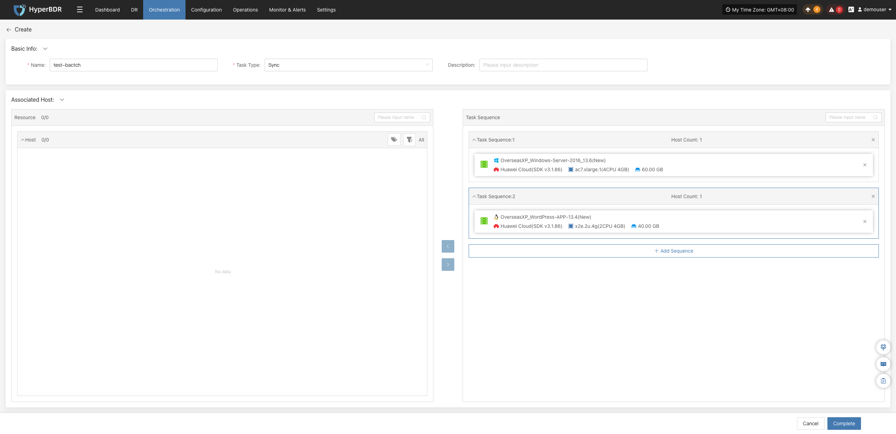

1. The left panel displays the list of protected hosts available in the current system, supporting fuzzy search and filtering by name.
2. The right panel displays the sequence groups (such as Task Sequence: 1). After checking the target hosts on the left, click the rightward transfer arrow to add the hosts to the corresponding sequence group.
3. Click the **【+ Add Sequence】** button to create a new sequence group (such as Task Sequence: 2), and assign the hosts that need to be executed later to the new group.
4. After confirming that all sequence groups and associated hosts are correct, click the **【Complete】** button in the lower right corner to finish creating the batch task.

::: tip Sequence Group Tips
By dividing hosts of different business layers into different Task Sequences (for example, assigning core database hosts to Task Sequence: 1, and application and middleware hosts to Task Sequence: 2), the system will schedule them strictly in batches during execution, ensuring business data consistency and startup order dependencies.
:::

### **Start**

Check the target task in the batch task list, and click the **【Start】** button at the top of the list:

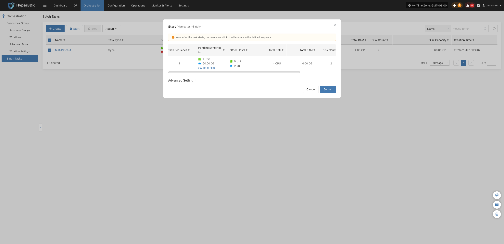

The pop-up start confirmation window clearly displays each sequence group (Task Sequence), the number of pending sync hosts, the number of other hosts, and the total CPU and memory specification summary. Expand **【Advanced Settings】** to fine-tune startup parameters. After confirming everything is correct, click **【Submit】** to trigger the batch task.

::: note Execution Order Note
After the task is started, resources in each group will be started and executed strictly in the defined order (Task Sequence 1 → Task Sequence 2 …).
:::

### **Stop**

When a batch task needs to be interrupted urgently during execution, check the executing target task in the list, and click the **【Stop】** button at the top of the list. The system will stop triggering host tasks of subsequent sequence groups.

### **Action**

Check the target task in the batch task list, and click the **【Action】** dropdown menu at the top of the list:

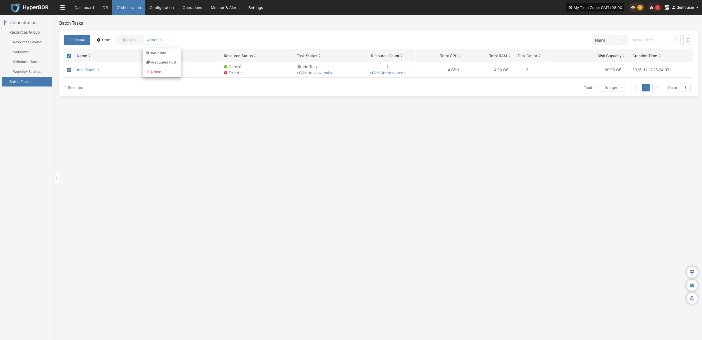

#### **Basic Info**

Click **【Action】>【Basic Info】** to enter the basic info editing page, where you can view or re-edit the name, task type, and description of the current batch task:

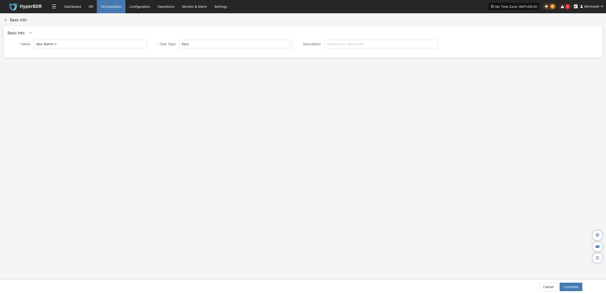

#### **Associated Hosts**

Click **【Action】>【Associated Hosts】** to enter the associated hosts adjustment page, where you can dynamically adjust the managed host list and the sequence group of each host:

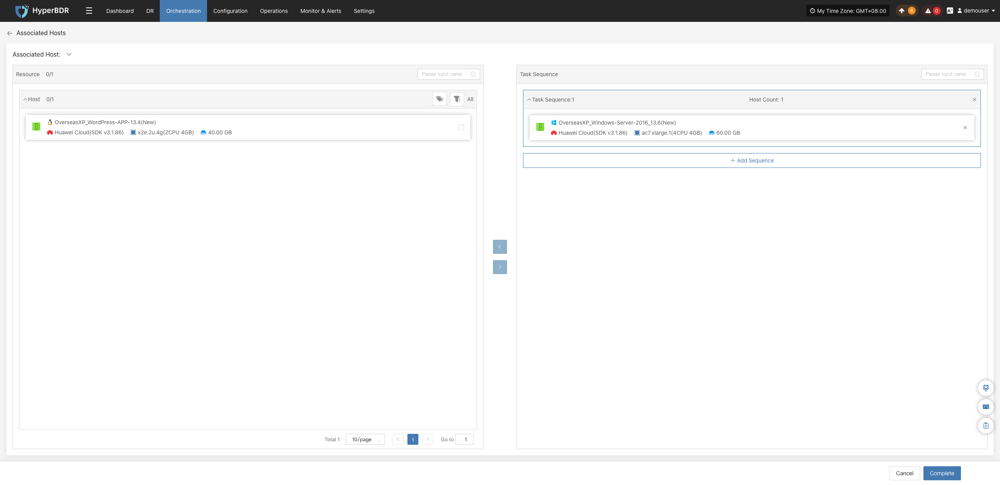

#### **Delete**

Click **【Action】>【Delete】**, type `Yes` as prompted in the secondary confirmation dialog, and click **【Submit】** to completely delete the logical orchestration of the batch task:

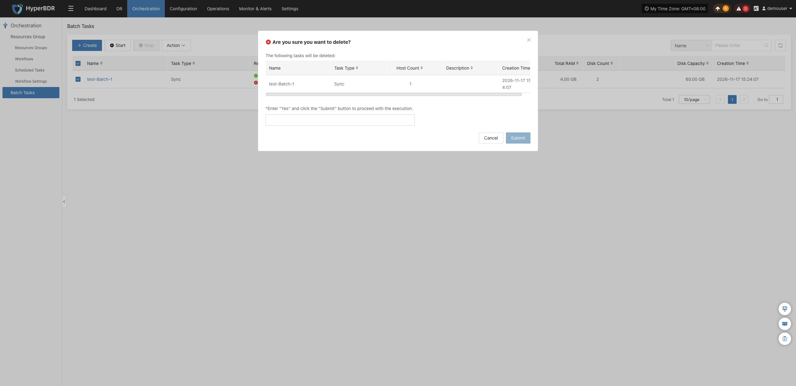

::: warning Operation Impact
Deleting a batch task only deletes the metadata orchestration configuration of the task, and does not affect the managed source host data, underlying sync progress, or disaster recovery snapshots.
:::
