# **Resources Group**

The Resources Group module is used to group, schedule, and orchestrate multiple related resources in the system (including hosts, networks, storage, and custom scripts) in a unified manner. Through the visual workflow canvas, you can predefine the startup dependency order of resources, disaster recovery verification scripts, and scheduled periodic tasks, ensuring that in the event of a disaster, business systems can automatically, quickly, and smoothly complete cross-environment recovery and takeover in the expected order.

## **Resource Group Management**

Log in to the HyperBDR console, and go to the **【Orchestration】>【Resources Groups】** page from the top navigation bar.

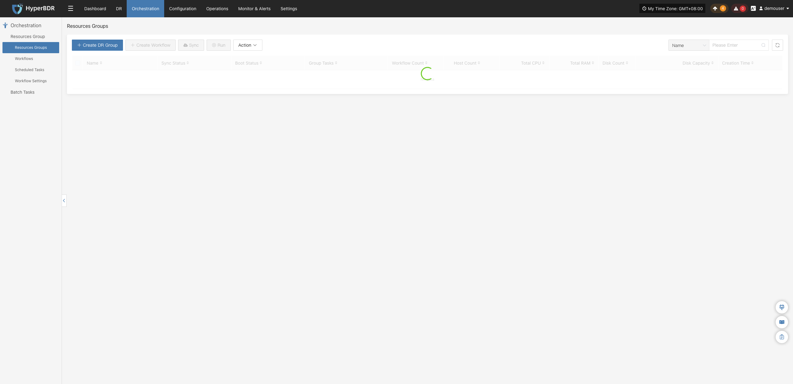

Action buttons are provided above the list: **【Create DR Group】**, **【Create Workflow】**, **【Sync】**, **【Run】**, and **【Action】**; below them are the search and filter bars. The list columns clearly display the resource group name, resource sync status, boot status, task status, number of workflows, number of hosts, and storage capacity.

#### **View Details**

Each row in the resource group list provides three quick detail drill-down drawer entries:

##### **View Associated Tasks**

Click **【Click to view tasks】** in the corresponding table row, and the drawer with all historical task execution records of the resource group will slide out on the right:

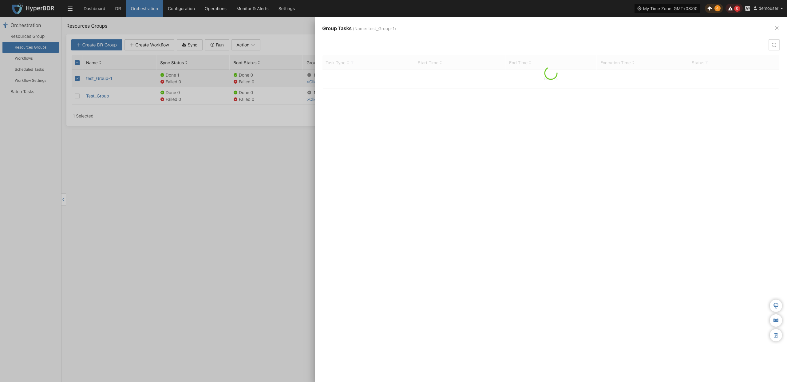

- **View task details**: In the task list drawer, click **【Click for details】** to further expand the sub-steps, execution duration, and log details of the task:

  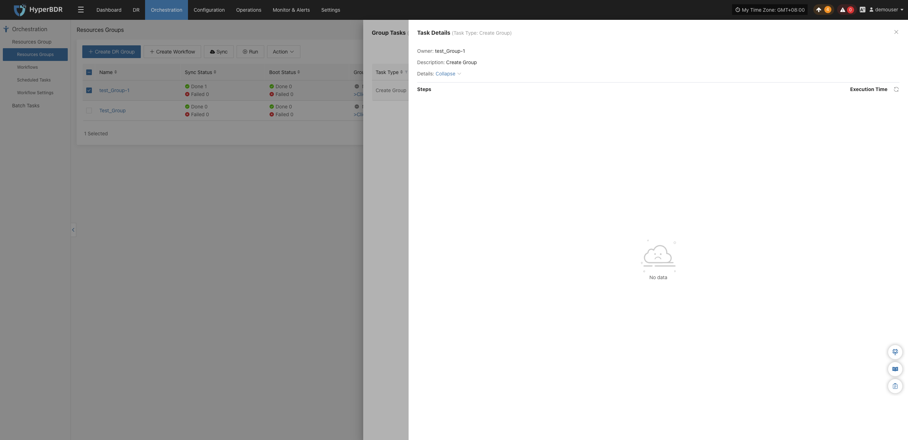

##### **View Associated Workflows**

Click **【Click to view workflows】** in the corresponding table row, and the drawer of all workflows already orchestrated for the current resource group will slide out on the right:

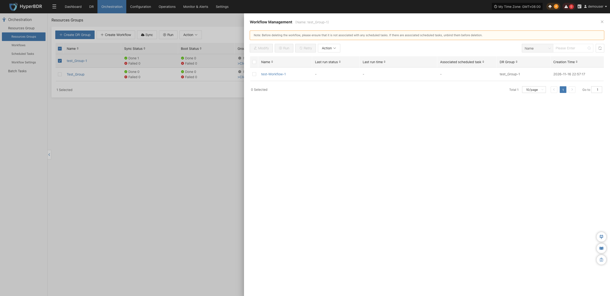

##### **View Associated Resources**

Click **【Click for resources】** in the corresponding table row, and the drawer of host resources managed by the current resource group will slide out on the right:

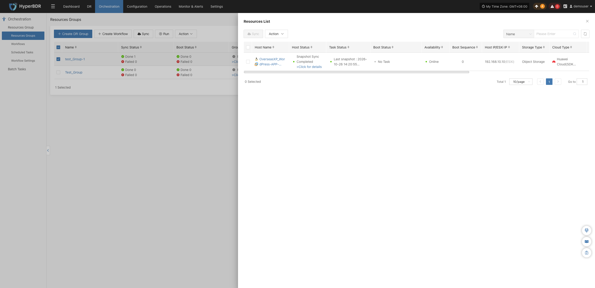

- **Data sync in the resource drawer**: After selecting the target host in the host resource drawer, click **【Sync】**, and the snapshot quota and sync policy window for that host will pop up:

  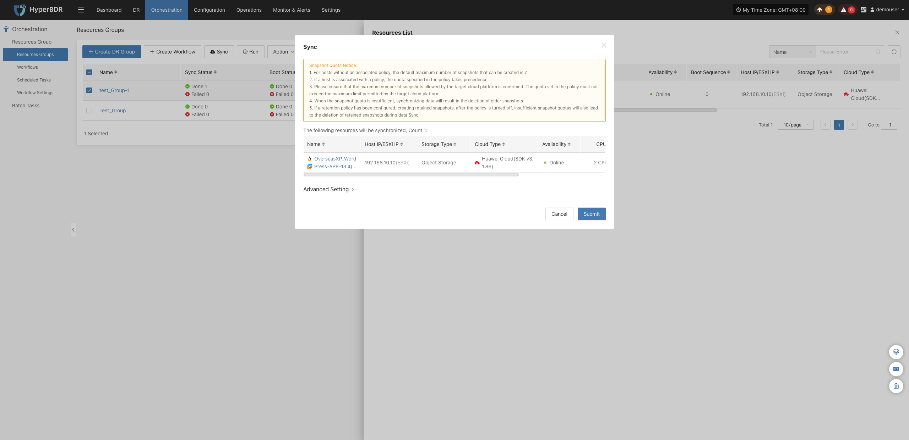

- **DR configuration in the resource drawer**: After selecting the target host in the host resource drawer, click **【Action】**, and the DR configuration information of that host will pop up. For details, refer to [Host DR](../dr/host-dr.md):

  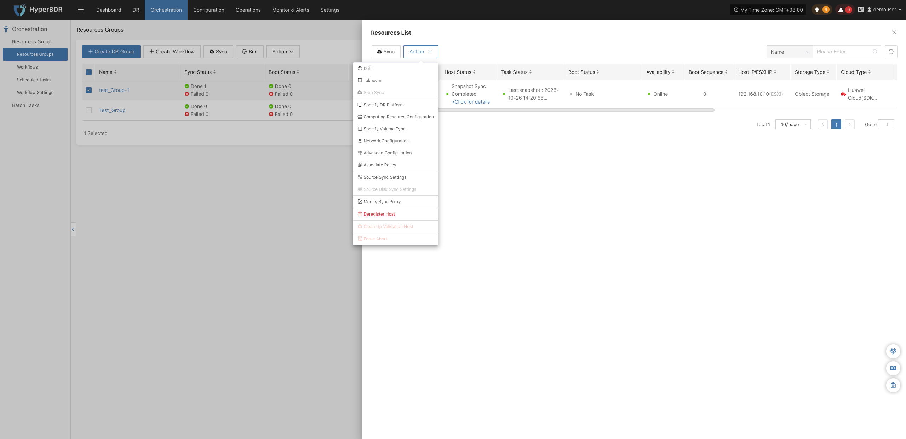

### **Create DR Group**

Click the **【Create DR Group】** button in the upper left corner of the list, and the creation wizard window will pop up. Fill in the basic information of the resource group according to the wizard form:

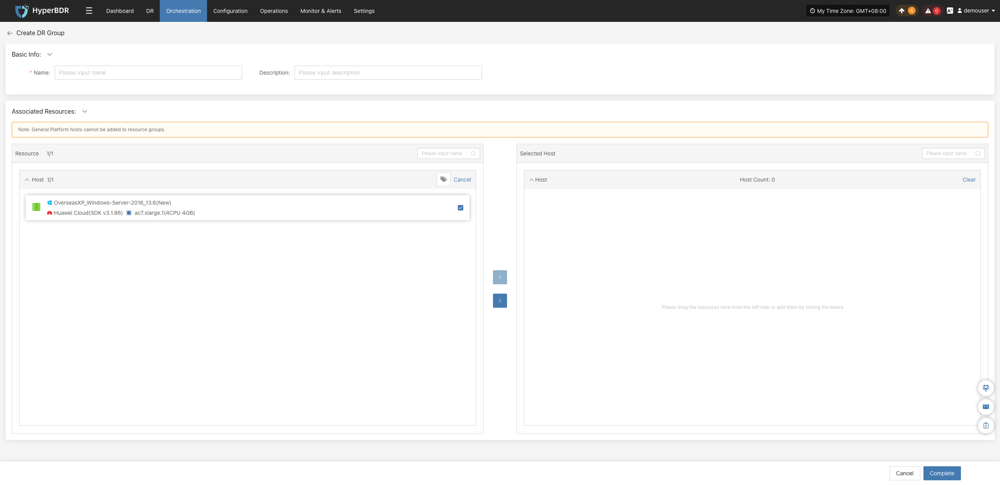

In the pending resource list on the left, check the target protected hosts, and click the **【>】** button in the middle (or drag and drop directly) to add them to the selected resource column on the right (the **【<】** button in the middle can remove selected hosts):

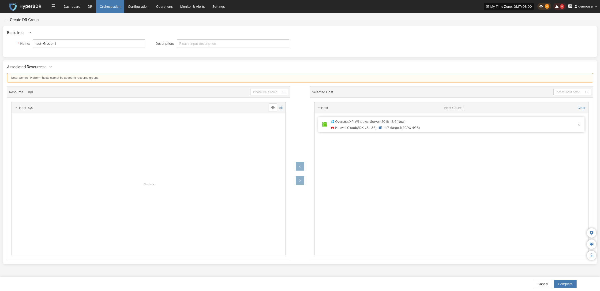

##### **Parameter Description**

| Parameter | Required | Description |
| :--- | :---: | :--- |
| **Name** | Yes | Custom unique identifier name of the resource group |
| **Description** | No | Remarks and business description of the resource group |
| **Associated Resources** | Yes | Check the target protected host resources to be added to the current resource group |

::: warning Note
Hosts on generic platforms cannot be added to resource groups.
:::

### **Create Workflow**

Check the target resource group in the resource group list, and click the **【Create Workflow】** button above the list. The visual workflow orchestration canvas will pop up:

- **Customize the workflow name**: In the menu bar at the top of the canvas, click the workflow name on the right to customize it.

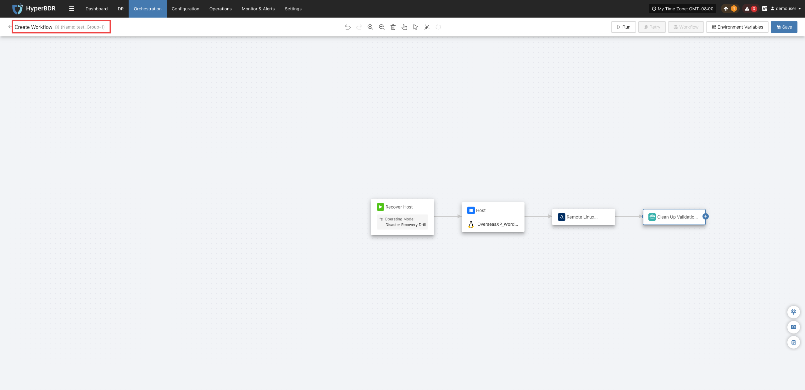

- **Common canvas tools**: The middle area of the top menu bar provides common canvas operations, supporting undo, zoom in, zoom out, and dragging the canvas.

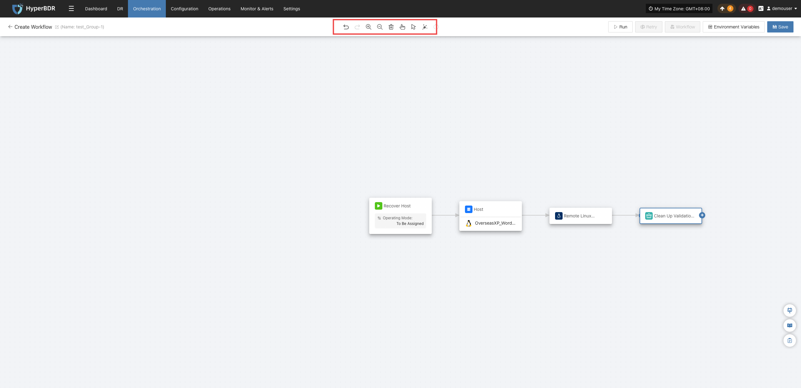

- **Workflow control bar**: The left area of the top menu bar provides workflow run, retry, environment variable configuration, and save functions, which can be used to edit the workflow, configure the runtime environment, and test the execution of the workflow.

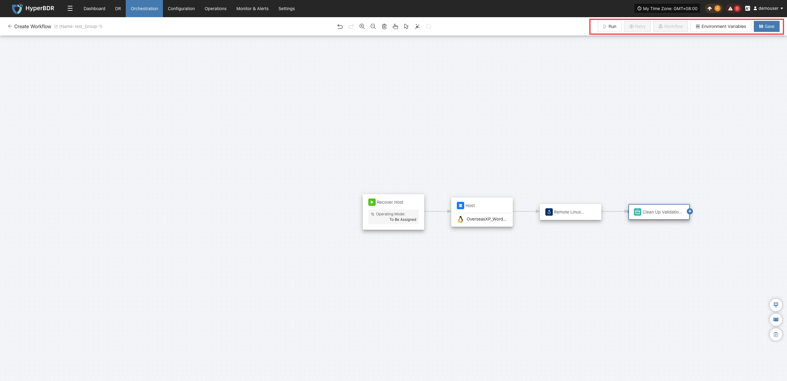

#### **Step 1: Select Run Mode**

Click the root node card, and select the run mode of the workflow in the right panel (【Disaster Recovery Drill】 or 【Disaster Recovery Takeover】):

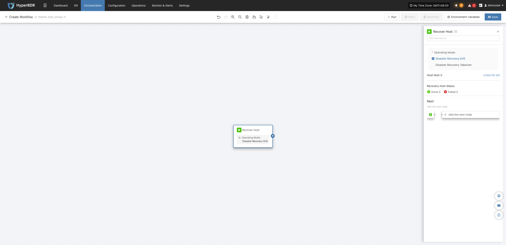

#### **Step 2: Add Nodes (Resources and Tools)**

Click the **【+】** (add node) button next to the node, and select the required node types in the pop-up node selection window. The panel supports two major categories: 【Resources】 and 【Tools】:

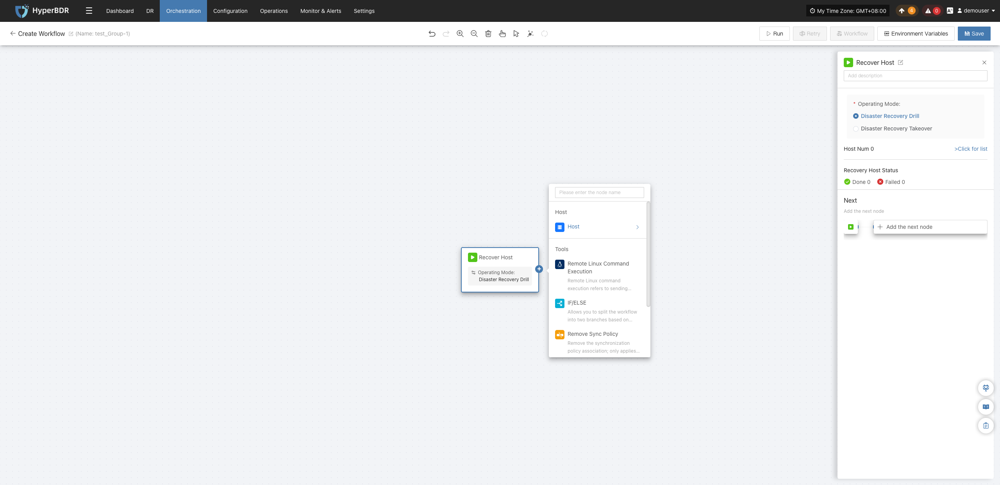

| Node Category | Node Name | Description |
| :--- | :--- | :--- |
| **Resources** | **Host** | Add protected host nodes, and orchestrate the startup order and dependencies of hosts |
| **Tools** | **Remote Linux Command Execution** | Send and execute custom commands or O&M scripts on the target host |
| | **Conditional Branch** | Split the workflow into different branches based on the execution status or conditional expressions |
| | **Remove Sync Policy** | Remove the data sync policy currently bound to the parent resource node |
| | **Stop Sync** | Force stop the data sync task being executed by the parent resource node |
| | **Clean Up Validation Resources** | Clean up only the disaster recovery validation resources started on the target side corresponding to this node |

- **Add a protected host node**: Select the 【Host】 node type, and check the target protected hosts in the pop-up host resource list:

  ::: tip
  Each host can only be selected once.
  :::

  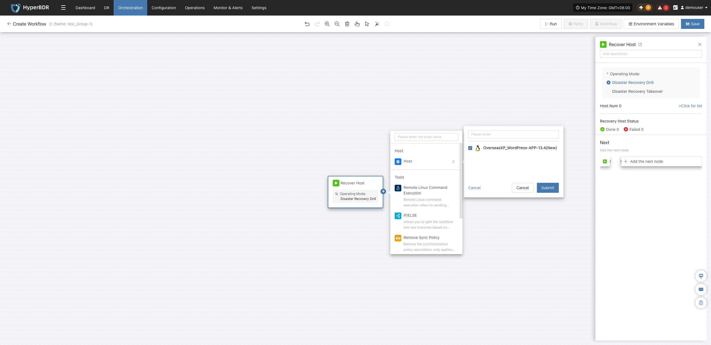

  After confirmation, the host node cards and their topology connections will be generated on the canvas:

  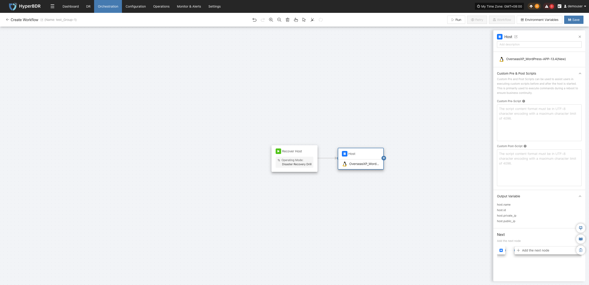

- **Add a tool node**: After the added host node, continue to click the **【+】** (add node) entry, and select downstream nodes such as 【Remote Linux Command Execution】:

  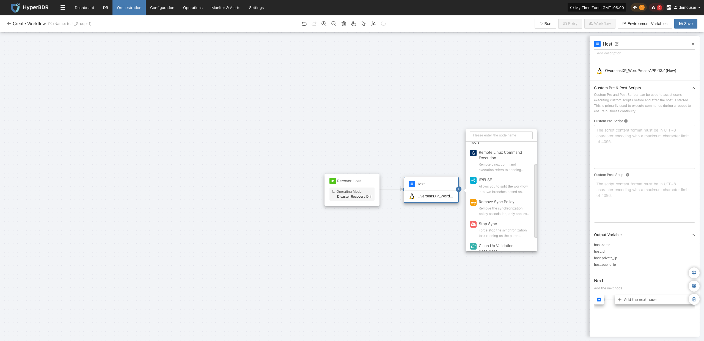

  Select 【Remote Linux Command Execution】 in the pop-up node list:

  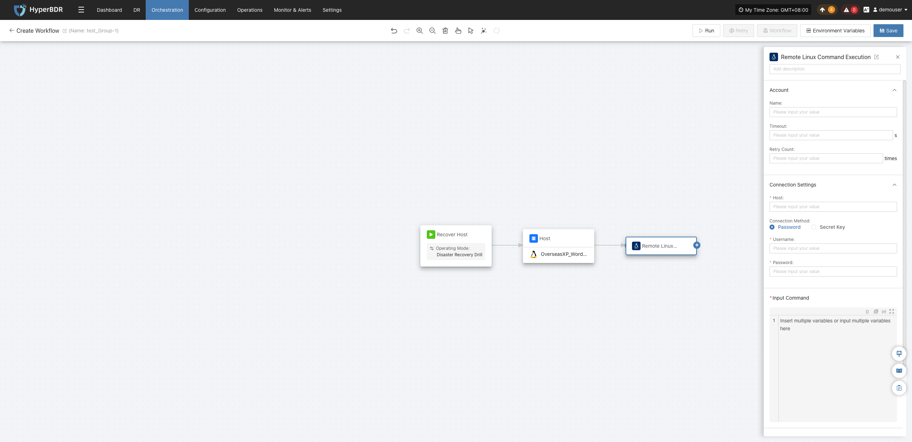

  After confirmation, the remote command execution node and its upstream/downstream dependency lines will be generated on the canvas:

  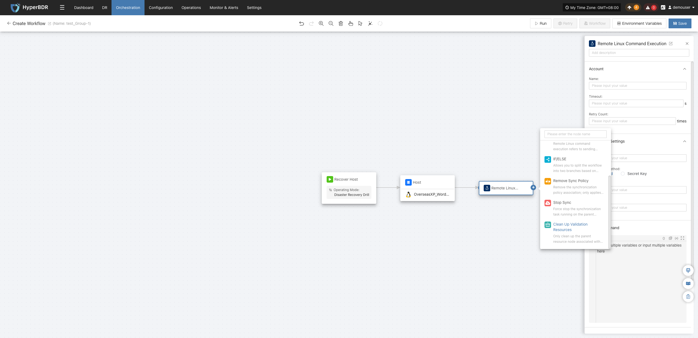

#### **Step 3: Configure Node Properties**

Click the target node card on the canvas, and the properties panel will slide out on the right side of the page, where you can configure basic information, connection credentials, execution scripts, or environment variables as needed:

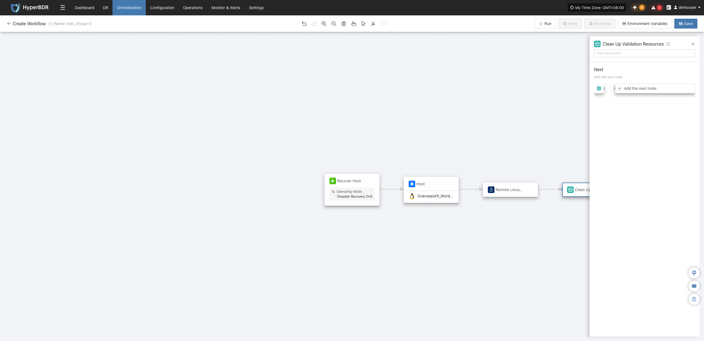

::: tip Best Practices
For end-to-end disaster recovery orchestration scenarios of enterprise-level multi-layer business architectures (such as WordPress + MySQL HA), automated switchover script specifications, and practical drill cases, refer to [HyperBDR Orchestration Best Practices](../../technical-practices/hyperbdr-orchestration-best-practices.md).
:::

### **Sync**

Check the target resource group in the resource group main list, and click the **【Sync】** button above the list. The system will initiate group-wide data sync for all associated hosts in the resource group:

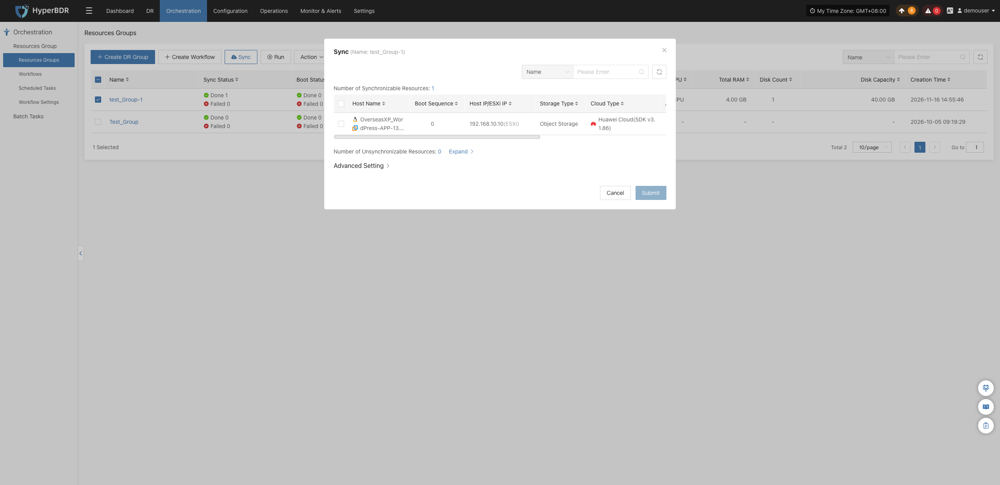

### **Run**

Check the target resource group in the resource group main list, and click the **【Run】** button above the list. The system will pop up the workflow detail list drawer, displaying the workflows bound to the resource group:

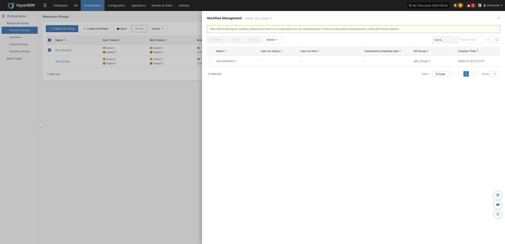

#### **Modify**

After checking the workflow, click the **【Modify】** button above the list to enter the visual workflow orchestration canvas, where the saved node topology and configuration parameters can be edited:

#### **Run**

After checking the target workflow, click the **【Run】** button above the list. The run parameter confirmation window will pop up, where you can select the recovery time point and advanced settings for each host before initiating the run:

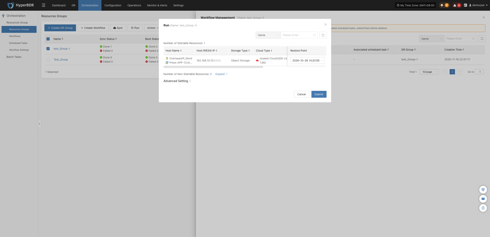

#### **Retry**

When the workflow fails or some nodes become abnormal, click the **【Retry】** button to re-initiate the execution of the failed nodes and downstream tasks.

#### **Action**

After selecting the workflow, click the **【Action】** dropdown menu to perform the following operations on the workflow:

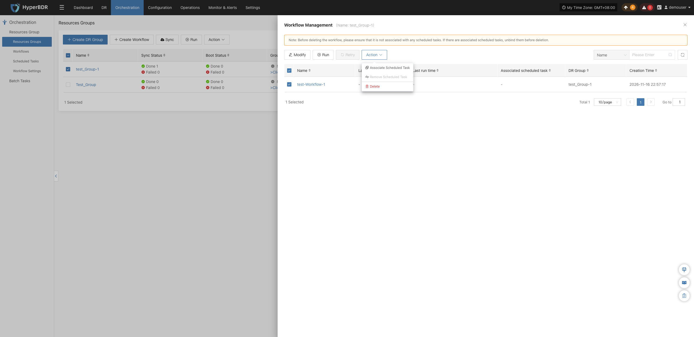

##### **Associate Scheduled Task**

Click **【Action】>【Associate Scheduled Task】**, and select the scheduled task to be bound in the pop-up window to enable scheduled automatic scheduling of the workflow:

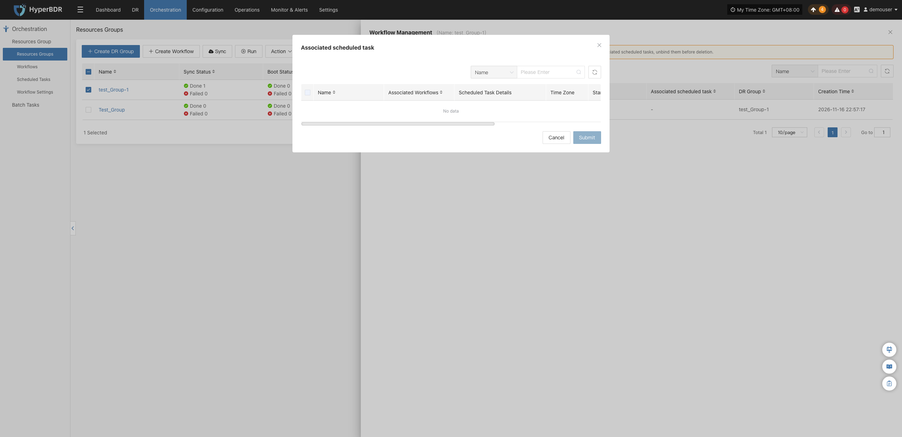

##### **Remove Scheduled Task**

Click **【Action】>【Remove Scheduled Task】** to unbind the workflow from the associated scheduled task. After removal, the scheduled task will no longer automatically trigger the workflow.

##### **Delete**

Click **【Action】>【Delete】**, and click **【Submit】** in the secondary confirmation window to completely delete the orchestration workflow:

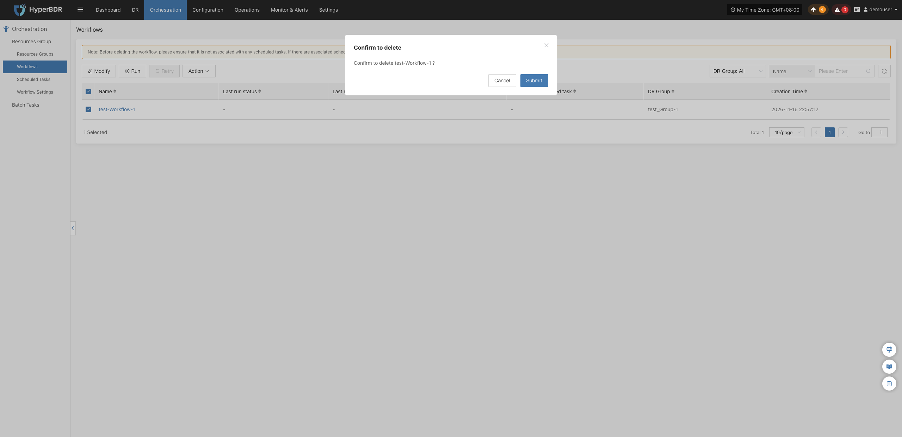

### **Action**

Check the target resource group in the resource group list, and click the **【Action】** dropdown menu at the top of the list:

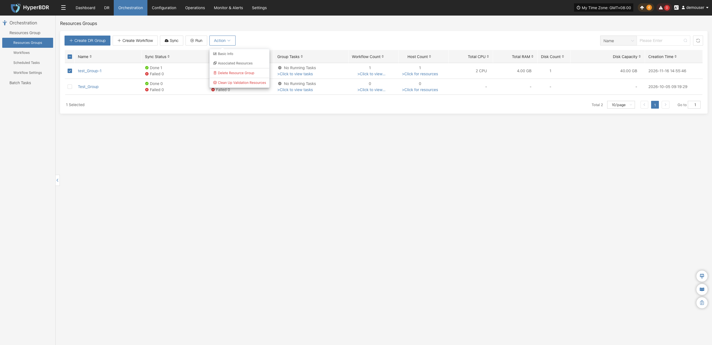

#### **Basic Info**

Click **【Action】>【Basic Info】** to view or edit the basic information of the current resource group (including the resource group name and description) in the pop-up window:

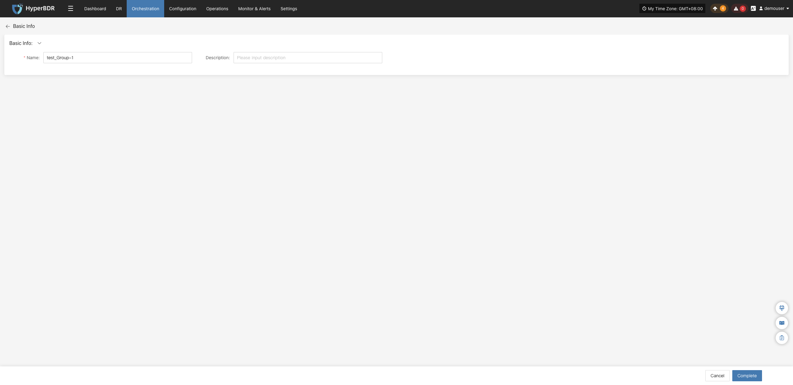

#### **Associated Resources**

Click **【Action】>【Associated Resources】** to view the list of protected hosts managed by the current resource group in the pop-up window, and adjust or transfer the associated hosts:

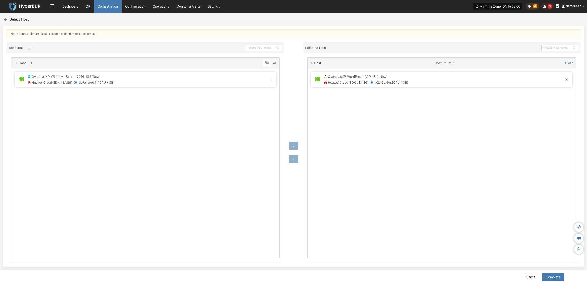

#### **Clean Up Validation Resources**

Click **【Action】>【Clean Up Validation Resources】**, and confirm in the secondary confirmation window to release all target-side cloud test validation instances and associated resources started by the current resource group during the disaster recovery drill:

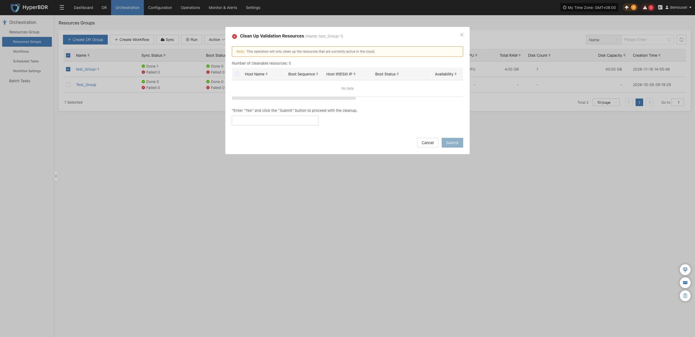

#### **Delete Resource Group**

Click **【Action】>【Delete Resource Group】**, and click **【Submit】** in the secondary confirmation dialog to completely delete the metadata logic configuration of the resource group:

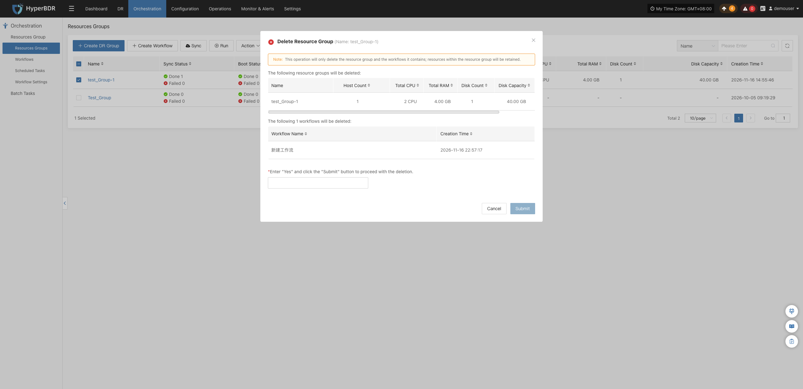

::: warning Operation Impact
Cleaning up validation resources only releases the test validation instances started on the cloud, and does not affect source production hosts or synchronized data. Deleting a resource group only deletes the metadata logic, and host data will be fully retained.
:::

## **Workflow Management**

Click **【Workflows】** in the left navigation bar to centrally view and manage all orchestration workflows created in the system:

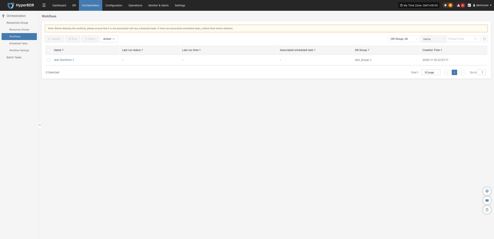

#### **View Workflow Tasks**

Click the target workflow name directly in the workflow list, and the drawer of execution topology details and historical task records of the workflow will slide out on the right:

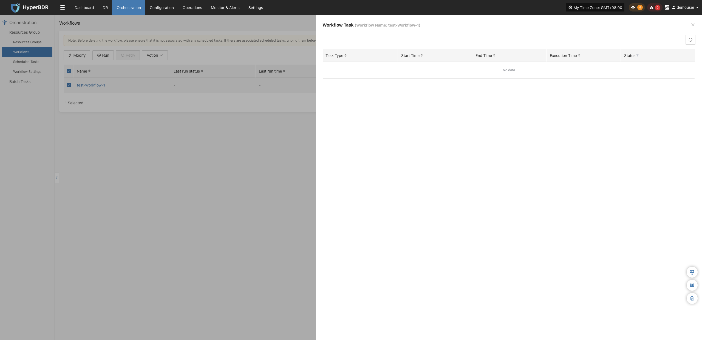

### **Modify**

Select the target workflow in the workflow list, and click the **【Modify】** button above the list:

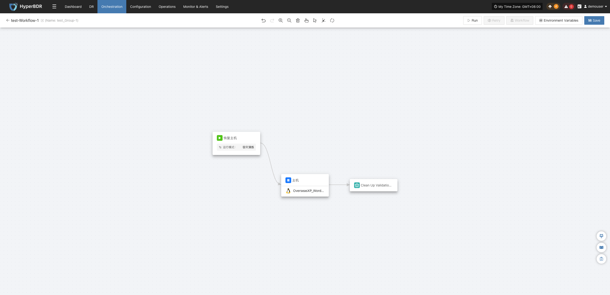

The system will reopen the visual orchestration canvas, where the saved workflow node topology and configuration parameters can be edited:

### **Run**

Check the target workflow in the workflow list, and click the **【Run】** button above the list (or click the run icon in the operation column directly). The workflow run parameter confirmation window will pop up:

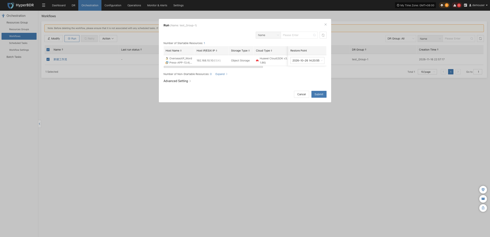

In the pop-up run configuration window, you can view the number of bootable resources managed by the workflow, protected host names, host IPs, storage types, target cloud platforms, and restore point snapshots, and expand **【Advanced Settings】** to adjust startup parameters. After confirming everything is correct, click **【Submit】** to trigger the workflow execution.

### **Retry**

When the workflow fails during execution due to exceptions such as network jitter, insufficient target resource quota, or script execution timeout, the **【Retry】** button above the list (and the retry icon in the operation column) will be activated.

Check the failed workflow in the workflow list, and click the **【Retry】** button. The system will continue execution from the failure breakpoint of the failed node, or re-trigger the workflow according to the preset retry policy, without reconfiguring and running from scratch.

::: tip Retry Availability
The **【Retry】** button is available only when the last execution status of the workflow is failed. For workflows that have never been executed or whose last execution succeeded, the button is grayed out.
:::

### **Action**

After selecting the target workflow, click the **【Action】** dropdown menu in the operation column:

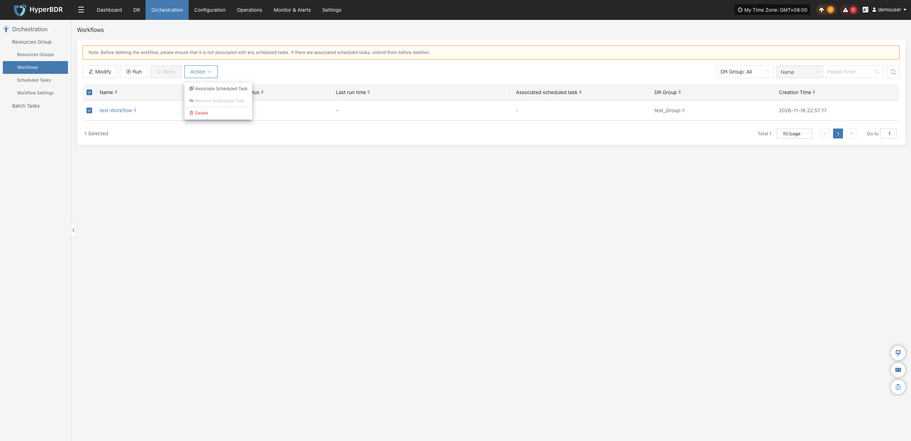

#### **Associate Scheduled Task**

Click **【Action】>【Associate Scheduled Task】**, and select a created scheduled task policy in the pop-up window for binding, so that the workflow can be automatically executed periodically according to the preset plan:

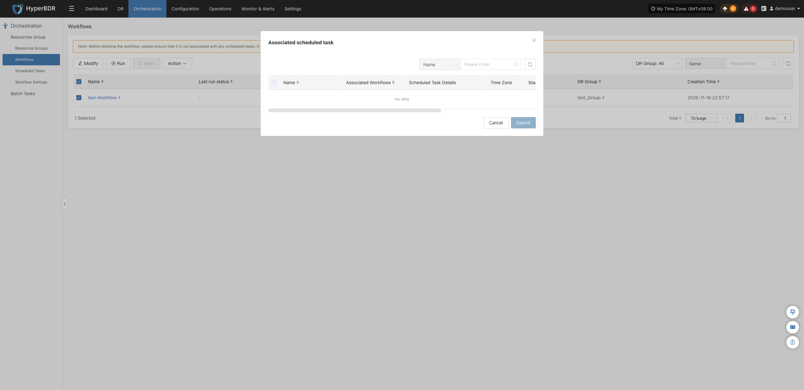

#### **Remove Scheduled Task**

If the current workflow is bound to a scheduled task, click **【Action】>【Remove Scheduled Task】** to unbind it. After removal, the workflow will no longer be triggered periodically by the scheduled task, but the workflow itself is unaffected.

::: note Check Before Deletion
Before deleting a workflow, make sure it is not associated with any enabled scheduled task. If there is an association, unbind it here first.
:::

#### **Delete**

Click **【Action】>【Delete】**, and click **【Submit】** in the secondary confirmation dialog to completely delete the workflow configuration:

::: warning Operation Impact
Deleting a workflow only deletes its metadata orchestration logic and topology configuration, and does not delete source host data or underlying snapshots.
:::

## **Scheduled Tasks**

Click **【Scheduled Tasks】** in the left navigation bar to configure and schedule scheduled automatic disaster recovery tasks in a unified manner:

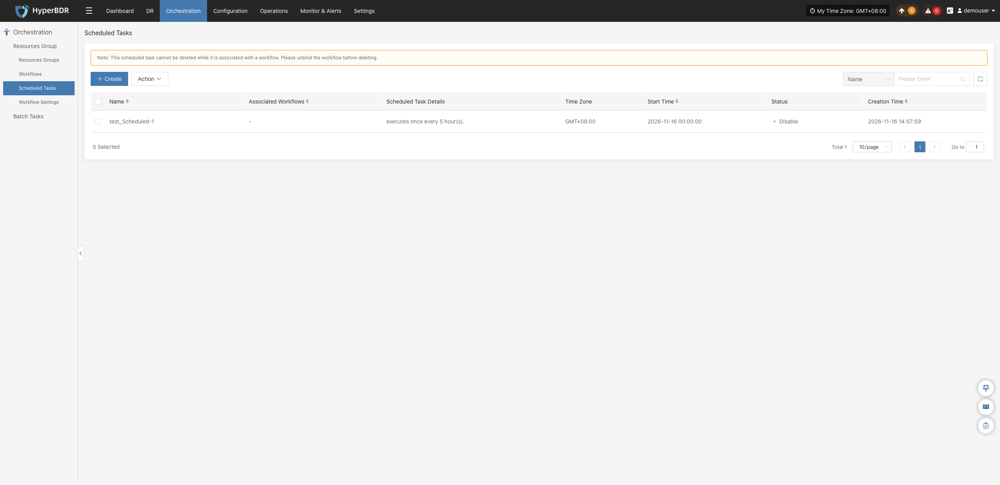

### **Create**

Click the **【Create】** button in the upper left corner of the page, and the scheduled task creation wizard window will pop up:

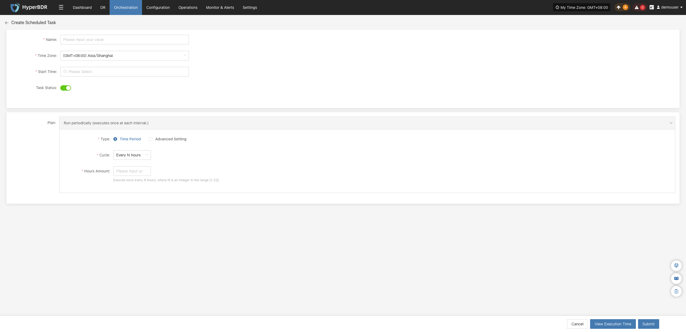

- **Configure the time cycle and scheduling parameters**: Set the execution cycle (such as every N hours, every N days) and the specific number of hours:
  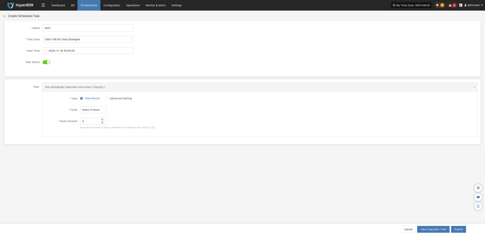
- **View Execution Time**: Click **【View Execution Time】** at the bottom of the form to preview the specific trigger time points of future cycles:
  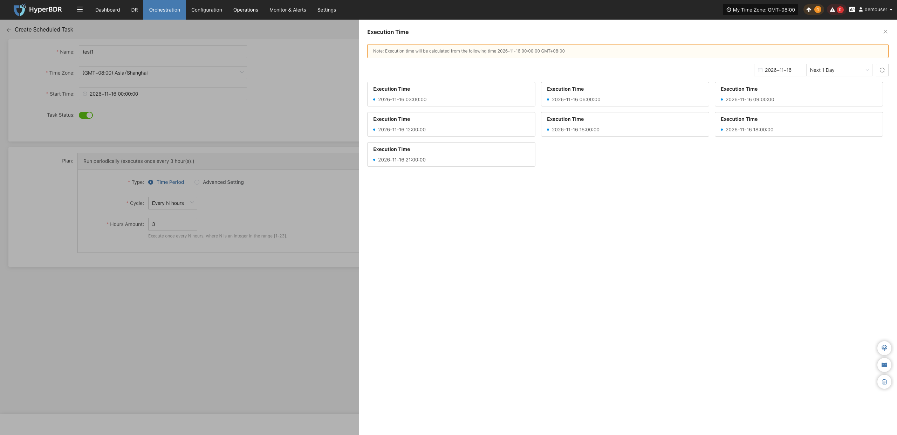

##### **Configuration Description**

| Configuration Item | Description |
| :--- | :--- |
| **Name** | Custom unique name of the scheduled task |
| **Time Zone** | Time zone in which the scheduled task takes effect, defaulting to (GMT+08:00) Asia/Shanghai |
| **Start Time** | Time when the scheduled task takes effect and is executed for the first time |
| **Task Status** | Switch control, enabled by default |
| **Type** | Supports time cycle and advanced settings (Crontab expression) |
| **Cycle** | Supports every N hours, every N days, weekly, and monthly |

### **Action**

Select the target scheduled task in the list, and click the **【Action】** menu:

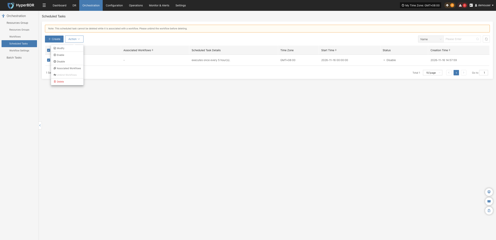

#### **Modify**

Click **【Action】>【Modify】** to re-edit the basic information and scheduling cycle policy of the scheduled task:

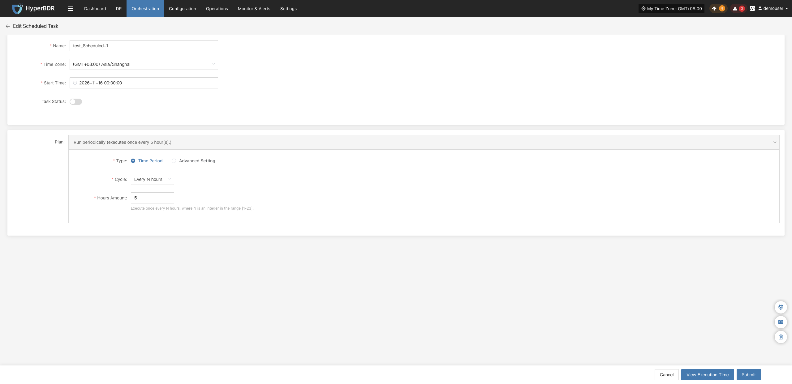

#### **Enable**

Click **【Action】>【Enable】** to enable a scheduled task that is in the paused state:

#### **Disable**

Click **【Action】>【Disable】** to pause the periodic scheduling of the scheduled task:

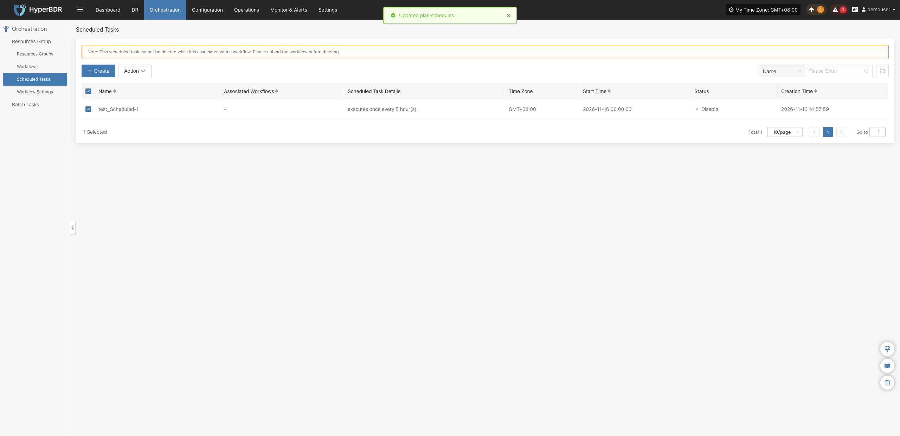

#### **Associated Workflows**

Click **【Action】>【Associated Workflows】** to view and manage the disaster recovery workflows bound to the scheduled task in the pop-up window:

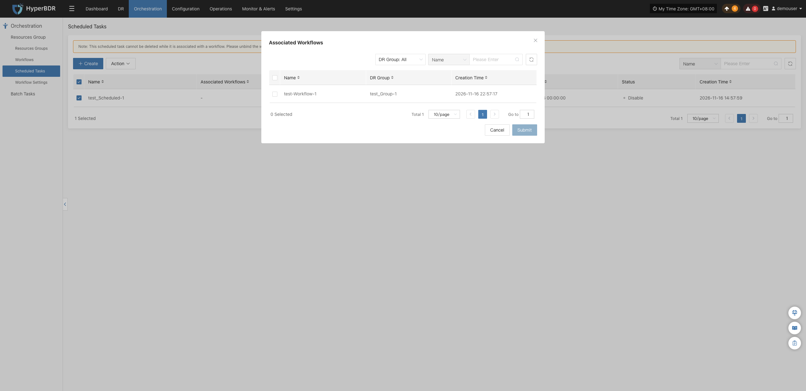

#### **Unbind Workflows**

Click **【Action】>【Unbind Workflows】** to unbind the scheduled task from the associated workflows.

#### **Delete**

Click **【Action】>【Delete】**, and click **【Submit】** in the confirmation prompt to delete the scheduled task:

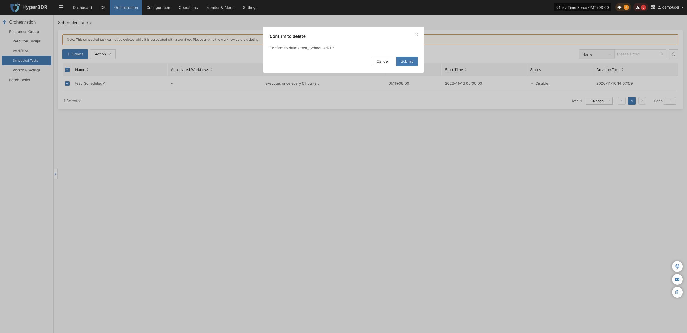

::: warning Deletion Restriction
A scheduled task associated with workflows cannot be deleted directly. Remove its association with the workflows first.
:::

## **Workflow Settings**

Click **【Workflow Settings】** in the left navigation bar to configure the global workflow concurrency and timeout policies of the system:

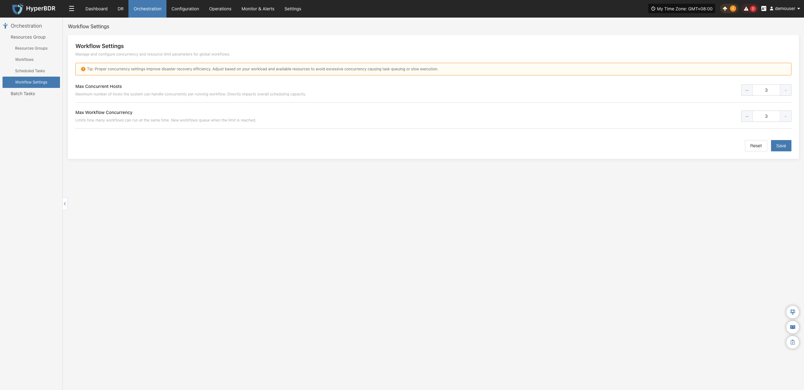

### **Max Concurrent Hosts**

Configure the maximum number of hosts that a running workflow can process concurrently:

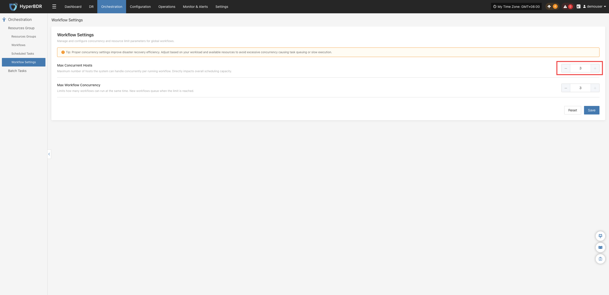

### **Default Timeout per Node**

Set the global default timeout limit for a single node such as command execution:

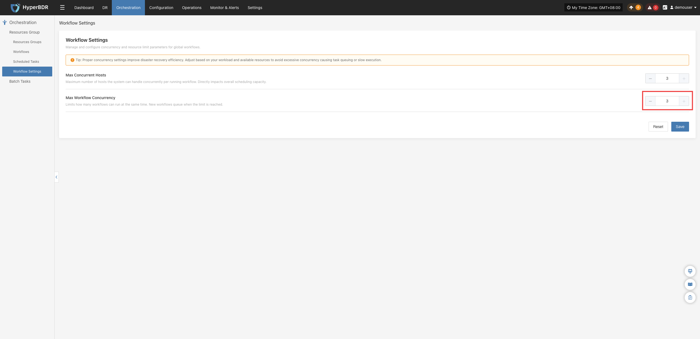

##### **Parameter Description**

| Configuration Item | Description |
| :--- | :--- |
| **Max Concurrent Hosts** | The maximum number of hosts that each running workflow can process concurrently |
| **Default Timeout per Node** | Sets the default maximum timeout for custom command nodes. If not completed within the timeout, execution will be interrupted and an alert will be triggered |
| **Failure Interruption Policy** | When a node in the workflow fails, determines whether to terminate subsequent execution or skip non-critical nodes and continue running |
