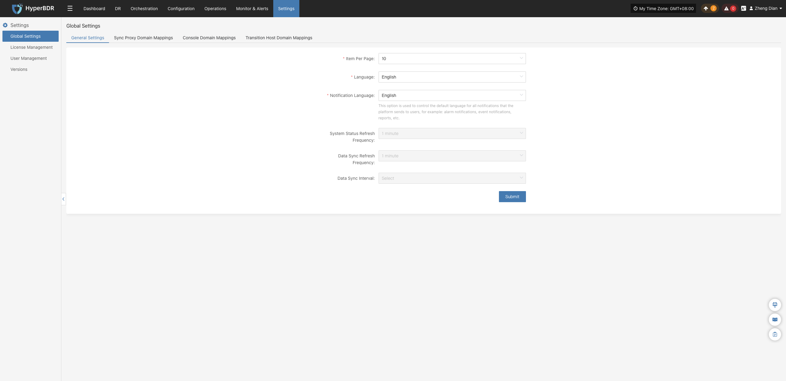
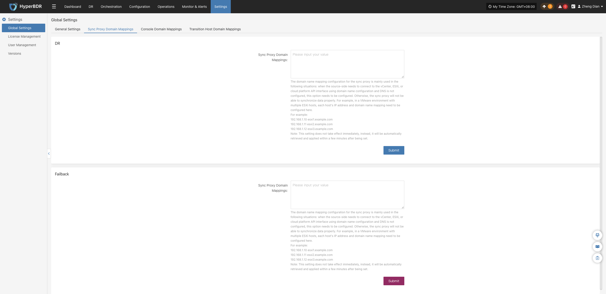
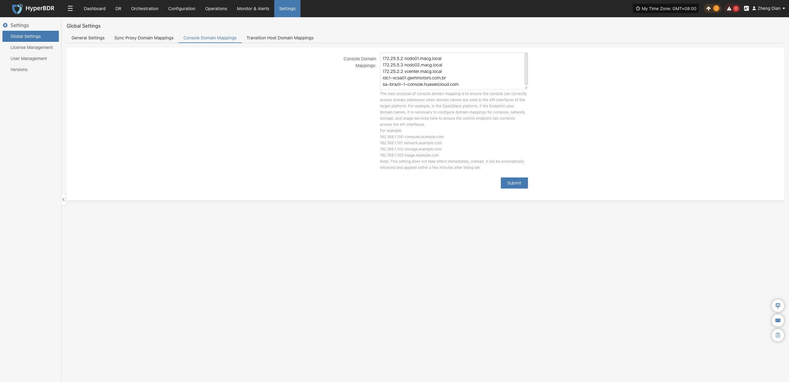
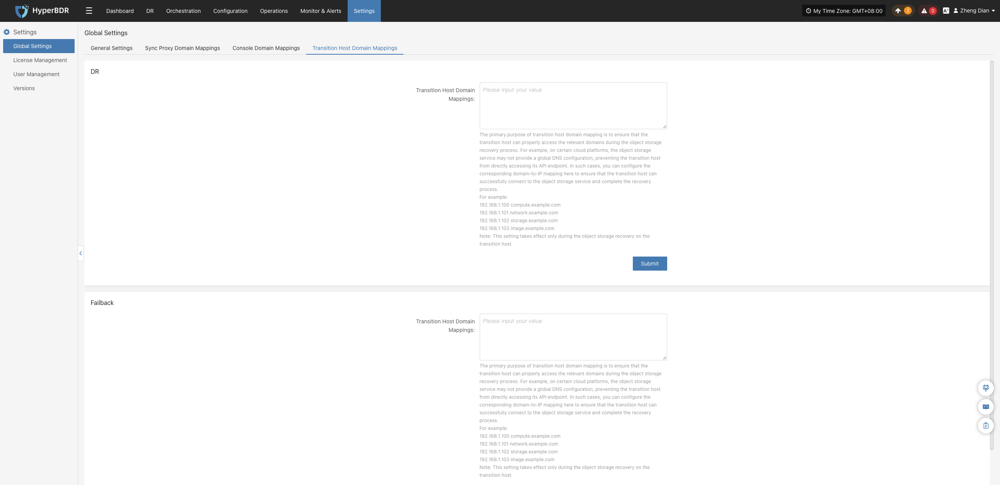

# **Global Settings**

The Global Settings module is used to configure the basic operating environment of the HyperBDR platform, including console interface display parameters, language preferences, system refresh frequency, and domain name and IP address mappings for the source sync proxy, console, and transition hosts.

## **General Settings**

Configure basic operating parameters and interface display preferences on the platform based on actual business needs.

**Configuration Method:**

Go to **Settings > Global Settings**, which opens to the **General Settings** tab by default. Adjust the items per page, interface display language, and alert notification language as needed. After completing the configuration, click **Save**.



**Parameter Description:**

| **Parameter** | **Options** | **Description** |
| :--- | :--- | :--- |
| **Items per page** | 10 / 20 / 30 / 40 / 50 / 60 | Set the number of items displayed per page on platform table pages. Default is 10. |
| **Language** | Simplified Chinese / English / Español | The display language of the platform console. Affects only the current user. |
| **Notification Language** | Simplified Chinese / English | The language used for system alert notifications (applicable to Email, SMS, Webhook, etc.). |
| **System Status Refresh Frequency** | 1 minute | Default is 1 minute. Not configurable in the current version. |
| **Data Sync Refresh Frequency** | 1 minute | Default is 1 minute. Not configurable in the current version. |
| **Data Sync Interval** | N/A | Not configurable by default. |

## **Sync Proxy Domain Mappings**

Used to add domain name and IP address mappings for the source production platform. The configuration format is consistent with `/etc/hosts` in Linux systems.

**Configuration Method:**

Go to **Settings > Global Settings**, and switch to the **Sync Proxy Domain Mappings** tab. Enter the mapping rules in the configuration box using the format `[IP Address] [Domain Name]`, with one entry per line. After completing the configuration, click **Save**.



**Configuration Example:**

```plaintext
192.168.1.10 esxi1.example.com
192.168.1.11 esxi2.example.com
192.168.1.12 esxi3.example.com
```

::: note
This setting does not take effect immediately. The system will automatically pull and apply it to the corresponding sync proxy nodes within a few minutes after saving.
:::

## **Console Domain Mappings**

Console domain mapping is mainly used when the target cloud platform API interfaces communicate via domain names, ensuring that the HyperBDR console can accurately resolve and invoke various API endpoints of the target platform services. For example, when connecting to an OpenStack platform whose service endpoints use domain names, you need to centrally configure domain mappings for Compute (Nova), Network (Neutron), Storage (Cinder), and Image (Glance) services here.

**Configuration Method:**

Go to **Settings > Global Settings**, and switch to the **Console Domain Mappings** tab. Enter the mapping rules in the configuration box using the format `[IP Address] [Domain Name]`, with one entry per line. After completing the configuration, click **Save**.



**Configuration Example:**

```plaintext
192.168.1.100 compute.example.com
192.168.1.101 network.example.com
192.168.1.102 storage.example.com
192.168.1.103 image.example.com
```

::: note
This setting does not take effect immediately. The system will automatically pull and apply it within a few minutes after saving.
:::

## **Transition Host Domain Mappings**

The transition host is responsible for volume mounting, driver adaptation, and data format conversion during disaster recovery takeover and drill recovery. When the cloud service interfaces of the target platform (such as image service, block storage service, object storage endpoint) use domain names for communication and the intranet lacks DNS, domain mappings must be configured here to ensure that the transition host can smoothly resolve and communicate with the target cloud service endpoints upon startup.

**Configuration Method:**

Go to **Settings > Global Settings**, and switch to the **Transition Host Domain Mappings** tab. Enter the mapping rules in the configuration box using the format `[IP Address] [Domain Name]`, with one entry per line. After completing the configuration, click **Save**.



**Configuration Example:**

```plaintext
192.168.1.100 compute.example.com
192.168.1.101 network.example.com
192.168.1.102 storage.example.com
192.168.1.103 image.example.com
```

::: note
This setting does not take effect immediately. The system will automatically pull and apply it within a few minutes after saving.
:::
