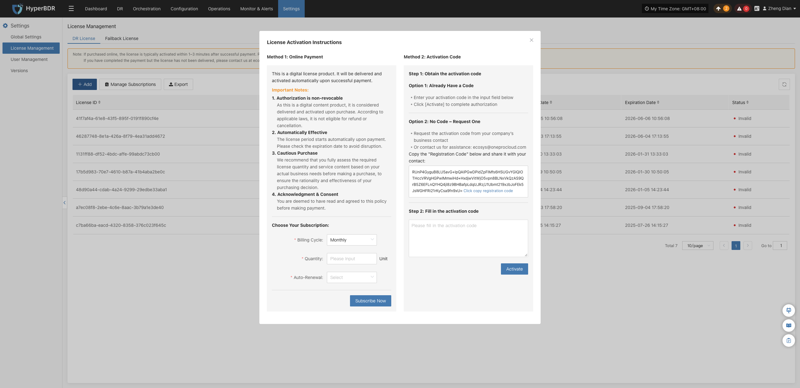
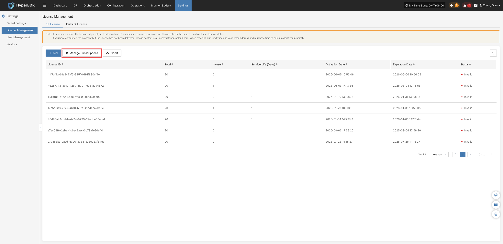
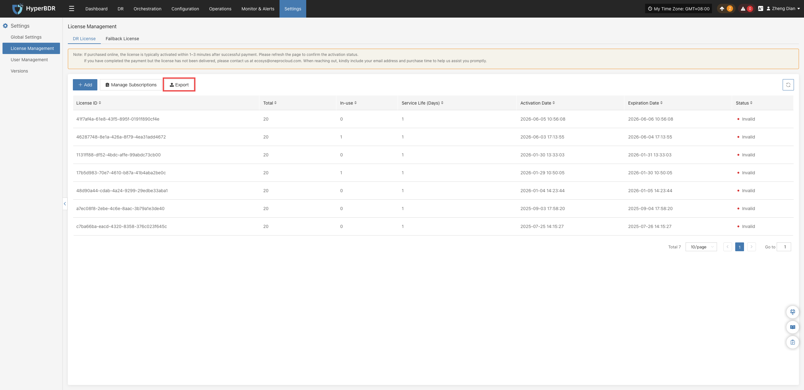
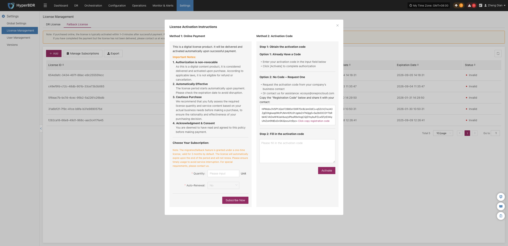
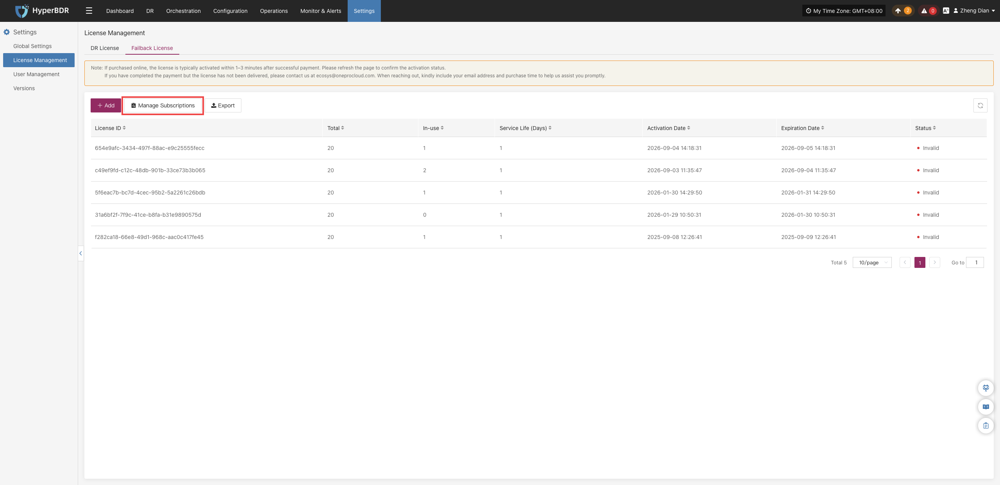
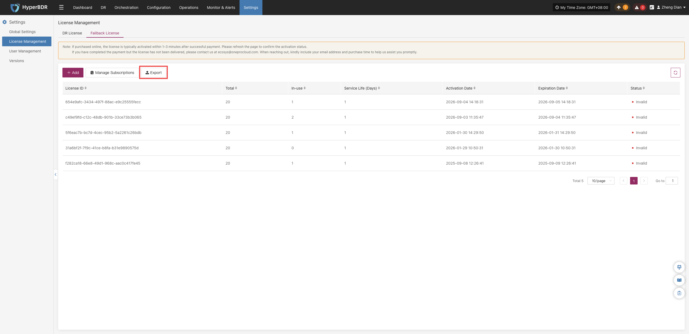

# **License Management**

License Management is used to control usage permissions for various platform resources in disaster recovery and data migration features, ensuring users possess the corresponding authorization when performing data synchronization, disaster recovery Drill, Takeover, and failback operations.

The platform provides two core license categories: **DR License** and **Failback License**.

## **DR License**

The DR License controls the license quota and validity period of managed hosts for data synchronization, disaster recovery Drill, and Takeover features.

### **Add**

Go to **Settings > License Management > DR License**, and click the **+ Add** button at the top of the page. An activation dialog will pop up, supporting two acquisition and activation methods:

1. **Method 1: Online Payment**
   - **Billing Cycle**: Supports subscription by month or year.
   - **Quantity**: Enter the number of host quotas to purchase.
   - **Auto-Renewal**: Choose whether to enable automatic renewal upon expiration. After verifying the order details, complete the payment. The license is usually issued automatically within 1–3 minutes after successful payment.
2. **Method 2: Activation Code**
   - If you already have an activation code, paste it into the code input box and click **Activate** to complete activation.
   - If you do not have an activation code, copy the unique Registration Code displayed on the interface and contact the sales or technical support team (ecosys@oneprocloud.com) to obtain the corresponding authorization code.

### **Manage Subscriptions**

In the top operation bar of the DR License page, click the **Manage Subscriptions** button.

The system will open the subscription management console, allowing administrators to centrally review online subscription orders, renewal status, billing cycles, and historical procurement details.

::: note
This feature is primarily used to inspect and manage automatic cloud subscription services purchased via online payment channels.
:::

### **Export**

In the top operation bar of the DR License page, click the **Export** button. The system will automatically generate and download an Excel/CSV file containing the license consumption details and key operation records of currently managed hosts.

## **Failback License**

The Failback License is used to manage authorization when migrating workloads smoothly back from the target cloud platform to the source site after Takeover. A valid failback license code is required to ensure the legality and integrity of the data migration and reverse recovery process.

### **Add**

On the **Settings > License Management** page, switch to the **Failback License** tab and click the **+ Add** button at the top. In the popup activation dialog, both Online Payment and Activation Code methods are supported, with the same operational workflow as the DR License.

### **Manage Subscriptions**

In the top operation bar of the Failback License page, click the **Manage Subscriptions** button to navigate to the subscription center to review and maintain the subscription quota and lifecycle for failback licenses.

### **Export**

In the top operation bar of the Failback License page, click the **Export** button to export the license usage records and operation history for current failback hosts.

