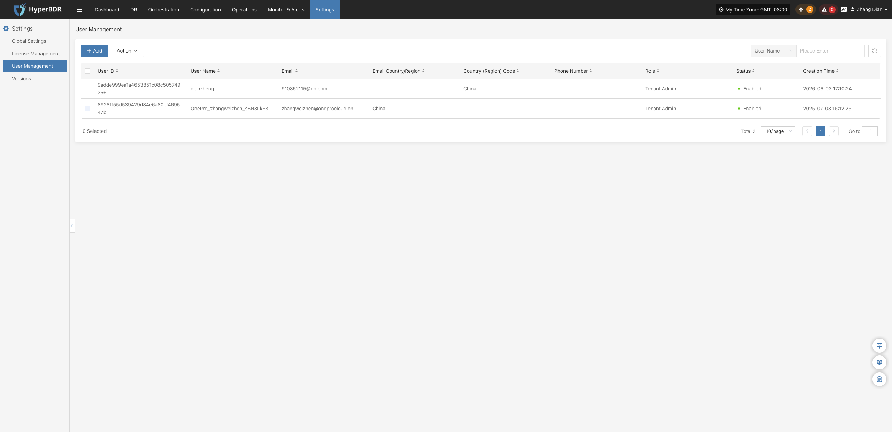
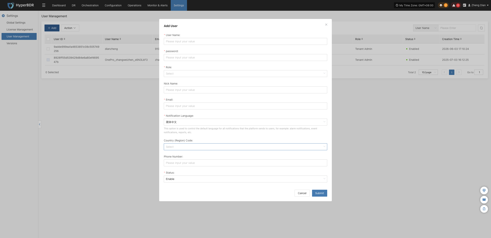
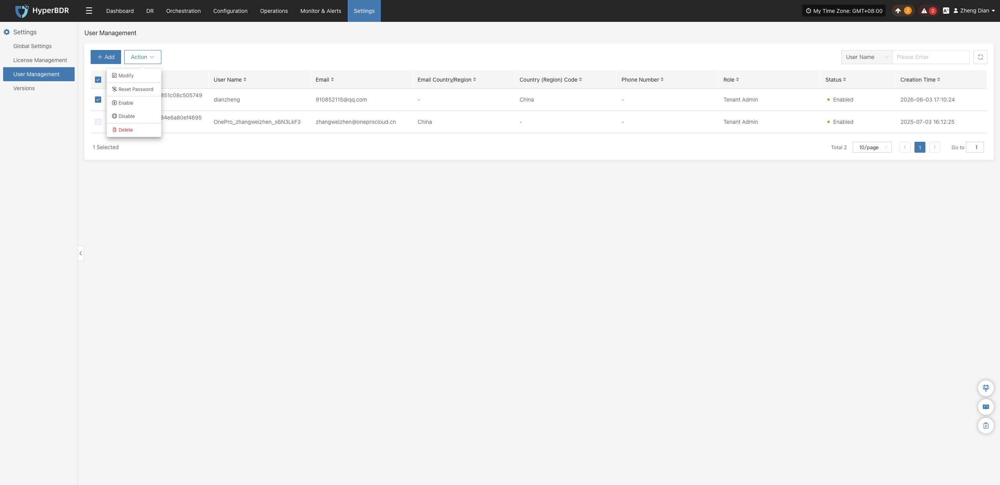
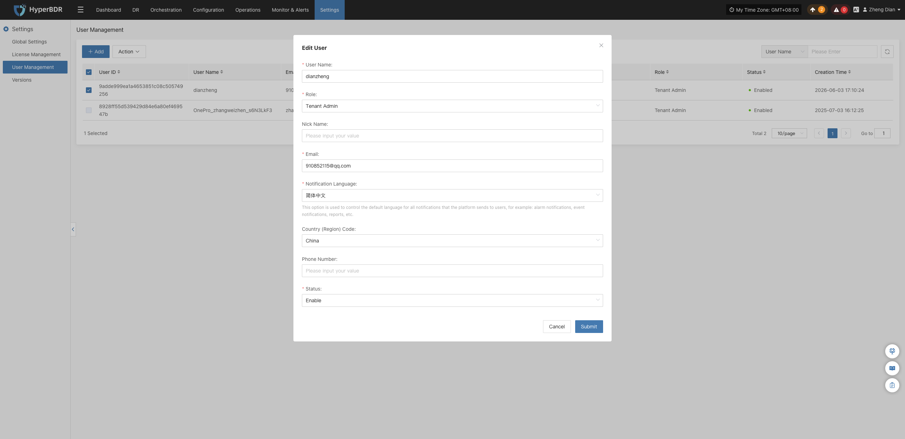
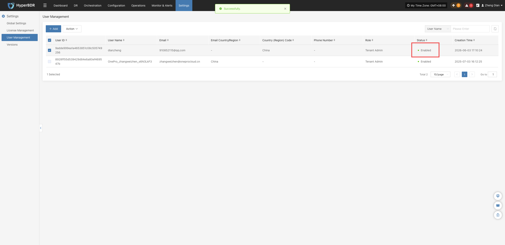
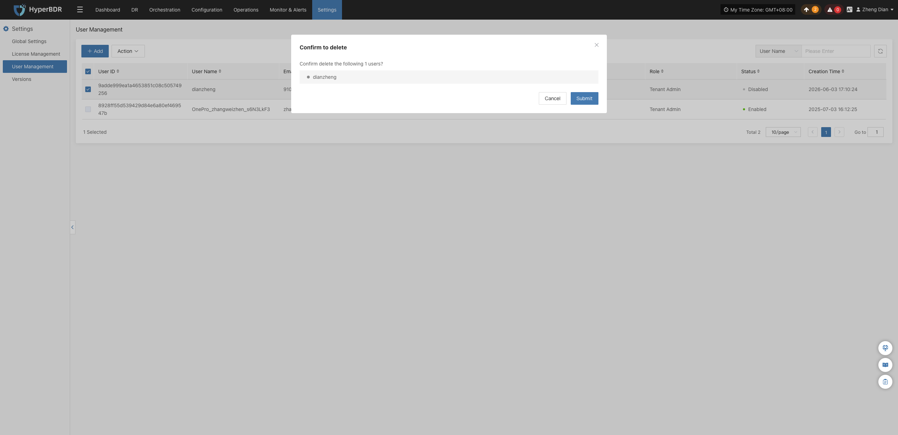

# **User Management**

A core module for the full lifecycle management of tenant accounts, supporting capabilities such as adding system accounts, assigning role permissions, viewing account information, and searching/filtering accounts. It enables hierarchical and decentralized administration for multiple operators to ensure the operational security of the backup platform.

## **User List Field Description**

Each user record in the list contains the following fields:

| **Field Name** | **Description** |
| :--- | :--- |
| **User ID** | A unique identifier automatically generated by the system. It cannot be modified and is used by the backend to identify accounts. |
| **Username** | The account name used to log into the system; a required credential for login. |
| **Email** | The contact email bound to the user, used for password retrieval and alert notification emails. |
| **Email Country / Region** | Identifier for the email region. Displays "-" if no specific region is set. |
| **User Mobile Country (Region) Code** | The country calling code for the mobile phone number (default: China +86). |
| **User's Mobile Phone Number** | The bound contact phone number used for account security verification. |
| **Role** | Account permission levels, categorized into three tiers: • **Tenant Administrator**: Highest privilege across the platform. • **Configured User**: Permissions limited to backup business operations. • **Read-only User**: Read-only access to view data across the platform without any editing permissions. |
| **Status** | Account login status: A green dot indicates enabled (can log in normally); disabled indicates login access is revoked. |
| **Creation Time** | The precise timestamp when the account was created. |

## **Add**

Log in to the console, navigate to **Settings > User Management**, and click the **+ Add** button at the top of the page. In the popup new user form, fill in the username, email, region, mobile phone number, and assigned role. After verifying the details, click save to complete account creation.

## **Action**

In the user list, click **Action** on the right side of the target user row to perform management operations such as modify, reset password, enable, disable, and delete from the dropdown menu.

### **Modify**

Click **Action > Modify**, and the Edit User dialog will appear. Administrators can modify the contact email, mobile phone number, role permissions, and enabled status for the account. Changes take effect immediately upon saving.

### **Reset Password**

Click **Action > Reset Password**, enter the new password in the popup dialog, and confirm to complete the password reset.

::: note
Once the password is reset, the original password becomes invalid immediately. Please deliver the new password to the user via a secure channel.
:::

### **Enable**

When the target account is disabled, click **Action > Enable** to enable the account. After successful activation, the account's login permissions are restored, and the status in the list updates to enabled.

### **Disable**

When the target account is enabled, click **Action > Disable** to disable the account. Once disabled, the account can no longer log in, and its status in the list updates to disabled.

::: warning
After an account is disabled, any active sessions for that user will be unable to continue business operations. Please ensure relevant tasks are properly handed over before proceeding.
:::

### **Delete**

Click **Action > Delete**, and a secondary confirmation alert dialog will appear. Upon confirmation, the user account will be permanently removed, and all account configurations and associated login credentials will become invalid.

::: danger
The deletion operation is irreversible. Before proceeding, confirm that the account has no ongoing tasks or associated dependent resources, verify the username carefully, and confirm with caution.
:::

