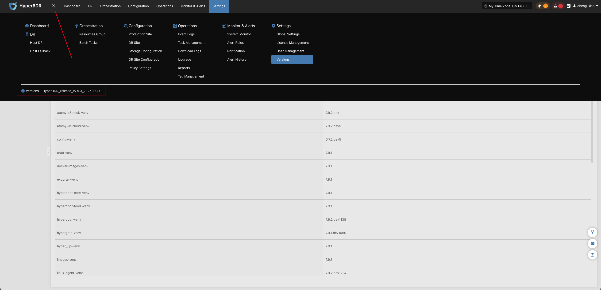
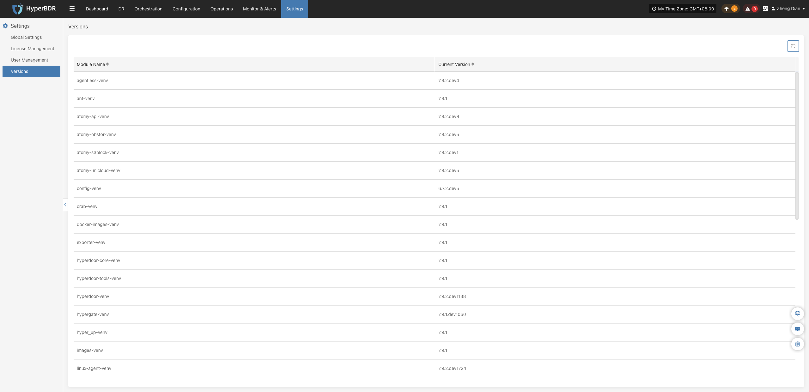

# **Versions**

The Versions module is used to display the software version data currently running on the HyperBDR platform. The system supports quickly checking the overall software package version via the **top navigation menu**, or navigating to the **Versions settings page** to view detailed versions of each core microservice and operating component.

## **View System Package Version**

After logging into the HyperBDR console, locate the menu icon (three horizontal lines) in the upper-left corner of the top navigation bar to view the currently deployed HyperBDR system package version.

## **View Component Details**

Log into the HyperBDR console, click **Settings** in the top navigation bar, and then click **Versions** in the left navigation menu. The page displays detailed version information for each microservice and runtime component in the current environment in card format.

::: tip Technical Support Recommendation
If you encounter issues during daily operations and need technical support, it is recommended to take a screenshot of the system package version as well as the complete version information on this page, and attach them to the ticket so that support engineers can quickly assess the system environment and troubleshoot version compatibility. [Get Support](https://support.oneprocloud.com/target/opc)
:::

### **Component Description**

The page typically includes version data for the following core runtime components:

| **Component Name** | **Description** |
| :--- | :--- |
| **Console Services** | Current running version and Build ID for the HyperBDR core console, scheduling engine, and API gateway services. |
| **Source Sync Proxy** | Version of the data sync proxy component deployed within the source virtualization or cloud platform. |
| **Source Agent** | Version of the lightweight Agent client deployed inside the protected source host operating system. |
| **Cloud Sync Gateway / Transition Host** | Core runtime environment image and service version responsible for data receiving, driver adaptation, and takeover boot on the target disaster recovery site. |
