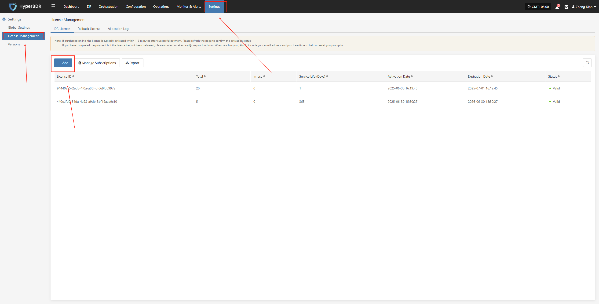
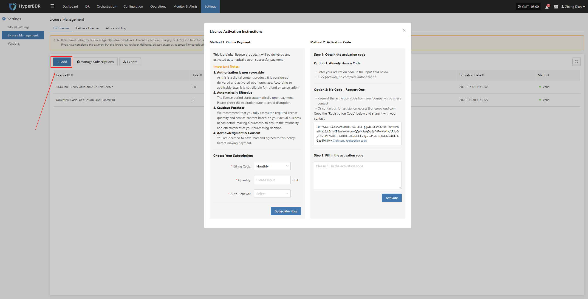
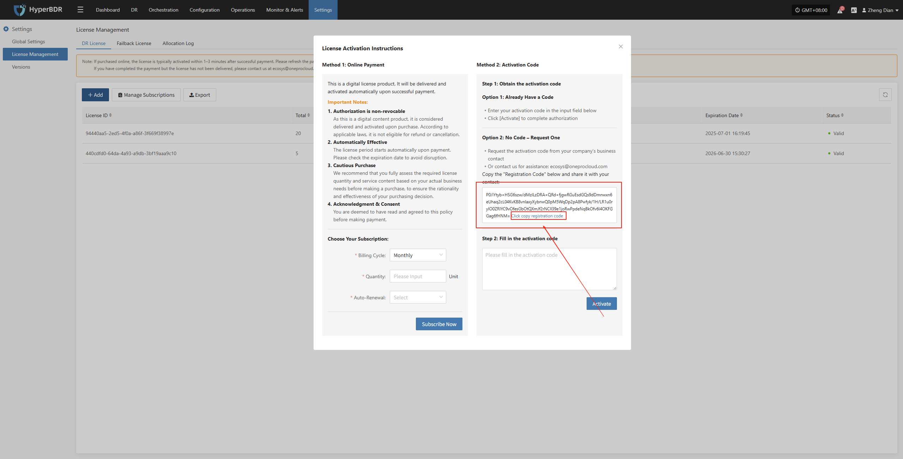
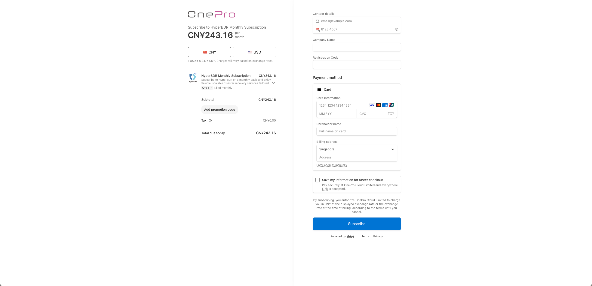
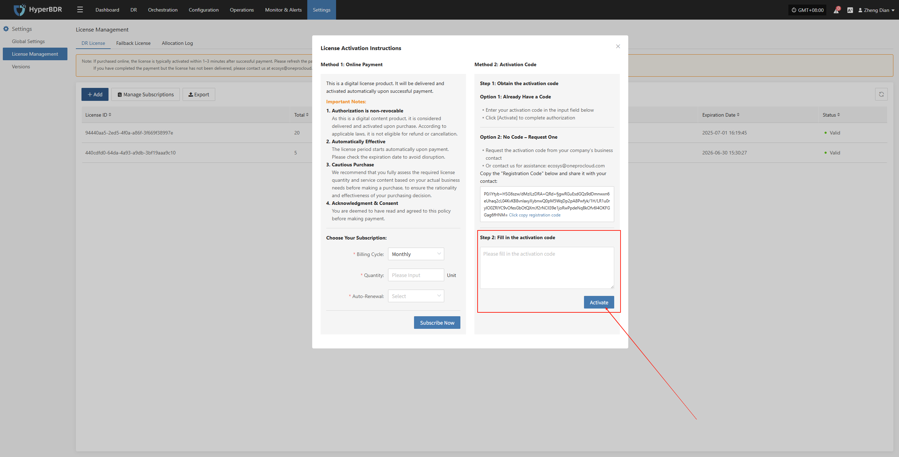
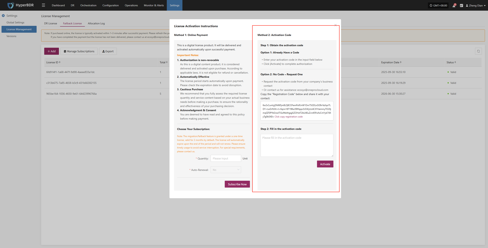
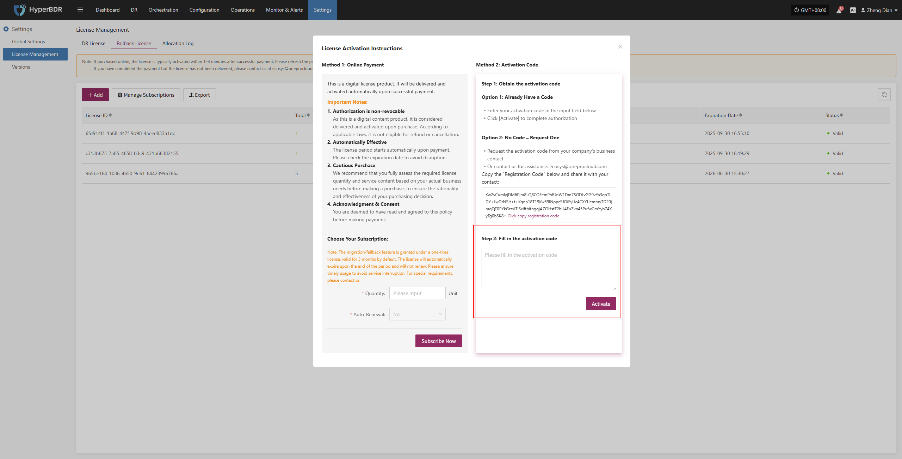
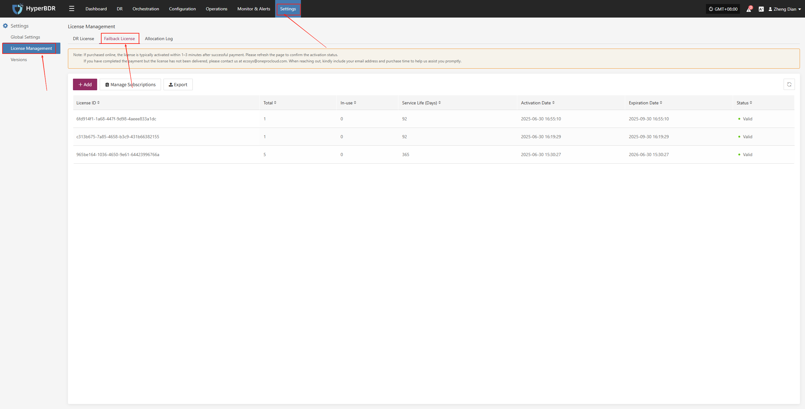
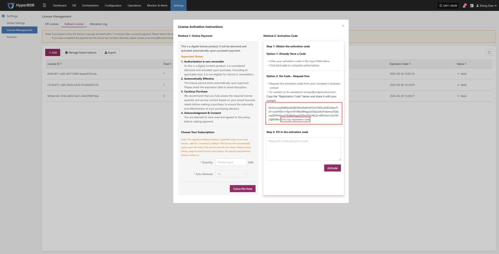

# **Activation Code**

## **DR Authorization Steps**

### **Already Have a Activation Code**

1. After logging in to the console, click "Settings" > "License Management" > "DR License" in the top navigation bar to enter the license management page.

2. Click the "Add" button in the upper right corner of the page to enter the license information entry page.

3. Enter your activation code in the input box below and click the **Activate** button to complete the authorization binding.

### **No Activation Code – Request One**

1. After logging in to the console, click "Settings" > "License Management" > "DR License" in the top navigation bar to enter the license management page.

2. Click the "Add" button in the upper right corner of the page to enter the license information entry page.

3. Please contact your company's business representative to request an activation code, or contact us for assistance with license procurement.

- Method 1:Copy the registration code below and send it to ecosys@oneprocloud.com. We will process your request as soon as possible after receiving your email.

- Method 2:Visit the [OneProCloud](https://oneprocloud.com/where-to-buy) purchase page, select the appropriate product, and follow the on-screen instructions to complete your payment. Please ensure that you enter the correct email address for receiving the activation code and the correct registration code to ensure successful delivery of the activation code.

4. After obtaining the activation code, enter it in the input box below and click the **Activate** button to complete the authorization binding.

## **Failback Authorization Steps**

### **Already Have a Activation Code**

1. After logging in to the console, click "Settings" > "License Management" > "Failback License" in the top navigation bar to enter the license management page.

2. Click the "Add" button in the upper right corner of the page to enter the license information entry page.

3. Enter your activation code in the input box below and click the **Activate** button to complete the authorization binding.

### **No Activation Code – Request One**

1. After logging in to the console, click "Settings" > "License Management" > "Failback License" in the top navigation bar to enter the license management page.

2. Click the "Add" button in the upper right corner of the page to enter the license information entry page.

3. Request the activation code from your company’s business contact,Or contact us for assistance: ecosys@oneprocloud.com

Copy the "Registration Code" below and share it with your contact:

4. After obtaining the activation code, enter it in the input box below and click the **Activate** button to complete the authorization binding.

