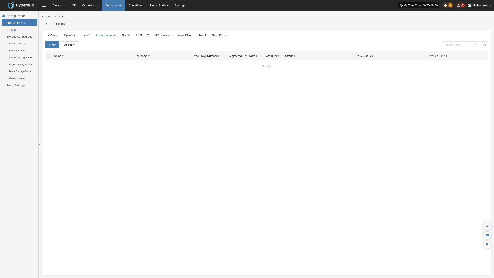
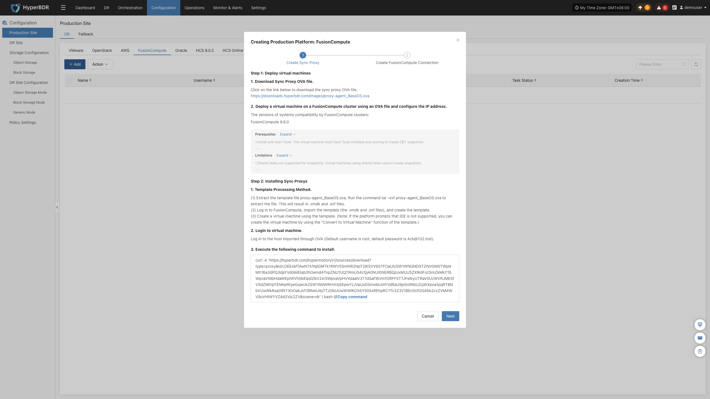
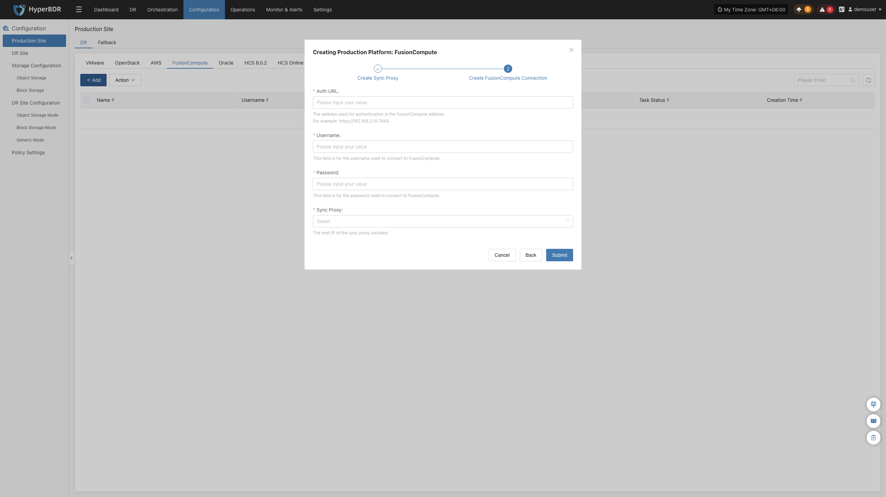

### **FusionCompute**

FusionCompute 页面用于配置和管理华为 FusionCompute 无代理（Agentless）生产平台，包括 VRM 鉴权、同步代理绑定及无代理连接状态监控。

#### **添加 FusionCompute 平台**

在控制台左侧导航栏点击 **“生产站点配置”** > **“FusionCompute”**，点击 **“添加”** 按钮，根据向导完成平台接入。

##### **部署同步代理**

在 FusionCompute 集群中导入 OVA 模板部署源端同步代理（Sync Proxy）：

1. **下载 OVA 模板**：
   * 可直接点击向导中的下载链接，或通过互联网下载：<https://downloads.oneprocloud.com/proxy-agent_BaseOS.ova>
2. **导入虚拟机**：
   * 将 OVA 文件导入 FusionCompute 集群，创建一台或多台源端同步代理虚拟机，并配置网络 IP 地址（推荐版本：FusionCompute 8.6.0 及以上）。
3. **登录虚拟机**：
   * 登录新创建的同步代理虚拟机，系统默认初始凭证为 `root` / `Acb@132.Inst`。
4. **一键安装注册**：
   * 在向导界面复制安装指令，在同步代理终端内粘贴执行。执行完成后该节点将自动注册到 HyperBDR 平台。

> **说明：** Sync Proxy 推荐规格为 **4C / 8G / 50GB**。详细规格与多节点横向扩展说明，请参见 [源端同步代理](#源端同步代理)。

* **FusionCompute 平台使用条件与限制：**

| **类别** | **关键要求与限制说明** |
| :--- | :--- |
| **前提条件** | 1. **安装并运行 Tools**：受保护虚拟机必须安装华为 VM Tools 并正常运行，这是创建 CBT 差异快照的前置条件； 2. **快照数量限制**：单台虚拟机快照总数不超过 32 个； 3. **虚拟机状态**：虚拟机需处于“运行”、“休眠”或“停止”状态方可创建快照。 |
| **限制条件** | 1. **不支持快照的场景**：使用共享磁盘、独立磁盘、链接克隆及模板虚拟机不支持快照备份； 2. **CBT 失效情形**：当虚拟机发生 HA 漂移、恢复历史快照、卷扩容或计算节点异常重启后，CBT 会失效，系统需自动触发一次全量校同比对； 3. **存储空间要求**：备份时源存储池需预留快照合并缓冲空间；单计算节点最多支持 8 个并发备份 Socket 连线。 |

##### **创建 FusionCompute 生产平台**

1. **FusionCompute 认证信息配置**

| **参数项** | **示例 / 格式** | **参数说明** |
| :--- | :--- | :--- |
| **鉴权地址** | `https://<VRM_IP_or_Domain>:7443` | FusionCompute VRM 管理节点访问地址（默认端口 7443）。若使用域名，请提前配置 DNS 或 hosts 解析。 |
| **用户名** | 管理员账号 | 具备平台查询与快照管理权限的管理员用户名。 |
| **密码** | 对应密码 | 连接 FusionCompute 的密码。 |
| **源端同步代理** | 下拉选择已注册节点 | 从下拉列表中选择刚部署完成的源端同步代理节点。 |

2. **网络策略要求**

| **源端** | **目标端** | **端口 / 协议** | **用途说明** |
| :--- | :--- | :--- | :--- |
| Sync Proxy | FusionCompute VRM 管理节点 | 7443 / TCP | 管理认证与快照 API 通信 |
| Sync Proxy | CNA 各计算节点 | 21064 / TCP | 数据流通道。用于直接从计算节点底层存储读取虚拟机磁盘数据，需确保连通所有涉及的计算节点 21064 端口。 |

确认配置无误后，点击 **“确定”** 提交。

##### **完成 FusionCompute 添加**

添加完成后返回 FusionCompute 生产平台列表。等待平台状态变为 **“正常”**，并成功获取到集群宿主机及虚拟机数量，即表示接入成功。

> **说明：**
> * 重复上述步骤可添加多个 FusionCompute 集群或独立的站点。

#### **更多操作**

在 FusionCompute 生产平台列表中，点击目标平台操作栏的 **“更多操作”** 下拉菜单，可执行 **设置**、**绑定**、**解绑**、**重载虚拟机**、**更新链接** 与 **删除** 操作。详细操作步骤请参见 [生产站点管理](#生产站点管理)。

---
