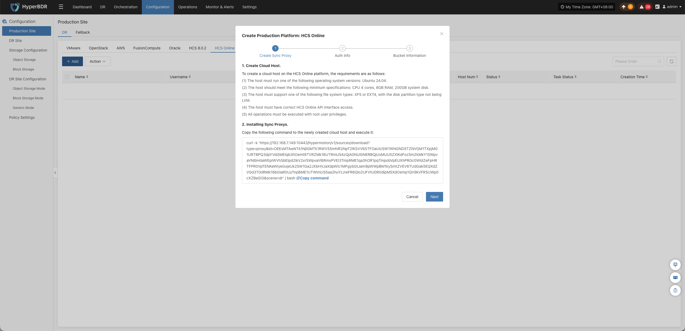
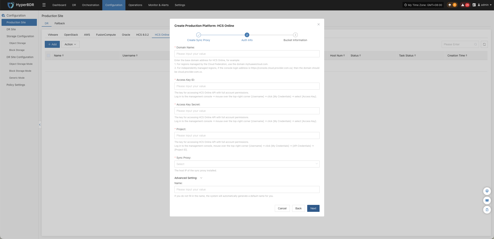
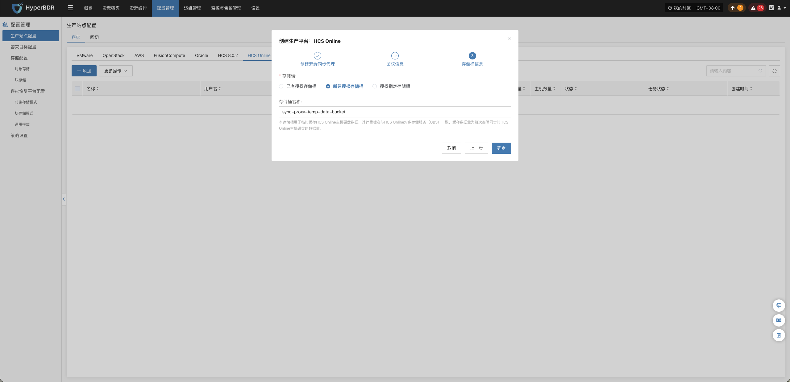

### **HCS Online**

HCS Online 页面用于配置和管理华为云 Stack Online（HCS Online）无代理（Agentless）生产平台，包括平台鉴权、底层存储对接、同步代理绑定及无代理连接状态监控。

#### **添加 HCS Online 平台**

在控制台左侧导航栏点击 **“生产站点配置”** > **“HCS Online”**，点击 **“添加”** 按钮，根据向导完成平台接入。

##### **部署同步代理**

在 HCS Online 环境中部署源端同步代理（Sync Proxy）：

1. **准备镜像与创建主机**：
   * 在 HCS Online 平台中创建云主机，选择 **Ubuntu 24.04** 系统镜像；
   * 推荐配置规格：**4C / 8G / 50GB**。
2. **网络连通性检查**：
   * 确保该主机能够连通 HyperBDR 控制台（端口 10443 与 30080），并具备访问 HCS Online 内部 API 端点的网络权限。
3. **一键安装注册**：
   * 在向导界面复制安装指令，登录同步代理云主机终端并以 root 权限执行；
   * 脚本执行完成后，该节点将自动向 HyperBDR 平台完成注册。

> **说明：** 详细规格与网络规划请参见 [源端同步代理](#源端同步代理)。

##### **创建 HCS Online 生产平台**

1. **HCS Online 平台连接鉴权信息**

| **参数项** | **填写方式** | **参数说明与获取方式** |
| :--- | :--- | :--- |
| **域名** | 输入域名 | 填写 HCS Online 的基础域名。例如：云联盟统一纳管的区域填写 `myhuaweicloud.com`；独立管理的区域，根据控制台登录地址填写对应的基础域名。例如，控制台地址为 `https://console.cloud.provider.com.xx/`，则填写 `cloud.provider.com.xx`。 |
| **Access Key ID** | 输入访问密钥 ID | 用于访问 HCS Online API 的身份认证。登录管理控制台，点击右上角用户名，进入 **“我的凭证” > “访问密钥”** 获取。 |
| **Access Key Secret** | 输入访问密钥 Secret | 与 Access Key ID 配套使用的访问密钥，用于 HCS Online API 身份认证。登录管理控制台，点击右上角用户名，进入 **“我的凭证” > “访问密钥”** 获取。 |
| **项目** | 输入项目名称或标识 | 填写调用 HCS Online API 所需的项目。登录管理控制台，点击右上角用户名，进入 **“我的凭证” > “API 凭证” > “项目”** 查看并获取。 |
| **源端同步代理** | 选择代理节点 | 选择已安装源端同步代理的主机 IP。 |
| **名称** | 选填 | 用于标识当前接入的生产平台。若不填写，系统将自动生成默认名称。 |

2. **存储桶信息**

| 配置项 | 示例 |
|---|---|
| 存储桶 | 支持三种类型：已有授权存储桶、新建授权存储桶、授权指定存储桶，请根据实际需求选择。 |
| 存储桶名称 | 从下拉列表中选择已有存储桶，或根据实际需求新建存储桶。 |

* **网络策略要求：**

| **源端** | **目标端** | **端口 / 协议** | **用途说明** |
| :--- | :--- | :--- | :--- |
| Sync Proxy | HCS Online API / OBS 端点 | 443 / TCP (HTTPS) | 访问 HCS Online API 进行鉴权认证并与 OBS 存储桶通信传输数据 |

##### **完成 HCS Online 添加**

确认各项认证信息与存储配置无误后，点击 **“确定”** 提交。等待平台状态变为 **“正常”**，并成功识别到纳管的 ECS 云主机数量，即表示接入成功。

> **说明：**
> * 若需保护多个不同区域或不同租户环境，可重复上述步骤分别添加。

#### **更多操作**

在 HCS Online 生产平台列表中，点击目标平台操作栏的 **“更多操作”** 下拉菜单，可执行 **设置**、**绑定**、**解绑**、**重载虚拟机**、**更新链接** 与 **删除** 操作。详细操作步骤请参见 [生产站点管理](#生产站点管理)。

---
