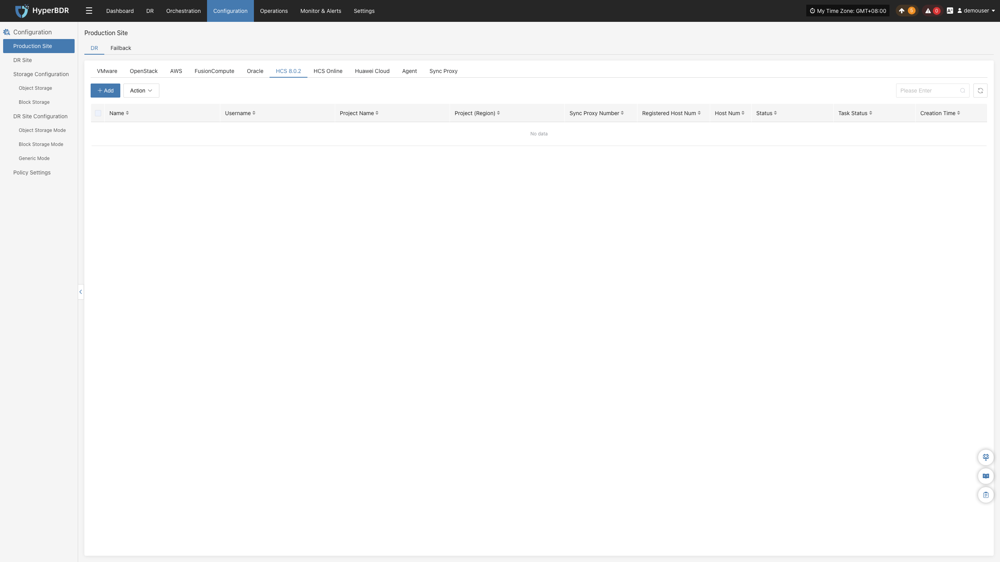
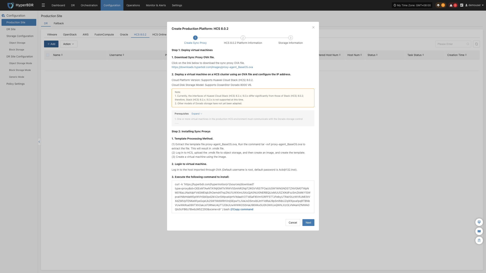
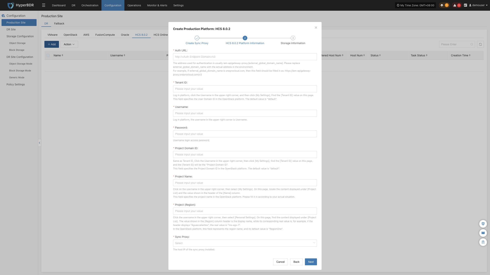
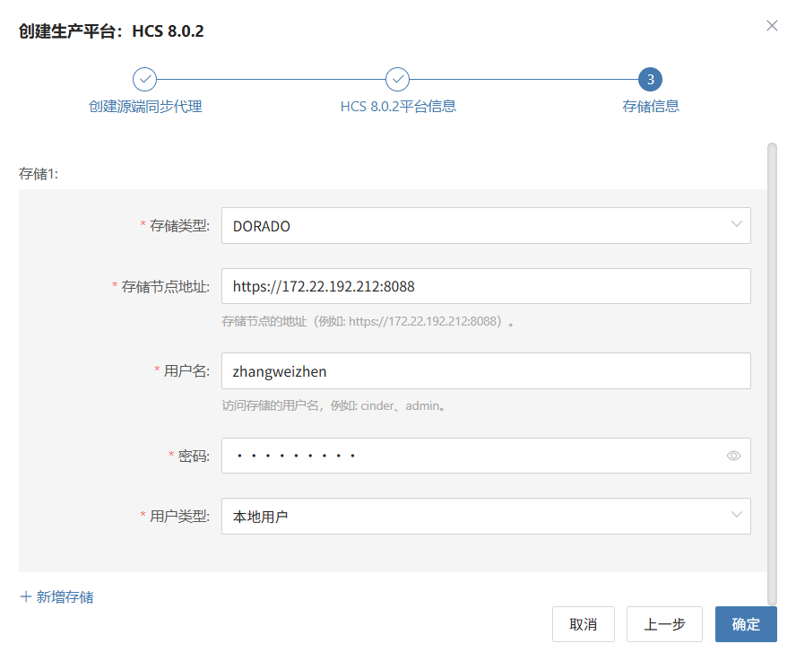

### **HCS 8.0.2**

HCS 8.0.2 页面用于配置和管理华为云 Stack (HCS) 8.0.2 无代理（Agentless）生产平台，包括 ManageOne 鉴权、Dorado 存储对接、同步代理绑定及无代理连接状态监控。

> **版本兼容性说明：**
> 1. 目前华为云 Stack (HCS) 8.2.x / 8.3.x 接口架构与 HCS 8.0.2 存在显著差异，本章节专属支持 **HCS 8.0.2** 版本；
> 2. 当前版本默认深度适配华为 OceanStor Dorado 全闪存存储底座。

#### **添加 HCS 8.0.2 平台**

在控制台左侧导航栏点击 **“生产站点配置”** > **“HCS 8.0.2”**，点击 **“添加”** 按钮，根据向导完成平台接入。

##### **部署同步代理**

在 HCS 8.0.2 集群中导入 OVA 模板部署源端同步代理（Sync Proxy）：

1. **下载 OVA 模板**：
   * 可直接点击向导中的下载链接，或通过互联网下载：<https://downloads.oneprocloud.com/proxy-agent_BaseOS.ova>
2. **导入虚拟机**：
   * 将 OVA 文件导入 HCS 集群，部署一台或多台源端同步代理虚拟机，并配置网络 IP 地址。推荐规格：**4C / 8G / 50GB**。
3. **登录虚拟机**：
   * 登录新创建的同步代理虚拟机，系统默认初始凭证为 `root` / `Acb@132.Inst`。
4. **一键安装注册**：
   * 在向导界面复制安装指令，在同步代理终端内粘贴执行。执行完成后该节点将自动注册到 HyperBDR 平台。

> **说明：** 详细规格与网络规划请参见 [源端同步代理](#源端同步代理)。

##### **创建 HCS 8.0.2 生产平台**

1. **HCS 平台连接鉴权信息**

| **参数项** | **示例 / 格式** | **参数说明与获取方式** |
| :--- | :--- | :--- |
| **鉴权地址** | `https://iam-apigateway-proxy.<external_global_domain_name>/v3` | HCS 统一 IAM APIG 接入地址，通常格式为 `iam-apigateway-proxy.{external_global_domain_name}`。需替换为实际环境中的全局外部域名，并提前在平台配置 hosts 解析。 |
| **租户 ID** | `HPUAAG0B2...` | 登录 ManageOne 运营面 → 点击右上角用户名 → 【个人设置】中查看【租户 ID】。 |
| **用户名** | 管理员账号 | 登录 ManageOne 运营面的用户名（需具备租户管理权限）。 |
| **密码** | 对应密码 | 用户登录密码。 |
| **项目 Domain ID** | `HPUAAG0B2...` | 项目所属的 Domain ID，通常与租户 ID 保持一致。 |
| **项目名称** | `admin` 或对应项目名 | ManageOne 运营面【项目列表】中的项目名称。 |
| **项目 (Region)** | `RegionOne` 或 `mx-ags-1` | 项目所归属的实际物理 Region 标识符。 |
| **源端同步代理** | 下拉选择已注册节点 | 从下拉列表中选择刚部署完成的源端同步代理节点。 |

2. **存储底座配置 (Dorado)**

点击页面 **“+ 新增存储”**，配置底层存储访问认证：

| **参数项** | **示例 / 格式** | **参数说明** |
| :--- | :--- | :--- |
| **存储类型** | `DORADO` | 下拉选择对接的华为 OceanStor Dorado 存储系列。 |
| **存储节点地址** | `https://172.22.192.212:8088` | 存储设备 DeviceManager 的管理地址与端口（默认 8088）。 |
| **用户名** | 存储管理员账号 | 登录存储系统 DeviceManager 的用户名。 |
| **密码** | 对应密码 | 存储系统用户密码。 |
| **用户类型** | `本地用户` | 账号所属类型（支持本地用户、LDAP 用户、RADIUS 用户）。 |

* **网络策略要求：**

| **源端** | **目标端** | **端口 / 协议** | **用途说明** |
| :--- | :--- | :--- | :--- |
| Sync Proxy | HCS APIG 统一网关 | 443 / TCP | 访问 HCS API 进行身份认证与虚拟机元数据管理 |
| Sync Proxy | Dorado 存储管理平面 | 8088 / TCP | 访问 Dorado 存储管理接口进行 LUN 查询与快照管理 |

##### **完成 HCS 8.0.2 添加**

确认各项认证信息与存储底座配置无误后，点击 **“确定”** 提交。等待平台状态变为 **“正常”**，并成功获取到纳入纳管的 ECS 云主机数量，即表示接入成功。

> **说明：**
> * 重复上述步骤可添加多个不同的 HCS 区域或不同租户环境。

#### **更多操作**

在 HCS 8.0.2 生产平台列表中，点击目标平台操作栏的 **“更多操作”** 下拉菜单，可执行 **设置**、**绑定**、**解绑**、**重载虚拟机**、**更新链接** 与 **删除** 操作。详细操作步骤请参见 [生产站点管理](#生产站点管理)。

---
