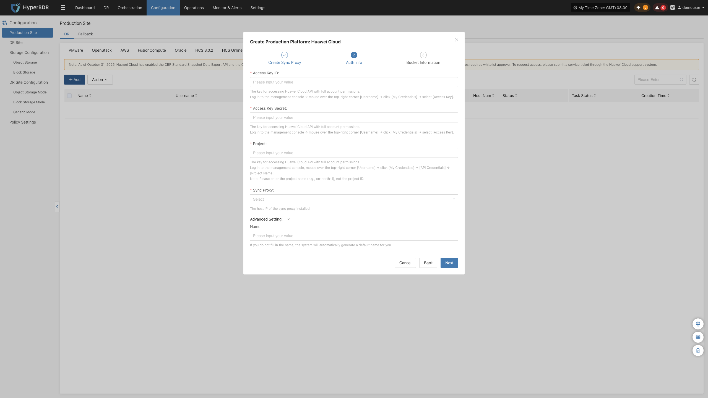
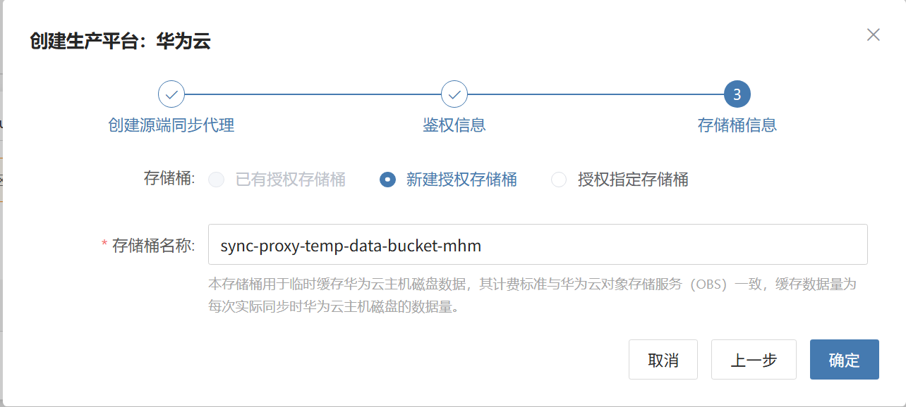

### **华为云**

华为云页面用于配置和管理华为公有云无代理（Agentless）生产平台，包括访问密钥、项目端点、OBS 临时桶配置、同步代理绑定及无代理连接状态监控。

::: warning
华为云无代理模式依赖华为云 CBR（云备份）标准快照数据导出接口及 CBR 数据桶委托权限。部分区域需提前向华为云提交工单申请白名单权限方可开通使用。
:::

#### **添加华为云平台**

在控制台左侧导航栏点击 **“生产站点配置”** > **“华为云”**，点击 **“添加”** 按钮，根据向导完成平台接入。

##### **部署同步代理**

在目标华为云 Region 内创建一台 ECS 云主机部署源端同步代理（Sync Proxy）：

1. **创建 ECS 实例**：
   * 在华为云控制台使用官方原生的 **Ubuntu 24.04** 镜像创建一台云主机（推荐配置：**4C / 8G / 系统盘 50GB 以上**，文件系统建议为 ext4 或 xfs，非 LVM 分区）。
2. **配置网络与安全组**：
   * 确保该实例能够访问 HyperBDR 控制台（端口 10443、30080），并具备访问华为云 IAM、ECS 及 OBS 服务端点的出站网络权限。
3. **一键安装注册**：
   * 登录该 ECS 实例，在终端粘贴向导界面提供的安装指令并以 root 身份执行。执行完成后该实例将自动注册为 Sync Proxy。

> **说明：** 详细规格与网络规划请参见 [源端同步代理](#源端同步代理)。

##### **创建华为云生产平台**

1. **华为云凭证与参数配置**

| **参数项** | **示例 / 格式** | **参数说明与获取方式** |
| :--- | :--- | :--- |
| **Access Key ID** | `H******************K` | 访问华为云 API 的访问密钥 ID。登录华为云控制台 → 点击右上角【用户名】→【我的凭证】→【访问密钥】中获取。 |
| **Secret Access Key** | `4*************************A` | 与 Access Key ID 配对的私有访问密钥密码。 |
| **项目 (Region/Project)** | `cn-north-4` 或 `tr-west-1` | 待容灾主机所在的项目区域标识符。登录华为云控制台 →【我的凭证】→【API 凭证】中查看【项目】名称（**请填写项目名称如 `cn-north-4`，非项目 ID**）。 |
| **源端同步代理** | 下拉选择已注册节点 | 从下拉列表中选择刚部署完成的源端同步代理节点。 |
| **平台名称** | 自定义名称（可选） | 生产平台标识名称，支持自定义或使用系统自动生成规则。 |

2. **临时存储桶配置 (OBS)**

华为云无代理模式通过 OBS 临时存储桶对 ECS 磁盘快照数据进行中转读取：

| **参数项** | **示例 / 格式** | **参数说明** |
| :--- | :--- | :--- |
| **存储桶名称** | `sync-proxy-temp-data-bucket-xxx` | 支持新建或选择已有 OBS 存储桶。用于临时中转备份数据，仅在同步过程中占用短暂存储，数据传输完毕后自动释放。 |

* **网络策略要求：**

| **源端** | **目标端** | **端口 / 协议** | **用途说明** |
| :--- | :--- | :--- | :--- |
| Sync Proxy | 华为云 IAM / ECS / OBS 端点 | 443 / TCP (HTTPS) | 调用华为云 API 并与 OBS 存储桶通信读取数据 |

##### **完成华为云添加**

点击 **“确定”** 提交。等待平台状态变为 **“正常”**，并成功获取到目标区域纳管的 ECS 实例总数，即表示接入成功。

> **说明：**
> * 若需保护多个不同华为云区域或不同主账号下的资产，可重复上述步骤独立添加。

#### **更多操作**

在华为云生产平台列表中，点击目标平台操作栏的 **“更多操作”** 下拉菜单，可执行 **设置**、**绑定**、**解绑**、**重载虚拟机**、**更新链接** 与 **删除** 操作。详细操作步骤请参见 [生产站点管理](#生产站点管理)。

---
