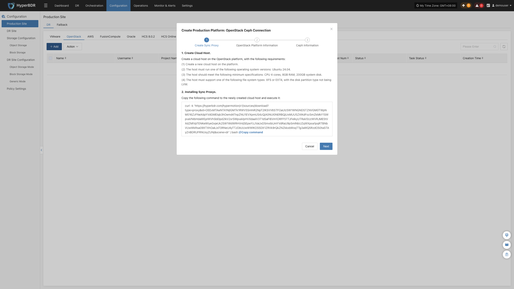
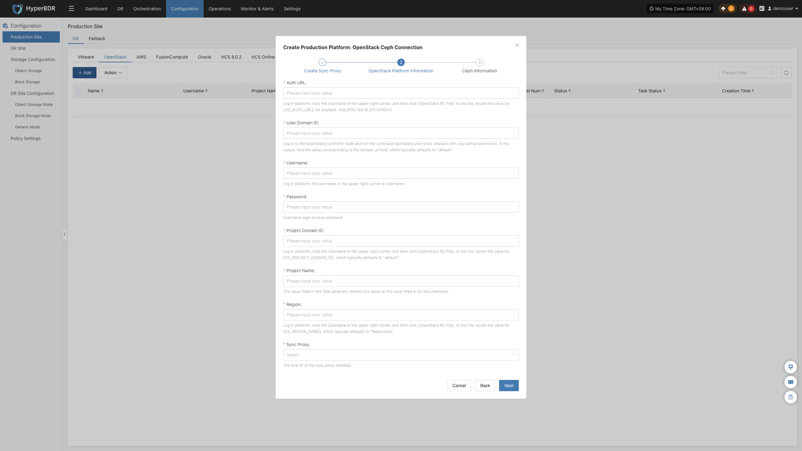
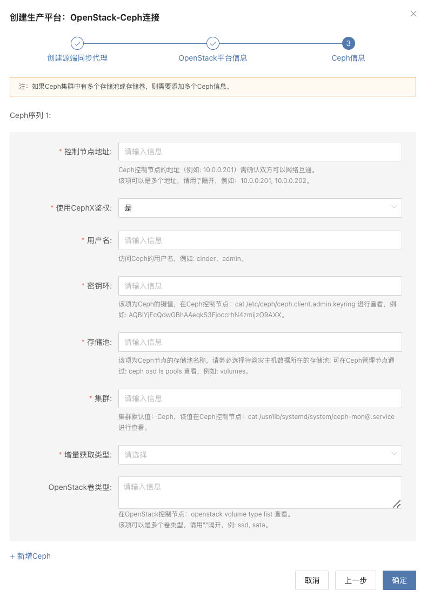

### **OpenStack**

OpenStack 页面用于配置和管理 OpenStack + Ceph 无代理（Agentless）生产平台，包括 Keystone 鉴权、Ceph 存储池对接、同步代理绑定及无代理连接状态监控。

#### **添加 OpenStack 平台**

在控制台左侧导航栏点击 **“生产站点配置”** > **“OpenStack”**，点击 **“添加”** 按钮，根据向导完成平台接入。

##### **部署同步代理**

在 OpenStack 环境中创建一台云主机部署源端同步代理（Sync Proxy）：

1. **准备镜像**：
   * 可直接使用 OpenStack 原生标准的 Ubuntu 24.04 镜像，或下载官方提供的 QCOW2 镜像导入镜像仓库：
   * [Ubuntu 24.04 QCOW2 镜像下载](https://downloads.oneprocloud.com/docs_images/ubuntu-24.04-server-cloud-init-amd64.qcow2)
   > **注意：** 该 QCOW2 镜像无预设静态密码，依赖 `cloud-init` 注入密码或 SSH Key，请确保平台支持 cloud-init。
2. **创建云主机**：
   * 基于该镜像在 OpenStack 中创建一台虚拟机并绑定网络 IP。推荐规格：**4C / 8G / 50GB**。
3. **一键安装注册**：
   * 登录云主机，在终端粘贴向导界面提供的安装指令并执行。执行完成后节点将自动注册到 HyperBDR 平台。

> **说明：** 详细规格与网络规划请参见 [源端同步代理](#源端同步代理)。

##### **创建 OpenStack 生产平台**

1. **Keystone 认证信息配置**

| **参数项** | **示例 / 格式** | **参数说明** |
| :--- | :--- | :--- |
| **鉴权地址** | `http://<Keystone_IP>:5000/v3` | OpenStack Keystone Public Endpoint（建议 v3 接口）。若使用域名，需提前配置域名解析。 |
| **用户 Domain ID** | `default` | 用户所属的 Domain ID。 |
| **用户名** | 管理员账号 | 具备平台查询及卷权限的用户名。 |
| **密码** | 对应密码 | 用户的登录密码。 |
| **项目 Domain ID** | `default` | 项目所属的 Domain ID。 |
| **项目名称** | `admin` | 用户所在的租户项目名称。 |
| **区域 (Region)** | `RegionOne` | 目标 OpenStack 集群的 Region 名称。 |
| **源端同步代理** | 下拉选择已注册节点 | 从下拉列表中选择已部署的源端同步代理节点。 |

* **OpenStack 服务网络策略要求：**

| **源端** | **目标端** | **端口 / 协议** | **用途说明** |
| :--- | :--- | :--- | :--- |
| Sync Proxy | OpenStack 控制节点 | 5000、9696、8774、8776、9292 / TCP | 分别对应 Keystone、Neutron、Nova、Cinder、Glance API 接口 |

2. **Ceph 存储集群认证信息配置**

HyperBDR 在 OpenStack 场景下通过直接对接底层 Ceph 存储池实现无代理快照数据差分读取：

| **参数项** | **示例 / 格式** | **参数说明** |
| :--- | :--- | :--- |
| **控制节点地址** | `10.0.0.201,10.0.0.202` | Ceph Monitor 节点 IP，多个地址以英文逗号 `,` 分隔。 |
| **使用 CephX 鉴权** | `是` | 是否启用 CephX 身份验证（推荐开启）。 |
| **用户名** | `cinder` 或 `admin` | 用于访问指定存储池的 Ceph 用户名。 |
| **密钥环** | `AQBBY9hf...==` | 客户端访问密钥，可在 Ceph 节点查看 `/etc/ceph/ceph.client.cinder.keyring` 获取。 |
| **存储池** | `volumes` | 被容灾虚拟机磁盘所在的 Ceph Pool（可通过 `ceph osd ls pools` 查看）。 |
| **增量获取类型** | `rbd diff` | 增量读取模式： + `rbd diff`：基于快照精细化比对差分，数据准确（推荐）； + `rbd du`：快速概览比对。 |
| **集群名称** | `ceph` | Ceph 集群名称，默认为 `ceph`。 |
| **OpenStack 卷类型** | `DEFAULT_VOLUME_TYPE, ssd` | 关联的 Cinder Volume Type，可通过 `openstack volume type list` 查询。 |

* **Ceph 存储网络策略要求：**

| **源端** | **目标端** | **端口 / 协议** | **用途说明** |
| :--- | :--- | :--- | :--- |
| Sync Proxy | Ceph Monitor / OSD | 6789、3300、6800-7300 / TCP | Ceph Mon 认证通信及向 OSD 节点直接读取磁盘块数据 |

##### **完成 OpenStack 添加**

点击 **“确定”** 保存后，平台将自动验证 Keystone 与 Ceph 集群连通性。等待平台状态变为 **“正常”** 并获取到集群云主机数量，即表示接入成功。

> **说明：** 若系统包含多个后端 Ceph 存储池或多个 OpenStack 集群，可重复添加绑定。

#### **更多操作**

在 OpenStack 生产平台列表中，点击目标平台操作栏的 **“更多操作”** 下拉菜单，可执行 **设置**、**绑定**、**解绑**、**重载虚拟机**、**更新链接** 与 **删除** 操作。详细操作步骤请参见 [生产站点管理](#生产站点管理)。

---
