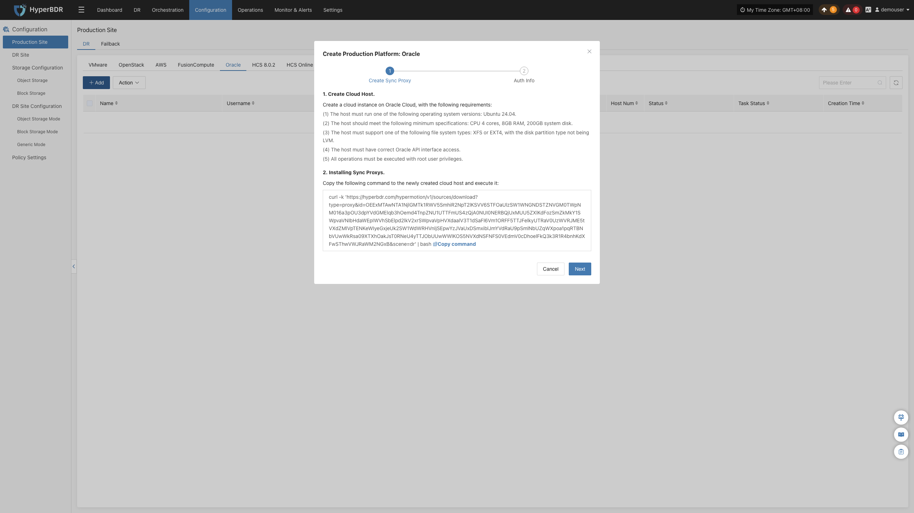

### **Oracle**

Oracle 页面用于配置和管理 Oracle Cloud Infrastructure (OCI) 无代理（Agentless）生产平台，包括 OCI 租户凭证、区域配置、同步代理绑定及无代理连接状态监控。

#### **添加 Oracle 平台**

在控制台左侧导航栏点击 **“生产站点配置”** > **“Oracle”**，点击 **“添加”** 按钮，根据向导完成平台接入。

##### **部署同步代理**

在目标 OCI Region 内创建一台计算实例（Compute Instance）部署源端同步代理（Sync Proxy）：

1. **创建 OCI 计算实例**：
   * 在 Oracle Cloud 控制台使用官方标准的 **Ubuntu 24.04** 镜像启动一台实例（推荐规格：**4 OCPU / 8GB 内存 / 50GB 引导卷**）。
2. **配置网络与安全列表**：
   * 确保该实例能够访问 HyperBDR 控制台（端口 10443、30080），并具备访问 OCI API 端点（443 端口）的出站网络权限。
3. **一键安装注册**：
   * 登录该计算实例，在终端粘贴向导界面提供的安装指令并执行。执行完成后该实例将自动注册为 Sync Proxy。

> **说明：** 详细规格与网络规划请参见 [源端同步代理](#源端同步代理)。

##### **创建 Oracle 生产平台**

1. **OCI 认证信息配置**

| **参数项** | **示例 / 格式** | **参数说明与获取方式** |
| :--- | :--- | :--- |
| **租户 OCID (Tenancy OCID)** | `ocid1.tenancy.oc1..aaaaaaaaxxxx` | OCI 租户的唯一标识符。登录 OCI 控制台 → 点击右上角用户头像 → 【Tenancy: 概要信息】中复制 OCID。 |
| **用户 OCID (User OCID)** | `ocid1.user.oc1..aaaaaaabbbbb` | 具备 API 访问权限的 OCI IAM 用户 OCID。在控制台【用户设置】或【身份与安全】>【用户】详情中复制。 |
| **私钥 (Private Key)** | `oci_api_key.pem` 内容 | 连接 OCI 服务的 API 私钥。在用户详情页的【API 密钥】中生成或上传公钥，并将对应的私钥内容粘贴至此处。 |
| **密钥指纹 (Fingerprint)** | `20:3b:97:13:55:1c:8c:...` | 对应 API 密钥的指纹字符串，在 OCI 控制台 API 密钥列表中直接查看复制。 |
| **区域 (Region)** | `ap-singapore-1` | 待容灾云主机所在的 OCI Region 标识符（如 `ap-singapore-1`、`us-ashburn-1` 等）。 |
| **源端同步代理** | 下拉选择已注册节点 | 从下拉列表中选择刚部署的源端同步代理计算实例。 |
| **平台名称** | 自定义名称（可选） | 生产平台标识名称，支持自定义或使用系统自动生成规则。 |

2. **网络策略要求**

| **源端** | **目标端** | **端口 / 协议** | **用途说明** |
| :--- | :--- | :--- | :--- |
| Sync Proxy | OCI 各服务 API 端点 | 443 / TCP (HTTPS) | 与 OCI Identity、Compute 及 Block Volumes API 认证交互并读取存储块数据 |

确认各项配置无误后，点击 **“确定”** 提交。

##### **完成 Oracle 添加**

添加完成后返回 Oracle 生产平台列表。等待平台状态变为 **“正常”**，并成功获取到该 Region 内纳管的 OCI 云主机总数，即表示接入成功。

> **说明：**
> * 若需保护多个不同 OCI 区域或不同租户下的业务主机，可重复上述步骤分别添加。

#### **更多操作**

在 Oracle 生产平台列表中，点击目标平台操作栏的 **“更多操作”** 下拉菜单，可执行 **设置**、**绑定**、**解绑**、**重载虚拟机**、**更新链接** 与 **删除** 操作。详细操作步骤请参见 [生产站点管理](#生产站点管理)。

---
