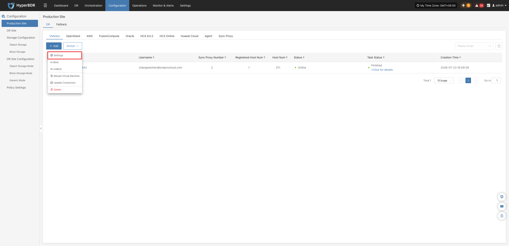
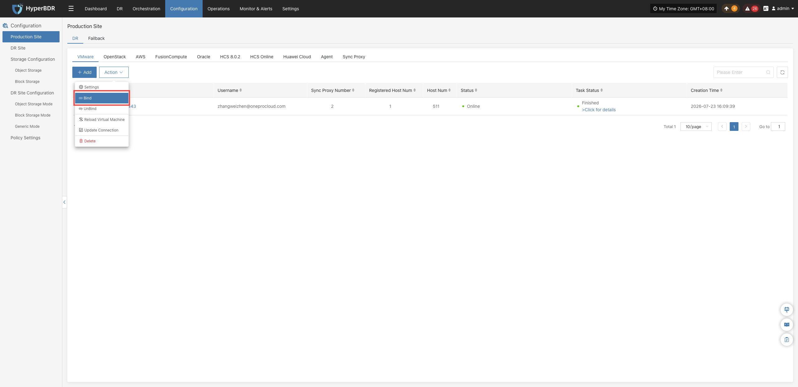
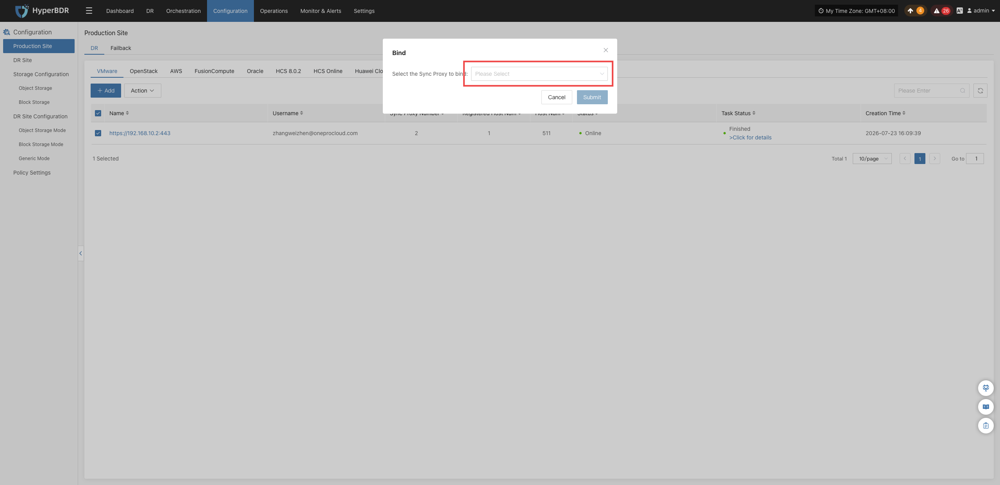
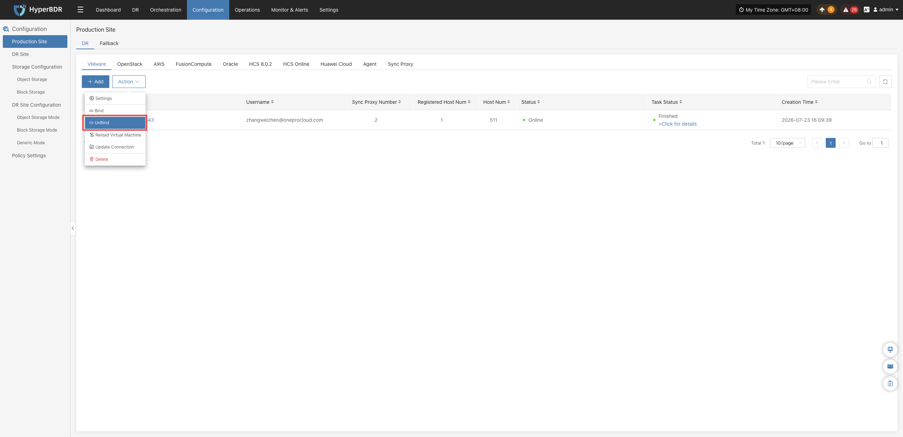
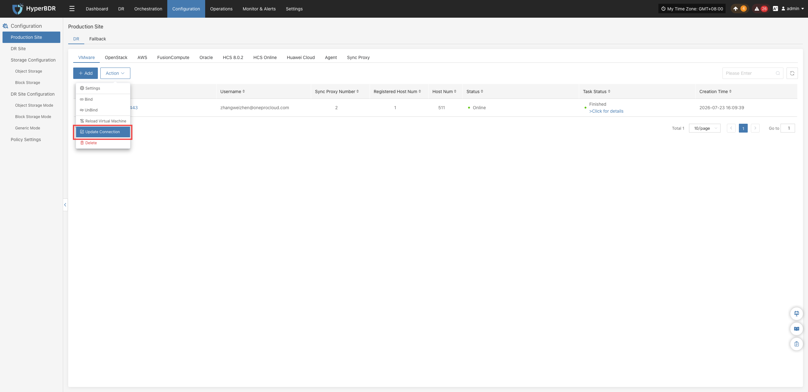
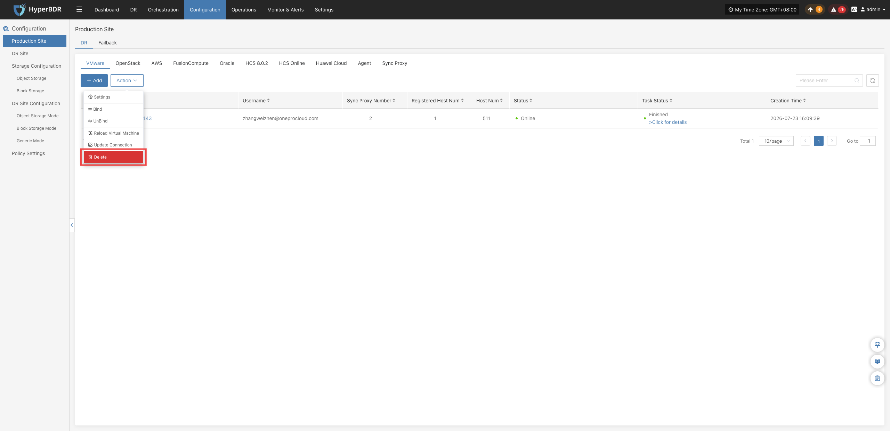
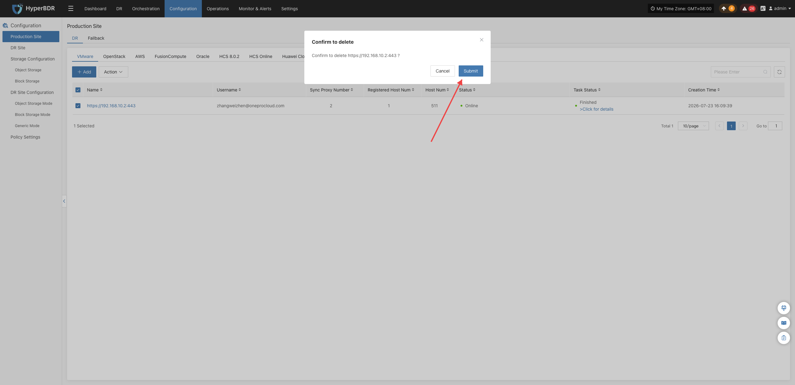

### **生产站点管理**

源端无代理（Agentless）生产平台接入完成后，在对应的平台列表中，点击目标平台操作列的 **“更多操作”** 下拉菜单，可对已接入的平台执行日常运维与生命周期管理操作：

>以下操作以 VMware 平台为例进行说明，其他平台的操作流程及功能基本一致，具体以各平台实际提供的能力为准。

#### **设置**

点击 **“操作”** > **“设置”**，可调整当前生产平台的源端同步运行参数：

> 配置修改后不会立即生效，具体生效规则如下：
> 1. **正在同步的任务**：需先停止同步，再重新开启同步，修改后的配置才会生效。
> 2. **尚未开始同步的任务**：修改后的配置将在下次同步时生效。

- 根据实际需求和页面提示调整相关参数，以获得更合适的同步配置。

| 配置项 | 默认值 | 说明 |
|---|---|---|
| 同步数据磁盘写入周期 | 60 秒 | 设置同步数据强制写入云硬盘的时间间隔。例如，设置为 60 秒，表示每隔 60 秒强制写入一次。 |
| 生产平台创建快照超时时间 | 60 分钟 | 设置创建快照的最长等待时间。超过设定时间仍未创建成功，任务将失败。建议根据生产平台的实际负载设置，可先手动创建快照，观察所需时间后再进行调整。 |
| 生产平台删除快照超时时间 | 60 分钟 | 设置删除快照的最长等待时间。超过设定时间仍未删除成功，任务将失败。建议根据生产平台的实际负载设置，可先手动删除快照，观察所需时间后再进行调整。 |

#### **绑定**

点击 **“操作”** > **“绑定”**，为当前生产平台关联并分配已就绪的源端同步代理（Sync Proxy）：

>单个生产平台支持同时绑定多个 Sync Proxy 节点，以扩展平台支持的最大挂盘数量。默认情况下，单台主机最多支持挂载 50 块磁盘。

* 在弹出的对话框中通过下拉列表选择目标 Sync Proxy 节点，点击 **“确定”** 完成绑定。

#### **解绑**

点击 **“操作”** > **“解绑”**，解除当前生产平台与指定源端同步代理节点之间的关联关系：

>执行解绑前，请确认该代理节点当前没有正在处理的数据同步或容灾备份任务。解绑后该代理将停止处理此平台的同步作业，可根据需要重新绑定至其他生产平台或进行节点下线。

* 在弹出的对话框中通过下拉列表选择目标 Sync Proxy 节点，点击 **“确定”** 完成解绑。

#### **重载虚拟机**

点击 **“操作”** > **“重载虚拟机”**，强制立即触发系统调用源端原生 API，重新拉取并同步最新的主机资产清单：

>当源端环境中新增了虚拟机/云主机，而控制台列表中尚未及时展示最新状态时，可通过此功能手动刷新资产列表。

* 在弹出的对话框中阅读注意事项后，点击 **“确定”** 开始重载虚拟机。

#### **更新链接**

点击 **“操作” > “更新链接”**，可直接修改已接入生产平台的认证信息和连接参数。

> 当源端平台的管理 IP、接入地址、管理员账号密码、API 访问密钥、连接端口或 SSL 证书发生变更，导致平台连接异常时，可通过此功能更新相关配置。更新后，系统将重新校验连接并更新平台状态，**无需删除并重新添加平台**，已有的容灾保护策略和历史备份数据不受影响。

- 在弹出的对话框中，修改需要更新的认证信息或连接参数。点击 **“确定”**，提交修改并开始重新校验连接。

#### **删除**

点击 **“操作”** > **“删除”**，从 HyperBDR 平台中彻底移除该生产平台：

> 删除前，请确保生产站点未关联 Sync Proxy。

* 确认满足删除条件后，在确认对话框中点击 **“确定”** 完成平台的彻底删除。

---
